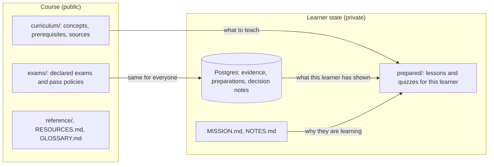
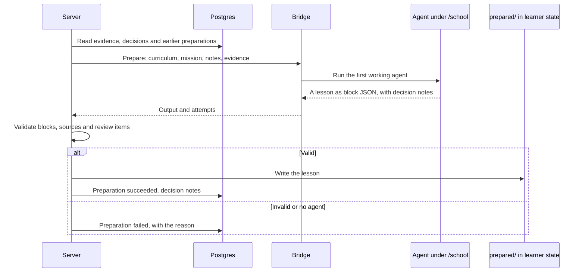
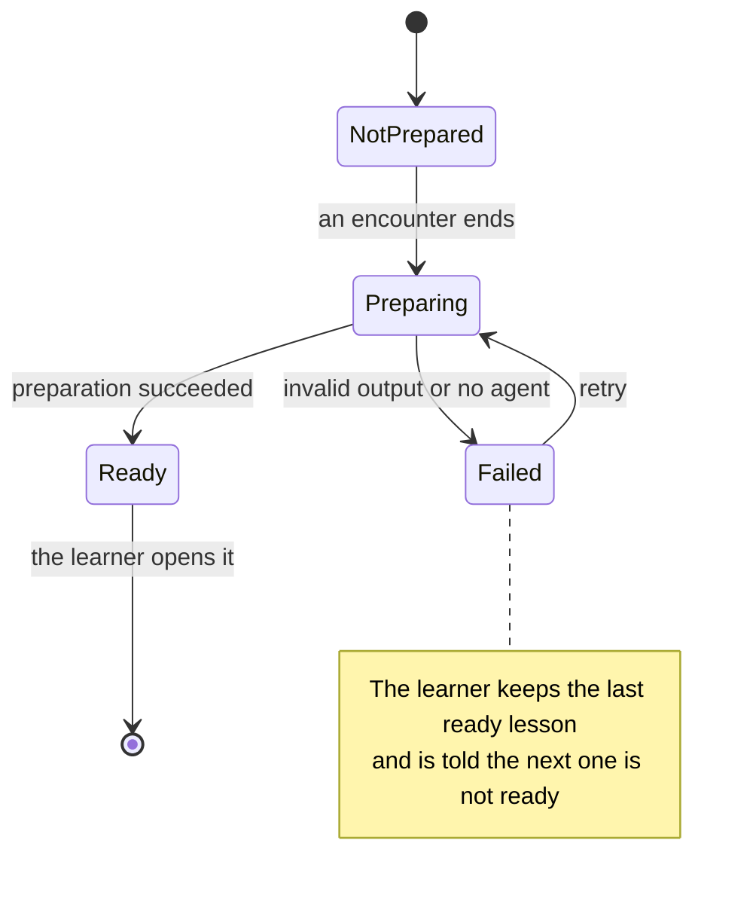
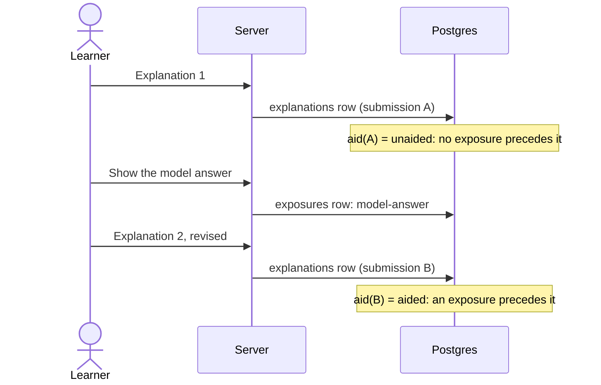
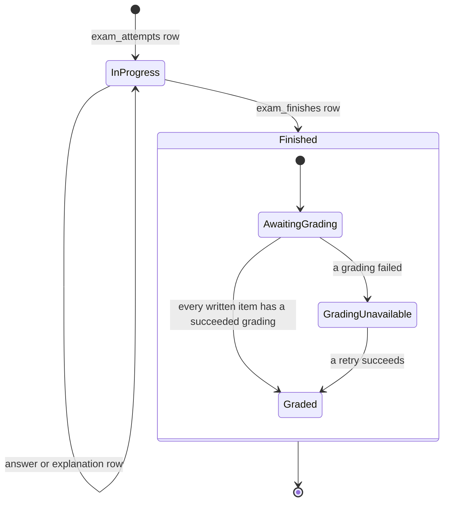
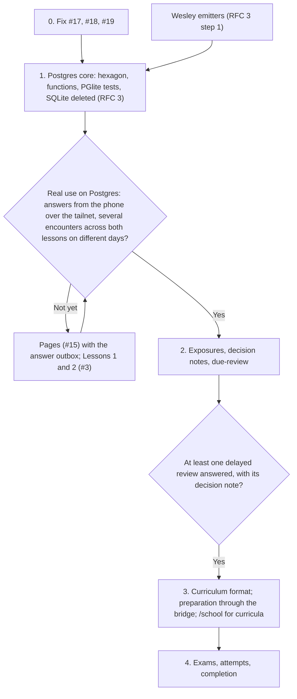

# RFC 2: Lessons written for each learner

> **How to read this.** **Built** means it exists at commit `a959505`. **Proposed** means this RFC
> asks for it. **Decided** means the maintainer has already chosen it; the RFC records the choice.
> **Open** means it still needs a decision. How School works today is in the
> [architecture reference](../topics/architecture/README.md); this RFC describes only changes.

## Executive Summary

School should write each lesson for the learner who will read it. A course becomes a
**curriculum**, public and shared, and the lessons and quizzes built from it become private
**learner state**. Exams stay declared in the course and identical for everyone, because passing
them is what clears a course.

| Change | Status | Why |
| --- | --- | --- |
| A course ships a curriculum, not finished lessons | Decided | Lessons tailored to one learner's evidence cannot be shared, and their rationale is private |
| The server prepares lessons and quizzes ahead of time into learner state | Decided | The next lesson responds to evidence; a learner never waits on a model |
| Exams are declared in the course; passing them completes it | Decided | Measurement must mean the same thing for every learner and every attempt |
| The record captures assistance (hints, model-answer reveals) | Proposed | RFC 1 requires it; without it an aided answer looks unaided |
| Exam attempts and completion are append-only events with derived status | Proposed | Keeps the record's rule that nothing is updated or deleted |
| Delayed review (`due-review`) is the first learning feature once real use begins | Proposed | It is the evidence that most predicts retention |
| Work is gated on evidence of real use, not on the calendar | Proposed | Two weeks with one lesson proves little |
| SQLite is retired: the record moves to Postgres functions, PGlite in tests, types from Wesley ([RFC 3](0003-postgres-functions-and-generated-types.md)) | Decided | One store; real study and new tables are born in Postgres |

This RFC answers three external reviews of v0.1.0 and the maintainer's own feedback; the
[review response](#appendix-a-review-response) lists every finding and what became of it.

In short: courses become curricula, learners get lessons and quizzes written for them in private,
exams decide completion, and the record learns to tell aided from unaided work.

## Contents

| # | Section |
| --- | --- |
| — | [Glossary](#glossary) |
| 1 | [Where things live](#1-where-things-live) |
| 2 | [Preparing lessons and quizzes](#2-preparing-lessons-and-quizzes) |
| 3 | [Recording assistance](#3-recording-assistance) |
| 4 | [Exams and completion](#4-exams-and-completion) |
| 5 | [Delayed review](#5-delayed-review) |
| 6 | [Order of work and evidence gates](#6-order-of-work-and-evidence-gates) |
| 7 | [Open questions](#7-open-questions) |
| A | [Appendix A: Review response](#appendix-a-review-response) |
| B | [Appendix B: Citations](#appendix-b-citations) |

## Glossary

These terms are new or change meaning under this RFC. The framework's
[glossary](../glossary.md) stays the authority and is updated when the RFC is accepted.

| Term | Meaning |
| --- | --- |
| **Curriculum** | What a course must teach: objectives, a set of **concepts**, their prerequisites and the sources that teach them. Public, in the course. |
| **Concept** | One teachable idea in a curriculum, with a stable `id`, a statement of what a learner can do once they have it, its prerequisites and its sources. |
| **Prepared lesson** | A lesson written for one learner from the curriculum and their evidence, stored in their state before they need it. Replaces "lesson rendering". |
| **Preparation** | One attempt to write a prepared lesson, through the bridge. Succeeds or fails, and is recorded either way. |
| **Generated quiz** | A quiz written for one learner, in their state. Practice and personal measurement; not comparable across learners. |
| **Exam** | An assessment declared in the course, identical for everyone. Passing the course's exams completes it. |
| **Exposure** | Something School showed that could help with a block: a hint, a model answer, feedback, the reference documents. |
| **Aided** | A submission made after an exposure to that block in School. **Unaided** means none was recorded, which is the most School can know. |
| **Decision note** | A private record of why the teacher chose something, naming the evidence. |

## 1. Where things live

The maintainer decided that lessons are written per learner and belong to the learner, and that a
course ships what must be taught. This section draws the new boundary.

| Item | Before (Built) | After (Decided) |
| --- | --- | --- |
| Objectives, resources, glossary, reference documents | Course | Course |
| Concepts, prerequisites, sources | Implicit in lessons | Course: `curriculum/` |
| Lessons | Course: `lessons/*.json` | Learner state: `prepared/<course>/lessons/` |
| Quizzes | Quiz blocks inside course lessons | Learner state: generated with each lesson |
| Exams | Not built | Course: `exams/` |
| Why an item was chosen | Not recorded | Learner state: decision notes |

**Figure 1. Where things live after this RFC**



*Figure 1. Where things live after this RFC. Everything written for one learner, and every reason
behind it, stays in their private state. The only things that flow from the course are the
curriculum and the exams. This closes the leak in v0.1.0's authoring flow, where an agent read
private evidence and committed a lesson to the public course.*

A course author still uses the `/school` skill, but to write a **curriculum** and **exams**, never a
learner's lesson. Personal material reaches a course only by an author's deliberate choice.

The AIΩN course's two existing lessons become the learner's first prepared lessons, written by
hand, and the course gains a curriculum derived from them.

In short: the course says what to teach and how completion is measured; everything tailored to a
person, and every reason for it, is private.

## 2. Preparing lessons and quizzes

Preparing a lesson is the second job ADR 8 gave the server's agent, deferred until now as
"model B"[^adr8]. This section specifies it so that a learner never waits on a model and nothing
unvalidated is ever shown.

| Rule | Proposal |
| --- | --- |
| When | Ahead of time: after each encounter ends, prepare the next lesson. How far ahead is **Open** (Q1). |
| Who writes | The server asks the bridge; the agent runs under the `/school` skill, which constrains structure, citations and question balance. |
| Inputs | The curriculum, the learner's mission and notes, their evidence, earlier prepared lessons. |
| Validation | A prepared lesson must pass the block validator, cite only the curriculum's sources and include at least one review item where evidence calls for it. Otherwise the preparation fails. |
| Storage | Written to learner state; a preparation row records the attempt, its inputs' hashes, the agent and the outcome. Snapshots work exactly as today. |
| Failure | Recorded like a failed grading. The learner sees the last prepared lesson and an honest "the next lesson is not ready yet". |
| Replay | A prepared lesson is a file; it plays with no agent running. |

**Figure 2. Preparing the next lesson**



*Figure 2. Preparing the next lesson. Preparation runs ahead of time and is validated before it
can be shown; success and failure are both recorded. The decision notes say why each review item
was chosen and stay private.*

From the learner's side, the only thing that matters is whether the next lesson is ready. That is
a state derived from the preparation rows, and it has one failure mode worth designing for.

**Figure 3. The state of the next lesson, as the learner sees it**



*Figure 3. The state of the next lesson. Status is derived from preparation rows, never stored as
a field. The emphasis is the failed state: a missing agent delays the future of a course, never the
lesson in front of the learner.*

Generated quizzes follow the same path inside each prepared lesson. They are practice and
personal measurement, so they may differ between learners. That replaces RFC 1's rule "declared
for measurement, generated for practice" with **"exams declared, everything else generated"**.

In short: lessons and quizzes are written ahead of time, validated, stored privately and
replayable, and a failure is recorded and shown honestly.

## 3. Recording assistance

RFC 1 requires that an answer given after help is not counted as unaided[^rfc1], and the record
cannot tell today. This section adds the missing observation.

| What School observes | Recorded as |
| --- | --- |
| A hint shown | An `exposures` row: encounter, block, `hint`, time |
| A model answer revealed | An `exposures` row: `model-answer` |
| Feedback shown after an answer | An `exposures` row: `feedback` |
| Reference documents opened during an exam | An `exposures` row: `reference` |
| Answers recorded before this change | No rows; aid is **unknown**, not "unaided" |

Whether a submission was aided is **derived**, never stored: it is aided when an exposure to the
same block precedes it in the same encounter, and unknown for rows older than the `exposures`
table. School records only what it showed; it cannot see other tabs or books, so "unaided" always
means "no recorded aid".

**Listing 1. Exposures and derived aid (proposed, illustrative)**

```sql
CREATE TABLE exposures (
  id INTEGER PRIMARY KEY,
  encounter_id TEXT NOT NULL REFERENCES encounters (id),
  block_id TEXT NOT NULL,
  kind TEXT NOT NULL CHECK (kind IN ('hint', 'model-answer', 'feedback', 'reference')),
  at TEXT NOT NULL
);
-- Append-only, like every evidence table.
CREATE VIEW explanation_aid AS
SELECT x.submission_id,
       CASE WHEN x.at < (SELECT min(at) FROM exposures) THEN 'unknown'
            WHEN EXISTS (SELECT 1 FROM exposures e
                         WHERE e.encounter_id = x.encounter_id AND e.block_id = x.block_id AND e.at < x.at)
            THEN 'aided' ELSE 'unaided' END AS aid
FROM explanations x;
```

*Listing 1. Exposures and derived aid. Proposed code, not in the repository. The same view shape
applies to answers. Aid is a query over facts, so a later change to what counts as aid reinterprets
nothing that was stored.*

**Figure 4. Submit, reveal, revise**



*Figure 4. Submit, reveal, revise: the acceptance trace a review asked for. The revised explanation
is useful learning and is kept, but the derived view marks it aided, so it can never count as
unaided evidence.*

The same separation applies to everything the record holds: **observations** (what was shown and
answered) are stored, **judgments** (correct, graded, aided) are derived or appended, and
**decisions** (what to review next) are notes that name their evidence.

In short: School records the help it gives, derives aid from those facts, and keeps unknown aid
unknown.

## 4. Exams and completion

Exams are declared in the course and identical for everyone, and passing them clears the course;
the maintainer decided both. This section makes them fit the record's rule that nothing is updated.

### 4.1 An exam

| Property | Proposal |
| --- | --- |
| Declared | `exams/<id>.json` in the course: covered concepts, an item pool, items drawn per attempt, and a pass policy |
| Identity | An attempt is pinned to the exam's snapshot hash when it starts; a course edit never changes a started attempt |
| Items | Drawn from the pool with a seed recorded at the start, and choice order shuffled by that seed, so a retake is not a memory test of the last sitting |
| Feedback | After finishing: which concepts were missed, not the answer key |
| Retakes | Allowed after a minimum delay the exam declares |
| Conditions | Whether references are allowed is a **declared condition**, recorded as an exposure if opened; School cannot enforce closed book on the learner's own machine |
| Encounters | Every attempt has its own encounter (the [glossary](../glossary.md)'s "one occasion of being shown content"); the six-hour resume rule never folds a retake into an earlier sitting |

### 4.2 Attempts as events

Every state change is a new row; status is a view.

| Event | Row | Rule |
| --- | --- | --- |
| Attempt starts | `exam_attempts`: id, exam snapshot hash, seed, encounter, time | One per start |
| An item is answered | `answers` and `explanations`, as today, in the attempt's encounter | Refused once the attempt has finished |
| The learner finishes | `exam_finishes`: attempt id, time | Unique per attempt; repeating it returns the existing row |
| A written item is graded | `gradings`, as today | Appended; `supersedes` for retries |
| Result | View: objective score from answers; written status from the latest grading of each item | Derived, never stored |

**Figure 5. An exam attempt, derived from its events**



*Figure 5. An exam attempt, derived from its events. Each transition is an inserted row and every
state is a query, so nothing is updated. A failed grading leaves the attempt awaiting feedback, not
failed: a broken grader is never an educational verdict.*

### 4.3 Passing and completion

| Question | Proposal |
| --- | --- |
| Passing an exam | Objective score at or above the declared pass mark, **and** no written item judged `misses` by its latest succeeded grading. Written grading is a model's judgment, so its weight is declared in the exam and visible to the learner. **Open** (Q3): whether a model may ever block a pass. |
| Grading unavailable | The attempt is **pending**, never passed or failed, until grading succeeds |
| Completing the course | Derived: every exam the course declares has a passed attempt. Each exam is identified by its snapshot hash, so completion names exactly what was passed. |
| A course revised later | A completion stands for the exam versions it names; a changed exam is a new exam to pass if the learner wants the new revision |
| Recording it | A view, not a flag. It lists the attempts that justify it. |

In short: exams are declared, drawn, attempted in their own encounters and recorded as events;
passing and completion are derived from those events and name their evidence.

## 5. Delayed review

All three reviews agree that delayed review is the feature that most improves the record, because a
correct, unaided answer after a delay is the strongest evidence School can hold. This section moves
it to the front.

| Rule | Proposal |
| --- | --- |
| Selector | `due-review`: a read-only query over answers, first tries, exposures and time since last seen |
| Output | A bounded list of block ids, snapshotted into the encounter like any content |
| Explanation | A decision note per item: "returning because the first answer on 14 November was wrong and the correction followed a model-answer reveal", linking the rows |
| Where | Inside prepared lessons; before model B exists, appended to an authored lesson |
| Store | Postgres functions ([RFC 3](0003-postgres-functions-and-generated-types.md)), with `exposures` and decision notes |

A spaced-repetition model such as FSRS can replace the first heuristic later, as a pure query over
the same rows.

In short: delayed review is the first learning feature once real study begins, and every review item
says why it came back.

## 6. Order of work and evidence gates

Each step starts only when the evidence from the step before exists. Calendar time alone is never a
gate.

**Figure 6. Order of work**



*Figure 6. Order of work. Security and correctness fixes come first. The Postgres core, with
Wesley's emitters, and the pages are built side by side; real study on the phone begins only when
both exist, so every piece of evidence is born in Postgres. Then delayed review, model B and exams.*

| Step | Evidence before the next |
| --- | --- |
| 0 | Tests for #17, #18 and #19 that failed before their fixes |
| 1 | RFC 3's evidence: rules hold on PGlite, races handled on real Postgres, no SQLite code remains |
| Gate | Answers recorded on Postgres from the phone over the tailnet; several encounters across Lessons 1 and 2 on different days; the outbox survives a tab closed offline |
| 2 | A delayed review answered, with a decision note naming the evidence |
| 3 | A prepared lesson validated, studied and replayed with no agent running; a failed preparation shown honestly |
| 4 | An attempt walked from start through a failed grading and a successful retry, with every row named; a completion that lists its attempts |

Interface details for the pages: the command palette opens with `⌘K` or `Space Space`, never `Esc`,
which keeps meaning close; `hjkl` act only outside text fields; and the phone, where most study
happens, is designed for touch first.

In short: fix what is broken, move the record to Postgres while the pages are built, study for real,
then add review, preparation and exams in that order, each proven by evidence.

## 7. Open questions

| # | Question | Recommendation |
| --- | --- | --- |
| Q1 | How far ahead does preparation run? | One lesson ahead, so evidence from the current lesson always shapes the next |
| Q2 | What is the curriculum's file format? | Markdown with typed front matter per concept, validated at load |
| Q3 | May a model's grading block an exam pass? | No: written items count toward the pass only when graded; a `misses` asks for a retake of that item, never a fail on its own |
| Q4 | Do generated quizzes gate the next lesson? | No; they inform preparation |
| Q5 | Should lesson prose be authored in Markdown? | Yes, with typed fields for interactive blocks |
| Q6 | Which homepage design? | Decide while building step 1 |

In short: six questions remain, each with a recommendation; none blocks step 0 or step 1.

## Appendix A: Review response

Three external reviews (A, B, C) and the maintainer's note (D) were received on 2026-11-22 for
v0.1.0. Every finding is listed with what became of it.

| Finding | From | Outcome |
| --- | --- | --- |
| Lessons are written per learner and belong in learner state; courses ship a curriculum | D | Adopted: §1, §2 |
| The authoring flow leaks private evidence into a public course | A, C | Fixed by §1: nothing personal is written to a course |
| DNS rebinding and HTML in courses reach the bridge's commands | A, B, C | Verified; filed as #18; step 0 |
| A malformed bridge reply skips the failed-grading row | C | Verified; filed as #17; step 0 |
| Resume ignores explanations | C | Verified; filed as #19; the architecture reference states the real rule |
| Assistance is not recorded | C | Adopted: §3 |
| Proposed attempt tables need updates | A, C | Fixed: §4.2 events and views |
| Completion unreachable when keyed to a course revision | A | Fixed: keyed to exam snapshot hashes, §4.3 |
| Attempts need their own encounters | A | Adopted: §4.1 |
| Identical exams with free retakes measure memory | A | Adopted: item pools, seeds, retake delay, §4.1 |
| Graded is not passed; unavailable grading needs a rule | C | Adopted: §4.3 |
| Postgres now; `first_try` race; roles; migration oracle | A, B, C | Overruled by the maintainer: SQLite is ditched; Postgres in production, PGlite in tests (roles and privileges verified in a spike). Every requirement is in RFC 3; with no learner data, nothing migrates and the oracle is not built |
| Wesley as a dependency | A, B, C | Overruled by the maintainer: types from Wesley; its emitters are on RFC 3's critical path, built in parallel with step 1 |
| `due-review` buried behind infrastructure | A, B, C | Partly adopted: it is the first feature after real use begins, ahead of model B and exams |
| Gate on evidence, not the calendar | A, C | Adopted: §6 |
| Append-only described as tamper-proof | A, C | Corrected in the architecture reference |
| Stay on React | A, B, C | Settled; removed from this RFC |
| `Esc` for the palette; bare `hjkl` and `Space` | A, B | Changed: §6 |
| Split the document; fewer diagrams; drop the formula wrapper | A, B, C | Done: three documents, six figures here |
| Delete the shadcn example files | A | Not adopted here: they are the `/demo` sandbox, tested against the registry |
| Confidence before reveal; hash-chained rows; teacher forecasts; two-grader agreement; FSRS; teacher brief; regrade harness; offline queue | A, B, C | Recorded as ideas, not scheduled; the offline queue is the ADR 9 outbox and is in step 1 |

## Appendix B: Citations

[^adr8]: flyingrobots/school, `docs/adr/0008-the-school-skill-and-who-invokes-whom.md` at `a959505`: the server invokes an agent for grading and for preparing future lessons; preparation was deferred as model B.
[^rfc1]: flyingrobots/school, `docs/rfc/0001-school.md` at `a959505`: the learning record contract, including "Assistance is recorded".
