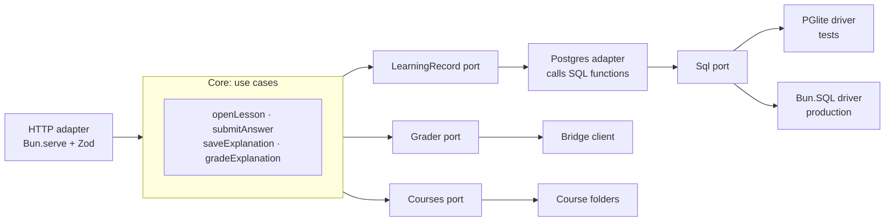

# RFC 3: Postgres functions and generated types

> **Decided, against the reviews' advice.** Three external reviews recommended staying on SQLite.
> The maintainer chose, on 2026-11-22: **ditch SQLite. Postgres in production, PGlite in tests,
> Wesley for the types, and a hexagon.** School holds no learner data yet, so the switch happens
> now, on a clean schema, with nothing to migrate.

## Executive Summary

Every read and write of School's learning record becomes a **Postgres function**. The server is a
**hexagon**: a core that knows only ports, with Postgres, HTTP and the grading bridge as adapters.
**Zod** checks every value that crosses a port. One **GraphQL SDL** file declares School's data
shapes, and **Wesley** generates the Zod schemas, TypeScript types and SQL signatures from it.
Tests run in process on **PGlite**; production runs on real Postgres.

| Topic | Decision |
| --- | --- |
| Production store | Postgres, in Docker beside the server |
| Test store | PGlite, in process; concurrency tests on real Postgres in CI |
| Interface | Functions only: the application role cannot touch a table |
| Shape of the server | Ports and adapters; the core imports no driver, no HTTP and no Bun API |
| Types | GraphQL SDL compiled by Wesley to Zod, TypeScript and SQL signatures |
| Rules and function bodies | Hand-written SQL; SDL cannot express them |
| SQLite | Retired now. No data exists, so the Postgres schema starts clean, without SQLite's legacy columns, and `bun:sqlite`, `server/migrate.ts` and the SQLite triggers are deleted in the same change |

In short: Postgres holds the rules, the hexagon keeps them behind one port, PGlite makes testing
them cheap, and Wesley keeps the declared shapes in one place.

## 1. Why now, and what it costs

The reviews' case for waiting was cost, most of it the migration. The maintainer's case is that
School should have one store, not two, and there is no data: every cost of migrating is zero
today and only grows once real study begins.

| Gains | Costs |
| --- | --- |
| A function-only role: no adapter can write a table directly, closing the gap where a direct `INSERT` bypasses the derived `correct` and `first_try` | A second service in Docker |
| A standard path to concurrent writers, which preparation and grading will become | `pg_dump` backups and a restore drill instead of copying one file |
| PGlite gives in-process tests with no live database | Concurrency needs real Postgres in CI |
| A clean schema: no `origin`, `question` or `prompt` columns kept for legacy rows that do not exist | Server dependencies for the first time: PGlite and Zod |

## 2. PGlite for tests

A spike on 2026-11-22 ran PGlite 0.5.17, which embeds PostgreSQL 18.7, under Bun:

| Check | Result |
| --- | --- |
| Tables, PL/pgSQL triggers, `SECURITY DEFINER` functions with a fixed `search_path` | Work |
| `CREATE ROLE`, grants and `SET ROLE` | Work |
| The application role calling a granted function | Works |
| The application role inserting into a table directly | Denied: "permission denied for table answers" |
| The application role truncating a table | Denied |
| An update by the owner against an append-only trigger | Refused by the trigger |
| A partial unique index | Works |

PGlite is a single connection, so it cannot reproduce two transactions racing. Every concurrency
case in §3.2 runs against real Postgres in a CI job; everything else runs on PGlite.

## 3. Requirements the reviews set

### 3.1 Privileges

| Requirement | Detail |
| --- | --- |
| Roles | An owner role for migrations; an application role that may only `EXECUTE` the public functions |
| Tables | No `INSERT`, `UPDATE`, `DELETE` or `TRUNCATE` for the application role; `TRUNCATE` is revoked explicitly, since row triggers do not fire on it |
| Functions | `SECURITY DEFINER` only where needed, each with a fixed `search_path` |
| Claim | "Guard rails and a function-only interface", not tamper-proofing: the owner can still drop a trigger |

### 3.2 Concurrency

Today `submit()` runs in an immediate SQLite transaction, which serialises writers. A direct
translation to Postgres does not: under `READ COMMITTED`, two concurrent first answers to one block
can both see no earlier answer and both record `first_try`.

| Case | Required outcome |
| --- | --- |
| Two different first answers to one block, concurrently | Exactly one is `first_try`: a partial unique index on `(encounter_id, block_id) WHERE first_try`, the loser retried as not first |
| The same submission twice, concurrently | One row; both callers receive the same result |
| One submission id reused for a different answer | Refused as a conflict |
| Two encounters opened for one lesson at once | One encounter, by a unique constraint or an advisory lock |

Each case runs against real Postgres, not argued from the SQL.

### 3.3 No migration

The reviews asked for a logical-export oracle so a migration could not change the meaning of the
learner's history. There is no history: the maintainer confirmed on 2026-11-22 that School holds
no learner data. So nothing migrates, and the oracle is not built.

| Consequence | Detail |
| --- | --- |
| Clean schema | Every answer names its encounter, block, choice and submission; the `NULL`-attribution columns for legacy rows go |
| One migration | `0001` creates the schema, the functions and the roles; later changes are new numbered files |
| Nothing kept from SQLite | No `progress.db` to preserve; `server/migrate.ts` and its tests are deleted |
| The rule from RFC 1 still holds | Later migrations may rebuild tables but never change logical history; the export oracle becomes a requirement the first time a migration touches populated tables |

## 4. The hexagon

The server's code today mixes HTTP handling, SQL and grading calls in one process-wide module.
The hexagon separates them: the **core** holds School's use cases and talks only to **ports**,
interfaces it defines; **adapters** implement those ports for one technology each.

| Port | Direction | Adapters |
| --- | --- | --- |
| `LearningRecord`: open an encounter, submit an answer, save an explanation, record a grading, read progress | Driven | Postgres functions, through a `Sql` port with two drivers: PGlite (tests) and `Bun.SQL` (production) |
| `Grader`: turn an explanation into findings or a failure | Driven | The bridge client; a scripted grader in tests |
| `Clock` | Driven | The system clock; a fixed clock in tests |
| `Courses`: resolve a lesson page | Driven | The course folders on disk |
| The HTTP API | Driving | `Bun.serve` routes, which parse each request with Zod, call one use case and serialise its result |

*Figure 1. The server as a hexagon: one driving adapter, three driven ports, and two drivers for the one SQL port, so the tests and production run the same functions.*

| Rule | Why |
| --- | --- |
| The core imports no adapter, driver, `Bun` API or HTTP type | It can be tested with fakes and moved without rewriting |
| Every value crossing a port is parsed by Zod | A driver or the network returning the wrong shape fails loudly at the edge |
| The Postgres adapter only calls functions | It holds no SQL that writes or reads a table, so the function-only role costs it nothing |
| Each adapter has a contract test that every implementation of its port passes | PGlite and `Bun.SQL` cannot drift; a fake grader behaves like the bridge |

## 5. Types from Wesley

Wesley compiles GraphQL SDL to any target through its emitters. Today it emits Rust and
TypeScript; the Zod and Postgres emitters School needs are planned as plugins over a published
IR, in their own repositories (`wesley-zod`, `wesley-postgres`, `wesley-typescript`).

| Generated from `school.graphql` | Hand-written |
| --- | --- |
| Zod schemas for every port's inputs and outputs | Function bodies |
| TypeScript types | Triggers, constraints and indexes |
| SQL composite types and function signatures | Roles and grants |
| pgTAP test scaffolds | The rules the tests assert |

Because the switch happens now, the hexagon does not wait for the emitters. `school.graphql` is
written first and is the declared source; until `wesley-zod` exists, the Zod schemas at the ports
are written by hand to match it, in one file, and are replaced by generated output when the
emitter lands. A test then checks that the generated schemas accept and reject what the
hand-written ones did.

The claim is narrow: one schema **reduces duplicated declarations and enables consistency checks**.
It does not make layers unable to disagree: an emitter can be wrong and a deployment can drift, so
the tests check the running database, not the declarations. ADR 7 withdrew Wesley for the **course
file format**; this RFC concerns School's own data model and changes nothing about course files.

## 6. Order of work

| Step | Work | Evidence before the next |
| --- | --- | --- |
| 1 | The hexagon: core, ports, fakes; the current behaviour moved behind the `LearningRecord` port, still on SQLite | The existing server tests pass unchanged against the new shape |
| 2 | `school.graphql`; migration `0001` with tables, functions, roles and triggers; the Postgres adapter; the `LearningRecord` contract test on PGlite | Every rule in the architecture reference holds on PGlite, including the denied direct writes |
| 3 | The server on Postgres: `Bun.SQL` driver, Postgres in Docker, scheduled `pg_dump` and a restore drill; delete `bun:sqlite`, `server/migrate.ts` and the SQLite triggers; amend ADRs 3 and 9 | No SQLite code path remains; a restore from a dump passes the contract test |
| 4 | Concurrency job on real Postgres in CI | Every case in §3.2 |
| 5 | Wesley: `wesley ir`, the plugin runner, `wesley-zod`, `wesley-postgres`; generated schemas replace the hand-written ones | Generated Zod accepts and rejects what the hand-written schemas did; generated signatures load into PGlite |

RFC 2's step 0 fixes and the pages do not wait for this work, but real study does: it begins on
Postgres. RFC 2's new tables (exposures, decision notes, preparations, exam attempts) are created
as later numbered migrations.

## 7. Ideas

| Idea | Why |
| --- | --- |
| Hash-chained rows | Each row carries the previous row's hash: real tamper evidence and a replay test |
| PGlite in the browser | The same functions could run client-side for an offline study mode; not proposed |

In short: SQLite is retired now, while there is nothing to migrate. The server becomes a hexagon
whose record port is backed by Postgres functions behind a function-only role; PGlite tests those
functions in process, real Postgres tests the races, and Wesley's emitters replace the
hand-written port schemas when they land.
