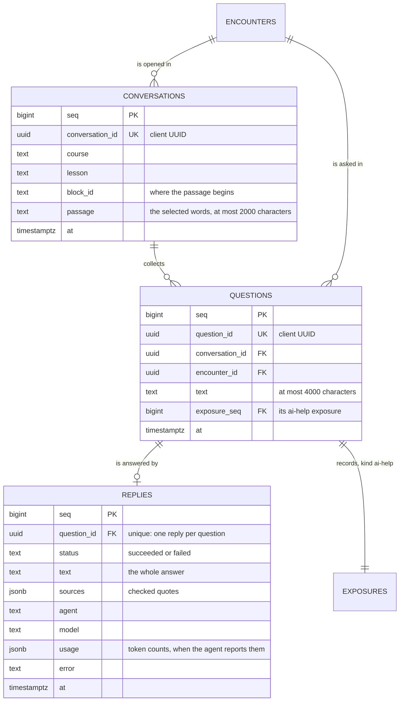
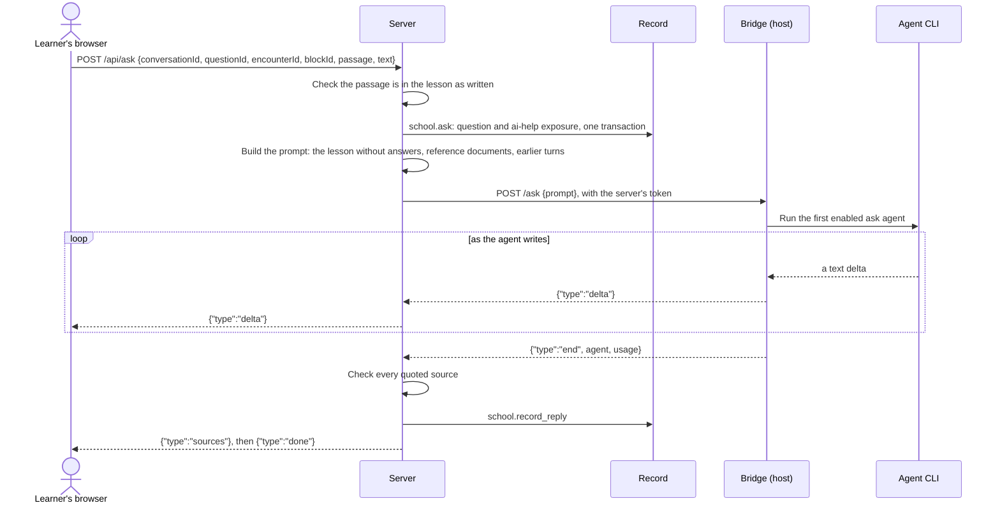

# RFC 6: Ask about a passage

> **How to read this.** **Built** means it exists at commit `2f18da4`. **Proposed** means this RFC asks for it. **Open** means it needs the maintainer's decision. The decision is recorded at the end of this RFC. How School works today is in the [architecture reference](../topics/architecture/README.md); this RFC describes only what would change. Terms are defined in the [glossary](../glossary.md).

## Executive summary

A learner stuck on a sentence has nowhere to ask about it without leaving the lesson (flyingrobots/school#190). This RFC recommends that selecting text in a lesson offers **Ask about this** (`A`), that an agent on the host answers through the bridge in a streamed reply labelled as AI, with the parts of the course it drew on shown beside it, and that every question and reply is appended to the learning record in Postgres.

The central recommendation is the aid rule. Asking is help, and School must say so in the record. This RFC proposes one general rule, which flyingrobots/school#191 (explain mode) can reuse: **when a model shows the learner more about a lesson, School records one `ai-help` exposure for the whole encounter, on the server, before the model is asked. Every quiz and explain block in that encounter then reads as aided for any answer given after it.** That needs one migration to the existing exposure mechanism, listed exactly in [§5.1](#51-the-aid-rule).

| Question from flyingrobots/school#190 | Recommendation |
| --- | --- |
| Does a question count as aid for nearby quizzes? | Yes, for **every** quiz and explain block in the encounter, not only nearby ones. Recorded by the server as one encounter-wide `ai-help` exposure before the agent runs, so it is recorded even when the answer fails or is cut off (§5.1) |
| Which agent and model, and the cost per question | The bridge's agents, from a separate `ask` list in `bridge.json` with its own queue. Default command: Claude Code on Claude Sonnet 5.5, streaming. Estimated $0.03 to $0.09 a question at API prices, nothing extra on a subscription (§5.4) |
| Do answers stay inside the course's sources? | Yes, for now. The agent is given the lesson and the course's reference documents, cites them by exact quote, and School checks every quote. An answer with no checked source says so (§5.5) |
| How the chat looks on a phone | A bottom drawer, with the ask button in a bar at the bottom of the screen, clear of the phone's own selection menu (§5.6) |
| How it is saved | Three append-only tables written only through Postgres functions: conversations, questions, replies. Nothing in browser storage (§5.2) |
| The first slice | Steps 1 to 5 of the [order of work](#6-order-of-work): the aid rule, the record, a streaming bridge route, the server route, and the lesson page |

_Table 0.1. Each open question in flyingrobots/school#190 and this RFC's recommendation. The aid rule is the one decision every other step depends on._

In short: ask from a selection, answer from the course, save to the record, and count every question as help for the whole lesson.

## Contents

1. [The problem and who it serves](#1-the-problem-and-who-it-serves)
2. [What exists today](#2-what-exists-today)
3. [Constraints](#3-constraints)
4. [Options](#4-options)
5. [Recommendation](#5-recommendation)
6. [Order of work](#6-order-of-work)
7. [Out of scope](#7-out-of-scope)
8. [Risks](#8-risks)
9. [Open questions](#9-open-questions)
10. [Decision](#10-decision)

## 1. The problem and who it serves

A lesson is read alone, often on a phone, and the glossary's rendering rule already says a lesson should "remind the learner that the agent is their teacher and can be asked follow-ups". Today there is no place to ask. The learner either stays stuck or leaves School for a chat window that knows nothing about the lesson and leaves nothing in the record.

| Who | What they need |
| --- | --- |
| A **learner** reading a lesson | To ask about the exact words that stopped them, without losing their place, and to find the answer again later |
| A **learner** answering quizzes afterwards | Review that is honest: if a question helped them, the quiz comes back for another look rather than counting as known |
| A **course author** | Answers that teach from their course, not from whatever the model remembers |
| The **maintainer** | A cost per question they can see and a model they can change without code |

_Table 1.1. Who asking about a passage serves, and what each needs. The second row is why the aid rule matters as much as the chat._

The feature is small for the learner and touches the record's most important rule, so the RFC spends most of its length on aid and the record.

## 2. What exists today

Most of the parts this feature needs are already built. This section names each one with the file it lives in, so the proposal can say exactly what is new.

| Part | Built | Where |
| --- | --- | --- |
| Exposures and aid | Help shown for a block is an exposure (`hint`, `model-answer`, `feedback`, `reference`). A submission is **aided** when an exposure to the same block in the same encounter has a smaller `seq`; **unknown** when the encounter was opened without aid tracking | `server/db/migrations/0001_init.sql` (table, kind check), `0002_exposures.sql` (`record_exposure`, `submission_aid`) |
| Due review | An aided first try is weak (`due-review/aided-first-try`), comes back after `REVIEW_DELAY_MS` (twenty hours), and its decision note cites the exposures | `server/db/migrations/0006_due_review.sql`, `reviewReason` in `server/core/school.ts`, [due review](../topics/due-review/README.md) |
| Exposures from the page | The lesson page opens every lesson with `?aid=1` and posts each exposure through the outbox ahead of later submissions | `web/src/pages/lesson.tsx`, `web/src/lib/outbox.ts`, [lesson page](../topics/lesson-page/README.md#the-help-it-records) |
| The bridge | A host process that runs the learner's agent commands in order as fallbacks, with no shell, an empty working folder and a timeout; one job at a time (`serially`); logs never hold a prompt or an answer | `bridge/bridge.ts`, `bridge/run.ts`, `bridge/bridge.example.json` |
| Waiting for a whole answer | `POST /run` returns only when the agent process has exited; there is no streaming route. Output kinds are `text` and `claude-json` | `bridge/run.ts` (`OUTPUTS`, `runAgent`) |
| Quote checking | A grading's contradictions must quote a source exactly; `checkQuotes` drops any quote not found | `server/core/school.ts` |
| Text built on the server | Reading aloud builds the spoken text from the lesson as written and leaves out quiz choices, `why`, model answers and explain sources, because each gives an answer away | `server/speak.ts`, [reading aloud](../topics/reading-aloud/README.md#what-is-spoken) |
| A highlight-and-act pattern | **Read aloud** (`R`) acts on the lesson, with a bar fixed to the bottom and an **AI voice** badge with a robot icon | `web/src/components/read-aloud.tsx` |
| Chat components | Registry components already installed: `Sheet`, `Drawer`, `Popover`, `Kbd`, `Badge`, `Spinner`, `InputGroup`, `Textarea`; `Message`, `MessageScroller`, `Bubble` and the `ai-elements` blocks (`sources`, `inline-citation`, `chat` among them), which only the `/demo` gallery uses so far; `Markdown` on Streamdown, which renders a stream as it arrives | `web/src/components/ui/`, `web/src/components/ai-elements/`, `web/src/components/markdown.tsx` |
| Phone width | `useIsMobile()`: below 768 px | `web/src/hooks/use-mobile.ts` |

_Table 2.1. What School already has that this feature builds on, read from the code at `2f18da4`. The gaps are a streaming bridge route, an encounter-wide exposure, and tables for conversations._

The lesson page's keys today are `p` (slides), `r` (read aloud, or revise inside an explain block), `g` (grade, inside an explain block), the quiz's number keys, and the app shell's `j` `k` `h` `l`, arrows, `Space` leader, `⌘K` and `⌘B`. `a` is free. In short: aid, review, the bridge and the components exist; streaming and conversation storage do not.

## 3. Constraints

Each option below is weighed against these. They come from existing decisions and the maintainer's standing rules, not from this RFC.

| # | Constraint | Source |
| --- | --- | --- |
| C1 | The record must never overstate mastery: help shown before a first try makes it aided, decided by `seq` | RFC 1 (assistance), [RFC 2 §3](0002-lessons-written-for-each-learner.md), `submission_aid` |
| C2 | Postgres is the only store. Every write is a `school.*` function; rows are append-only; no state in browser storage (the outbox is a delivery queue, never read as progress) | [RFC 3](0003-postgres-functions-and-generated-types.md), ADR 9, the architecture reference |
| C3 | Models run only on the host through the bridge, under commands written only in the bridge's file; the server never runs a model and never sets a command | The architecture reference, `server/agents.ts` |
| C4 | Knowledge comes from high-trust resources, never from an agent's parametric memory | The glossary, "Knowledge, Skills, Wisdom" |
| C5 | Model output is labelled as AI, and rendered as escaped text | flyingrobots/school#37, the **AI voice** badge |
| C6 | UI only from shadcn registry components, theme-book tokens, light and dark | `web/components.json`, the stylesheet and component-hash tests |
| C7 | School's voice: encouraging or neutral, inviting with questions, never "wrong" or "attempt" | [School's voice](../topics/voice/README.md) |
| C8 | Most study is on a phone | The app shell's keys decision (flyingrobots/school#84) |

_Table 3.1. The constraints every option must hold. C1 and C2 decide the aid rule and the record; C3 and C4 decide the agent and its sources._

C1 is the one that shapes the design most, so the options start with it.

## 4. Options

There are three independent choices: how a question counts as aid, how the answer reaches the page, and what the answer may draw on. Each is weighed below; the comparison table closes the section.

### 4.1 How a question counts as aid

The record decides aid per block, per encounter, by `seq`. A question about a passage is about prose, which is not a quiz, so the question is which blocks it aids.

| Option | Rule | For | Against |
| --- | --- | --- | --- |
| A1: not aid | Record the conversation, change nothing | No migration | Breaks C1: a question before a quiz leaves its right first try clean |
| A2: the same section | An exposure to each quiz in the passage's section | Matches "nearby" in the issue | The agent sees the whole lesson and the panel stays open while the learner scrolls; a question about section 1 can answer a quiz in section 3 |
| A3: the whole encounter | One exposure that aids every quiz and explain block in the encounter's snapshot, review items included | Simple, deterministic, needs no judgment of what the answer touched; reusable by flyingrobots/school#191 | Over-marks: a quiz the answer never touched comes back for another look |
| A4: model-judged | Ask the model which blocks its answer touched | Precise when right | A model deciding the evidence about itself; not deterministic; breaks the spirit of C1 |

_Table 4.1. Four ways to count a question as aid. A3 is the only one that is both honest and deterministic._

The costs are asymmetric. Over-marking costs one extra review item the next day, which School presents as "ready for another look". Under-marking makes the record claim the learner knew something they were just told. A3 accepts the first cost to rule out the second.

### 4.2 How the answer reaches the page

The issue asks for a streamed answer. The bridge's `POST /run` returns only when the agent has exited, so streaming needs something new.

| Option | For | Against |
| --- | --- | --- |
| B1: reuse `POST /run`, show the whole answer at once | No bridge change | Ten seconds or more of a spinner on every question; not what the issue asks for |
| B2: a streaming bridge route (`POST /ask`), proxied by the server as NDJSON | Keeps C3: the model still runs only on the host, under the learner's commands | A new bridge route, output kind and log messages |
| B3: the server calls a model API directly | Simplest streaming | Breaks C3: an API key inside the container the network can reach |
| B4: the browser calls the bridge | No server work | Breaks C3 and C2: the token in the browser, and nothing reaches the record unless the browser sends it |

_Table 4.2. Four ways to deliver the answer. Only B2 streams while keeping the model on the host._

B2 costs one bridge route and one output kind, and keeps every model run where the learner's credentials already are.

### 4.3 What the answer may draw on

| Option | For | Against |
| --- | --- | --- |
| S1: the course's sources only, cited and checked | Holds C4; every claim can be traced; the course author's words teach | Some questions go past the course, and the answer has to say so |
| S2: anything, labelled as AI | Answers more questions | Breaks C4; a confident wrong answer looks like the course |
| S3: the course first, beyond it only when marked "Not from this course" | Flexible | The learner has to weigh two kinds of answer in one reply; the label is easy to miss on a phone |

_Table 4.3. Three source policies. S1 keeps the knowledge rule; S3 is a later step if S1 proves too narrow._

S1 is narrower than a general chat, and that is the point: the course author chose the sources, and the answer can show which words it leaned on.

### 4.4 Comparison

| | A1 | A2 | A3 | A4 | B2 | B3 | S1 | S2 |
| --- | --- | --- | --- | --- | --- | --- | --- | --- |
| Record stays honest (C1) | breaks | partly | holds | uncertain | n/a | n/a | n/a | n/a |
| Postgres only (C2) | holds | holds | holds | holds | holds | holds | n/a | n/a |
| Models on the host (C3) | n/a | n/a | n/a | n/a | holds | breaks | n/a | n/a |
| Knowledge from sources (C4) | n/a | n/a | n/a | n/a | n/a | n/a | holds | breaks |

_Table 4.4. The options against the constraints they touch. A3, B2 and S1 hold every one._

In short: count a question as help for the whole encounter, stream through a new bridge route, and answer from the course.

## 5. Recommendation

**A3, B2 and S1.** Proposed. The subsections below give the aid rule, the record, the path of one question, the agent and its cost, sources and labelling, and the page.

### 5.1 The aid rule

The rule is stated generally, so that explain mode (flyingrobots/school#191) and any later model-written help use it unchanged.

> **When School shows the learner text a model wrote in answer to the learner's request for help with a lesson, it records one exposure of kind `ai-help` for the whole encounter, on the server, before the model is asked. A quiz answer or explanation in that encounter with a larger `seq` is aided, whichever block it belongs to.**

Each part of the rule has a reason:

| Part | Why |
| --- | --- |
| One exposure for the whole encounter | The model sees the whole lesson, and the learner can scroll anywhere while the answer is open (§4.1) |
| Recorded by the server | The browser cannot skip it, and it does not depend on the outbox delivering it. `POST /api/exposure` keeps refusing `ai-help` |
| Before the model is asked | The answer may be read while it streams, or only partly; recording first means no answer is ever shown unrecorded. A failed answer still counts, which over-marks slightly and never under-marks |
| A new exposure each time | Reopening a saved answer in a later encounter is showing help again, as reopening a source is today |
| Only in tracked encounters | An encounter with `aid_tracking` NULL already reads every answer as `unknown`, which is never clean; asking there is refused, as `record_exposure` refuses today |

_Table 5.1. The parts of the aid rule and the reason for each. Every part errs toward marking aid, never away from it._

One ordering detail matters. Answers given offline wait in the outbox, and a question goes straight to the server. If the learner answered a quiz offline and then asked, the question's exposure would get the smaller `seq` and the answer would read as aided although it came first. So the page sends a question only when the outbox is empty; asking needs the network anyway.

What must change, exactly, in one new migration and the code beside it:

| # | Change | Where |
| --- | --- | --- |
| 1 | `exposures_kind` accepts `ai-help` | A new migration, replacing the check from `0001_init.sql` |
| 2 | `exposures.block_id` may be NULL, and is NULL exactly when the kind is `ai-help`: `CHECK ((kind = 'ai-help') = (block_id IS NULL))` | The same migration |
| 3 | `submission_aid` treats an exposure with NULL `block_id` in the same encounter as an exposure to every block: `AND (p.block_id = s.block_id OR p.block_id IS NULL)` | `CREATE OR REPLACE` of the function from `0002_exposures.sql` |
| 4 | `due_review` does the same in its `judged` step (the aided test) and its `cited` step (the exposures it cites) | `CREATE OR REPLACE` of the function from `0006_due_review.sql` |
| 5 | A new function, `school.record_lesson_help(exposure_id, encounter_id, kind, at)`, stores one encounter-wide exposure, idempotent by its id, and refuses an untracked or unknown encounter. Granted to `school_app` and added to `GRANTED_FUNCTIONS` | The same migration; `server/adapters/database.ts` |
| 6 | The record's exposure kind gains `ai-help`; the HTTP exposure's kind does not. `helpWords` names it "asking about the lesson", so a reason reads "On 21 November, asking about the lesson helped you find this one. It's back so you can answer it from memory." | `server/core/model.ts`, `server/schema/school.graphql` (and Wesley's output), `server/core/school.ts` |

_Table 5.2. The changes to the exposure mechanism. `record_exposure`, the client's route and the aid capture version stay as they are._

The aid capture version does not change. It declares what the **client** records, and `ai-help` is recorded by the server in every tracked encounter. Grading feedback on an explanation is model-written too; whether it falls under this rule is [Q7](#9-open-questions).

The rule over-marks by design and that is its whole cost: a lesson with five quizzes and one question sends up to five items to tomorrow's review instead of none.

### 5.2 The record

Conversations live in the learning record and nowhere else. Three new append-only tables, with the same triggers as every other table and one shared `seq`, hold them.

**Figure 5.1. The conversation tables beside the existing ones**

_Figure 5.1. The proposed tables, in schema `school`. A conversation is anchored to a passage; each question is asked in an encounter and records its own `ai-help` exposure; each question has at most one reply._

| Function | Does |
| --- | --- |
| `school.ask(conversation_id, question_id, encounter_id, block_id, passage, text, at)` | In one transaction: opens the conversation on its first question (the passage is required then, refused after), checks that the encounter is tracked and its snapshot holds `block_id`, records the `ai-help` exposure through `record_lesson_help`, and stores the question. Answers `stored`, `duplicate` (the same id, the same question), `conflict` (the same id, something else) or `rejected` |
| `school.record_reply(question_id, status, text, sources, agent, model, usage, error, at)` | Stores the one reply to a question, succeeded or failed; `duplicate` or `conflict` on a second |
| `school.lesson_conversations(course, lesson)` | Reads a lesson's conversations, their questions and replies, in `seq` order |

_Table 5.3. The proposed record functions. Every write goes through one of them, as RFC 3 requires._

The server checks that the passage occurs in the text of the lesson as written before it calls `school.ask`, in the core, where the text is already built for reading aloud. A question with no reply, because the server stopped mid-answer, stays as it is; the page offers to ask it again, which is a new question with a new id. Nothing about a conversation is kept in IndexedDB or `localStorage`: a question being typed lives in the page's memory until it is sent, and a page that opens reads every conversation back from School.

In short: three tables, three functions, and the question and its aid written together.

### 5.3 The path of one question

One question goes from the page to the record before any model is asked, and the answer is stored whether or not the page is still there to receive it.

**Figure 5.2. Asking about a passage**

_Figure 5.2. One question, end to end. The record holds the question and its aid before the bridge is called, and the reply after the stream ends, even if the browser has gone._

| Piece | Proposed |
| --- | --- |
| `POST /api/ask` | JSON in, guarded like every `POST /api/*`; answers `application/x-ndjson`, one JSON object per line: `stored`, `delta`, `sources`, `done`, or `failed` with a reason in words. Each line type has a schema, as the programs' output does |
| `GET /api/courses/:c/lessons/:id/conversations` | The lesson's conversations, from `school.lesson_conversations` |
| The bridge's `POST /ask` | `{ prompt, deadline_ms }`; answers NDJSON `delta` lines and one `end` line with the agent, its status and its usage. It uses the `ask` agents from `bridge.json`, in their own queue, one at a time, so a question never waits behind a three-minute grading |
| Fallback | The next agent is tried only before the first delta is sent. Once text has reached the learner, a failure ends the reply as failed; it never switches voices mid-answer |
| A new output kind | `claude-stream-json`: Claude Code's `--output-format stream-json`, read line by line for text deltas and its final usage. An agent with output `text` or `claude-json` still works and delivers its answer as one delta at the end |
| Logs | `bridge.ask.start`, `bridge.ask.attempt`, `bridge.ask.end`, with schemas in `bridge/schemas/`; token counts but never a prompt, a passage or an answer |

_Table 5.4. The routes and bridge changes the path needs. The server owns the stream format; the browser never sees the bridge._

School speaks its own NDJSON rather than the AI SDK's chat protocol, although `@ai-sdk/react` is installed. `useChat` keeps the conversation in the browser's state, while here the record is the conversation and the page only shows it.

### 5.4 The agent, the model and the cost

The agent is whatever the learner's `bridge.json` declares, under a new `ask` list, so changing the model is an edit on the host and never a code change.

| Setting | Proposed default |
| --- | --- |
| The `ask` list in `bridge.json` | `{ "timeout_seconds": 90, "agents": [...] }`, beside the existing grading list, which is unchanged |
| First ask agent | `claude --model claude-sonnet-5-5 --tools "" --strict-mcp-config --no-session-persistence --output-format stream-json --include-partial-messages --verbose -p {prompt}`, output `claude-stream-json`. The streaming flags are to be checked against the installed CLI in step 3 |
| Fallback | `codex exec ... -o {output_file}`, as today, delivering its answer at the end |
| Memory | None in the agent: each run is a fresh process with no session; the server sends the earlier turns of the conversation from the record |
| Context sent | The lesson as written, without the review section and without what reading aloud never says (any quiz choice, a quiz's `why`, an explain block's model answer and sources, a nest diagram); the course's reference documents up to 100,000 characters, then only their titles; the passage and the question inside tags marked as the learner's text |

_Table 5.5. The proposed agent settings. Withholding answers keeps the chat from becoming an answer key; the aid rule covers whatever it still teaches._

Claude Sonnet 5.5 is the recommendation because explaining a hard passage is the whole job, and it costs half of Claude Opus 5.5 per token. Claude Haiku 5.5 is twenty times cheaper again and is the first thing to try if the cost is too high.

The cost per question depends on how School runs the agent. Through a Claude subscription, as the CLI usually is, a question costs nothing extra and counts against the subscription's usage limits. At API prices it costs as Table 5.6 estimates.

| Model | Price per million tokens, input / output | A question, 8,000 tokens of context | A question, 40,000 tokens of context |
| --- | --- | --- | --- |
| Claude Haiku 5.5 | $0.10 / $0.50 | about $0.001 | about $0.005 |
| Claude Sonnet 5.5 | $2.00 / $10.00 | about $0.03 | about $0.09 |
| Claude Opus 5.5 | $4.00 / $20.00 | about $0.05 | about $0.18 |

_Table 5.6. Estimated cost of one question at API prices (Anthropic's first-party list, cached 2026-11-03), assuming 1,000 output tokens including thinking. These are estimates, not measurements: the CLI adds its own prompt, whose size is not measured here, and a follow-up within five minutes can read the cached context at a twentieth of the input price._

The bridge reports each answer's token counts, and `school.record_reply` stores them, so the real cost per question can be read from the record after a week of use instead of guessed. Latency is not measured either: the CLI's start-up time comes before the first word.

### 5.5 Sources and labelling

Answers teach from the course (S1). The agent is told to explain the passage from the lesson and the reference documents it is given, in plain words, and to quote the source for each claim of fact.

| Rule | Proposed |
| --- | --- |
| Citing | The agent ends its answer with a marked block listing each source it used, by id, with the exact words it relied on. The server strips the block from the text shown |
| Checking | Each quote is checked to occur in the source it names, as `checkQuotes` checks a grading's contradictions. An unchecked quote is dropped from the sources and stored as dropped |
| No checked source | The reply says, under the answer: "This answer doesn't point to a part of this course. Would the course's own sources help here?" |
| Not covered | When the course does not cover the question, the agent says so plainly instead of answering from memory |
| The AI label | Every reply carries an **AI answer** badge with the robot icon used by **AI voice**, and a muted line naming the agent that answered |
| Sources shown | Under each reply, the `ai-elements` sources list: each source's title (a lesson section, or a reference document), opening to it, with the quoted words |
| Model text | Rendered by the `Markdown` component as text: raw HTML in an answer stays inert, shown by a test, as flyingrobots/school#37 requires of grading output |

_Table 5.7. How an answer stays inside the course and says where it came from. Whether S3 is allowed later is [Q4](#9-open-questions)._

In short: the answer quotes the course, School checks the quotes, and the label never lets an answer pass for the course itself.

### 5.6 The page

The page is built only from registry components already installed (§2), styled by the theme-book tokens, so light and dark need no work of their own.

| Part | Wide screen | Phone (below 768 px) |
| --- | --- | --- |
| The ask button | **Ask about this**, with its `Kbd` hint `A`, in a `Popover` anchored to the selection | The same button in a bar fixed to the bottom of the screen, above the read-aloud bar when that is showing, so the phone's own selection menu does not cover it |
| The panel | A `Sheet` on the right, not modal, so the lesson stays readable and scrollable beside it | A `Drawer` from the bottom, half height, dragged up to full |
| Inside the panel | The passage quoted at the top; the turns in a `MessageScroller` of `Message` and `Bubble`; the answer streaming into `Markdown`; a `Spinner` with "Reading the passage…" before the first word; an `InputGroup` with a `Textarea` and a send `Button` for the question | The same, full width |

_Table 5.8. The page on a wide screen and on a phone. The phone layout avoids the one thing that differs there, the system's selection menu._

| Key | Does |
| --- | --- |
| `A` | With text selected in the lesson, opens the panel with that passage. Does nothing with no selection, while typing, inside the slides view, or with focus in an explain block's text |
| `Enter` | Sends the question; `Shift Enter` is a new line |
| `Esc` | Closes the panel; the conversation is already saved |

_Table 5.9. The keys. `A` is free on the lesson page today (§2), and every key shows its `Kbd` hint, as the app shell requires._

The copy follows School's voice: questions that invite, nothing about what went wrong.

| Where | Words |
| --- | --- |
| The question box, empty | "What would you like to know about this passage?" |
| Under the panel | "Answers come from an AI and can be mistaken; each one shows the parts of this course it used. Questions you ask here count as help, so this lesson's quizzes come back for another look later." |
| No answer came back | "No answer came back this time. Would you like to ask again?" |
| No bridge | "Asking needs the bridge. Would you like to connect it in Settings?" |
| Offline | "School can't be reached right now. Would you like to ask once it's back?" |
| A question with no saved reply | "This question has no saved answer. Would you like to ask it again?" |

_Table 5.10. The proposed copy. The line under the panel tells the learner, in neutral words, that asking is recorded as help._

A selection may span blocks; it is anchored to the block where it begins and must be at most 2,000 characters. A selection inside a quiz is allowed: the agent still never sees the quiz's correct choice, and the aid rule covers the quiz. In short: one button, one panel, one key, and the record behind it.

## 6. Order of work

Each row is one task issue with one observable outcome. None is created by this RFC. Steps 1 to 5 are the first slice the issue asks for: highlight, ask, a streamed answer, and the conversation saved to the record. Each step updates the living references it changes in the same pull request, so there is no separate documentation step.

| # | Task issue | Depends on | Done when |
| --- | --- | --- | --- |
| 1 | **Help for a whole encounter counts as aid.** The migration in Table 5.2: the `ai-help` kind, NULL `block_id` for it, `submission_aid` and `due_review` reading it, `school.record_lesson_help`, the port method, `helpWords`, the GraphQL schema | none | Contract cases on PGlite and Bun.SQL: an `ai-help` exposure before a first try makes every quiz and explain block in that encounter aided and due as `aided-first-try`, citing it; one after does not; an untracked encounter is rejected; `POST /api/exposure` still refuses `ai-help`. The due-review and architecture references describe it |
| 2 | **Conversations are kept in the record.** The tables of Figure 5.1 and the functions of Table 5.3; `school.ask` records its exposure through step 1's function in the same transaction | 1 | Contract cases on both drivers: a question is stored once per id (`duplicate`, `conflict`), its exposure has a smaller `seq` than any later answer, a reply is stored once, every table refuses update, delete and truncate, and the read returns turns in `seq` order. The architecture reference lists the tables |
| 3 | **The bridge streams an answer.** `POST /ask`, the `ask` list in `bridge.json`, its own queue, the `claude-stream-json` output kind, fallback before the first delta only, the three log messages with schemas and token counts | none | Bridge tests with a fake streaming agent: deltas reach the caller before the agent exits; a failure before the first delta falls back, one after ends the reply as failed; a grading in progress does not delay a question; no log line holds the prompt or the answer; `--schema` lists the new messages. The programs' output reference and `bridge.example.json` are updated |
| 4 | **The server answers a question about a passage.** `POST /api/ask` and `GET .../conversations`: the passage check, the prompt with answers withheld, the question stored before the bridge is called, the stream proxied, quotes checked, the reply stored even when the browser has gone | 2, 3 | HTTP tests with a fake bridge: deltas arrive as NDJSON; the question and its exposure are in the record before the bridge is asked; a passage not in the lesson is refused (400); no quiz choice, `why` or model answer is in the prompt; an unchecked quote is dropped; a browser that disconnects still leaves a stored reply; with no bridge, a 503 with the reason |
| 5 | **A learner asks about a passage on the lesson page.** The button, `A`, the panel as `Sheet` and `Drawer`, the streamed answer with its AI label and sources, the conversation read back on reload, questions held until the outbox is empty | 4 | Browser tests: selecting text and pressing `A` or the button opens the panel with the passage; the answer streams in, labelled, with its sources; a reload shows the conversation; at 390 px wide the drawer and the bottom bar are used; light and dark render; raw HTML in an answer is inert; every string passes the voice test. The lesson page reference describes it. **The first slice is complete** |
| 6 | **Follow-up questions continue a conversation.** A second question in the panel, with the earlier turns sent from the record | 5 | A test shows the earlier turns in the second prompt, and the second question's own `ai-help` exposure in the record |
| 7 | **Earlier conversations come back.** The lesson page lists the lesson's conversations from earlier encounters by their passage; opening one records a new `ai-help` exposure in this encounter | 5 | A browser test opens an earlier conversation in a new encounter, and the record holds a new exposure for that encounter |

_Table 6.1. The order of work. Steps 1 and 3 can start at once; step 5 completes the first slice; steps 6 and 7 follow it._

In short: the aid rule first, then the record, a streaming bridge, the server, and the page.

## 7. Out of scope

These are left out on purpose, each with its reason, so a build issue does not drift into them.

| Left out | Why |
| --- | --- |
| Explain mode | flyingrobots/school#191; it reuses §5.1's rule but is its own design |
| Asking from the slides view, the reference page or Home | The slides view opens no encounter, so aid cannot be recorded; the others are later issues if wanted |
| Answers from beyond the course, web search, agent tools | C4; option S3 is [Q4](#9-open-questions) |
| Editing or deleting a conversation | The record is append-only (C2) |
| Choosing a model in the app | Commands are written only on the host (C3) |
| Speaking an answer aloud, or asking by voice | A later issue; reading aloud would need its never-spoken rules extended to answers |
| A page listing every conversation in every course | A later issue, once step 7 shows whether learners come back to them |
| Courses from strangers | A stranger's course text in the prompt is a prompt-injection risk; RFC 4's untrusted courses would need asking switched off or sandboxed first |

_Table 7.1. What this RFC does not build, and why. None of it blocks the first slice._

Each of these can be its own issue later; none needs a decision now.

## 8. Risks

The main risks are a wrong answer, a record that says too much or too little, and cost. Each has a mitigation in the design.

| Risk | Mitigation |
| --- | --- |
| A confident wrong answer | The AI label, the agent named, sources shown with the words used and checked, an answer with no source says so, and the line under the panel says answers can be mistaken |
| The record overstates mastery | §5.1: encounter-wide, server-recorded, before the model runs, and questions held until the outbox is empty |
| The record understates it, and review fills up | One extra review item per quiz in a lesson where the learner asked; due review shows at most three in a lesson (`REVIEW_LIMIT`). Accepted as the honest cost |
| The chat becomes an answer key | Correct choices, `why` and model answers are never in the prompt; whatever the answer still teaches is aid |
| The learner's text steers the agent | The passage and question are wrapped and marked as the learner's text, as grading does; the agent has no tools and an empty working folder |
| Cost grows unnoticed | Token counts stored with every reply; the model is one edit in `bridge.json` |
| A slow first word | Its own bridge queue, a "Reading the passage…" state, and a 90-second timeout with a reason in words |
| The phone's selection menu covers the button | The button lives in a bottom bar on a phone, never beside the selection |
| CLI streaming flags change | Isolated in one output kind in `bridge/run.ts`, tested with a fake agent; other output kinds still work without streaming |

_Table 8.1. Risks and their mitigations. The aid rule's one known cost, extra review, is accepted rather than mitigated._

The risk this RFC treats as worst is a record that claims too much, and the design gives up some precision to rule it out.

## 9. Open questions

Each question has a recommendation that holds until the maintainer decides otherwise. Q1 is the decision the issue's acceptance criteria name.

| # | Question | Recommendation |
| --- | --- | --- |
| Q1 | How does a question count as aid? | §5.1: one server-recorded `ai-help` exposure for the whole encounter, before the model is asked; every later answer in the encounter is aided |
| Q2 | Which agent and model? | The bridge's `ask` list; Claude Sonnet 5.5 first, Codex as the fallback; Haiku 5.5 if cost matters more than depth |
| Q3 | What may a question cost? | Nothing extra on a subscription; at API prices an estimated $0.03 to $0.09 on Sonnet 5.5. Measure from the stored token counts after a week before changing the model |
| Q4 | May answers go beyond the course's sources? | Not now (S1). Revisit S3, with "Not from this course" marked, if learners often meet "doesn't point to a part of this course" |
| Q5 | How does it look on a phone? | A bottom drawer, with the ask button in a bottom bar (Table 5.8) |
| Q6 | Is the kind called `ai-help`? | Yes; it names who helped, not the feature, so explain mode can use it too |
| Q7 | Does grading feedback on an explanation fall under the rule? | Not in this RFC. It judges the learner's own explanation of one block, after that block's model answer has already made it aided; decide it with flyingrobots/school#191 |
| Q8 | Does a question keep an encounter open, or make a study day? | It keeps the encounter open (it is the learner's activity), but it is not a study day: asking is reading, not retrieval. The first changes `open_encounter`'s resume rule and would be its own issue |
| Q9 | Should a question about a quiz itself be allowed? | Yes. The quiz's answer is never in the prompt, and the aid rule covers it |

_Table 9.1. Open questions and recommendations. Q1 and Q4 are the two the maintainer most needs to decide; the rest can stand as recommended._

In short: the maintainer decides the aid rule, the source policy and the model; the rest has a recommendation that holds until someone objects.

## 10. Decision

Decided on 2026-11-26 by an agent under the maintainer's delegated authority for that run. The decision record, with each option's pros, cons and why it was rejected, was delivered to Reader's inbox (receipt `dde2878f-326f-4ac5-8fe2-507c82ee0781`). The maintainer may overturn any part.

Every recommendation in Table 0.1 and §9 is accepted as written, the encounter-wide `ai-help` aid rule of §5.1 first. Grading feedback under the aid rule is decided with flyingrobots/school#191.

| Step | Issue |
| --- | --- |
| 1, the aid rule | flyingrobots/school#224 |
| 2, conversations in the record | flyingrobots/school#225 |
| 3, the bridge streams | flyingrobots/school#226 |
| 4, the server route | flyingrobots/school#227 |
| 5, the lesson page (first slice complete) | flyingrobots/school#228 |
| 6, follow-up questions | flyingrobots/school#229 |
| 7, earlier conversations | flyingrobots/school#230 |

In short: RFC 6 is decided as written, and its seven steps are filed.
