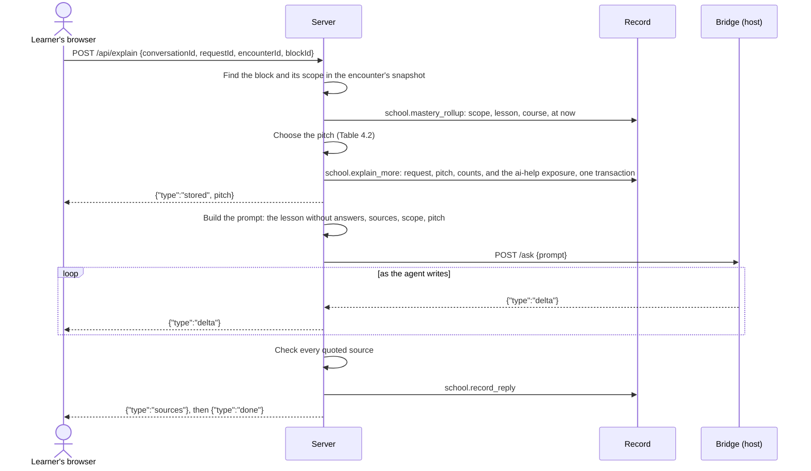

# RFC 8: Explain mode

> **How to read this.** **Built** means it exists at commit `2f18da4`. **Proposed** means this RFC asks for it. **Open** means it needs the maintainer's decision. Nothing here is decided. It builds on two RFCs decided on 2026-11-26 whose pull requests are not yet merged: [RFC 5, mastery that fades](https://github.com/flyingrobots/school/pull/208) and [RFC 6, ask about a passage](https://github.com/flyingrobots/school/pull/207). What they propose is cited as theirs and is not re-proposed here. How School works today is in the [architecture reference](../topics/architecture/README.md).

## Executive Summary

Every learner reads the same lesson text, whether the record shows they have that material settled or are still finding it (flyingrobots/school#191). The maintainer wants an **Explain more** action: an agent on the host writes more about one part of a lesson, pitched to what the learner has shown, labelled as AI, and recorded as help. This is the opposite direction from the explain block (flyingrobots/school#37), where the learner explains and School grades.

This RFC recommends that **Explain more** be RFC 6's ask path with a different prompt and no typed question. The server reads the learner's mastery of the quizzes around the block from RFC 5's `school.mastery_rollup`, picks one of four named **pitches** by a fixed rule, records RFC 6's encounter-wide `ai-help` exposure and the request in RFC 6's conversation tables before the model is asked, and streams the answer through RFC 6's bridge route into RFC 6's panel. The pitch is shown to the learner in words, so the text visibly changes as their mastery does. Nothing new is measured, cached or stored outside the record.

| Question | Recommendation |
| --- | --- |
| What "demonstrated mastery" means, as a database function | RFC 5's `school.mastery_rollup` over the quizzes around the block, plus the lesson and the course, in one call. Its four counts choose one of four pitches by a fixed rule in the core: **Still settling** gets more depth and a worked example, **Not started yet** a first explanation, **Ready for another look** a short refresher, **Holding** a brief recap and a pointer onward. No new measure (§4.1, §4.2) |
| Cached per mastery level, or written fresh | Written fresh each time. Every explanation is kept in the record with the pitch and the counts it was written for; earlier ones come back from the record, as RFC 6's earlier conversations do, and showing one again is a new exposure. No cache table (§4.5) |
| How it counts as aid | Exactly RFC 6's rule (§5.1 there): one server-recorded `ai-help` exposure for the whole encounter, before the model is asked, refused in an untracked encounter, held until the outbox is empty (§4.4) |
| How it relates to RFC 2's lessons written for each learner | A different thing, not the same thing on demand. RFC 2 writes the lesson itself, ahead of time, into learner state; reading it is not help. Explain mode adds text beside a lesson that already exists, on request, into the record; reading it is help. Explain mode works on authored and prepared lessons alike, and RFC 2's preparation may read its requests as evidence (§4.7) |
| RFC 6's Q7: does grading feedback on an explanation fall under the aid rule? | No. Grading feedback is about one block, from a grader given only that block, and it is shown after the block's model answer has already made any revision aided. It is recorded as a block-scoped `feedback` exposure, which the page does not record today (§4.6) |
| The first slice | Steps 1 to 4 of the [order of work](#5-order-of-work): the record, the pitch, the server route, and **Explain more** on a section |

_Table 0.1. The open questions in flyingrobots/school#191, RFC 6's deferred Q7, and this RFC's recommendation for each. Every recommendation reuses a piece RFC 5 or RFC 6 already defines._

In short: read mastery, pick a pitch, record the help, then ask the model through the path RFC 6 is building.

## Contents

1. [The problem and who it serves](#1-the-problem-and-who-it-serves)
2. [Constraints](#2-constraints)
3. [Options](#3-options)
4. [Recommendation](#4-recommendation)
5. [Order of work](#5-order-of-work)
6. [Out of scope](#6-out-of-scope)
7. [Risks](#7-risks)
8. [Open questions](#8-open-questions)

## 1. The problem and who it serves

A lesson is written once for every reader, and School already holds evidence of what this reader has found from memory. Nothing joins the two. This section names what is built, what RFC 5 and RFC 6 will add, and who the feature serves.

**Built** at `2f18da4`:

| Part | What it does | Where |
| --- | --- | --- |
| Blocks | A lesson is a `page` of `section`, `prose`, `card`, `quote`, `aside`, `quiz`, `explain` and `nest` blocks, each with a stable `id` | `server/blocks.ts` |
| Exposures | `hint`, `model-answer`, `feedback` and `reference`, each to one block; a submission is aided when an exposure to its block in its encounter has a smaller `seq` | `server/db/migrations/0001_init.sql`, `0002_exposures.sql` (`record_exposure`, `submission_aid`) |
| What the lesson page records | `feedback` when a quiz shows its "Why", `model-answer` when an explain block shows its model answer (once the explanation is saved), `reference` when a source opens | `web/src/pages/lesson.tsx`, [lesson page, the help it records](../topics/lesson-page/README.md#the-help-it-records) |
| Grading | The grader is sent one explain block's prompt, model answer and sources, and the learner's explanation; it returns per-criterion verdicts (`meets`, `partly`, `misses`), notes and quoted contradictions. Showing the grading records no exposure | `server/grade.ts` (`GradingInput`, `gradingPrompt`), `web/src/components/explain.tsx` |
| Due review | Brings back a quiz whose latest first try was wrong, aided, or of unknown aid | `server/db/migrations/0006_due_review.sql`, [due review](../topics/due-review/README.md) |
| The bridge | Runs the learner's agent commands on the host, in order as fallbacks, with no tools and an empty folder; `POST /run` only, no streaming | `bridge/bridge.ts`, `bridge/run.ts`, `bridge/bridge.example.json` |
| The lesson as written | The server builds the lesson's text without quiz choices, `why`, model answers or explain sources, for reading aloud | `server/speak.ts` (`lessonSpeech`) |

_Table 1.1. What explain mode builds on, read from the code at `2f18da4`. Nothing measures mastery, nothing streams, and no exposure covers more than one block._

**Decided, not yet built**, and reused here unchanged:

| Piece | From | Issue |
| --- | --- | --- |
| `school.mastery`: per quiz, at a given time, its stability, strength and whether it is settled | RFC 5 §4.4 | flyingrobots/school#217 |
| `school.mastery_rollup`: per group of quizzes, the counts `notStarted`, `settling`, `holding`, `faded`, and a mean strength | RFC 5 §4.5 | flyingrobots/school#218 |
| The four words: Not started yet, Still settling, Holding, Ready for another look | RFC 5 §4.7 | flyingrobots/school#221 uses them first |
| The `ai-help` exposure, NULL `block_id`, `school.record_lesson_help` | RFC 6 §5.1 | flyingrobots/school#224 |
| The conversation tables and `school.ask`, `school.record_reply`, `school.lesson_conversations` | RFC 6 §5.2 | flyingrobots/school#225 |
| The bridge's streaming `POST /ask`, its `ask` agent list and the `claude-stream-json` output kind | RFC 6 §5.3, §5.4 | flyingrobots/school#226 |
| `POST /api/ask`: the prompt without answers, the NDJSON stream, checked source quotes | RFC 6 §5.3, §5.5 | flyingrobots/school#227 |
| The ask panel: `Sheet` on a wide screen, `Drawer` on a phone, the **AI answer** badge, sources shown | RFC 6 §5.6 | flyingrobots/school#228 |
| Earlier conversations listed, reopening one a new exposure | RFC 6 step 7 | flyingrobots/school#230 |

_Table 1.2. The pieces RFC 5 and RFC 6 decided on 2026-11-26 that explain mode uses. Explain mode needs one extension to RFC 6's tables and one new route; everything else is here already._

| Who | What they need |
| --- | --- |
| The **learner** | More on the part that has not settled, less on the part that has, without leaving the lesson, and a record that does not count the extra help as knowing |
| A **course author** | Extra explanation that teaches from their course, not from the model's memory |
| The **maintainer** | A pitch rule they can read in one table, and the cost visible in the record |

_Table 1.3. Who explain mode serves. The learner's second need is why the aid rule is the centre of the design._

In short: the evidence exists, RFC 5 turns it into a measure, RFC 6 builds the path to a model and the aid rule, and explain mode joins them.

## 2. Constraints

Each option is weighed against these. They come from existing decisions and the maintainer's standing rules, not from this RFC.

| # | Constraint | Source |
| --- | --- | --- |
| C1 | The record never overstates mastery: model-written help shown before an answer makes it aided, decided by `seq` | RFC 6 §5.1; [RFC 2 §3](0002-lessons-written-for-each-learner.md#3-recording-assistance) |
| C2 | Postgres is the only store. Every read and write is a `school.*` function; rows are append-only; anything cached is derivable from the record or recorded in it; no state in browser storage | [RFC 3](0003-postgres-functions-and-generated-types.md); ADR 9; RFC 5 C2 |
| C3 | "Demonstrated mastery" is RFC 5's measure, not a new one; explanation grades are model grading and are not part of it | RFC 5 §4.5; the [glossary](../glossary.md), "Server grading and model grading" |
| C4 | Models run only on the host through the bridge; knowledge comes from the course's sources, quoted and checked | RFC 6 C3, C4, §5.5 |
| C5 | Model output is labelled as AI and rendered as inert text | flyingrobots/school#37; RFC 6 §5.5 |
| C6 | UI only from shadcn registry components, theme-book tokens, light and dark | `web/components.json`; RFC 6 C6 |
| C7 | School's voice: encouraging or neutral, inviting with questions, never "wrong", "attempt" or "forgot"; results in words, never numbers | [School's voice](../topics/voice/README.md); RFC 5 §4.7 |
| C8 | Most study is on a phone, by one learner | flyingrobots/school#84; ADR 4 |

_Table 2.1. The constraints every option must meet. C1 and C3 decide what the pitch may read and how the help is recorded; C2 decides caching._

C1 and C3 pull against each other in one place: the record must say that the learner was helped, and the measure the help is pitched to must not be moved by anything but answers. The design keeps both by reading mastery first and recording the help second.

## 3. Options

Four choices are open: what the pitch reads, how the pitch is chosen, where explanations are kept, and how they are reused. Each is weighed below and the comparison closes the section.

### 3.1 What the pitch reads

The issue suggests "first tries, due-review state, explanation grades". RFC 5 has since defined mastery from first tries, aid and time, and left explanation grades out.

| Option | For | Against |
| --- | --- | --- |
| P1: RFC 5's rollup over the quizzes around the block, the lesson and the course | One definition shared with the course page and the timeline (C3); four counts the pitch can name in words; one call | A block with no quiz near it has no evidence of its own, so it falls back to the lesson |
| P2: RFC 5's per-quiz `school.mastery`, the weakest quiz decides | Precise: one quiz still settling is enough to go deeper | A list the core then reduces to the same four states P1 already counts; more to test for the same answer |
| P3: P1 plus the latest grading verdicts for explain blocks nearby | Uses everything the issue listed | Mixes model grading into the measure, against C3 and RFC 5 §4.5; a grader's `partly` would move the pitch |
| P4: a new `school.explain_level` function | Every decision in the database | A second definition of mastery beside RFC 5's, which the brief and C3 rule out |

_Table 3.1. Four inputs for the pitch. P1 uses RFC 5's measure as RFC 5 says explain mode should, and nothing else._

P2 stays available: RFC 5 §8 Q7 left "mean or weakest" to explain mode, and P1's counts already give the weakest state without the mean.

### 3.2 How the pitch is chosen

Mastery must change the text in a way the learner can see and the record can explain later.

| Option | For | Against |
| --- | --- | --- |
| L1: the server picks one of four named pitches by a fixed rule, records it, and sends the agent the pitch's instructions | Deterministic and testable at a fixed clock; the pitch is shown in words and stored with the request; a fake agent in tests can prove the text depends on it | Four steps, not a continuous scale |
| L2: send the agent the counts and let it decide how deep to go | No rule to maintain | The same record can give different depths; nothing the learner or a test can check; the model judges the evidence about itself, which RFC 6 rejected as A4 |
| L3: send the mean strength as a number | Fine-grained | A number the learner never sees and the agent reads as a probability, which RFC 5 §4.1 forbids |

_Table 3.2. Three ways to pitch. L1 is the only one where "visibly changes with mastery" is a test, not a hope._

### 3.3 Where explanations are kept

An explanation is model text shown to one learner, so it is private and belongs in the record (C2).

| Option | For | Against |
| --- | --- | --- |
| K1: RFC 6's conversation tables, with a conversation `kind` of `explain`, a NULL passage, and the pitch and counts on the request row | One set of tables, functions and read paths for all model help; a follow-up question continues the same conversation; RFC 6's earlier-conversations list shows both | A migration that extends tables flyingrobots/school#225 creates |
| K2: new tables for explanations | Explain mode can ship without waiting for flyingrobots/school#225 | Parallel tables, functions and reads for the same shape of data, which the brief rules out |
| K3: files in learner state, as RFC 2's prepared lessons are | Replayable with no database | The record could no longer say which text was shown in which encounter; two stores (C2) |

_Table 3.3. Three places to keep an explanation. K1 reuses RFC 6's record; the extension is three columns and one function._

### 3.4 Cached per mastery level, or written fresh

The issue asks whether an explanation written for one pitch should be shown again the next time the same pitch applies.

| Option | For | Against |
| --- | --- | --- |
| F1: written fresh each time; earlier ones listed from the record | No cache to invalidate; each one is written for the lesson as served now; an earlier one is one tap away | Costs a model call each time; a few seconds to the first word |
| F2: reuse the latest succeeded explanation with the same block, snapshot hash, pitch and prompt version, unless the learner asks for another | Instant and free on a repeat | A rule for when the key matches; the same words again when the learner pressed the button because the first ones did not help |
| F3: a cache table keyed by pitch | Fast lookup | Mutable or derived state outside the record's shape (C2); F2 already gets the same result from the record |
| F4: prepare every pitch ahead of time | No wait | Four model calls per block for text most learners never open; this is RFC 2's preparation, not on demand |

_Table 3.4. Four answers to caching. F1 is the simplest that holds C2; F2 needs no new store and can follow if cost or latency turns out to matter._

### 3.5 Comparison

The four choices are independent, so the comparison takes the options that survive each one.

| | P1 | P3 | P4 | L1 | L2 | K1 | K2 | F1 | F2 | F3 |
| --- | --- | --- | --- | --- | --- | --- | --- | --- | --- | --- |
| Record stays honest (C1) | holds | holds | holds | holds | holds | holds | holds | holds | holds | holds |
| Postgres only, derivable (C2) | holds | holds | holds | holds | holds | holds | holds | holds | holds | breaks |
| RFC 5's measure only (C3) | holds | breaks | breaks | holds | holds | n/a | n/a | n/a | n/a | n/a |
| Change is visible and testable | n/a | n/a | n/a | holds | breaks | n/a | n/a | holds | holds | holds |
| Reuses RFC 6, nothing parallel | n/a | n/a | n/a | n/a | n/a | holds | breaks | holds | holds | breaks |

_Table 3.5. The options against the constraints they touch. P1, L1, K1 and F1 hold every one; F2 is a later step, not a rival._

In short: read RFC 5's rollup, pick a named pitch on the server, keep it in RFC 6's tables, and write it fresh.

## 4. Recommendation

**P1, L1, K1 and F1.** Proposed. The subsections define the scope of a block, the pitch rule, the path of one request, the aid rule as it applies here, keeping and showing explanations again, RFC 6's Q7, and the relation to RFC 2, then the page.

### 4.1 Demonstrated mastery, for a block

Demonstrated mastery is RFC 5's measure read for three groups of quizzes at once. The only thing this RFC adds is which quizzes a block is about, its **scope**.

| Block the learner asks about | Its scope |
| --- | --- |
| A `section` | The quiz blocks among its descendants |
| A `quiz` | That quiz |
| An `explain` block | The quiz blocks in the section that holds it; an explain block is not measured by RFC 5 (C3) |
| A section with no quiz, or a block outside any section | The lesson's quiz blocks |

_Table 4.1. The scope of each kind of block. Scope is read from the lesson as served in the encounter's snapshot, so it never names a block the learner cannot see._

The server calls `school.mastery_rollup(course, groups, at, REVIEW_DELAY_MS)` once, with three groups: `scope`, `lesson` (every quiz in the lesson) and `course` (every quiz in the course as served). `at` is the server's clock when the request arrives. The request's own `ai-help` exposure cannot change the pitch: RFC 5's measure moves only on answers, so the exposure counts against the answers given after it, never against the evidence the pitch was read from. The pitch is chosen from `scope`; `lesson` and `course` go to the agent as words, so a Holding section in a mostly settling course can still point back rather than onward.

In short: RFC 5's rollup, over the quizzes the block is about, read from answers alone.

### 4.2 The pitch

The pitch is the weakest state present in the scope, in a fixed order. It is chosen in the core by a pure function of the four counts, so it is tested at fixed clocks with no model.

| Pitch | Chosen when the scope has | The learner sees | The agent is asked for |
| --- | --- | --- | --- |
| `deeper` | Any quiz Still settling | "Written for a part that's still settling" | The idea again from its start, in different words from the lesson; one worked example; the confusion the quiz's topic most often meets, named without answering the quiz |
| `first` | Any quiz Not started yet, none settling | "Written for a first look" | A fuller explanation at the lesson's level, with one example and the term definitions the passage leans on |
| `refresh` | Any quiz Ready for another look, none settling or not started | "Written as a refresher" | The key idea in a short paragraph, and a question the learner can ask themselves, with no answer given |
| `onward` | Every quiz Holding | "Written for a part that's holding" | A recap in two or three sentences, and a pointer further on: the next lesson, or a reference document the course lists |

_Table 4.2. The four pitches, from the weakest state to the strongest. Each pitch's label is shown above the explanation, so the learner can see why the text is pitched as it is._

A scope with no quiz falls back to the lesson (Table 4.1); a lesson with no quiz gets `first`. The pitch, the three groups' counts, and the evidence `seq`s that `school.mastery` cites for the scope are stored with the request (§4.5), so a later reader of the record can see what it was pitched to and why, as a decision note can.

The words "settling", "holding" and "ready for another look" are RFC 5's (§4.7 there). No pitch names a number or says the learner lost anything (C7).

In short: four pitches, chosen by one ordered rule over four counts, shown in words and stored.

### 4.3 The path of one request

One request goes from a button to the record before any model is asked, exactly as an RFC 6 question does. The only differences are that the server reads mastery first and that there is no typed question.

**Figure 4.1. Explain more, end to end**

_Figure 4.1. One Explain more request. The pitch reaches the page in the first line, before any text, and the record holds the request and its aid before the bridge is called._

| Piece | Proposed |
| --- | --- |
| `POST /api/explain` | JSON in, guarded like every `POST /api/*`; answers RFC 6's NDJSON lines, with `stored` carrying the pitch. Refused with 409 in an untracked encounter, 400 for a block not in the snapshot |
| The prompt | RFC 6's context (the lesson without the review section, quiz choices, `why`, model answers, explain sources or nest diagrams; the course's reference documents), the target block marked, the scope's quizzes by their question text only, the three groups in RFC 5's words, and the pitch's instructions from Table 4.2. Prompt text is versioned, as `PROMPT_VERSION` is for grading |
| The agent | The bridge's `ask` list and its queue, unchanged (flyingrobots/school#226). Explaining and answering a question are the same job |
| Sources and labels | RFC 6 §5.5 unchanged: quotes checked, an answer with no checked source says so, raw HTML inert |
| The server code | The stream proxy, quote check and reply storage are the ones `POST /api/ask` uses (flyingrobots/school#227), called with a different prompt |

_Table 4.3. The routes and code a request uses. One new route; the bridge and the stream are RFC 6's._

In short: one new route that reads mastery and picks a pitch, then RFC 6's path from there.

### 4.4 How it counts as aid

Explain mode is the case RFC 6's rule was written for, and uses it unchanged: **when School shows the learner text a model wrote in answer to the learner's request for help with a lesson, it records one exposure of kind `ai-help` for the whole encounter, on the server, before the model is asked** (RFC 6 §5.1).

| Part of RFC 6's rule | What it means here |
| --- | --- |
| One exposure for the whole encounter | Explaining a section can teach a quiz in another; every quiz and explain block answered afterwards in the encounter is aided |
| Recorded by the server, before the model is asked | `school.explain_more` records it through `school.record_lesson_help` in the same transaction as the request; a failed or partly read explanation still counts |
| A new exposure each time | Showing an earlier explanation again (§4.5) records a new one in the current encounter |
| Only in tracked encounters | Refused when `aid_tracking` is NULL |
| Sent only when the outbox is empty | The page holds the request until earlier answers are delivered, so an answer given before the help never reads as after it |

_Table 4.4. RFC 6's aid rule, applied to explain mode. Nothing in the rule changes; the table says how each part lands._

The effect on mastery follows from RFC 5 §4.2 with no rule of its own: a quiz answered right after Explain more is an aided first try, so its strength is refreshed and its stability returns to one day, and due review brings it back the next day for an answer from memory. That is the honest cost, and the panel says so in neutral words (§4.8).

In short: RFC 6's rule, applied as written; RFC 5 then treats what follows as help.

### 4.5 Keeping it, and showing it again

Every explanation is kept in RFC 6's conversation tables, extended by one migration after flyingrobots/school#225. Nothing is cached anywhere else; showing one again reads it from the record.

| # | Change | Why |
| --- | --- | --- |
| 1 | `conversations.kind`, `ask` or `explain`, default `ask`; `passage` NULL exactly when the kind is `explain` | An explanation is anchored to a block, not to selected words |
| 2 | `questions.text` may be NULL, for the first request of an `explain` conversation only; `questions.pitch` and `questions.mastery` (jsonb: the three groups' counts and the evidence `seq`s), NULL for every `ask` question. The rules that span the two tables are enforced by `school.ask` and `school.explain_more`, since a `CHECK` cannot read another table | The request records what it was pitched to |
| 3 | `school.explain_more(conversation_id, request_id, encounter_id, block_id, pitch, mastery, at)`: in one transaction, opens the `explain` conversation, checks the encounter is tracked and its snapshot holds the block, records the `ai-help` exposure through `school.record_lesson_help`, and stores the request. Answers `stored`, `duplicate`, `conflict` or `rejected`, as `school.ask` does | One write function, like `school.ask` |
| 4 | `school.record_reply` and `school.lesson_conversations` unchanged; the read returns `kind`, `pitch` and the counts | One reply and one read for both kinds |

_Table 4.5. The extension to RFC 6's record. Every row stays append-only and every write is a function, as flyingrobots/school#225 builds them._

The recommendation is **written fresh each time** (F1). The panel lists this block's earlier explanations from `school.lesson_conversations`, each with its date and its pitch's label; opening one records a new `ai-help` exposure, as RFC 6's step 7 does for an earlier conversation. Reuse without a new model call (F2) is a later step if the stored token counts or latency say it is needed (§8 Q6); it needs no new store, because the key (block, snapshot hash, pitch, prompt version) is already in the record.

Because the pitch is part of every request, the text the learner sees changes when their mastery does, whether the explanation is fresh or reopened: a reopened one is labelled with the pitch it was written for, and the panel offers a fresh one when today's pitch differs.

In short: RFC 6's tables, three columns and one function; fresh by default, earlier ones from the record.

### 4.6 RFC 6's Q7: grading feedback

RFC 6 left one question to this RFC: does grading feedback on an explanation fall under the encounter-wide rule? The recommendation is **no; it is a block-scoped `feedback` exposure**, and the page starts recording it.

| Fact | Where it is checked |
| --- | --- |
| The grader is given one explain block's prompt, model answer and sources, and the learner's explanation, nothing else from the lesson | `GradingInput` and `gradingPrompt` in `server/grade.ts` |
| The learner asks for grading on an explanation already saved, and the model answer is shown as soon as it is saved | `web/src/components/explain.tsx` ("The model answer appears once you save"; `useShowing(!writing, onModelShown)`) |
| So any revision of that block is already aided by its `model-answer` exposure before grading feedback can be seen | `submission_aid` in `server/db/migrations/0002_exposures.sql` |
| Showing a grading records no exposure today | The kinds the lesson page records ([lesson page](../topics/lesson-page/README.md#the-help-it-records)) |

_Table 4.6. The facts behind the answer to Q7, read from the code at `2f18da4`. Grading feedback is about one block and comes after that block is already aided._

The encounter-wide rule exists because the model saw the whole lesson and the learner asked for help with it. A grader sees one block and was asked to judge the learner's own work, so its reach is the block's, like the model answer it is compared with. Making it encounter-wide would send every quiz in the lesson to review whenever the learner asked for feedback, which is help with nothing but that explanation, and would discourage the explain block's whole purpose.

What changes: the lesson page records a `feedback` exposure to the explain block each time it shows a succeeded grading, through the existing `POST /api/exposure` and outbox, as it does for a quiz's "Why". No migration is needed: the kind exists and is block-scoped. Today this changes no submission's aid, because `model-answer` already precedes any revision; it makes the record say what was shown, so a decision note can cite it, and it keeps that true if the model answer is ever shown later than the grading. Grading feedback stays out of RFC 5's measure (C3).

In short: grading feedback is block-scoped help, recorded as `feedback` from now on, and not `ai-help`.

### 4.7 How it relates to RFC 2

The issue asks whether explain mode is RFC 2's lessons written for each learner, on demand. It is not; the two differ in what they write, when, where it is kept, and whether reading it is help.

| | RFC 2: a prepared lesson | RFC 8: Explain more |
| --- | --- | --- |
| What is written | The lesson itself, its quizzes and explain blocks included | Extra text beside one block of a lesson that already exists; never a quiz |
| When | Ahead of time, when the previous lesson's last block is answered | On request, while the lesson is open |
| What shapes it | The curriculum, the mission, notes and the learner's evidence | RFC 5's mastery for the block's scope, and the lesson as served |
| Where it is kept | Files in learner state, `prepared/<course>/lessons/`, with a preparation row | The record, in RFC 6's conversation tables |
| Is reading it help | No: it is the lesson, and its quizzes are measured after it | Yes: one `ai-help` exposure for the encounter (§4.4) |
| Rendering | Untrusted: inert Markdown and typed blocks, answer keys quoted | Untrusted: inert Markdown, sources quoted and checked (RFC 6 §5.5) |
| Status | RFC 2 step 3; not built at `2f18da4` | This RFC |

_Table 4.7. RFC 2's prepared lessons beside explain mode. They share the bridge and the untrusted-content rule; everything else differs, and the aid row is the one that matters._

Three precise relations follow. Explain mode does not wait for RFC 2: it reads blocks from the encounter's snapshot, so it works on today's authored lessons and on prepared lessons alike. RFC 2's preparation may read explain-mode requests from `school.lesson_conversations` as evidence of where the learner wanted more, as it reads `partly` judgments; that is an input to RFC 2's step 3, not a step here. And an explanation is never promoted into a prepared lesson: what the learner was helped with in one encounter is not what the next lesson should assume they know.

In short: RFC 2 writes the lesson; explain mode writes help beside it, and the record says so.

### 4.8 The page

The page reuses RFC 6's panel (flyingrobots/school#228). **Explain more** opens it on a block instead of a passage; everything inside is RFC 6's, built from shadcn registry components already in `web/src/components/ui/` and `web/src/components/ai-elements/`, coloured by theme-book tokens in light and dark.

| Part | Proposed |
| --- | --- |
| The button | A ghost `Button` "Explain more" with a `Kbd` hint `E`, in each section's heading row in the first slice; quiz and explain blocks in a later step. On a phone, the same button in the heading row, full-size for touch |
| The key | `e` with a section or block focused (the app shell's focus stops). `e` appears unused on the lesson page at `2f18da4`, whose block keys are `g`, `r`, `Mod+Enter` and a quiz's number keys; step 4 confirms it |
| The panel | RFC 6's `Sheet` or `Drawer`. At the top, the block's title, then the pitch's label (Table 4.2) as a `Badge`, beside RFC 6's **AI answer** badge |
| The text | Streamed into `Markdown`, inert, with the sources list below, as RFC 6 |
| Earlier explanations | A list of this block's earlier ones in an `Item` group, each with its date and pitch label |
| A follow-up | RFC 6's question box below the explanation, continuing the same conversation (step 8) |

_Table 4.8. The page. The only new parts are the button and the pitch badge; the panel is RFC 6's._

The copy invites with questions and stays neutral about help (C7).

| Where | Words |
| --- | --- |
| Under the panel | "Explanations come from an AI and can be mistaken; each one shows the parts of this course it used. Reading one counts as help, so this lesson's quizzes come back for another look later." |
| Before the first word | "Writing an explanation for this part…" |
| No explanation came back | "No explanation came back this time. Would you like to try again?" |
| A different pitch today | "This one was written as a refresher. Would you like one written for where you are today?" |
| No bridge | "Explaining needs the bridge. Would you like to connect it in Settings?" |

_Table 4.9. The proposed copy. The line under the panel tells the learner, in neutral words, that reading counts as help._

In short: one button and one badge on RFC 6's panel, in School's voice.

## 5. Order of work

Each row is one task issue with one observable outcome. None is created by this RFC; the coordinator files them once the maintainer decides. Steps 1 to 4 are the first slice flyingrobots/school#191 asks for: one block's Explain more visibly changes with the learner's recorded mastery, and is recorded as an exposure. Each step updates the living references it changes in the same pull request.

| # | Task issue | Depends on | Done when |
| --- | --- | --- | --- |
| 1 | **Explanations are kept in the record.** The migration of Table 4.5: `conversations.kind`, NULL passage and first text for `explain`, `questions.pitch` and `questions.mastery`, `school.explain_more` granted to `school_app` and in `GRANTED_FUNCTIONS`; the port method, Zod schema, SDL type and Wesley output; `lesson_conversations` returns the new fields | flyingrobots/school#224, flyingrobots/school#225 | Contract cases on PGlite and Bun.SQL: a request is stored once per id (`duplicate`, `conflict`); its `ai-help` exposure has a smaller `seq` than any later answer and makes every quiz in the encounter aided; an untracked encounter or a block not in the snapshot is `rejected`; an `ask` conversation still needs a passage and an `explain` one refuses it; every table still refuses update, delete and truncate. The architecture reference lists the columns |
| 2 | **The server chooses a pitch from recorded mastery.** The scope rule (Table 4.1) and the pitch rule (Table 4.2) as pure core functions, and a core method that reads `masteryRollup` for scope, lesson and course at the caller's clock | flyingrobots/school#218 | Core tests at fixed clocks with an in-memory record: a section with one Still settling quiz gets `deeper`; with only Not started yet, `first`; with one Ready for another look and the rest Holding, `refresh`; all Holding, `onward`; a section with no quiz uses the lesson; a quiz block's scope is itself; an explain block's scope is its section's quizzes |
| 3 | **The server explains a block.** `POST /api/explain`: block and scope from the snapshot, the pitch from step 2, `school.explain_more` before the bridge is called, the prompt of Table 4.3 with answers withheld and its version recorded, the stream, quote check and reply storage shared with `POST /api/ask` | 1, 2, flyingrobots/school#226, flyingrobots/school#227 | HTTP tests with a fake bridge: the first NDJSON line carries the pitch; the request and its exposure are in the record before the bridge is asked; two records differing only in a quiz's mastery give prompts with different pitch instructions; no quiz choice, `why` or model answer is in the prompt; an unchecked quote is dropped; a browser that disconnects still leaves a stored reply; an untracked encounter is 409; no bridge is 503 with the reason |
| 4 | **A learner asks for more on a section, pitched to their mastery.** The **Explain more** button and `e` on each section, RFC 6's panel with the pitch badge, the AI label and sources, the request held until the outbox is empty | 3, flyingrobots/school#228 | Browser tests against a fake bridge that echoes the pitch: the same section shows "Written for a part that's still settling" after a wrong first try and "Written for a part that's holding" after clean answers, with different text; the record holds one `ai-help` exposure per request; at 390 px the drawer is used; light and dark render; raw HTML is inert; every string passes the voice test, which gains "forgot" and "attempt" if RFC 5 has not added them; nothing is written to browser storage. The lesson page reference describes it. **The first slice is complete** |
| 5 | **Grading feedback shown is recorded as help for its block.** The lesson page records a `feedback` exposure to an explain block each time it shows a succeeded grading, through `POST /api/exposure` and the outbox (§4.6) | none | A browser test shows a grading, then finds one `feedback` exposure to that block in the record, a second on reload, and none to any other block; the lesson page reference's table of recorded help lists it |
| 6 | **Explain more on a quiz or an explain block.** The button and `e` on those blocks, with their scope from Table 4.1 | 4 | A browser test asks on a quiz before answering it: the panel shows the pitch for that quiz alone, the prompt holds no choice marked correct, and the quiz's first try afterwards reads as aided |
| 7 | **Earlier explanations come back.** The panel lists the block's earlier explanations with date and pitch label; opening one records a new `ai-help` exposure in this encounter; a different pitch today is offered as a fresh one | 4, flyingrobots/school#230 | A browser test opens an earlier explanation in a new encounter: the record holds a new exposure for that encounter, and the panel offers a fresh one when today's pitch differs |
| 8 | **A follow-up question continues an explanation.** RFC 6's question box below an explanation, sent as a question in the same `explain` conversation | 4, flyingrobots/school#229 | A test shows the explanation in the follow-up's prompt as an earlier turn, and the follow-up's own `ai-help` exposure in the record |
| 9 | **The learner uses Explain more in real study.** Study, no code, as flyingrobots/school#52 does for due review | 4 | The record holds Explain more requests for one section under two different pitches, on different days, and the aided quiz that followed one of them came back for review and was answered from memory |

_Table 5.1. The order of work. Steps 1 and 2 can run in parallel once flyingrobots/school#224, #225 and #218 exist, and step 5 can start at once; step 4 completes the first slice._

In short: the record, the pitch, the route and the button make the first slice; grading feedback, more blocks, earlier explanations, follow-ups and real study follow.

## 6. Out of scope

These are left out on purpose, each with its reason, so a build issue does not drift into them.

| Left out | Why |
| --- | --- |
| Explanation grades in the pitch | Model grading is not RFC 5's measure (C3); a `partly` verdict may go to the agent as context in a later issue, never into the pitch |
| A cache table, or explanations prepared ahead for every pitch | C2; F4 is RFC 2's preparation, not on demand |
| Showing a mastery number, a percentage or a strength bar | C7; RFC 5 §4.7 |
| Explain more in the slides view, on Home or on the reference page | The slides view opens no encounter, so aid cannot be recorded (RFC 6 §7) |
| Answers from beyond the course | RFC 6's source rule S1 (C4) |
| Speaking an explanation aloud | Reading aloud's never-spoken rules would have to cover model text first; a later issue, as for RFC 6 |
| Promoting an explanation into a prepared lesson | §4.7: help in one encounter is not what the next lesson should assume |
| Courses from strangers | RFC 6 §7: a stranger's course text in a prompt needs a sandbox first |

_Table 6.1. What this RFC does not propose, and why. None of it blocks the first slice._

Each of these can be its own issue later; none needs a decision now.

## 7. Risks

The risks are text that overstates what the learner knows, a pitch that feels like a grade, and review volume. Each has a mitigation in the design or a test in the order of work.

| Risk | Mitigation |
| --- | --- |
| Personalised text quietly overstates what the learner knows (the issue's own risk) | RFC 6's encounter-wide `ai-help` exposure, server-recorded before the model is asked, so every answer after it is aided and RFC 5 withholds growth from it |
| An `onward` pitch tells a learner they know something they do not | `onward` needs every quiz in scope Holding, which RFC 5 defines from clean first tries; the lesson and course counts go to the agent so it can point back instead |
| The pitch label reads as a grade | RFC 5's words only, describing the part, not the learner ("a part that's still settling"); the voice test covers every label |
| Explaining a Holding section resets the stability of every quiz answered after it | The honest cost of RFC 5 §4.2 and RFC 6 §5.1; the line under the panel says reading counts as help; a quiz comes back the next day, not lost |
| The model ignores the pitch | Every pitch's instructions are versioned in the prompt and stored; the label shows what was asked; step 9 shows whether two pitches read differently in practice |
| The prompt gives away a quiz | Answers withheld as in RFC 6 §5.4; step 6 tests a quiz's correct choice is not in the prompt; whatever it still teaches is aid |
| Cost grows unnoticed | Token counts stored with every reply (RFC 6 §5.4); F2 reuse is a later step if they say so |
| RFC 6's tables change shape before step 1 | Step 1 depends on flyingrobots/school#225 and extends it by migration, so it follows whatever #225 builds |

_Table 7.1. Risks and mitigations. The issue's own risk is handled by RFC 6's rule; the risk this RFC adds is a pitch that reads like a grade._

The risk this RFC treats as worst is the one the issue names, and the design gives up some review volume to rule it out.

## 8. Open questions

The maintainer decides Q1 to Q5, which are the issue's own and RFC 6's Q7; the rest have a recommendation that holds until someone objects.

| # | Question | Recommendation |
| --- | --- | --- |
| Q1 | What does "demonstrated mastery" mean, as a database function? | RFC 5's `school.mastery_rollup` over the block's scope, the lesson and the course; the weakest state in scope picks one of four pitches (§4.1, §4.2) |
| Q2 | Cached per mastery level, or written fresh? | Fresh each time, kept in the record with its pitch; earlier ones listed from the record, and reopening one is a new exposure. No cache table (§4.5) |
| Q3 | How does it count as aid? | RFC 6's encounter-wide `ai-help` rule, unchanged (§4.4) |
| Q4 | How does it relate to RFC 2? | A different thing: RFC 2 writes the lesson ahead of time and reading it is not help; explain mode writes beside it on request and reading it is. Works on both; preparation may read its requests as evidence (§4.7) |
| Q5 | RFC 6's Q7: does grading feedback fall under the aid rule? | No: a block-scoped `feedback` exposure, which the page starts recording (§4.6, step 5) |
| Q6 | When should reuse without a model call (F2) be built? | When a month of stored token counts or a measured first-word latency says repeat requests matter; not before |
| Q7 | Should the pitch read the weakest quiz (P2) rather than the counts? | No: the counts already give the weakest state; P2 adds a list for the same answer |
| Q8 | Should a `partly` grading verdict go to the agent as context? | Later, as its own issue, and never into the pitch (C3) |
| Q9 | One `ask` agent list, or a separate `explain` list? | One: the job is the same, and a second queue would let an explanation and a question run at once on one learner's host |

_Table 8.1. Open questions and recommendations. Q1 to Q4 come from flyingrobots/school#191 and Q5 from RFC 6; Q6 to Q9 come from this design._

In short: the maintainer decides the measure, caching, the aid rule, the relation to RFC 2 and grading feedback; the rest can stand as recommended.
