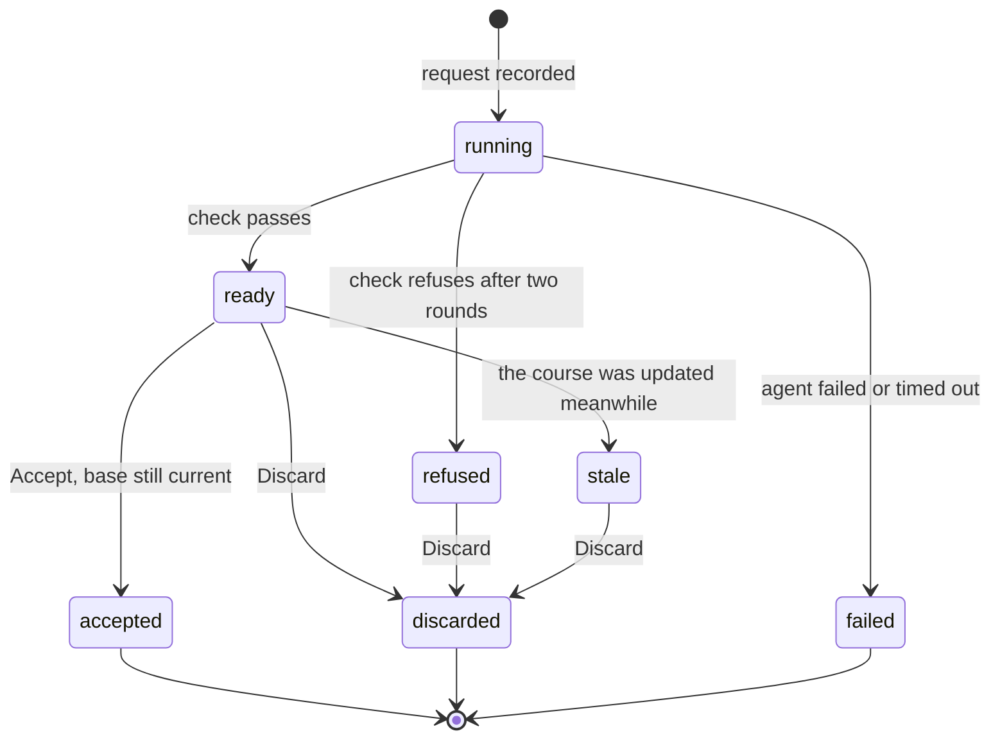

# RFC 9: Authoring a course in the browser

> **How to read this.** **Built** means it exists at commit `2f18da4`, with the file that shows it. **Proposed** means this RFC asks for it. **Open** means it needs the maintainer's decision; §9 lists those. It builds on three RFCs decided on 2026-11-26 whose pull requests are not merged yet: [RFC 7](0007-installing-courses.md) (installing courses, flyingrobots/school#216), [RFC 6](0006-ask-about-a-passage.md) (asking about a passage) and [RFC 4](0004-publishing-courses.md) (publishing, the Library). Their links resolve once those pull requests merge. How School works today is in the [architecture reference](../topics/architecture/README.md); this RFC describes only what would change.

## Executive summary

Writing or revising a School course needs a terminal and an agent session today (flyingrobots/school#189). This RFC recommends an authoring page in School where the author describes a change, an agent on the host runs the `school` skill against a **draft**, a throwaway copy of the course, and School shows the agent's steps, then a checked diff and a preview. The author accepts or discards the draft. An accepted draft becomes a **new install** of the course in RFC 7's course store, written once, exactly as an update from a repository would be. The learner's live course never changes until then.

The design rests on one choice: **the agent never touches the course store.** The server copies the course into the request it sends the bridge; the bridge gives the agent a fresh working folder holding only that copy and the pinned skill; the bridge returns the files the agent wrote; and the server builds a draft commit from them with RFC 7's hostile-input extractor and runs RFC 7's `checkCourse`. The agent has file tools and nothing else: no shell, no web, no MCP, no path outside its folder.

| Open question in flyingrobots/school#189 | Recommendation |
| --- | --- |
| Where the authoring skill lives, and how it is pinned | Where it is now, `.agents/skills/school/` in this repository. Compose mounts it read-only into the server, which sends it with every request and records its SHA-256, so each draft names the exact skill that wrote it. The agent's own installed copy is switched off (`--disable-slash-commands`) (§5.3) |
| How the agent is sandboxed | A fresh folder holding only the draft and the skill; tools limited to `Read`, `Write`, `Edit`, `Glob` and `Grep`, with reads and writes outside the folder denied; no `Bash`, no web tools, no MCP. The only network is the CLI's own connection to its model. The bridge returns only course files; the server checks them again. Confinement is tested against the real CLI before the feature is switched on (§5.2) |
| How drafts are kept apart from the live course | Drafts live in a new `drafts/` folder of the course store, are never in `/api/courses`, never open an encounter, and are previewed through their own read-only routes. Accepting one is an RFC 7 install under the same name; the record is never rewritten (§5.4) |
| Review before publish | Nothing is accepted without a passing check, a diff and the author's explicit **Accept**. Accepting changes only this School. Publishing to the Library stays outside School: the author exports the change as a patch, applies it in the course's repository, and lists it by RFC 4's reviewed pull request (§5.6) |
| The robot label on AI actions | The request button, the agent's steps, the draft's **AI draft** badge, its preview banner and the course's provenance on the Courses card carry the robot icon School already uses (`BotIcon`). **Accept** and **Discard** are the author's own actions and carry none (§5.7) |

_Table 0.1. Each open question in flyingrobots/school#189 and this RFC's answer. Every answer keeps the learner's live course out of the agent's reach._

The first slice is one authoring request from the browser that produces a checked, previewed diff of an installed course, which the author accepts or discards: tasks 1 to 9 in [§6](#6-order-of-work). In short: the agent edits a copy in a sealed folder, School checks and shows the result, and only the author's **Accept** installs it.

## Contents

1. [The problem and who it serves](#1-the-problem-and-who-it-serves)
2. [Constraints](#2-constraints)
3. [What exists today](#3-what-exists-today)
4. [Options](#4-options)
5. [Recommendation](#5-recommendation)
6. [Order of work](#6-order-of-work)
7. [Out of scope](#7-out-of-scope)
8. [Risks](#8-risks)
9. [Open questions](#9-open-questions)
10. [Decision](#10-decision)

## 1. The problem and who it serves

A course is written today by running an agent with the `school` skill in a terminal, in the course's own repository, and then running `./school check`. Someone studying from a phone over the tailnet cannot do that, and a small fix ("this quiz has two right answers") costs a whole session. This section names who would author in the browser and what each needs.

| Who | What they need |
| --- | --- |
| A **course author** revising a course | To describe a change in words, watch it being made, and see exactly what changed before anything goes live |
| A **learner** studying the course | A course that changes only when someone has reviewed the change, and progress that survives it |
| The **maintainer** running School | An agent that cannot reach beyond the course copy it was given, and a record of who asked for what, with which skill and agent |
| A **course author publishing** to the Library | The accepted change back in the course's own repository, so the Library's listing stays the repository at a commit |

_Table 1.1. Who authoring in the browser serves. On a one-learner School the author and the learner are usually the same person, which is why review matters even with no one else involved._

In short: the author wants to change a course without a terminal, and everyone else needs that change kept away from the live course until it is reviewed.

## 2. Constraints

Each option is weighed against these. They come from existing decisions and the maintainer's standing rules, not from this RFC.

| # | Constraint | Source |
| --- | --- | --- |
| C1 | Postgres is the only authoritative store: requests, provenance and decisions are rows, appended through `school.*` functions; nothing that matters lives in browser storage | [ADR 9](../adr/0009-the-learning-record-is-enforced-by-the-database.md); [RFC 3](0003-postgres-functions-and-generated-types.md); RFC 7 C1 and C2 |
| C2 | Course files are content: School reads a course and never writes into one it did not install; installed folders are written once | [ADR 6](../adr/0006-separate-framework-lessons-and-learner-state.md); RFC 7 §5.1 |
| C3 | Models run only on the host through the bridge, under commands written only in the bridge's file; the server never runs a model or sets a command | `server/agents.ts`; the [architecture reference](../topics/architecture/README.md#the-bridge) |
| C4 | School is reachable only over Tailscale or localhost, with no login, and has no write endpoint a public page can trigger | [ADR 4](../adr/0004-docker-on-this-mac-behind-tailscale.md); RFC 4 §3; RFC 7 §8 |
| C5 | Every course School serves passes `checkCourse` (flyingrobots/school#231); an installed course is untrusted until the learner trusts it | RFC 7 §4 and §5.3; flyingrobots/school#210 |
| C6 | An update never rewrites the record: progress follows lesson and block ids | RFC 7 §5.3 |
| C7 | UI only from shadcn registry components, theme-book colours, light and dark; AI actions carry a robot label; multi-step processes show a stepper | `web/components.json`; the maintainer's web style rules |
| C8 | Copy is encouraging or neutral and invites with questions, never commands | [School's voice](../topics/voice/README.md) |

_Table 2.1. Constraints every part of this RFC keeps. C2, C3 and C5 shape the design most: the agent works on the host, the course store belongs to the server, and nothing unchecked is served._

In short: the record decides, the agent stays on the host, and the live course changes only through an install.

## 3. What exists today

The bridge already runs agents on the host with a token and an empty folder, RFC 7 brings a course store, an extractor for hostile trees and a shared check, and RFC 6 brings a streaming bridge route. What is missing is an agent with file tools confined to one folder, a place for drafts, and a page to review them. This section grounds each piece in the code at `2f18da4`, or in the decided RFC that adds it.

| Piece | Built, or decided | What authoring needs from it |
| --- | --- | --- |
| Running an agent | `runAgent` gives each run a fresh `mkdtemp` folder, runs the learner's command with no shell, kills the process group on timeout, caps output at 1 MiB and deletes the folder (`bridge/run.ts`) | The same, with the draft written into the folder first and the agent's files read back before it is deleted |
| The token | Every bridge request must carry `Bearer <token>`, compared in constant time (`authorised`, `bridge/bridge.ts`); the server holds it as a compose secret (`server/compose.yaml`, `bridge_token`) | Unchanged; the browser never sees the bridge |
| One job at a time | `serially` queues every run (`bridge/bridge.ts`) | Authoring takes minutes, so it needs its own queue, as RFC 6 gave asking |
| Commands | Declared only in `bridge.json`; over HTTP agents can only be reordered, switched and tested (`server/agents.ts`, `reorder` in `bridge/bridge.ts`) | A third list, `author`, under the same rule |
| Isolation | "No shell, an empty working folder, the process tree killed on timeout. This is not filesystem confinement" ([the bridge](../topics/architecture/README.md#the-bridge)); the grading command runs with `--tools ""` (`bridge/bridge.example.json`) | Real confinement, because an authoring agent needs file tools |
| Streaming | Decided in RFC 6 §5.3: a bridge route answering NDJSON and the `claude-stream-json` output kind (flyingrobots/school#226) | Reused for the agent's progress |
| The skill | `.agents/skills/school/SKILL.md` with a worked example in `example/`; it tells the agent to run `./school check` (step 9) | Pinned and shipped to the agent; the check is run by School instead |
| The skill in the image | Absent. The image is built from `server/` and `.dockerignore` admits only its own `*.ts`, SQL and schemas (`server/.dockerignore`) | A read-only mount, as `/framework/assets` already is (`server/compose.yaml`) |
| Checking a course | `school check` (`server/check-course.ts`); RFC 7 makes it a function, `checkCourse` (flyingrobots/school#231) | The gate every draft must pass |
| The course store | Decided in RFC 7 §5.1: `SCHOOL_COURSE_STORE` with `staging/` and write-once `courses/<install id>/`, and `git` in the image (flyingrobots/school#233) | A third folder, `drafts/` |
| Extracting a tree safely | Decided in RFC 7 §6: a commit's tree is walked and only `course.json`, `lessons/*.json` and `reference/**` regular files are written (flyingrobots/school#235) | The same walk over the agent's output |
| Installs and updates | Decided in RFC 7 §7 and §5.3: append-only install rows, a registry that refreshes without a restart, and an update preview counting what stops counting (flyingrobots/school#232, #234, #238, #241) | Accepting a draft is one of these updates |
| The write guard | `POST /api/*` must be `application/json` and not `Sec-Fetch-Site: cross-site` (`guardApi`, `server/server.ts`); RFC 7 §8 also requires `same-origin` when the header is present | Kept, with RFC 7's stricter form |
| The robot label | **Get AI feedback** carries `BotIcon` (`web/src/components/explain.tsx`); the read-aloud bar has an **AI voice** badge with it (`web/src/components/read-aloud.tsx`) | The same icon on every AI action here |
| Components | `Card`, `Dialog`, `AlertDialog`, `Tabs`, `Textarea`, `Badge`, `Alert`, `Spinner`, `code-block`, `resizable`, and the `ai-elements` `tool`, `task`, `plan`, `file-tree` and `prompt-input` (`web/src/components/ui/`, `web/src/components/ai-elements/`) | Most of the page; the local registry has no diff view and no stepper yet |

_Table 3.1. What authoring reuses and what it adds. The runner, token, check, store, extractor and installs exist or are decided; confinement, drafts and the review page do not._

In short: authoring is mostly a new route through parts that exist, plus a confined agent and a drafts folder.

## 4. Options

Four questions have real alternatives: where the agent works on the course, where the skill comes from, how the agent is confined, and how a draft becomes live. Each is weighed here against §2; [§5](#5-recommendation) assembles the chosen answers.

### 4.1 Where the agent works on the course

The agent runs on the host (C3) and the course store is a Docker volume (RFC 7 §5.1), so something has to carry the course between them.

| Option | For | Against |
| --- | --- | --- |
| **A. The server sends a copy; the bridge returns the files** (recommended) | The agent sees only its copy; the store stays the server's alone (C2); the server re-checks everything returned with RFC 7's extractor; the bridge needs no access to Docker | A course travels twice over the loopback link, within RFC 7's 64 MiB limit; the bridge must collect files carefully |
| B. Mount the store's drafts folder on the host for the agent | No copying | The host process could write into a volume the server serves from; a symlink or race in one draft can reach another; ties the bridge to compose |
| C. Run the agent inside the server's container | No bridge change | Puts the learner's agent credentials into the container the network reaches, which the bridge exists to prevent (C3) |
| D. The agent returns a patch, not files | Small replies | A second parser for hostile input (unified diffs, renames, binary hunks), and a patch can name any path |

_Table 4.1. Where the agent could work. A copy in and files out keeps the agent away from the store and reuses RFC 7's checks on the way back._

Option A is the only one that keeps both the store and the agent's credentials where they are today.

### 4.2 Where the skill comes from, and how it is pinned

The agent needs the `school` skill and the references it links. The question is which copy, and who can say afterwards which one wrote a draft.

| Option | For | Against |
| --- | --- | --- |
| **A. The server sends the skill from a read-only mount, and records its digest** (recommended) | One School, one skill: the same checkout's skill, references and `checkCourse`; every draft names its skill's SHA-256; no network | One more mount in compose |
| B. The agent's own installed skill (`sync-agents`) | Nothing to build | Unpinned: whatever version the host last synced, possibly from another checkout; the record cannot say which wrote a draft |
| C. The bridge reads the skill from its own checkout | No mount | The bridge and the server can run different checkouts; the skill could disagree with the check that judges its work |
| D. Bake it into the image | Pinned by the build | The build context is `server/` and cannot reach `.agents/` without restructuring the image (`server/.dockerignore`) |

_Table 4.2. Where the skill could come from. Sending it from the server keeps the skill and the checker at the same version._

Option A costs one mount and makes every draft's skill a recorded fact rather than a guess.

### 4.3 How the agent is confined

An authoring agent needs to read and write files, so the grading command's `--tools ""` is not enough. The architecture reference is plain that the bridge alone is not filesystem confinement.

| Option | For | Against |
| --- | --- | --- |
| **A. Layers: a sealed folder, a tool allowlist, deny rules, and a filter on what comes back** (recommended) | Uses what the CLIs already offer (`--tools`, `--disallowedTools`, `--settings`, `--strict-mcp-config`, `--disable-slash-commands` on Claude Code 2.1.323; `--sandbox` on Codex); each layer is testable; a gap in one is caught by the next | The commands are the learner's to write (C3), so the bridge cannot force them; it can only ship a confined example and refuse what comes back |
| B. Also wrap the agent in an operating-system sandbox (`sandbox-exec` on macOS) | Confinement the CLI cannot undo | `sandbox-exec` is deprecated by Apple; a profile that still lets the CLI reach its model and its own credentials is delicate; one more thing to keep working |
| C. Give the agent a shell so it can run `./school check` itself, as the skill says | Matches the skill as written | A shell is code execution on the host from a browser request; the check is School's job and School can run it |
| D. A separate macOS user for the bridge | Strong file isolation | The agent CLIs authenticate as the learner; a second account needs its own logins and keychain |

_Table 4.3. How the agent could be confined. Layered CLI confinement with a server-side filter is enough for files the author reviews before anything goes live; an operating-system sandbox stays open as Q6._

Option A holds only if its CLI layers hold, which is why the order of work tests them against the real CLIs before authoring is switched on.

### 4.4 How a draft becomes live

A draft must not reach the learner's live course unreviewed, and accepting it must not lose progress.

| Option | For | Against |
| --- | --- | --- |
| **A. Accepting a draft is an RFC 7 install under the same name** (recommended) | Write-once folders, one registry, one record; the update preview and trust reset come with it (C2, C6); a draft is never served | Needs a third install source, `authored`, in RFC 7's table |
| B. Edit the current install's folder in place | Simple | Breaks RFC 7's write-once rule and its content digest; a half-applied edit is live |
| C. Write into the course's own git repository | The change lands where the author keeps it | School never writes into a configured course (C2); an installed course has no working tree to write into; would need credentials to push |
| D. Serve the draft as a second course beside the live one | The learner can try it | Two names for one course split progress; a draft would open encounters and write answers |

_Table 4.4. How a draft could become live. An install keeps every rule RFC 7 already decided and reaches the course's repository by an exported patch instead._

Option A adds one install source to RFC 7 and nothing else to how a course goes live.

In short: copy in and files out, a pinned skill from the server, layered confinement, and acceptance as an install.

## 5. Recommendation

The recommendation is option A in each of §4's four questions. This section follows one request from the page to an accepted install, then describes the workspace and its confinement, the skill, drafts, the record, review, the page, and who can ask.

### 5.1 The path of one request

One request is recorded before the bridge is called, its draft is checked before the author sees it, and the live course changes only on **Accept**.

```mermaid
sequenceDiagram
    actor A as Author's browser
    participant S as Server
    participant D as Record
    participant T as Course store
    participant B as Bridge (host)
    participant G as Agent CLI
    A->>S: POST /api/authoring {requestId, course, text}
    S->>D: school.request_authoring (base install, skill digest, agent list)
    S->>T: Copy the current install into the draft's base
    S->>B: POST /author {prompt, files, guide}, with the token
    B->>B: Write files into a fresh folder: course/ and guide/
    B->>G: Run the first enabled author agent, confined
    loop as the agent works
        G-->>B: tool use: Read, Edit, Write a path
        B-->>S: {"type":"step", "tool", "path"}
        S-->>A: {"type":"step", "tool", "path"}
    end
    B->>B: Collect course files from the folder; delete it
    B-->>S: {"type":"files", ...}, then {"type":"end", agent, usage}
    S->>T: Build the draft commit with RFC 7's extractor
    S->>S: checkCourse on the draft
    alt the check refuses
        S->>B: One more round: the draft and the check's message
    end
    S->>D: school.record_draft (commit, digest, check outcome)
    S-->>A: {"type":"draft", draftId}
    A->>S: GET the draft's diff and preview
    A->>S: POST accept for the draft
    S->>T: RFC 7 stages 4 and 5: move to a new install folder
    S->>D: school.install_course (source authored) and school.decide_draft
```

_Figure 5.1. One authoring request, end to end. The agent sees only a copy; the record holds the request before the bridge is called and the decision after the author makes it._

| Piece | Proposed |
| --- | --- |
| `POST /api/authoring` | JSON, guarded as RFC 7 §8 guards installs. Refused (409) while another request is running, or when the course is not a current install. Answers `application/x-ndjson`: `stored`, `step`, `round`, `draft`, or `failed` with a reason in words, each with a schema. The request runs to its end even if the browser goes away |
| `GET /api/authoring/<id>` | The request's state from the record: running, a draft, or failed; a reload reads this, never browser storage |
| The bridge's `POST /author` | `{ prompt, files, guide, deadline_ms }`; answers NDJSON `step` lines naming a tool and a path (never content), one `files` line, and one `end` line with the agent, status and usage. It uses the `author` list in `bridge.json`, in its own queue |
| Repair rounds | When `checkCourse` refuses a draft, the server sends the draft back once with the check's message, as the skill's step 9 loop would. At most two rounds in all; a draft that still fails is kept and shown with its message, and cannot be accepted |
| Timeout | `timeout_seconds: 900` for the `author` list, the most `loadConfig` allows (`bridge/run.ts`). The stream carries a heartbeat line every 30 seconds so neither side's idle timeout ends it |
| Logs | `bridge.author.start`, `bridge.author.attempt`, `bridge.author.end`, with schemas in `bridge/schemas/` and token counts, never a prompt, a request or a file |

_Table 5.1. The routes and bridge changes one request needs. The server owns the stream to the browser; the browser never sees the bridge._

In short: record, copy, run, collect, check, show, and install only on **Accept**.

### 5.2 The workspace and its confinement

The agent works in a folder the bridge makes for one run and deletes after it, holding only the draft and the skill. Four layers keep it there; a gap in one is caught by the next.

```text
<fresh folder from mkdtemp>/
  course/      the draft: the current install's course.json, lessons/, reference/
  guide/       the pinned skill: SKILL.md, example/, the block reference, the voice reference
  .claude/     settings the bridge writes: the deny rules below (read-only to the agent)
```

_Listing 5.1. The agent's working folder. `course/` is the only part whose changes come back; everything else is deleted with the folder._

| Layer | What it does |
| --- | --- |
| 1. A sealed folder | `runAgent`'s fresh folder as today, with the draft written in by the bridge, which refuses any path that is absolute, holds `..`, a NUL, or leaves `course/` or `guide/` |
| 2. A tool allowlist | The shipped `author` command allows `Read`, `Write`, `Edit`, `Glob` and `Grep` only (`--tools`), loads no MCP server (`--strict-mcp-config`), no skill or command of the learner's own (`--disable-slash-commands`) and no user settings (`--setting-sources` naming none), and keeps no session. No `Bash`, `WebFetch`, `WebSearch` or `Task`. Codex has no mode without a shell: its fallback runs with `-C` set to the folder and `--sandbox workspace-write`, which confines its commands' writes to the folder and, by default, their network. If task 4 finds that does not hold, Codex stays off the `author` list |
| 3. Deny rules | A settings file passed with `--settings` denies `Read`, `Write` and `Edit` outside the folder and `Write` or `Edit` inside `guide/` and `.claude/` |
| 4. A filter on what comes back | The bridge walks `course/` with `lstat`, never following a link, and returns only regular files under `course.json`, `lessons/`, `reference/`, `OBJECTIVES.md` and `RESOURCES.md`, within RFC 7's limits (Table 6.2 there). The server then rebuilds the tree as a commit and runs RFC 7's extractor (flyingrobots/school#235) on it, so every refusal RFC 7 tests applies again |

_Table 5.2. The four layers of confinement. Layers 2 and 3 are the learner's command (C3), so task 4 tests them against the real CLIs before authoring is switched on._

Each flag is named as `claude --help` lists it on Claude Code 2.1.323, read on 2026-11-26. That a flag exists is not evidence it confines anything, and whether `--setting-sources` accepts an empty list is unverified; task 4 shows what each one does.

**Network.** The skill itself needs no network: it says that without web access the author marks unsourced claims as unsourced and says so (`.agents/skills/school/SKILL.md`, step 2). The only connection is the CLI's own to its model, which the grading command already makes. Sources the author wants used are pasted into the request; fetching them is a later, server-side task (§7).

**Prompt injection.** A course installed from someone else is untrusted (C5), and its text is in the agent's folder. With no shell, no web and no path outside the folder, the worst a hostile course can make the agent do is write a hostile draft, which the check, the diff, untrusted serving and the author's review all stand in front of.

In short: a folder holding only the draft, file tools only, nothing outside the folder, and nothing back but course files School checks again.

### 5.3 The skill, pinned

The skill stays where it is, `.agents/skills/school/` in this repository, and the server sends the copy from its own checkout with every request, so the skill that writes a draft and the check that judges it are always the same version.

| Part | Proposed |
| --- | --- |
| The mount | Compose mounts `../.agents/skills/school` at `/framework/skills/school` and `../docs/topics/course-format` and `../docs/topics/voice` under `/framework/docs/`, read-only, beside `/framework/assets` (`server/compose.yaml`) |
| The digest | At start the server hashes the mounted files into one manifest digest, as RFC 7 §7 does for an install (`<sha256> <path>` per file, sorted). Without the mount, authoring is switched off and the page says why |
| What the agent gets | The files under `guide/` (Listing 5.1) and a prompt that names `guide/SKILL.md` as its instructions, the author's request inside tags marked as the author's text, and the rule that School runs the check after it finishes |
| The agent's own copy | Switched off by `--disable-slash-commands`, so a `school` skill installed on the host by `sync-agents` cannot be loaded instead |
| A change to the skill | One section, "When School runs you", in `SKILL.md`: files are under `course/`, there is no shell, School runs `school check` and sends back the first problem. Step 9 stays for terminal use |
| The record | Each request stores the skill digest and School's version; each draft commit carries them as trailers (§5.5) |

_Table 5.3. How the skill is shipped and pinned. The record can say which skill wrote every draft, and the skill never disagrees with the check._

In short: one skill in the repository, sent by the server, hashed into the record, and the host's own copy switched off.

### 5.4 Drafts in the course store

Drafts live in a third folder of RFC 7's course store, which the server alone writes. They are never in `/api/courses`, never open an encounter, and never write a learner's record.

```text
<SCHOOL_COURSE_STORE>/
  staging/<preview id>/   RFC 7: one fetch or bundle being checked (scratch)
  courses/<install id>/   RFC 7: one installed version, written once
  drafts/<draft id>/
    repo.git/             a bare repository: the base commit and the draft commit
    course/               the draft as RFC 7's extractor wrote it, for preview
```

_Listing 5.2. The course store with drafts. Only `courses/` is served to learners; `drafts/` is read only by the review routes._



_Figure 5.2. A draft's life. Only a `ready` draft whose base is still the course's current install can be accepted._

| Rule | Proposed |
| --- | --- |
| The base | The course's current install, copied from `courses/<install id>/`. Its files become the base commit, made by School with a fixed author and the install's time, so the same install always gives the same base commit |
| The draft commit | The files the bridge returned, written into `repo.git` as a commit on the base, with the request as its message and trailers naming the request, agent and skill (§5.5). RFC 7's extractor then writes `course/` from it |
| The preview | `GET /api/drafts/<id>/lessons/<lesson>` renders a draft lesson as the lesson page does, read-only: no encounter, no outbox, quizzes shown with their answers. Files under `reference/` are served with RFC 7's untrusted headers (flyingrobots/school#210) whatever the base's trust |
| The diff | `GET /api/drafts/<id>/diff`: `git diff` between the two commits, by file, as JSON; and, from task 10, RFC 7's comparison by lesson and quiz id (flyingrobots/school#241): what is added, changed and removed, and how many recorded answers would stop counting |
| Accept | Refused unless the draft is `ready` and its base is still the current install. The server runs `checkCourse` again (School may have been upgraded since), then RFC 7's stages 4 and 5: the folder moves to `courses/<install id>`, `school.install_course` records it with source `authored`, and the registry refreshes. It is untrusted, and the author is asked whether to keep a trusted base's trust, defaulting to no (RFC 7 §5.3) |
| Discard | Recorded; the folder is deleted. The live course is untouched |
| Sweeping | At start School keeps `drafts/` folders whose draft is undecided and deletes the rest; a draft undecided for 14 days is offered for discard, never deleted silently |
| A configured course | School never writes into it (C2), and RFC 7 refuses a name both configured and installed. Its drafts can be reviewed but not accepted into School; the author takes the change as a patch (task 11) and applies it in the course's repository, and School reads it from there |

_Table 5.4. How drafts are kept apart from the live course. A draft is content in the store, the decision is a row in the record, and the live course moves only by an install._

**The store stays rebuildable.** RFC 7 §5.1 lets the store be rebuilt from the record. An authored install has no URL to fetch again, so its decision row keeps the draft's patch (`git format-patch` of the draft commit, bounded by RFC 7's 64 MiB total). Rebuilding an authored install is rebuilding its parent and applying the patch, then checking the content digest.

In short: drafts sit beside installs, never among them, and an accepted draft is one more write-once install with its patch in the record.

### 5.5 The record

Each request, each draft and each decision is a row in Postgres, appended through a function and never changed, so the record can say who asked for what, which agent and skill answered, and what was accepted. Task 2 builds these as the next migration.

| Table | Columns | Rules |
| --- | --- | --- |
| `school.authoring_requests` | `id` (uuid), `seq`, `course`, `base_install_id`, `text`, `skill_sha256`, `school_version`, `at` | `base_install_id` references `course_installs`; `text` at most 20,000 characters |
| `school.authoring_drafts` | `id`, `seq`, `request_id`, `round`, `status` (`ready`, `refused`, `failed`), `agent`, `commit`, `content_sha256`, `check_message`, `input_tokens`, `output_tokens`, `at` | `round` is 1 or 2; `commit` and `content_sha256` set exactly when a draft was built; `check_message` set exactly when `refused` |
| `school.authoring_decisions` | `id`, `seq`, `draft_id`, `decision` (`accepted`, `discarded`), `install_id`, `patch`, `at` | One per draft; `install_id` and `patch` set exactly when `accepted` |

_Table 5.5. The proposed tables. Each is append-only with the same `refuse_change` triggers as every record table._

| Function | Does |
| --- | --- |
| `school.request_authoring(id, course, base_install_id, text, skill_sha256, school_version, at)` | Appends a request. Answers `stored`, `duplicate`, or `refused` when the base is not the course's current install |
| `school.record_draft(id, request_id, round, status, ...)` | Appends a draft for a request |
| `school.decide_draft(id, draft_id, decision, install_id, patch, at)` | Appends the decision. Refused for a second decision, for accepting a draft that is not `ready`, or when the base is no longer current |
| `school.course_authoring(course)` | The course's requests with their drafts and decisions, in `seq` order |

_Table 5.6. The proposed functions, granted to `school_app` and listed in `GRANTED_FUNCTIONS` (`server/adapters/database.ts`)._

RFC 7's `school.course_installs` gains a third source. Its `source` becomes `git`, `bundle` or `authored`; an `authored` row has neither `url` nor `bundle_sha256`, names the draft commit as `commit`, and gains `parent_install_id` and `draft_id`. Every other rule in RFC 7 §7 holds, and `installed_courses()` reports the source so the Courses card can show it.

The draft commit's trailers repeat the provenance in the content, so an exported patch carries it into the course's repository:

```text
Add a lesson on rounds

Requested in School: "Add a lesson on rounds after the plain hunt lesson."

School-Authoring-Request: 7d2f3c1e-0000-4000-8000-000000000000
School-Agent: claude
School-Skill: sha256:<digest of the skill manifest>
```

_Listing 5.3. A draft commit's message (illustrative). The trailers name the request, agent and skill, so the provenance survives outside School._

In short: three append-only tables and four functions, one new install source, and provenance in both the record and the commit.

### 5.6 Review before publish

"Publish" means two different things here, and the RFC keeps them apart. Accepting a draft makes it live in this School; publishing makes it available to others through the Library, which RFC 4 keeps outside School entirely.

| Gate | Where | What it requires |
| --- | --- | --- |
| The check | Server | `checkCourse` passes on the draft, and again at **Accept** |
| The review | Authoring page | The author has the diff by file, the change by lesson and quiz id with answers that would stop counting, and a preview of every changed lesson |
| The decision | Authoring page | An explicit **Accept** in an `AlertDialog` that states what learners will see; nothing accepts automatically, and no draft is accepted by an agent |
| The live course | Record | An install row, untrusted, with the draft named |
| Publishing | Outside School | The author exports the patch (task 11), applies it with `git am` in the course's repository, and lists the new commit in the Library by RFC 4's reviewed pull request |

_Table 5.7. The gates between a draft and other learners. School never publishes; a published course is always a repository commit a person chose to list._

In short: School reviews before a draft goes live here, and the Library's own review stands between it and anyone else.

### 5.7 The page and the robot label

Authoring is one page per course, reached from the course page and from the Courses card RFC 7 adds to Settings, built from registry components with theme-book colours in light and dark. Two components it needs are missing from the local registry: a diff view and a stepper. Both are built from ui-sdk and shadcn and registered first (task 8), as the web style rules require.

| Part | Built from |
| --- | --- |
| The stepper | **Describe**, **Drafting**, **Checking**, **Review**, **Accepted** or **Discarded**: the new registry stepper |
| The request | `prompt-input` with a `Textarea` and the submit `Button` **Ask the agent to draft this**, with `BotIcon` and its `Kbd` hint |
| The agent's steps | `ai-elements` `task` and `tool` rows: "Read lessons/0002-rounds.json", "Edited lessons/0002-rounds.json"; a `Spinner` while it works |
| The draft | A `Card` with the **AI draft** `Badge` and `BotIcon`, a muted line naming the agent and round, the check's outcome in an `Alert`, and the counts by lesson and quiz |
| The diff | `Tabs` for **Changes** and **Preview**; `file-tree` of changed files beside the new registry diff view; the preview in a `resizable` pane with an `Alert` banner, with `BotIcon`: "This is an AI draft. It isn't in your course yet." |
| The decision | **Accept** and **Discard** `Button`s, each confirmed in an `AlertDialog`. They are the author's actions and carry no robot icon |
| Provenance | On the Courses card, an authored install shows "authored with AI" with `BotIcon` and the short commit |

_Table 5.8. The page's parts and the components each uses. Every part the agent produced carries the robot icon; the author's own decisions do not._

| Moment | Copy (illustrative) |
| --- | --- |
| The request box, empty | "What would you like to change in Bells? A lesson to add, a quiz to make harder?" |
| Drafting | "The agent is drafting. Bells stays as it is until you accept a draft." |
| Refused after two rounds | "This draft doesn't pass School's check yet: lessons/0002-rounds.json > q1: exactly one choice must be correct. Would you like the agent to have another go?" |
| Ready | "Here is the draft: 1 lesson added, 2 quizzes changed. Would you like to look it over?" |
| Accept | "Accept this draft into Bells? It is what you'll see next time you open Bells, and every answer already in your record stays there." |
| Answers that stop counting | "1 quiz is no longer in the course; your 3 answers to it stay in your record. Accept anyway?" |
| Discard | "Discard this draft? Bells stays as it is." |
| Stale | "Bells changed since this draft began. Would you like to ask again from the current version?" |
| No bridge | "Authoring needs the bridge. Would you like to connect it in Settings?" |
| No author agents | "The bridge has no authoring agents yet. They are declared in its `bridge.json`, described in Configuration." |
| A configured course | "Bells is set by its folder, so School can't change it here. Would you like the change as a patch for its repository?" |

_Table 5.9. Illustrative copy for each moment. Every message is neutral or encouraging and asks rather than tells._

Every reply is parsed with Zod before the page reads it, as Settings does (`web/src/lib/settings-api.ts`), and nothing about a request or a draft is kept in browser storage: a reload asks the server.

In short: one page, a stepper, the agent's steps and draft under the robot label, and the author's decision without it.

### 5.8 Who can ask

An authoring request makes the host run an agent with file tools, so it must be reachable only from the author's own School page (C4). The guards RFC 7 §8 decided for installs apply unchanged.

| Guard | Proposed |
| --- | --- |
| Host | Every request's `Host` must be one of School's names (`server/hosts.ts`), which stops a DNS-rebinding page |
| Writes | `POST /api/authoring`, `.../accept` and `.../discard` are `application/json` under `/api/`, refused for `Sec-Fetch-Site: cross-site` (`guardApi`) and, as RFC 7 §8 adds, for anything but `same-origin` when the header is present |
| Reads | The review routes are `GET` and change nothing; a cross-site page cannot read their responses |
| The bridge | Reached only by the server, with the token; the browser never learns its address or token |
| Cost | One request at a time; a second is refused (409) with the running one's id. Token counts are stored on every draft |

_Table 5.10. Who can start an authoring request. The same guards as every write, RFC 7's stricter form, and the bridge's token._

In short: only School's own page can ask, only the server can reach the bridge, and one request runs at a time.

## 6. Order of work

Each row is one task issue with one observable outcome. None is filed by this RFC. Tasks 1 to 9 are the first slice flyingrobots/school#189 asks for: one request from the browser produces a checked, previewed diff of an installed course that the author accepts or discards. Each task updates the living references it changes in the same pull request: the architecture's bridge, trust and configuration sections, [the program output reference](../topics/program-output/README.md), and the course-format and settings-page references, so there is no separate documentation step.

| # | Task | Depends on | Done when |
| --- | --- | --- | --- |
| 1 | **Ship the pinned skill to the server.** The read-only mounts of §5.3, the manifest digest at start, the "When School runs you" section in `SKILL.md`; authoring reports itself switched off without the mount | none | A test finds the mounted skill's digest equal to the checkout's, a School without the mount reports authoring off with the reason, and `server/school-skill.test.ts` still passes |
| 2 | **Record authoring in the database.** The three tables and four functions of §5.5, and RFC 7's `course_installs` with the `authored` source, `parent_install_id` and `draft_id` | flyingrobots/school#232 | The contract suite covers each function on PGlite and Bun.SQL; an update or delete on each table is refused; a second decision, accepting a draft that is not `ready`, and a stale base are refused |
| 3 | **The bridge drafts in a working folder.** `POST /author`, the `author` list in `bridge.json` with its own queue, the workspace of Listing 5.1, layer 1 and layer 4 of Table 5.2, `step` lines from the stream, the three log messages with schemas | flyingrobots/school#226 | Bridge tests with a fake agent: steps reach the caller before it exits; a path outside `course/`, a symlink, an oversized file and a file over the count are refused; the folder is gone afterwards; a grading or an ask is not delayed; no log line holds a prompt or a file; `--schema` lists the new messages |
| 4 | **Prove the shipped author commands are confined.** Layers 2 and 3 of Table 5.2 in `bridge.example.json`, and a test, run against the installed Claude Code and Codex, whose prompt tries to read a file in the home folder, write outside the folder, run a command and fetch a URL | 3 | The recorded run shows each of the four refused by the CLI and nothing outside the folder changed; the test is documented as run before authoring is switched on |
| 5 | **Build and check drafts in the course store.** The `drafts/` layout of Listing 5.2, the deterministic base commit, the draft commit from returned files, RFC 7's extractor and `checkCourse` on it, the diff by file, the sweep rule | flyingrobots/school#231, flyingrobots/school#233, flyingrobots/school#235, 2 | With a fake bridge result: a good draft is built and checked; a hostile file is refused with its reason; `courses/` and the record's installs are unchanged; a restart keeps an undecided draft and sweeps a decided one |
| 6 | **The server runs an authoring request.** `POST /api/authoring` and `GET /api/authoring/<id>`: stored before the bridge is called, the stream proxied, at most two rounds, the draft recorded even if the browser has gone; the read-only preview and diff routes | 2, 3, 5 | HTTP tests with a fake bridge: steps arrive as NDJSON; the request is in the record before the bridge is asked; a refused draft gets one repair round; a disconnected browser still leaves a recorded draft; a second request is a 409; the preview opens no encounter and writes no answer; a cross-site or non-JSON request is refused |
| 7 | **Accept or discard a draft.** Accept re-checks, then installs as RFC 7's stages 4 and 5 with source `authored`, untrusted, its patch in the decision row; discard records and deletes | 5, 6, flyingrobots/school#234, flyingrobots/school#238 | After **Accept** the course is served under the same name from a new install, untrusted, every record row is still there, and its row names the draft; a stale base is refused; after **Discard** `/api/courses` is unchanged |
| 8 | **Add a diff view and a stepper to the registry.** Both built from ui-sdk behaviours and shadcn parts, registered in the local `@flyingrobots` registry, installed with the shadcn CLI | none | Each installs from the registry into `web/`, renders in light and dark, and its keyboard and ARIA tests pass |
| 9 | **Author from the browser.** The page of §5.7: the request, the stepper, the agent's steps, the draft, the diff and preview, **Accept** and **Discard**, with the robot labels | 6, 7, 8 | A browser test makes one request against a fake bridge, sees the steps, the diff and the preview, and accepts it; another discards one; both in light and dark; every string passes the voice test; a reload shows the draft. **The first slice is complete** |
| 10 | **Show what accepting would do to progress.** RFC 7's comparison by lesson and quiz id, with answers that would stop counting, in the review and the **Accept** dialog | 9, flyingrobots/school#241 | A fixture draft that removes one quiz shows the counts that match the record |
| 11 | **Export a draft as a patch.** `git format-patch` of the draft commit, downloadable; for a configured course this is the only way to take a draft | 7 | The patch applies with `git am` to the course's repository at the base commit and yields the draft's tree |
| 12 | **Rebuild authored installs from the record.** When an authored install's folder is missing, rebuild its parent and apply the stored patch, then check the digest | 7, flyingrobots/school#234 | A test deletes an authored install's folder, restarts, and finds it rebuilt with the same digest |
| 13 | **Write a new course from a description.** An empty base; the name chosen at **Accept** as RFC 7 §5.2 chooses an install's | 9, flyingrobots/school#238 | A browser test writes a two-lesson course from a description and installs it under a new name |
| 14 | **Revise a draft.** A follow-up request whose base is the draft, not the install ("make the second quiz harder") | 9 | A second request on a ready draft produces a draft whose diff against the install includes both changes |

_Table 6.1. The build, as task issues. Tasks 1, 3 and 8 can start at once, with task 2 once flyingrobots/school#232 is merged; task 9 completes the first slice; tasks 10 to 14 follow it._

In short: nine tasks reach one request, one checked draft and one decision; five more add the progress preview, export, rebuild, new courses and follow-ups.

## 7. Out of scope

These are left out on purpose, each with its reason, so a build issue does not drift into them.

| Left out | Why |
| --- | --- |
| The agent fetching sources from the web | No network for the agent (§5.2). A later issue could let the server fetch URLs the author names into `guide/`, with RFC 7's fetch limits |
| Pushing to a course's repository | School holds no credentials (RFC 7 §11); the author applies the exported patch |
| Publishing to the Library from School | RFC 4 keeps the Library outside School, and so does this RFC |
| Editing course files by hand in the browser | A different feature; the diff view is read-only |
| Several authors, or authoring accounts | School has no login (C4) |
| A shell for the agent, or running `school check` inside its folder | §4.3, option C |
| Accepting into a configured course | School never writes into a configured mount (C2); export the patch |
| Choosing a model in the app | Commands are written only on the host (C3) |

_Table 7.1. What this RFC does not build, and why. None of it blocks the first slice._

Each of these can be its own issue later; none needs a decision now.

## 8. Risks

The main risk is the one flyingrobots/school#189 names: an agent writing files on the host because of a browser request. Each risk below is paired with its mitigation.

| Risk | Mitigation |
| --- | --- |
| The agent reads or writes outside its folder | Four layers (Table 5.2); task 4 proves layers 2 and 3 against the real CLIs before authoring is on; RFC 7's extractor stands behind layer 4 |
| The learner's command for the `author` list is not confined | The commands are theirs to write (C3). The shipped example is confined and tested, the configuration reference says what each flag does, and layer 4 still refuses anything returned outside course files |
| A bad draft reaches the live course | It must pass `checkCourse` twice, be reviewed, and be accepted by a person; it is installed untrusted; the previous install stays in the store until swept and can be installed again |
| A public page starts a request | The guards of §5.8, RFC 7's stricter form; the bridge is unreachable from the browser |
| A hostile installed course steers the agent | No shell, no web, no paths outside the folder; the result is only a draft the author reviews |
| The skill and the check drift apart | Both come from the same checkout; the record names the skill digest of every draft |
| A CLI's flags or stream format change | Isolated in one output kind and one example command; task 4's test is rerun when a CLI is upgraded |
| Cost grows unnoticed | One request at a time; token counts on every draft; the model is one edit in `bridge.json` |
| Losing the store loses accepted work | The patch is in the record (§5.4), and task 12 rebuilds from it |

_Table 8.1. Risks and their mitigations. Confinement carries the most weight, so it is tested against the real CLIs rather than assumed._

The risk this RFC treats as worst is an unconfined agent, and the design makes confinement a tested precondition rather than a property of the code.

## 9. Open questions

Each question has a recommendation that holds until the maintainer decides otherwise. Q1 to Q5 are flyingrobots/school#189's own.

| # | Question | Recommendation |
| --- | --- | --- |
| Q1 | Where does the authoring skill live, and how is it pinned? | In this repository, mounted read-only into the server, sent with each request, its digest recorded (§5.3) |
| Q2 | How is the agent sandboxed? | Four layers: a sealed folder, file tools only, deny rules outside the folder, and a filter on what comes back; tested against the real CLIs (§5.2) |
| Q3 | How are drafts kept apart from the live course? | A `drafts/` folder in the course store, never served to learners; accepting is an RFC 7 install under the same name (§5.4) |
| Q4 | What is review before publish? | A passing check, a diff and preview, and an explicit **Accept**; publishing stays the Library's reviewed pull request (§5.6) |
| Q5 | What does the robot label look like here? | `BotIcon` on the request button, the agent's steps, the **AI draft** badge, the preview banner and an authored course's provenance; none on **Accept** or **Discard** (§5.7) |
| Q6 | Should the agent also run inside an operating-system sandbox? | Not at first. Revisit if task 4 finds a CLI layer that does not hold, or before courses from strangers are authored routinely |
| Q7 | Which model drafts? | Claude Opus 5.5 first, because a course change is rare and quality matters most, with Codex as the fallback; measure from the stored token counts before changing it |
| Q8 | How many repair rounds? | Two in all. More rounds cost more than asking again with a clearer request |
| Q9 | Do lessons from an accepted AI draft carry an AI label for the learner? | The course carries it, on the Courses card and the course page, from the record; individual blocks do not, because a person reviewed and accepted them |
| Q10 | May a configured course be authored? | Yes, to a draft and a patch, never accepted into School (§5.4) |
| Q11 | Does a draft keep `OBJECTIVES.md` and `RESOURCES.md`? | Yes, in the draft commit and its patch, since the skill writes them; School does not serve them, as RFC 7 installs only what School reads |

_Table 9.1. Open questions and recommendations. Q2 and Q3 are the two that most protect the learner; the rest can stand as recommended._

In short: the maintainer decides the confinement, the draft model and the model choice; each has a recommendation that holds until someone objects.

## 10. Decision

Decided on 2026-11-26 by an agent under the maintainer's delegated authority for that run. The decision record, with each option's pros, cons and why it was rejected, was delivered to Reader's inbox (receipt `1bd9dda3-fe7d-436e-8210-e9a584fe9cf9`). The maintainer may overturn any part.

Every recommendation is accepted as written.

| Task | Issue |
| --- | --- |
| 1 | flyingrobots/school#257 |
| 2 | flyingrobots/school#258 |
| 3 | flyingrobots/school#259 |
| 4 | flyingrobots/school#260 |
| 5 | flyingrobots/school#261 |
| 6 | flyingrobots/school#262 |
| 7 | flyingrobots/school#263 |
| 8 | flyingrobots/school#264 |
| 9 | flyingrobots/school#265 |
| 10 | flyingrobots/school#266 |
| 11 | flyingrobots/school#267 |
| 12 | flyingrobots/school#268 |
| 13 | flyingrobots/school#269 |
| 14 | flyingrobots/school#270 |

In short: this RFC is decided as written, and its tasks are filed.
