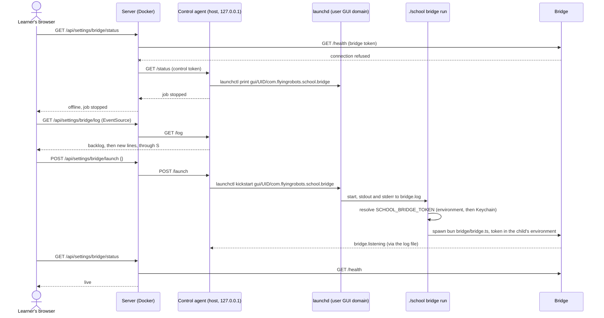
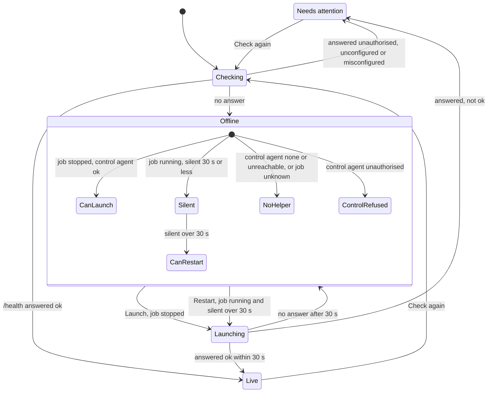

# RFC 10: Bridge controls in Settings

> **How to read this.** **Built** means it exists at commit `502304a`, with the file that shows it. **Proposed** means this RFC asks for it. **Open** means it still needs checking or a decision; §10 lists those. Every design choice here was decided by the maintainer on 2026-11-27; what remains Open is what could not be verified from this machine, chiefly the commands of two agents installed only on the Mac that will host School and Linux support. It builds on [RFC 6](0006-ask-about-a-passage.md) (the Ask bar and the ask list) and [RFC 9](0009-authoring-in-the-browser.md) (the author list, flyingrobots/school#259). How School works today is in the [architecture reference](../topics/architecture/README.md); this RFC describes only what would change.

## Executive summary

Settings today can reorder and test the grading agents and save the bridge's address and token, but it cannot tell whether the bridge is running, start it, show why it stopped, choose the voice School reads in, or touch the ask and author lists. This RFC gives Settings those controls without ever letting the server, which usually runs in Docker and is reachable over the tailnet, start a process on the host. A second, tiny host process, the **control agent**, kept alive by launchd, is the only thing that can start the bridge, and it answers only School's server, with its own token. The bridge's voice controls go through the bridge's existing AI-TTS socket client and change only School's own voice. On a phone, the read-aloud bar gives the bottom of the screen back to RFC 6's Ask bar and becomes a chip in the top bar that opens a drawer.

| Decision (2026-11-27) | What this RFC builds |
| --- | --- |
| 1. The bridge shows **Live**, **Needs attention** or **Offline**; when Offline, **Launch** (or **Restart** for a bridge that has stopped answering) and a read-only output panel | A status badge in the bridge card, **Launch** or **Restart**, and a shadcn `ScrollArea` streaming the bridge's log in monospace; bijou-web replaces the panel once it is published (§5.5, task 12) |
| 2. Launching uses macOS LaunchAgents, never the server | Two user LaunchAgents, `com.flyingrobots.school.bridge` (`./school bridge run`) and `com.flyingrobots.school.bridge-control`; `./school bridge install`, which generates any missing secret first, and `uninstall`; the server proxies `/api/settings/bridge/*` behind its existing guards; Linux is Open (§5.1 to §5.4) |
| 3. AI-TTS controls: School's voice and the installed version | The bridge's `GET /speech/info` and `PUT /speech/voice` over `assign_voice` with source `School`; the server's `GET` and `PUT /api/settings/speech`; a **Reading aloud** card (§5.6) |
| 4. Every agent list is reorderable | The agents card covers grading, ask and author, each with its own order and switches; absorbs flyingrobots/school#328 (§5.7) |
| 5. Every list defaults to claude, codex, agy, lms-qwen | `bridge.example.json` declares all four in every list; a new `openai` agent kind reaches LM Studio's local server for lms-qwen; Settings shows each agent's kind and, for HTTP agents, whether the endpoint answers (§5.8) |
| 6. Phone playback controls, option C | A "Reading 2/5" chip in the top bar that opens a shadcn `Drawer` with the controls; desktop keeps today's bar (§5.9) |

_Table 0.1. Each decision and what this RFC builds for it. Every row keeps the server unable to run anything on the host and keeps the record as the only store._

The build is twelve independently mergeable tasks in [§7](#7-order-of-work). In short: launchd starts the bridge, a token-guarded helper on 127.0.0.1 reports, launches and, only when it has stopped answering, restarts it for the server, and Settings shows the state, the output, the voice and every agent list.

## Contents

1. [The problem and who it serves](#1-the-problem-and-who-it-serves)
2. [Constraints](#2-constraints)
3. [What exists today](#3-what-exists-today)
4. [Options](#4-options)
5. [Design](#5-design)
6. [Threat model](#6-threat-model)
7. [Order of work](#7-order-of-work)
8. [Out of scope](#8-out-of-scope)
9. [Risks](#9-risks)
10. [Open questions](#10-open-questions)
11. [Decision](#11-decision)

## 1. The problem and who it serves

When the bridge is not running, grading, asking and reading aloud stop, and the only sign in School is a status line saying it could not be reached. Starting it means opening a terminal on the Mac, which a learner on a phone over the tailnet cannot do. This section names who meets each gap.

| Who | What they need |
| --- | --- |
| A **learner on a phone** | To see that the bridge is down, start it, and keep studying, without a terminal; playback controls that leave the bottom of the screen to the Ask bar |
| A **learner choosing a voice** | To pick the voice School reads in, without changing the voice every other agent on the Mac uses |
| The **maintainer** running School | To see why the bridge stopped (its own output), to order every agent list from one page, and to be sure no browser request can make the server run a command |

_Table 1.1. Who the bridge controls serve. The same person is usually all three, studying on a phone with the Mac across the room._

In short: the learner needs to start and steer the bridge from the browser, and the maintainer needs that to give no one a way to run a command on the host.

## 2. Constraints

Each part of the design is held to these. They come from existing decisions and the maintainer's standing rules, not from this RFC.

| # | Constraint | Source |
| --- | --- | --- |
| C1 | Postgres is the only store that counts: nothing that matters lives in browser storage | [ADR 9](../adr/0009-the-learning-record-is-enforced-by-the-database.md); [RFC 3](0003-postgres-functions-and-generated-types.md) |
| C2 | The server never runs a model, sets a command, or starts a host process; it usually runs in Docker | `server/agents.ts`; `server/compose.yaml`; decision 2 |
| C3 | Agent commands are declared only in `bridge.json` on the host; over HTTP agents are only reordered, switched and tested | `reorderList` in `bridge/bridge.ts` (flyingrobots/school#18) |
| C4 | Secrets live in the macOS Keychain and reach containers only as compose secret files; never in a plist, argv, `.env` or a log | [School's secrets](../topics/secrets/README.md) |
| C5 | School is reachable only over Tailscale or localhost, with no login; state-changing requests are JSON and never cross-site | [ADR 4](../adr/0004-docker-on-this-mac-behind-tailscale.md); `guardApi` and `hostAllowed` in `server/server.ts` |
| C6 | Logs never contain a prompt or an answer, which are the learner's private work | `bridge/bridge.ts` header |
| C7 | UI only from the shadcn registry with theme-book tokens, light and dark; AI actions carry the robot label | `web/components.json`; the maintainer's web style rules |
| C8 | Copy is encouraging or neutral and invites with questions, never "wrong", "attempt" or "forgot" | [School's voice](../topics/voice/README.md) |
| C9 | Every program's output is JSON Lines with a published schema per message, `--help`, `--schema` and `--human` | [The programs' output](../topics/program-output/README.md) |

_Table 2.1. Constraints every part of this RFC keeps. C2 and C4 shape it most: the server can only ask, and no secret is written where launchd or a log can show it._

In short: the server asks and the host decides, secrets stay in the Keychain, and the page stores nothing.

## 3. What exists today

The bridge, its token, the AI-TTS client and the Settings agents card all exist; nothing on the host can start the bridge without a terminal, and nothing reports the AI-TTS daemon's version or voice to the page. This section grounds each piece in the code at `502304a`.

| Piece | Built | What this RFC needs from it |
| --- | --- | --- |
| The bridge | `bun bridge/bridge.ts` on 127.0.0.1:4748, every route behind `Bearer <token>` compared in constant time (`authorised`); JSON Lines on stdout scrubbed of the token (`bridge/bridge.ts`) | Started by launchd, its stdout and stderr in a log file |
| The bridge's token | `SCHOOL_BRIDGE_TOKEN` from the environment, else the Keychain item `./school up` stored (`resolveSecret`, `host/secrets.ts`); the server reads it from `/run/secrets/bridge_token` (`server/compose.yaml`) | Unchanged; `./school bridge run` resolves it and passes it in the child's environment only |
| The `./school` command | `up`, `down`, `compose`, `import`, `check`, with every effect a dependency for tests (`host/launcher.ts`, `host/school.ts`) | A `bridge` command with `run`, `control`, `install` and `uninstall` |
| Host secrets | Three in `SECRETS`, the bridge token generated when missing (`host/secrets.ts`); `./school up` generates and stores each missing `generate` secret before it starts anything (`host/launcher.ts`) | A fourth, `SCHOOL_BRIDGE_CONTROL_TOKEN`, generated the same way, by `./school bridge install` as well as `up` |
| Bridge status in Settings | `GET /api/settings/status` maps `/health` to `none`, `unreachable`, `unauthorised`, `unconfigured`, `misconfigured` or `ok` (`bridgeStatus`, `server/settings.ts`; [Settings page](../topics/settings-page/README.md#connection-and-agents)) | Folded into **Live**, **Needs attention** or **Offline** |
| Agent lists | The bridge's `/health` and `PUT /config` cover the grading list (`agents`) and the ask list (`ask.agents`) (`reorder`, flyingrobots/school#287); the server's `POST /api/settings/agents` and the page handle grading only (`agentOrder`, `server/agents.ts`; `web/src/pages/settings.tsx`) | All three lists through the server and the page |
| The author list | Decided in RFC 9 §5.1, built by flyingrobots/school#259 (open); not in `bridge/run.ts` at `502304a` | Reorderable like the others once it exists |
| Agent kinds | Every agent is a command; its `output` is `text`, `claude-json` or `claude-stream-json` (`OUTPUTS`, `bridge/run.ts`). The prompt goes in argv only where a command names `{prompt}`, otherwise on stdin (`usesPlaceholder`); a long argv can fail with `E2BIG` (`spawnFailure`) | An HTTP kind beside the command kind, for a local OpenAI-compatible server |
| The example configuration | claude and codex in the grading and ask lists (`bridge/bridge.example.json`) | Four agents in every list, in the maintainer's order |
| The AI-TTS client | One JSON line each way on the daemon's Unix socket; `status` checked for 0.2.0 or later before each submission; submissions use `source: "School"` (`bridge/speech.ts`) | Three more ops: `voices`, `voice_assignments`, `assign_voice` |
| The AI-TTS daemon | Ops `status`, `voices`, `engines`, `voice_assignments` and `assign_voice {source, voice, release}`; `assign_voice` refuses a voice not in the engine's list, and releasing a source with no voice is `not_found` (AI-TTS's `src/aitts/daemon.py` and `voice_registry.py`). `status` reports `version` from 0.2.0, which is on AI-TTS's `feat/synthesis-only-submit` branch (commit `7ac7935`) and not on its `main` (`c081d50`, 0.1.0) as checked on 2026-11-27 | Read-only use, except `assign_voice` for source `School` |
| The read-aloud bar | A `Card` fixed to the bottom with the **AI voice** badge, previous, pause or resume, next and stop; keys `R`, `,`, `/`, `.`, `Esc` (`web/src/components/read-aloud.tsx`) | Unchanged on desktop; on a phone, a chip and a drawer instead |
| The Ask bar on a phone | Decided in RFC 6 Table 5.8: fixed to the bottom, "above the read-aloud bar when that is showing" | Alone at the bottom: this RFC amends that row |
| Components | `Card`, `Badge`, `Button`, `Combobox`, `Drawer`, `ScrollArea`, `Progress`, `Item`, `Kbd`, `Alert`, `Spinner`, `Collapsible` in `web/src/components/ui/`; the `@flyingrobots/sortable-list` block | All of the UI here; nothing new in the registry |

_Table 3.1. What the bridge controls reuse and what they add. The bridge, its token, the socket client and the sortable list exist; launchd jobs, the control agent, the voice routes and the HTTP agent kind do not._

In short: most pieces exist, and what is missing is a host-side way to start the bridge, three socket ops, an HTTP agent kind, and the page that shows them.

## 4. Options

Four questions had real alternatives. The maintainer chose each answer on 2026-11-27; the tables keep the reasons.

### 4.1 How the bridge is started

Something on the host must start the bridge, and the server must never be that thing (C2).

| Option | For | Against |
| --- | --- | --- |
| **A. User LaunchAgents and a control agent** (chosen) | launchd starts and logs the job; the control agent can only run three fixed `launchctl` commands; the server only sends HTTP | Two plists and a fourth secret |
| B. The server spawns the bridge | Nothing new on the host | Impossible from Docker, and from a host-run server it is code execution reachable from the tailnet (C2) |
| C. The bridge itself as a KeepAlive LaunchAgent, no control agent | One plist | No **Launch** when it crashes in a loop or was stopped on purpose; no output for the page |
| D. A Docker socket or SSH from the container | Uses existing tools | Hands the container far more power than "start one job" |

_Table 4.1. How the bridge could be started. A control agent that can do three fixed things is the smallest power that gives Settings a Launch button and a Restart for a hung bridge._

Option A keeps the power to start a process on the host, where launchd already owns it.

### 4.2 How the bridge's output reaches the page

The learner needs to see why the bridge did not start, read-only.

| Option | For | Against |
| --- | --- | --- |
| **A. launchd writes a log file; the control agent streams it as Server-Sent Events** (chosen) | The log exists even when nothing is watching; one fixed file; bounded backlog | The file grows (Open, Q4) |
| B. The bridge streams its own output | No file | Says nothing when the bridge cannot start, which is when the panel matters |
| C. Store the output in the record | Survives everything | Logs are not learning; they would fill the record with host paths |

_Table 4.2. How the output could reach the page. A file written by launchd is there even when the bridge never starts._

Option A shows the output exactly when the bridge has failed, which is the reason for the panel.

### 4.3 Where School's voice is set

The AI-TTS daemon has one default voice for every agent and per-source assignments.

| Option | For | Against |
| --- | --- | --- |
| **A. `assign_voice` with source `School`** (chosen) | Changes only School's voice; the daemon checks the name; release returns School to the default | Needs the daemon's voice register |
| B. Change the daemon's default voice | One setting | Changes every agent's voice on the Mac |
| C. Send a voice with every submission | No state in the daemon | Every reading would need the page's choice, which would then need a store; the daemon already has one |

_Table 4.3. Where the voice could be set. A source assignment is the daemon's own per-client setting, so School stores nothing._

Option A keeps the choice in the daemon, so School holds no voice setting of its own (C1).

### 4.4 Phone playback controls

On a phone, RFC 6's Ask bar and the read-aloud bar would both want the bottom of the screen. Three layouts were prototyped.

| Option | For | Against |
| --- | --- | --- |
| A. Today's bottom bar, with the Ask bar stacked above it | No new component | Two fixed bars take a fifth of a small screen; small targets |
| B. A floating radial control | Compact | Hides labels; hard to reach one-handed; unusual on the web |
| **C. A "Reading 2/5" chip in the top bar and a `Drawer`** (chosen) | The bottom stays the Ask bar's; large targets in the drawer; the chip shows progress at a glance | One more tap to pause |

_Table 4.4. Phone playback layouts from the prototype. Option C trades one tap for a free bottom edge and large controls._

Option C leaves the bottom of the screen to asking, which RFC 6 made the phone's main action.

In short: launchd and a minimal helper start the bridge, its log file feeds the page, the daemon keeps School's voice, and a chip and drawer carry playback on a phone.

## 5. Design

This section follows one **Launch** from the page to a running bridge, then describes the two LaunchAgents, the control agent's routes, the server's proxy, the bridge card, the voice, the agent lists, the four default agents and the phone controls. Everything here is Proposed.

### 5.1 The path of one Launch

The server asks the control agent, which asks launchd, which starts `./school bridge run`, which reads the token and starts the bridge. The page watches the log and the status until the bridge answers.

_Figure 5.1. One Launch, end to end. The server sends only HTTP; launchd starts the process; the token travels from the Keychain to the bridge's environment and nowhere else._

In short: the page asks, the server relays, the control agent runs one fixed `launchctl` command, and the bridge reads its own token.

### 5.2 The two LaunchAgents

`./school bridge install` first makes sure both tokens exist, then writes two plists into `~/Library/LaunchAgents/` and loads each with `launchctl bootstrap gui/<uid> <plist>`; `./school bridge uninstall` runs `launchctl bootout gui/<uid>/<label>` and removes them. Neither plist holds a secret.

| Key | `com.flyingrobots.school.bridge` | `com.flyingrobots.school.bridge-control` |
| --- | --- | --- |
| `ProgramArguments` | The absolute path of `bun`, `<checkout>/host/school.ts`, `bridge`, `run` | The same, ending `bridge`, `control` |
| `WorkingDirectory` | The checkout | The checkout |
| `RunAtLoad` | `false`: it starts on **Launch** or `launchctl kickstart` (Q3) | `true` |
| `KeepAlive` | `false`: a bridge that stops stays stopped, so its output can be read | `true` |
| `StandardOutPath`, `StandardErrorPath` | `~/Library/Logs/School/bridge.log` | `~/Library/Logs/School/bridge-control.log` |
| `EnvironmentVariables` | `PATH` as the installing shell had it, so the bridge finds `claude`, `codex` and `agy`; `SCHOOL_KEYCHAIN_ACCOUNT` and `SCHOOL_BRIDGE_PORT` when set. No token | The same, so the control agent probes the port the bridge listens on. No token |
| `ProcessType` | `Interactive` | `Background` |

_Table 5.1. The two plists. Only paths and labels are written; both tokens are read from the Keychain by the processes the plists start._

`./school bridge run` resolves `SCHOOL_BRIDGE_TOKEN` with `resolveSecret` (`host/secrets.ts`), spawns `bun bridge/bridge.ts` with the token in that child's environment only, passes on `SIGTERM` and `SIGINT`, and exits with the child's code. `./school bridge control` resolves `SCHOOL_BRIDGE_CONTROL_TOKEN` the same way and starts the control agent. Both print the launcher's JSON Lines with schemas (`school.launcher.*`, C9) before handing over.

`install` works in a fixed order. It first resolves `SCHOOL_BRIDGE_TOKEN` and `SCHOOL_BRIDGE_CONTROL_TOKEN` as `./school up` resolves its secrets: the environment, then the Keychain, and when one is in neither, it generates one with `generateSecret` and stores it in the Keychain, reporting `generated` as `up` does (`host/launcher.ts`). It never asks for `SCHOOL_POSTGRES_PASSWORD`, which only `up` needs. Only then does it bootstrap the bridge's plist and, last, the control agent's. The order matters because the control agent's plist has `KeepAlive` true: started before its token exists, it would exit at once and launchd would restart it in a loop. A token that `install` generates reaches the server at its next `./school up`, which passes it as a compose secret; until then Settings shows no working helper and no **Launch**.

`install` refuses (exit 2) when run as root, when the checkout path or `bun` path holds characters a plist cannot carry unescaped, or when `bootstrap` fails, naming the label and `launchctl`'s exit code. `install` and `uninstall` are idempotent: a loaded job is booted out before it is replaced.

In short: two plists with paths only, loaded only once both tokens exist, one job that runs when asked and one that always runs.

### 5.3 The control agent

The control agent is a Bun process of about a hundred and fifty lines (`host/bridge-control.ts`) listening on 127.0.0.1:4749 (`SCHOOL_BRIDGE_CONTROL_PORT`). It has four routes and runs exactly three commands, each with a fixed argv: `launchctl print`, `launchctl kickstart` and, for a hung bridge only, `launchctl kickstart -k`.

| Route | Does | Answers |
| --- | --- | --- |
| `GET /status` | `launchctl print gui/<uid>/com.flyingrobots.school.bridge`, parsing the `state = ` and `pid = ` lines in the format task 1's recorded run pins | `{ job: "running" \| "stopped" \| "not installed" \| "unknown", pid: number \| null, silent_seconds: number \| null }`; exit 113 (no such service) is `not installed`; `silent_seconds` is how long the bridge has not answered its probe while the job runs (below) |
| `POST /launch` | When the job is `stopped`, `launchctl kickstart gui/<uid>/com.flyingrobots.school.bridge` (without `-k`, so a running bridge is never killed) | `{ status: "started" \| "running" \| "busy" \| "not installed" \| "unknown" }` |
| `POST /restart` | Only when the job is `running` and `silent_seconds` is over 30, `launchctl kickstart -k gui/<uid>/com.flyingrobots.school.bridge`, which kills the hung process and starts it again | `{ status: "restarted" \| "answering" \| "stopped" \| "busy" \| "not installed" \| "unknown" }`; `answering` means the probe heard the bridge within the last 30 seconds, so nothing ran |
| `GET /log` | `~/Library/Logs/School/bridge.log` as `text/event-stream`: the last 200 lines or 64 KiB, whichever is less, then each new line as it is written; a heartbeat comment every 15 seconds; a file that shrinks is read again from its start | One `data:` event per line, each at most 8 KiB, scrubbed of both tokens; at most four streams at once |

_Table 5.2. The control agent's routes. No route takes a parameter that reaches a command, a path or a label, and `-k` runs only for a job that is running and has been silent for over 30 seconds._

`POST /launch` and `POST /restart` share one lock: one at a time, and at most one of either per 10 seconds, so a second request is `busy`.

**The probe.** While the job is running, the control agent sends `GET /health` to the bridge at `127.0.0.1` on `SCHOOL_BRIDGE_PORT` (4748 by default) every 5 seconds, with a 2-second timeout and no token. Any HTTP answer, a 401 included, counts as answering, because it shows the bridge's event loop is serving requests; only a refused connection or a timeout counts as silent. `silent_seconds` is the time since the last answer, or since the job started when it has not answered yet, and `null` while the job is not running. The control agent therefore never holds the bridge's token, and the 30-second rule rests on its own probe, never on what the server says. A bridge busy grading still answers `/health`, because each agent is a child process the bridge awaits without blocking (`Bun.spawn` in `bridge/run.ts`), so `-k` cannot cut a grading that is making progress.

**Parsing `launchctl print`.** Apple's manual says the output of `launchctl print` "is NOT API in any sense at all" (`man launchctl`, read on macOS on 2026-11-27). So the parser accepts only the format task 1's recorded run pins as a fixture: exactly one `state = <word>` line at the service's top level, `running` or one of the stopped states the fixture lists, and, when running, one `pid = <digits>` line. Anything else, an unknown state word, a missing or repeated line, or a non-zero exit other than 113, is `job: "unknown"`, logged with the macOS version and never guessed at. With `unknown`, `/launch` and `/restart` run nothing and answer `unknown`, and Settings offers neither button.

Every request must carry `Authorization: Bearer <SCHOOL_BRIDGE_CONTROL_TOKEN>`, compared in constant time as the bridge compares its own. A request whose `Host` is not `127.0.0.1:4749`, `localhost:4749` or `host.docker.internal:4749`, or that carries an `Origin` or any `Sec-Fetch-*` header, is refused (403) before the token is checked: School's server sends none of those, and every browser does. Its own output is JSON Lines with schemas (`school.bridge-control.*`), and it never logs a line of the bridge's log. `uid` is `process.getuid()`; the label is a constant.

In short: a token-guarded helper that can report one job, start it, restart it only when it has stopped answering, and read one file, and that does nothing when it cannot read the job's state.

### 5.4 The server's proxy

The server gains one secret, one address and four routes. Compose mounts `bridge_control_token` from `SCHOOL_BRIDGE_CONTROL_TOKEN` at `/run/secrets/bridge_control_token`, read through `SCHOOL_BRIDGE_CONTROL_TOKEN_FILE`; `SCHOOL_BRIDGE_CONTROL_URL` (for example `http://host.docker.internal:4749`) comes only from the environment, and the token is sent only to it, as the bridge token is sent only to an environment `SCHOOL_BRIDGE_URL`.

| Route | Guard | Does |
| --- | --- | --- |
| `GET /api/settings/bridge/status` | `hostAllowed` | `{ bridge: "live" \| "needs attention" \| "offline", connection, job, silent_seconds, control: "ok" \| "none" \| "unreachable" \| "unauthorised" }`, where `connection` is `bridgeStatus`'s value. **Live** means `/health` answered `ok`. **Needs attention** means the bridge answered but is `unauthorised`, `unconfigured` or `misconfigured`, each with its own detail line (§5.5). **Offline** means `none` or `unreachable`. `job` and `silent_seconds` are the control agent's, or `null` |
| `POST /api/settings/bridge/launch` | `hostAllowed`, `guardApi` (JSON body, not cross-site), and `Sec-Fetch-Site: same-origin` when the header is present (RFC 7 §8) | Relays to `POST /launch`; `503` with a neutral reason when there is no control agent |
| `POST /api/settings/bridge/restart` | The same as `launch` | Relays to `POST /restart`, whose own probe decides; the server adds no condition and cannot widen one |
| `GET /api/settings/bridge/log` | `hostAllowed`, and when fetch metadata is present, `Sec-Fetch-Site: same-origin` and `Sec-Fetch-Dest: empty`, as `guardLessonOpen` does | Relays the event stream unchanged; the browser opens it with `EventSource` |

_Table 5.3. The server's bridge-control routes. The server holds the control token and relays; it runs nothing, and a bridge that answers but cannot work shows as **Needs attention**, never as **Live**._

The existing `GET /api/settings/status` and `POST /api/settings/agents` stay as they are. In short: four relayed routes, each behind the guards School already uses.

### 5.5 The bridge card

The bridge card gains a status line, **Launch** or **Restart**, and an output panel. It has three states: **Live** when `/health` answers `ok`; **Needs attention** when the bridge answers but refuses the token, has no agents, or cannot read its file; and **Offline** when it does not answer. The page polls `GET /api/settings/bridge/status` every 2 seconds while a launch or restart is in progress, for at most 30 seconds, every 5 seconds while the job is running but silent, and otherwise when the learner chooses **Check again**.

_Figure 5.2. The bridge card's states. **Live** means the bridge can work; **Launch** and **Restart** appear only when the control agent can act on them, and **Restart** only for a job that is running but has not answered for over 30 seconds._

| State | The card shows |
| --- | --- |
| **Live** | A `Badge` "Live" and today's connection details; a `Collapsible` **Bridge output** holding the panel, closed |
| **Needs attention**, token refused | A `Badge` "Needs attention" and "The bridge and School have different tokens. Would you like to run `./school up` on the Mac, so School picks up the token in the Keychain?" Under launchd the bridge reads its token from the Keychain, so a mismatch means the server's compose secret is out of date, which the card cannot fix. The `Collapsible` **Bridge output**, open. No **Launch**, because the bridge is already running |
| **Needs attention**, no agents or file unreadable | A `Badge` "Needs attention" and today's detail line for that connection (`connectionText` in `web/src/pages/settings.tsx`); the `Collapsible` **Bridge output**, open. No **Launch** |
| **Offline**, job stopped, control agent ok | A `Badge` "Offline", "The bridge isn't running right now. Would you like to launch it?", **Launch**, and the panel open |
| **Offline**, job running, silent 30 s or less | A `Badge` "Offline", "The bridge is running and hasn't answered yet. School will check again in a moment." No button; the panel open |
| **Offline**, job running, silent over 30 s | A `Badge` "Offline", "The bridge is running but hasn't answered for a while. Would you like to restart it? Anything it is working on stops, and you can ask again after.", **Restart** in place of **Launch**, and the panel open |
| **Launching** | **Launch** or **Restart** disabled with a `Spinner`, "Starting the bridge…", the panel following new lines |
| **Offline**, no control agent | "School can start the bridge for you once its helper is installed. Would you like to run `./school bridge install` on the Mac?" No **Launch**; no panel |
| **Offline**, control agent `unauthorised` | "School's helper on the Mac didn't accept School's token. Would you like to run `./school up` on the Mac, so School picks up the helper's new token?" No **Launch**; no panel. This is the state right after `./school bridge install` makes the control token and before the next `up`, and it is also what a process squatting on port 4749 produces |
| **Offline**, job `unknown` | "School can't read the bridge's state on this Mac right now, so it won't start or restart it. Would you like to check it from a terminal on the Mac?" No button; the panel open |
| **Offline** after 30 s | "The bridge hasn't answered yet. Its output below may say why." The panel stays open |

_Table 5.4. What the bridge card shows in each state. Every line is neutral and invites rather than instructs (C8)._

The panel is a shadcn `ScrollArea` holding a `<pre>` in the theme's monospace font, read-only, scrolled to the newest line unless the learner has scrolled up. Each JSON line is shown as it was written; nothing is parsed, coloured by meaning or stored. Closing the page closes the `EventSource`. Task 12 replaces the panel with `@flyingrobots/bijou-web`'s DOM host once that package is published; today it is a private workspace package tested only with in-memory fakes (bijou's `packages/bijou-web/package.json`).

In short: a badge that says **Live** only when the bridge can work, a button that appears only when it can work, and a plain read-only view of the log.

### 5.6 School's voice

The bridge gains two routes over its existing socket client, and the server relays them.

| Route | Does |
| --- | --- |
| Bridge `GET /speech/info` | `status`, then `voices` and `voice_assignments`. Answers `{ version, engine, voices: string[], voice: string \| null, default: string \| null }`: `voice` is the assignment whose `source` is `School`, `default` is `status.voice`. A daemon older than 0.2.0 answers `{ status: "outdated", version }`; no socket, `{ status: "unavailable" }` (503) |
| Bridge `PUT /speech/voice` | `{ voice: string }` or `{ voice: null }`. A name is accepted only if it is in the daemon's current `voices` list, then `assign_voice { source: "School", voice }`; `null` is `assign_voice { source: "School", release: true }`, and the daemon's `not_found` (nothing to release) counts as done. Answers the new `/speech/info` |
| Server `GET /api/settings/speech` | Relays `/speech/info` with the bridge token |
| Server `PUT /api/settings/speech` | `guardApi`; a voice of 1 to 200 characters with no control character, or `null`; relays `PUT /speech/voice` |

_Table 5.5. The voice routes. Source `School` is a constant in the bridge, so no request can change another client's voice or the daemon's default._

The **Reading aloud** card shows "AI-TTS <version>", the engine, and a `Combobox` of the daemon's voices whose first item is **Default** ("Default: <default>"). Choosing a voice saves it at once; the next reading uses it, and one already playing is not changed. When AI-TTS cannot be reached the card says "Reading aloud isn't available right now. Is AI-TTS running on the Mac?"; when it is older, "Choosing a voice needs AI-TTS 0.2.0 or newer, and this Mac has <version>. Would you like to update it?" The **AI voice** badge with `BotIcon` labels the card, as it labels the read-aloud bar.

In short: School's voice is the daemon's own assignment for source `School`, and the card only shows and sets it.

### 5.7 Every agent list in Settings

The agents card shows three sections, **Grading**, **Asking** and **Authoring**, each the existing sortable list with its switches, **Test** and keys. A list the bridge does not declare shows "No <list> agents are declared in <file>" and no list. `POST /api/settings/agents` accepts `{ agents }`, `{ ask: { agents } }`, `{ author: { agents } }` or any mix, passes each to the bridge's `PUT /config`, and the bridge's `reorder` gains the `author` key under the same rule as `ask`: names and `enabled` only (C3). Saving one list never rewrites another, which the bridge already guarantees by leaving out lists the body omits. **Test** names the list as well as the agent. This absorbs flyingrobots/school#328.

An agent whose program is not found keeps today's "Not found" badge, and once the bridge runs under launchd its line also says why that can happen: "Its program was not found on the bridge's computer. The bridge looks on the PATH saved when its helper was installed, so a program installed or moved since then won't show up yet. Would you like to run `./school bridge install` again on the Mac?" The bridge's `found` check reads `Bun.which` against its own `PATH` (`bridge/bridge.ts`), and under launchd that is the `PATH` the plist captured at install (Table 5.1), so running `install` again is what brings a new program into view.

In short: three sections built from the one list component, each saved on its own.

### 5.8 Four agents by default

Every list in `bridge/bridge.example.json` declares, in this order, `claude`, `codex`, `agy` and `lms-qwen`. `claude` and `codex` keep today's commands. The other two are installed only on the host Mac, so their exact invocation is declared here and verified there (Q5, Q6).

| Agent | Kind | Declared as | Verified |
| --- | --- | --- | --- |
| `claude` | command | As in `bridge.example.json` today: `claude-json` for grading, `claude-stream-json` for asking | Yes, in the existing bridge tests and runs |
| `codex` | command | As today: `codex exec ... -o {output_file}`, output `text` | Yes |
| `agy` | command | `agy --mode plan --effort high --print`, the prompt on stdin (the bridge's default when no `{prompt}` is named, which also avoids `E2BIG` and keeps the prompt out of `ps`); `agy --mode plan --effort high --print {prompt}` only if agy will not read stdin. Output `text`, the answer parsed and checked against the schema like codex's | Open (Q5) |
| `lms-qwen` | `openai` | `{ "name": "lms-qwen", "kind": "openai", "url": "http://127.0.0.1:1234/v1", "model": "<id from /v1/models>" }`. `lms-qwen` is how the maintainer starts LM Studio's model, not how the bridge calls it | Open (Q6) |

_Table 5.6. The default agents, in the order every list tries them. Two of the four are declarations to be checked on the machine that has them._

The `openai` kind (`bridge/openai.ts`) is a second way to run an agent, beside the command. It is held to every rule a command agent is held to, plus loopback.

| Rule | For the `openai` kind |
| --- | --- |
| Where it may connect | `url` must be `http://127.0.0.1`, `http://[::1]` or `http://localhost` with a port; `localhost` is connected as 127.0.0.1. Anything else is a configuration error (exit 2 at start, `misconfigured` after). Redirects are not followed |
| Who sets it | Only `bridge.json`, like a command (C3); `PUT /config` cannot change `kind`, `url` or `model` |
| Grading (`/run`) | `POST <url>/chat/completions` with the prompt as one user message and `response_format: { type: "json_schema", json_schema: { name: "answer", schema, strict: true } }`; `"structured": false` in the agent's entry sends no `response_format`. The reply's `choices[0].message.content` is checked against the schema either way, as every answer is |
| Asking (`/ask`) | The same with `stream: true`; each `choices[0].delta.content` is a `delta` line, `[DONE]` ends it; a stream that restarts after its first delta fails, as `claude-stream-json` does |
| Timeout, size and fallback | The list's `timeout_seconds` as an abort signal; at most 1 MiB of reply (8 MiB for a stream); a timeout, a non-2xx status, a refused connection or an answer that fails the schema hands over to the next agent |
| Logs | The attempt's error is `HTTP <status>`, `timeout` or `connection refused`; never a response body, which can echo the prompt (C6) |
| Usage | `usage.prompt_tokens` and `completion_tokens` reported as `input_tokens` and `output_tokens` |
| Health | `/health` reports `{ kind: "openai", answers }` for it, where `answers` is whether `GET <url>/models` answered within 2 seconds and listed `model`; a command agent reports `{ kind: "command", found }` as today |

_Table 5.7. The rules of the `openai` agent kind. It is a command agent's rules with the program replaced by a loopback HTTP endpoint._

Settings shows each agent's kind ("Command" or "Local HTTP") and, in place of "program found", "Endpoint answers" or "Endpoint not answering" for an HTTP agent.

In short: four agents in every list, two of them declarations to check on the host Mac, and one new agent kind that only talks to loopback.

### 5.9 Phone playback controls

Below 768 px (`useIsMobile`, `web/src/hooks/use-mobile.ts`), while School reads aloud, the fixed bottom bar is not shown. A chip in the app shell's top bar (`<header>` in `web/src/components/app-shell.tsx`) takes its place, and RFC 6's Ask bar keeps the bottom of the screen alone. Desktop keeps today's bar.

| Part | What it is |
| --- | --- |
| The chip | A `Button` (variant `secondary`, size `sm`) reading "Reading 2/5", with three level bars animated in theme tokens while playing, a pause icon while paused, a `Spinner` while a part is being prepared; `aria-expanded` and `aria-controls` naming the drawer; its accessible name "Reading part 2 of 5. Show playback controls" |
| The drawer | A shadcn `Drawer` from the bottom: the lesson title, "Reading part 2 of 5", one `Progress`-style segment per part (five in this example) with the current one marked in text as well as colour, the **AI voice** badge with `BotIcon` |
| The controls | Previous part, Pause or Resume, Next part, each at least 56 px square, Pause or Resume 72 px; **Stop reading** below them, full width |
| Reduced motion | Under `prefers-reduced-motion: reduce` the bars are still, at three fixed heights |
| Keys | Unchanged: `R`, `,`, `/`, `.`; `Esc` closes an open drawer first, and stops reading when it is closed |
| A refusal | The chip reads "Can't read now"; the drawer holds the reason and **Close**, as the bar does today |

_Table 5.8. The phone's playback controls. The chip shows where reading is; the drawer gives large targets; nothing is stored._

This amends RFC 6 Table 5.8: on a phone the Ask bar is never stacked above a read-aloud bar, because there is none. In short: on a phone, reading aloud moves to the top bar and a drawer, and the bottom belongs to asking.

## 6. Threat model

The new attack surface is a process on the host that can start the bridge, a log the browser can read, an HTTP agent, and one daemon setting the browser can change. This section names each asset, who could reach it, and what stops them.

| Concern | Threat | Mitigation |
| --- | --- | --- |
| The control token | Someone with it could start the bridge or read its log | Generated (32 letters and digits, `generateSecret`), stored in the Keychain as `SCHOOL_BRIDGE_CONTROL_TOKEN`, given to the server only as a compose secret file (mode 0400, uid 1000) and to the control agent only in its environment; never in a plist, argv, `.env`, a response or a log line, all of which are scrubbed of it; compared in constant time. It is a separate secret from the bridge token, so a leak of either does not grant the other's routes |
| The 127.0.0.1 binding | Another machine on the tailnet or LAN reaches the control agent | It listens on 127.0.0.1 only, like the bridge; Docker Desktop reaches it through `host.docker.internal`, verified for the bridge in RFC 1 on 2026-11-22. Other processes of any user on the Mac can connect, which is why every route needs the token |
| DNS rebinding | A web page in the learner's browser rebinds its name to 127.0.0.1 and calls the control agent or the bridge directly | The page lacks the token; the control agent refuses any `Host` but its three names and any request with `Origin` or `Sec-Fetch-*`, and sends no CORS headers; School itself refuses unknown `Host` headers (`hostAllowed`) |
| CSRF through the server's proxy | Another site, or a course page, makes the learner's browser call `/api/settings/bridge/launch`, `/restart`, `/log` or `/api/settings/speech` with the server's tokens behind them | Writes need `application/json` (a preflight the server never answers) and are refused cross-site, and `same-origin` is required when `Sec-Fetch-Site` is sent; the log stream needs `same-origin` and `empty` destination when metadata is sent, so an untrusted course page (opaque origin, `cross-site`) cannot read it. A forged **Launch** could at worst start the bridge the learner installed, and a forged **Restart** could at worst restart a bridge that has already been silent for over 30 seconds by the control agent's own probe; both are rate-limited |
| The log's contents | The panel shows the learner's private work, or a secret | The bridge never logs a prompt or an answer (C6) and scrubs its token; the control agent scrubs both tokens again and caps each line. The log does hold host paths (the checkout, `~/.config/school/bridge.json`, the home folder and so the macOS user name), agent names and programs, and an `error` field can carry a parser's message, which may quote a fragment of an agent's malformed reply. So the log is as private as the record: shown only to School's own pages over the tailnet (C5), never stored by the page |
| `launchctl`'s scope | The control agent is used to run, stop or load something else, or to kill a working bridge | It runs only `launchctl print`, `launchctl kickstart` and `launchctl kickstart -k` against the constant label in `gui/<its own uid>`, the user's own GUI domain; no argv part comes from a request. `-k` runs only when `print` reports the job running and the control agent's own token-less probe has heard nothing for over 30 seconds, so neither the server nor a forged request can make it kill a bridge that answers. A `print` output it cannot parse is `unknown`, and then it runs nothing (§5.3). It runs as the user, never with `sudo`, so it cannot reach the system domain or another user's jobs. Installing and removing jobs (`bootstrap`, `bootout`) happens only in `./school bridge install` and `uninstall` at a terminal |
| The voice route | A request changes another client's voice or the Mac's default voice | `source` is the constant `School` in the bridge; the name must be in the daemon's own list, which the daemon checks again; release affects only `School` |
| The `openai` agent | The bridge is made to send prompts off the machine, or to an internal service | `url` is loopback only, set only in `bridge.json`, with no redirects; a response body is never logged. Any process of the same user listening on that port receives the prompts, as any program on `PATH` named `agy` would; that is the trust the bridge already places in the host |

_Table 6.1. Threats to the bridge controls and their mitigations. The design gives the browser no new power beyond starting one job the learner installed, restarting it when it has stopped answering, and reading one file._

In short: two separate tokens, loopback only, Host and fetch-metadata checks on both hops, and a helper that can do three fixed things in the learner's own launchd domain, the third only for a bridge that has stopped answering.

## 7. Order of work

Each row is one task issue with one observable outcome, independently mergeable. They are filed as flyingrobots/school#372 to flyingrobots/school#383 (§11). Each task updates the living references it changes in the same pull request: the [Settings page](../topics/settings-page/README.md), [Reading aloud](../topics/reading-aloud/README.md), [School's secrets](../topics/secrets/README.md), [the programs' output](../topics/program-output/README.md) and the architecture's bridge and configuration sections.

| # | Task | Depends on | Done when |
| --- | --- | --- | --- |
| 1 | **Run the bridge as a LaunchAgent.** `./school bridge run`, `install` and `uninstall` for `com.flyingrobots.school.bridge` (Table 5.1), with schemas (§5.2) | none | Launcher tests with a fake `launchctl` and fake Keychain: the plist holds no token, the child gets it in its environment only, `install` twice is one job; with no bridge token in the Keychain, `install` generates and stores one before `bootstrap` runs; a recorded run on macOS shows `launchctl print` running after `kickstart` and the log at `~/Library/Logs/School/bridge.log`, and commits that run's `launchctl print` output for a running, a stopped and a never-run job, with the macOS version, as the fixture §5.3's parser accepts |
| 2 | **The control agent.** `host/bridge-control.ts` with its probe, `./school bridge control`, the fourth secret, its plist added to `install` and `uninstall` (§5.2, §5.3) | 1 | Tests with a fake `launchctl` and a fake bridge: each route's answers; `/restart` runs `kickstart -k` only for a running job silent over 30 seconds, and answers `answering` without running anything for a bridge that answered, even with a 401, within 30 seconds; any `print` output unlike task 1's fixture is `unknown`, and then `/launch` and `/restart` run nothing; with no control token in the Keychain, `install` generates and stores it before it bootstraps the control plist; a wrong token, a foreign `Host`, an `Origin` or a `Sec-Fetch-Site` is 403; no argv part comes from a request; the backlog is bounded; a truncated log restarts; both tokens are scrubbed |
| 3 | **The server relays bridge control.** The compose secret, `SCHOOL_BRIDGE_CONTROL_URL`, and the four routes of Table 5.3 | 2 | HTTP tests with a fake control agent: Live, Needs attention and Offline as defined, with `unauthorised`, `unconfigured` and `misconfigured` each Needs attention; a cross-site or non-JSON launch or restart is refused; a cross-site log read is refused; the token is sent only to an environment URL and never appears in a response |
| 4 | **Live, Needs attention, Offline, Launch and Restart in Settings.** The bridge card of §5.5 with the `ScrollArea` panel, and the not-found line of §5.7 | 3 | A browser test, light and dark: Offline shows **Launch** and the panel; Launch reaches Live against a fake control agent that starts a real bridge; a refused token shows Needs attention with the `./school up` line of Table 5.4 and no **Launch**; a control agent that refuses School's token shows its `./school up` line, not the install line; a running job silent over 30 seconds shows **Restart** in place of **Launch**, and one silent for less shows neither; a job `unknown` shows neither; no helper shows the install line; an agent whose program is not found suggests running `./school bridge install` again; every string passes the voice test; nothing in browser storage |
| 5 | **The bridge reports and sets School's voice.** `GET /speech/info` and `PUT /speech/voice` (Table 5.5) | none | Bridge tests with a fake daemon socket: an unknown voice is refused without `assign_voice` being sent; `null` releases, and `not_found` counts as done; source is always `School`; an older daemon is `outdated` |
| 6 | **The server relays the voice.** `GET` and `PUT /api/settings/speech` | 5 | HTTP tests with a fake bridge: guarded like other writes; a bad name is 400 before the bridge is asked |
| 7 | **The Reading aloud card.** Version, engine, the voice `Combobox` with **Default**, the neutral lines (§5.6) | 6 | A browser test, light and dark: choosing a voice sends it and shows it after a reload; **Default** releases it; unreachable and older states show their lines |
| 8 | **The `openai` agent kind.** `bridge/openai.ts` under the rules of Table 5.7, for `/run`, `/test` and `/ask`, and `kind` in `/health` | none | Bridge tests against a fake loopback server: a schema answer passes; `structured: false` sends no `response_format`; a stream yields deltas; a non-loopback URL is refused at start; a timeout and a 500 fall through to the next agent; no log line holds a prompt or a body |
| 9 | **Four agents in every list.** `bridge.example.json` with claude, codex, agy and lms-qwen in grading, ask and author (Table 5.6), and the configuration reference | 8, flyingrobots/school#259 | `loadConfig` accepts the example; a recorded run on the host Mac shows agy and lms-qwen grading and answering, or records which of Q5 and Q6 failed and the fix |
| 10 | **Every agent list in Settings.** Grading, asking and authoring sections, the `author` key in `reorder`, kinds and "Endpoint answers" (§5.7, §5.8) | 8, flyingrobots/school#259 | A browser test, light and dark, reorders and switches an ask agent and an author agent and the bridge's `/health` shows it; saving one list leaves the others as written; an HTTP agent shows its kind and whether it answers. Absorbs flyingrobots/school#328 |
| 11 | **Phone playback chip and drawer.** §5.9 | none | A browser test at 390 px: the chip shows "Reading 2/5" and no bottom bar; tapping opens the drawer with `aria-expanded` true; targets measure at least 56 px and 72 px; reduced motion stills the bars; the keys still act; at 1280 px today's bar is unchanged |
| 12 | **The output panel in bijou-web.** Replace the `ScrollArea` panel with `@flyingrobots/bijou-web`'s DOM host. Waits on bijou-web being published | none in School | The panel renders the same stream through bijou-web in light and dark, read-only, with the same browser test passing |

_Table 7.1. The build, as task issues. Tasks 1, 5, 8 and 11 can start at once; 9 and 10 also wait for RFC 9's author list (flyingrobots/school#259); 12 waits for bijou-web to be published._

In short: three tracks start at once (launching, the voice, the HTTP agent), the phone controls stand alone, and the bijou-web panel waits outside School.

## 8. Out of scope

These are left out on purpose, so a build issue does not drift into them.

| Left out | Why |
| --- | --- |
| Linux (systemd user units) and Windows | Decided out for now; Open (Q1) |
| Stopping the bridge from Settings, or restarting one that answers | Not asked for; a `-k` kickstart could kill a grading mid-run, so **Restart** is offered only for a bridge silent for over 30 seconds (§5.3) |
| Editing `bridge.json` or an agent's command, URL or model from Settings | C3 |
| Choosing the AI-TTS engine, speed or default voice | Those belong to every client of the daemon, not to School |
| Showing the control agent's own log | Its lines say only what it did; `~/Library/Logs/School/bridge-control.log` is there for the maintainer |
| An API key for the `openai` kind | LM Studio's local server needs none; a key would be a fifth secret for a loopback call |

_Table 8.1. What this RFC does not build, and why. None of it blocks a task._

Each can be its own issue later.

## 9. Risks

The worst risk would be a browser request that runs something on the host; the design leaves it only "start the one job the learner installed". The others are operational.

| Risk | Mitigation |
| --- | --- |
| launchd's minimal `PATH` hides the agents' programs | `install` writes the installing shell's `PATH` into both plists; Settings already shows "program found" per agent |
| The plist's `PATH` goes stale when a program is installed or moved after `install` | Settings' not-found line suggests running `./school bridge install` again (§5.7), which writes the current `PATH` |
| A macOS update changes `launchctl print`'s output, which Apple says is not an API | The parser accepts only task 1's pinned fixture and reports anything else as `unknown`, so Settings then offers no **Launch** or **Restart** rather than acting on a guess; a new fixture is one recorded run |
| The Keychain asks for permission when a launchd job first reads it | The read goes through `security`, the same tool `./school up` uses; task 1's recorded run checks no prompt appears in a fresh login session |
| The log file grows without bound | Open (Q4), with a recommendation |
| AI-TTS 0.2.0 is not on AI-TTS's `main` yet | The card says so neutrally; task 5 tests against a fake socket; reading aloud already requires 0.2.0 |
| agy or LM Studio behave differently than declared | Q5 and Q6; task 9's recorded run on the host Mac; fallback moves on to the next agent meanwhile |
| A local process squats on port 1234 or 4749 | Port 4749: the server's token check fails and Settings shows the control agent `unauthorised` state of §5.5. Port 1234: Table 6.1, the same trust as `PATH` |
| bijou-web is never published | The `ScrollArea` panel is complete on its own; task 12 is a replacement, not a dependency |

_Table 9.1. Risks and their mitigations. Most are about the host environment under launchd, which task 1's recorded run checks._

The risks left are ones a recorded run on the real Mac settles, which is why tasks 1 and 9 end in one.

## 10. Open questions

These are the questions a maintainer decision or a run on the host Mac still has to settle. Each has a recommendation that holds until then.

| # | Question | Recommendation |
| --- | --- | --- |
| Q1 | Linux: systemd user units in place of LaunchAgents? | Out of scope now. The control agent's three commands map to `systemctl --user status`, `start` and `restart`, so a later RFC can add an adapter |
| Q2 | Should the bridge plist set `KeepAlive` on crash? | No: a crash loop would hide its own output; **Launch** restarts it |
| Q3 | Should the bridge start at login (`RunAtLoad`)? | No at first, so a fresh login never runs agents unasked; one key to change later |
| Q4 | How is `bridge.log` kept small? | `./school bridge run` truncates it in place when over 10 MiB before starting the bridge; this relies on launchd opening the file for appending, which task 1 must verify |
| Q5 | agy: does `--print` read the prompt from stdin, and is its output plain text that matches the response schema, or JSON of its own? | Prompt on stdin, output `text`; if agy prints a JSON envelope, add an `agy-json` output kind as `claude-json` was added. Verify on the host Mac |
| Q6 | lms-qwen: the model id, whether LM Studio's server honours `response_format` with `json_schema` for that model, and whether it streams | Read the id from `/v1/models` on the host Mac; keep `structured` on if the schema is honoured, else `false` and rely on the schema check |

_Table 10.1. Open questions and recommendations. Q5 and Q6 are facts about one machine; Q1 to Q4 are choices that can change without redesign._

In short: Linux waits, the bridge job stays manual, and two agents are checked where they are installed.

## 11. Decision

Decided by the maintainer on 2026-11-27: the six decisions of Table 0.1, as §5 describes them. The tasks of §7 are filed as flyingrobots/school#372 to flyingrobots/school#383, task 1 as #372 through task 12 as #383, in order. flyingrobots/school#328 is absorbed by task 10 (flyingrobots/school#381).

In short: the design is decided, and its open points are facts to check on the host Mac and Linux, which waits.
