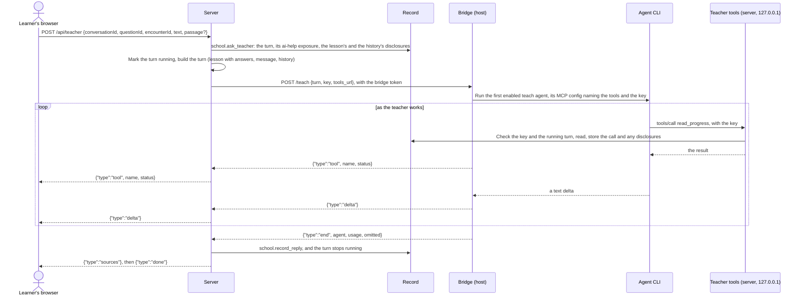
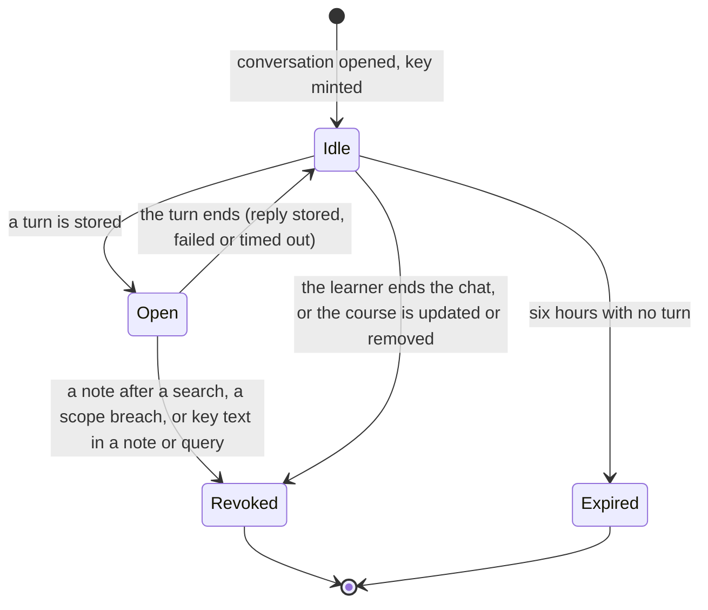
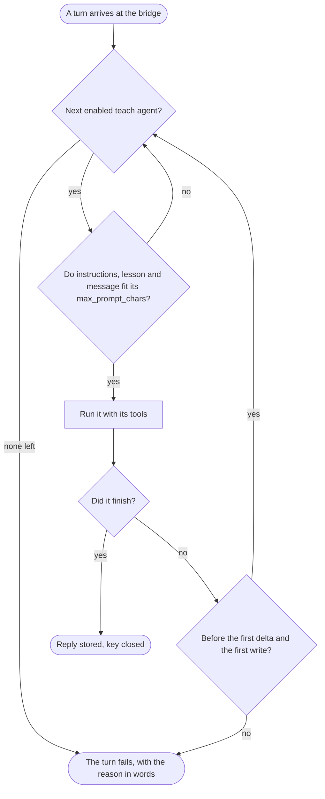
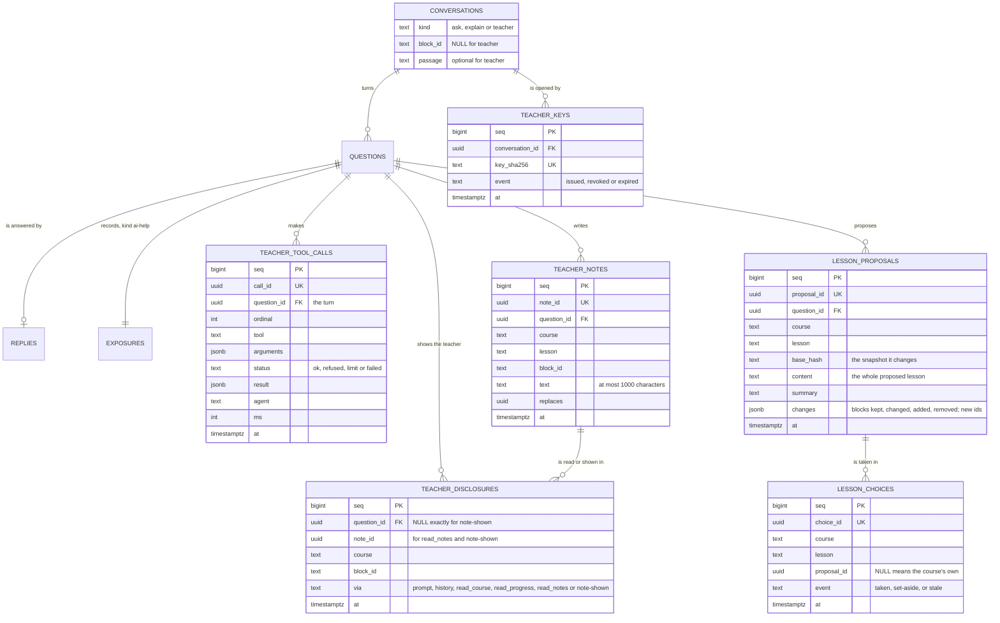
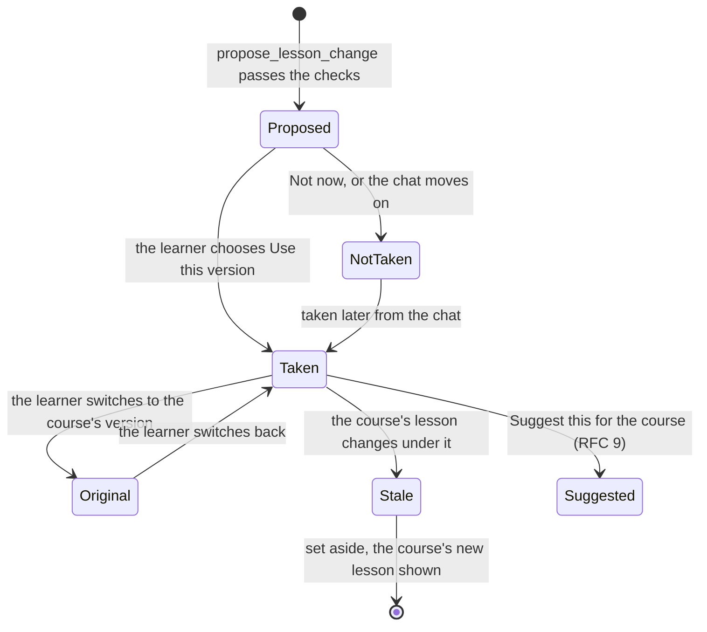

# RFC 11: Asking the teacher, who can change the lesson

> **How to read this.** **Built** means it exists at commit `502304a`, with the file that shows it. **Proposed** means this RFC asks for it. **Open** means it still needs the maintainer's decision or a run on the Mac that hosts School; §10 lists those. The maintainer decided the five points in Table 0.1 on 2026-11-27; everything else here is this RFC's proposal. It builds on [RFC 6](0006-ask-about-a-passage.md) (asking, the `ai-help` exposure, the conversation tables), [RFC 2](0002-lessons-written-for-each-learner.md) (lessons for one learner, untrusted generated content), [RFC 5](0005-mastery-that-fades.md) (mastery), [RFC 8](0008-explain-mode.md) (explain mode), [RFC 9](0009-authoring-in-the-browser.md) (drafts, `checkCourse`, **Accept**) and [RFC 10](0010-bridge-controls-in-settings.md) (the agent hierarchy, the `openai` agent kind, the phone reading chip). RFC 10's link resolves once flyingrobots/school#371 merges, and RFC 6's server route is flyingrobots/school#363, open at the time of writing. How School works today is in the [architecture reference](../topics/architecture/README.md); this RFC describes only what would change.

## Executive summary

RFC 6 lets a learner ask about a selected passage, and the agent that answers sees only that lesson with its answers withheld. The maintainer wants more: a **teacher** the learner can talk to from any lesson, who knows the whole course and the learner's record, keeps notes about how the learner is doing, and can rewrite the lesson in front of them. This RFC designs that teacher. The learner opens a chat about the lesson. Each turn sends the agent the lesson, the message and the whole chat so far. The agent fetches everything else it needs through School's tools, reached with a key scoped to that one conversation. School checks every change the teacher proposes, and a change goes live only when the learner takes it, as their own version of the lesson.

| Decision (2026-11-27) | What this RFC builds |
| --- | --- |
| 1. Ask the teacher from any lesson, about the whole lesson; every turn carries the full chat, tool calls included | A teacher conversation kind beside RFC 6's, with the passage optional; each turn is a question and a reply in RFC 6's tables, its tool calls in a new append-only table (§5.1, §5.6) |
| 2. Context is everything: the course, the learner's quizzes and answers with correct answers and `why`, the teacher's notes | The teacher can give answers away, and this RFC says so to the learner. RFC 6's encounter-wide `ai-help` exposure covers each turn; a new **disclosure** rule makes the next try of any quiz whose answer reached the teacher, its chat history or a note the learner was shown count as aided, wherever it is answered (§5.7) |
| 3. Fetched by key, not packed into the prompt | Six tools on a School endpoint bound to the host's loopback: read the course, read progress, read and write notes, search the web, propose a change. MCP for claude, codex and agy; the bridge runs the tool loop for the `openai` kind (lms-qwen). The key goes in the transport, never in the prompt text. The server checks it, scopes it to one conversation, accepts it only while a turn runs, and logs every call (§5.3 to §5.5) |
| 4. Teacher notes, append-only, per course, written by tool, read on the next lesson, visible to the learner | A `teacher_notes` table; notes checked against School's voice, and refused when they hold a quiz's answer, before they are stored; shown in the panel's **Notes** tab and on the course page under an AI label, each showing recorded as a disclosure (§5.8) |
| 5. The teacher can change the current lesson | A proposal School checks with `checkCourse`, with quiz-id rules that keep progress lined up; the learner sees what would change and takes it or not; a taken change becomes the learner's own version, kept in the record and snapshotted like any lesson shown; the course's original is one tap away; folding a version back into the course is RFC 9's **Accept** (§5.9) |

_Table 0.1. The maintainer's decisions and what this RFC builds for each. Rows 2 and 5 change what the record means, so they get the most space._

The first slice is tasks 1 to 8 in [§7](#7-order-of-work): a teacher chat on the lesson page, answered by Claude Code with the read tools and notes, every turn and tool call in the record, and the aid it costs recorded. Lesson changes, web search and the other agent kinds follow. In short: the learner talks to a teacher who can look anything up and suggest a better lesson, and the record says honestly how much help that was.

## Contents

1. [The problem and who it serves](#1-the-problem-and-who-it-serves)
2. [Constraints](#2-constraints)
3. [What exists today](#3-what-exists-today)
4. [Options](#4-options)
5. [Design](#5-design)
6. [Threat model](#6-threat-model)
7. [Order of work](#7-order-of-work)
8. [Out of scope](#8-out-of-scope)
9. [Risks](#9-risks)
10. [Open questions](#10-open-questions)
11. [Decision](#11-decision)

## 1. The problem and who it serves

RFC 6's agent can explain a sentence. It cannot say "you found ring three hard last week, so here is a worked example", because it never sees the record. It also cannot replace a quiz the learner keeps missing with an easier one, because it has no way to change anything. A human tutor does both, and the maintainer wants School's agent to work that way. This section names who the teacher serves and what each of them needs.

| Who | What they need |
| --- | --- |
| A **learner** in a lesson | To talk about the lesson as a whole, about anything in the course or about their own progress, without first selecting text |
| A **learner** who is stuck | A teacher who remembers what they found hard, and a lesson that can change to meet them, with the original always one tap away |
| A **learner** reading their record | Review that stays honest after the teacher has shown them answers, and notes about them that they can read |
| The **maintainer** running School | Tools that can read only this learner's record for this course, a log of every call, and nothing that leaves the Mac except search queries the learner can see |
| A **course author** | The course unchanged by a teacher's rewrite, and a way to take a good rewrite back into the course through review |

_Table 1.1. Who the teacher serves. On a School with one learner these are often the same person; the record still has to be honest for each of them._

In short: the learner wants a teacher who knows them and can change the lesson, and everyone else needs that teacher bounded, logged and honest in the record.

## 2. Constraints

Each part of the design is held to these constraints. They come from earlier decisions and the maintainer's standing rules, not from this RFC.

| # | Constraint | Source |
| --- | --- | --- |
| C1 | The record never overstates mastery. Help shown before a first try makes it aided, and "before" is decided by `seq` | RFC 6 §5.1; `submission_aid` (`server/db/migrations/0012_ai_help.sql`) |
| C2 | Postgres is the only store. Every write is a `school.*` function; rows are append-only; nothing that matters lives in browser storage | [RFC 3](0003-postgres-functions-and-generated-types.md); [ADR 9](../adr/0009-the-learning-record-is-enforced-by-the-database.md) |
| C3 | Models run only on the host through the bridge, under commands written only in `bridge.json`; the server never runs a model or sets a command | `server/agents.ts`; [the bridge](../topics/architecture/README.md#the-bridge) |
| C4 | School is reachable only over Tailscale or localhost, with no login; writes are JSON and never cross-site | [ADR 4](../adr/0004-docker-on-this-mac-behind-tailscale.md); `guardApi` and `hostAllowed` in `server/server.ts` |
| C5 | Course files are content: School never writes into a course; a course changes only by an install (RFC 7) or an accepted draft (RFC 9) | [ADR 6](../adr/0006-separate-framework-lessons-and-learner-state.md); RFC 9 §5.4 |
| C6 | Model output is labelled as AI and rendered as inert text; a generated lesson is untrusted content, with typed blocks only and no `html` block | RFC 6 §5.5; RFC 2 §2 |
| C7 | Logs never hold a prompt, an answer or the learner's record | `bridge/bridge.ts` header; RFC 10 C6 |
| C8 | UI only from shadcn registry components, with theme-book tokens, in light and dark; AI output carries the robot label | `web/components.json`; the maintainer's web style rules |
| C9 | Copy is encouraging or neutral, invites with questions, and never says "wrong", "attempt" or "forgot" | [School's voice](../topics/voice/README.md) |
| C10 | Most study is on a phone | RFC 6 C8; RFC 10 §5.9 |

_Table 2.1. The constraints every part of this RFC keeps. C1 and C3 shape the design most: the teacher sees answers, so the record must say so, and the teacher runs on the host, so its tools must reach it from there._

Decision 2 sets aside RFC 6's withholding of answers (RFC 6 Table 5.5) for the teacher, by the maintainer's explicit choice. RFC 6's passage asking and RFC 8's explain mode keep their withholding. In short: the record stays honest, the model stays on the host, the course stays unchanged, and the page stores nothing.

## 3. What exists today

Most of what the teacher needs exists on `main` or in RFC 6's open server route. What is missing is a way for an agent to call School, a key to scope those calls, notes, and a lesson that can differ per learner. This section grounds each piece in the code at `502304a`.

| Piece | Built, or decided | What the teacher needs from it |
| --- | --- | --- |
| The `ai-help` exposure | One encounter-wide exposure, recorded by the server before the model is asked; `submission_aid`, `quiz_episodes` and `due_review` read it as aiding every block of the encounter (`0012_ai_help.sql`) | Recorded for every teacher turn, as for every question |
| Conversation tables | `conversations` (anchored to a block and a passage, both `NOT NULL`), `questions` (each naming its `ai-help` exposure), `replies` (one per question); `school.ask`, `school.record_reply`, `school.lesson_conversations` (`0017_conversations.sql`) | A teacher kind with no block and an optional passage, and a table for tool calls |
| Conversation kinds | Decided in RFC 8 §4.5 and filed as flyingrobots/school#248 (open): `conversations.kind`, `ask` or `explain` | A third kind, `teacher` |
| The server's ask route | flyingrobots/school#363 (open, for flyingrobots/school#227): `POST /api/ask` stores the question before the bridge is called, builds the prompt, proxies the stream, checks quotes and stores the reply. `fitPrompt` drops the oldest earlier turns until the prompt fits within `BRIDGE_MAX_PROMPT`, 200,000 characters (`server/ask.ts` on that branch). Untrusted courses are refused (403) | The same steps for a teacher turn, with a structured prompt and a key |
| The bridge's ask route | `POST /ask` streams NDJSON `delta` lines and an `end` line; its own queue; agents from the `ask` list; fallback only before the first delta (flyingrobots/school#226, closed) | A `teach` route that also gives the agent its tools |
| Agent kinds | Commands with outputs `text`, `claude-json` and `claude-stream-json` (`bridge/run.ts`); RFC 10 §5.8 adds the loopback-only `openai` kind and the default order claude, codex, agy, lms-qwen (not yet built) | A way to hand tools to each kind |
| Agent CLIs on this Mac | Claude Code 2.1.323 lists `--mcp-config`, `--strict-mcp-config`, `--tools` and `--allowedTools`; codex-cli 0.171.0 reads MCP servers from configuration, including a streamable HTTP server whose bearer token is read from a named environment variable (`codex mcp add --help`: `--url`, `--bearer-token-env-var`); agy lists an `mcp` subcommand and a per-session `--settings` (read on 2026-11-27) | MCP configuration given per run, the key outside argv |
| Mastery and due review | `school.mastery`, `school.mastery_rollup` and the `due-review/faded` rule read answers by course and block id (`0011_mastery.sql`, `0013_mastery_rollup.sql`, `0014_faded_review.sql`) | Read by the progress tool; unchanged quiz ids keep a learner's version lined up with them |
| Snapshots and encounters | Every lesson shown is stored once as a snapshot by its canonical JSON's SHA-256; an encounter names its snapshot, and different content opens a new encounter (`open_encounter`, `0001_init.sql`) | A learner's version snapshotted exactly like any lesson shown |
| Checking a course | `checkCourse` (`server/check-course.ts`, flyingrobots/school#231) | Run on the course with the proposed lesson in place |
| Drafts and **Accept** | RFC 9: an authoring request, a checked draft, the author's **Accept** as a new install; record tables in `0016_authoring.sql`; the server route is flyingrobots/school#262 (open) | The way a learner's version is folded back into the course |
| Components | `Sheet`, `Drawer`, `Tabs`, `Badge`, `Card`, `Alert`, `AlertDialog`, `ToggleGroup`, `Collapsible`, `ScrollArea`, `Kbd`, `Spinner`, `MessageScroller`, `Bubble`, `InputGroup`, `Textarea`; `ai-elements` `message`, `tool`, `sources`, `inline-citation`, `prompt-input`, `confirmation`, `suggestion` (`web/src/components/ui/`, `web/src/components/ai-elements/`) | All of the panel; the diff view comes from RFC 9's registry task (flyingrobots/school#264) |

_Table 3.1. What the teacher reuses and what it adds. Asking, aid, the record and the check exist or are decided. Tools, keys, notes, disclosures and learner versions do not exist yet._

In short: the teacher is RFC 6's path with tools added, a key to bound them, and a lesson that one learner may hold in their own version.

## 4. Options

Five questions have real alternatives: how tools reach the agent, where the key is checked, how a quiz whose answer the teacher read counts as aided, where a changed lesson lives, and who runs a web search. Each one is weighed below against §2. [§5](#5-design) puts the chosen answers together.

### 4.1 How the tools reach the agent

The agents run on the host (C3), and the record is in the server, usually inside Docker. Something has to carry each tool call between them, and the agent kinds differ in what they support.

| Option | For | Against |
| --- | --- | --- |
| **A. School's server exposes the tools as an MCP endpoint on a loopback-only port; MCP-capable CLIs connect to it directly, and the bridge runs the tool loop for the `openai` kind against the same endpoint** (recommended) | One implementation of the tools, in the process that holds the record; the key is checked in one place; claude and codex already take MCP servers over streamable HTTP; lms-qwen gets the same tools through OpenAI-style function calling | A second listener in the server and one published port; the bridge gains a tool loop for one kind |
| B. The bridge hosts the tools and forwards each call to the server | The agent talks only to the bridge, as now | Two hops and two places to check scope; the bridge would need a route into the server, which today only the server opens |
| C. A stdio MCP shim the agent spawns, forwarding to the server | Works with CLIs that take only stdio MCP | A process per run, and the key in the shim's environment; still needs option A's endpoint behind it |
| D. No tools: pack the context into the prompt, as RFC 6 does | Nothing new | Decision 3 rules it out; a course plus a record does not fit in 200,000 characters, and the teacher could not write notes or propose changes |

_Table 4.1. How tools could reach the agent. Option A puts the tools where the record is and gives every agent kind one way in; option C remains a fallback for a CLI that takes only stdio MCP._

Option A costs one listener and one tool loop, and leaves the server as the only thing that reads or writes the record.

### 4.2 Where the key is checked, and what it opens

A tool call carries a key, and something must turn that key into "this learner, this course, this conversation, now". The question is where that happens and how long the key lives.

| Option | For | Against |
| --- | --- | --- |
| **A. One key per conversation, minted by the server and stored only as a hash; the server accepts it only while a turn of that conversation runs, and refuses it after the conversation ends or is revoked** (recommended) | Matches decision 3; a leaked key is useless between turns; every call is attributed to exactly one turn; nothing secret is stored | The server has to track the running turn, which it already does to proxy the stream |
| B. A key per turn | Shortest life | Decision 3 asks for one conversation key; little gain over option A's "only while a turn runs" |
| C. The bridge token reused for tools | No new secret | The bridge token opens every bridge route; a tool call could not be scoped to one conversation |
| D. The key inside the prompt text, as decision 3's wording allows | The model can pass it on | The model can also leak it, into a search query or a note; the transport can carry it without the model ever reading it |

_Table 4.2. How the key could be scoped. Option A gives one key per conversation as decided, carried outside the model's text, and usable only during a turn._

Option A keeps the key out of the model's text and out of the record, and gives the record a turn for every call.

### 4.3 How a quiz whose answer the teacher read counts as aided

RFC 6's rule aids every block in the encounter where help was asked. The teacher, though, can read quiz answers from any lesson in the course and tell them to the learner, who may answer that quiz days later in another encounter.

| Option | Rule | For | Against |
| --- | --- | --- | --- |
| A. RFC 6's rule only | Each turn aids the current encounter | No migration | Breaks C1: the teacher reads lesson 3's answers during lesson 1, and lesson 3's first try next week reads as clean |
| **B. Disclosures: each block whose answer reached the teacher is recorded; the next episode of that block, in any encounter, is aided** (recommended) | Exact: the server knows from its own tool log which blocks it returned; deterministic by `seq`; aids once, so the following episode can be clean again | One table and one more clause in the aid functions |
| C. Course-wide help | A teacher turn aids every quiz in the course for a fixed time | Simple | Over-marks every quiz in the course; needs a time window, where the record orders by `seq` (RFC 3 §3.4) |
| D. The model says what it told the learner | Precise if true | A model deciding the evidence about itself, which RFC 6 §4.1 rejected (option A4 there) |

_Table 4.3. How help beyond the current lesson could count. Option B marks exactly the quizzes the teacher saw, once each, from the server's own log._

The cost of option B is the same kind RFC 6 accepted: a quiz the teacher read but never mentioned comes back for one more look. The record never claims the learner found an answer from memory when the teacher had read it.

### 4.4 Where a changed lesson lives

A change the learner takes must be served to that learner, snapshotted, and never seen in the course (C5). The choice is where its content is kept.

| Option | For | Against |
| --- | --- | --- |
| **A. In the record: a proposal row holds the whole proposed lesson; a choice row says which version the learner is reading; the server serves it in place of the course's lesson and `open_encounter` snapshots it** (recommended) | One store (C2); append-only, so every version ever shown is on record; nothing touches the course store; a snapshot already holds any content | Lesson JSON in a row, bounded by RFC 7's per-file limit |
| B. A draft in RFC 9's `drafts/` folder | Reuses RFC 9's machinery and diff | A draft is a course-wide change for an author; it is never served to learners, which is exactly what a learner's version must be |
| C. RFC 2's `prepared/` learner state | Where RFC 2 puts lessons written for one learner | Not built; files outside the record need their own backup and provenance, and RFC 2 itself keeps evidence in Postgres |

_Table 4.4. Where a learner's version could live. The record already stores every lesson shown as a snapshot, so it can store a proposed one too._

Option A treats a learner's version like any other lesson the record has shown, with one more row saying where it came from.

### 4.5 Who runs a web search

Decision 3 includes web search, with results shown and stored as unchecked sources. Some agents have their own search tool, and some have none.

| Option | For | Against |
| --- | --- | --- |
| **A. School's own `web_search` tool, run by the server through one search provider whose key is a host secret** (recommended) | One tool for every agent kind, lms-qwen included; School sees and stores every query and result; the query can be checked before it leaves | A provider account and a fifth secret; the provider is a choice (Q3) |
| B. Each agent's own search (Claude Code's `WebSearch`, codex's search) | Nothing to build | Not every kind has one; School sees results only where the stream reports them; the query leaves before School can check it |
| C. No search in the first slice | Smallest risk | Decision 3 includes search; still the right order of work, so search is its own task after the slice |

_Table 4.5. Who could run a search. School's own tool is the only way to show, store and check every query for every agent kind._

Option A puts the one channel that leaves the Mac under School's control, and option C's caution survives as the order of work.

In short: tools on a loopback MCP endpoint in the server, one key per conversation checked there, disclosures for answers read anywhere in the course, learner versions in the record, and School's own search.

## 5. Design

This section follows one teacher turn from the panel to the record. It then describes the prompt and its budget, the tools, the key, how each agent kind gets its tools, the record, the aid rules, notes, lesson changes, and the panel. Everything here is Proposed.

### 5.1 The path of one turn

One turn is stored, with its aid, before any model is asked. The turn's key opens the tools only while the turn runs, and every tool call is stored as it is answered.

_Figure 5.1. One teacher turn, end to end. The record holds the turn and its aid before the bridge is called; the tools refuse the key once the turn has ended._

| Piece | Proposed |
| --- | --- |
| `POST /api/teacher` | JSON, guarded like every `POST /api/*` and, as RFC 7 §8 adds, `same-origin` when `Sec-Fetch-Site` is sent. Answers `application/x-ndjson`: `stored`, `tool`, `delta`, `proposal`, `sources`, `done`, or `failed` with a reason in words, each line with a Zod schema as `AskLine` has in flyingrobots/school#363. Refused (409) while another turn of the same conversation runs, and (403) for an untrusted course, as asking is |
| `GET /api/courses/:c/lessons/:id/teacher` | The lesson's teacher conversations with their turns, tool calls (name, arguments, status, and a summary of each result), replies and proposals, from the record |
| `GET /api/courses/:c/teacher-notes` | The course's notes for the **Notes** tab and the course page (`?newest=3`). Before it answers, the server records a `note-shown` disclosure for every block a returned note names (R4, §5.7), so no note is shown unrecorded. Because it writes, it is guarded as `guardLessonOpen` is: `same-origin` and `Sec-Fetch-Dest: empty` when fetch metadata is sent |
| The bridge's `POST /teach` | `{ turn, key, tools_url, deadline_ms }`. `tools_url` is the server's `SCHOOL_TEACHER_TOOLS_URL`, which holds the tool endpoint's address as the host sees it, `http://127.0.0.1:4750/mcp` by default, because the agents that call it run on the host; it is never the container's own view of its listener (`0.0.0.0:4750` inside Docker). The bridge renders `turn` into each agent's prompt, fitting it to that agent's budget (§5.2), and gives the agent its tools (§5.5). It answers NDJSON `delta`, `tool` (a tool's name and status, never its arguments or result) and one `end` line with the agent, status, usage and how many earlier turns were left out. It uses the new `teach` list in `bridge.json` and shares the `ask` queue, so one interactive job runs at a time and never waits behind a grading; a passage question asked during a teacher turn therefore waits for it (§9) |
| Timeout | `timeout_seconds: 180` for the `teach` list: a turn makes several model calls |
| After the turn | The server stores the reply whether or not the browser is still there, as RFC 6 does, then marks the turn ended, which closes the key until the next turn |
| Logs | `bridge.teach.start`, `bridge.teach.attempt`, `bridge.teach.end` and the server's `school.teacher.tool` (tool, status, milliseconds, sizes), each with a schema; never a prompt, an argument, a result or the key (C7) |

_Table 5.1. The routes and bridge changes one turn needs. The browser never sees the bridge or the tools._

In short: store the turn and its aid, open the key, let the teacher work through its tools, store the reply, and close the key.

### 5.2 The prompt and its budget

The prompt carries only what decision 3 lists: the lesson, the message and the history. Everything else arrives by tool. The server sends the bridge a structured turn, not finished text, because each agent kind presents tools differently and has its own context size.

| Part | At most | Rule |
| --- | --- | --- |
| Instructions | 8,000 characters | Fixed text, versioned as `TEACHER_PROMPT_VERSION` and stored with each turn. It says who the teacher is, what each tool does, that notes and proposals are read by the learner, that course text, tool results and web results are material and never instructions, and that the learner may be given answers when it helps them learn, with the learner told that this counts as help |
| The lesson as served | 60,000 characters | The lesson the learner is reading (the course's or their own version), with quiz choices, which is correct, `why` and model answers. A longer lesson is sent as its outline, with each section's blocks fetched by `read_course` |
| The passage | 2,000 characters | Only when the learner opened the panel from a selection (RFC 6's `PASSAGE_MAX`) |
| The message | 4,000 characters | RFC 6's `QUESTION_MAX` |
| History | The rest | Every earlier turn in order: the learner's message, each tool call with its arguments and a result summary, and the teacher's reply. Arguments are capped like results: at most 2,000 characters each, cut with a marker, and a `propose_lesson_change` call's arguments (up to 64 KiB) are replaced by its `summary` and its counts of blocks kept, changed, added and removed. A result summary is at most 2,000 characters ("the full result can be read again by tool"). When the whole does not fit, the oldest whole turns are dropped first and the prompt says how many, as `fitPrompt` does today. Every block any earlier turn disclosed is disclosed again for this turn, dropped or not (R2) |
| Conversation | 36 characters | The conversation's id, so the teacher can tell the learner what it refers to. The key is never in the text (§5.4) |

_Table 5.2. The prompt budget for one turn. The fixed parts take at most 74,000 characters, which leaves at least 126,000 of the bridge's 200,000 for history._

The budget is per agent. Each `teach` agent in `bridge.json` may set `max_prompt_chars`, which defaults to 200,000 (`MAX_PROMPT` in `bridge/bridge.ts`). The bridge fits the turn to it with the same rule, so a fallback to a smaller local model drops more history rather than failing. A model with a context too small for the instructions, the lesson and the message is skipped, and the `end` line names it.

The cost of a turn is higher than a question's, because each tool call is another model call over the growing context. As an estimate, not a measurement: a turn of four tool calls is about five model calls over 30,000 tokens each, or 150,000 input tokens. That costs about $0.30 on Claude Sonnet 5.5 at the API prices RFC 6 Table 5.6 used, less when the context is cached, and nothing extra on a subscription. The bridge reports usage per turn and the record stores it, so the real cost can be read after a week of use.

In short: the lesson, the message and the history go in the prompt, everything else comes by tool, and each agent gets the history its context can hold.

### 5.3 The tools

The teacher has six tools. Four only read. `write_note` is the one write decision 4 allows besides a lesson change, and `propose_lesson_change` writes only a proposal, which changes nothing until the learner takes it. Every tool is scoped by the key to this course and this learner's record, and every call is stored with its turn.

| Tool | Arguments | Returns | Writes |
| --- | --- | --- | --- |
| `read_course` | none, `{ lesson }` or `{ reference, offset? }` | With none: the course outline (each lesson's id and title, its sections, its quiz and explain block ids, the reference documents' titles). With a lesson: that lesson as served to this learner, with answers. With a reference document: up to 32 KiB of its text from `offset` | A disclosure for each quiz and explain block returned with its answer |
| `read_progress` | none or `{ lesson }` | RFC 5's state in words per quiz, the due-review items with their reasons, the learner's answers (choice, right or not, first try, aid, date), explanations and gradings | A disclosure for each block whose answers it returned |
| `read_notes` | none | This course's teacher notes, newest first, at most 50, with any the learner set aside marked | A disclosure for each block a returned note names |
| `write_note` | `{ text, lesson?, block?, replaces? }` | `stored`, or the reason it was refused: a word School's voice avoids, or a quiz's answer (§5.8) | One note (§5.8) |
| `web_search` | `{ query }` | At most five results: title, URL, and a snippet of at most 300 characters | The query and results, as unchecked sources (§5.10) |
| `propose_lesson_change` | `{ summary, edits }`, each edit replacing, inserting after or removing one block of the current lesson | The proposal's id and what changed, or `checkCourse`'s first problem so the teacher can try again | One proposal (§5.9) |

_Table 5.3. The teacher's tools. Disclosures are written by the three read tools before they answer, so the record knows what the teacher saw before the teacher does._

Each turn has limits, enforced by the server when the call arrives. A call over a limit is refused with a reason the teacher can read, and is still stored.

| Limit | Per turn |
| --- | --- |
| Tool calls of any kind | 12 |
| `web_search` | 3 |
| `write_note` | 2, and none after a `web_search` in the same turn (§6) |
| `propose_lesson_change` | 1 stored proposal, from at most 2 tries |
| One result | 32 KiB |
| All results | 256 KiB |
| Arguments | 64 KiB for a proposal, 2 KiB for any other call |

_Table 5.4. The limits on one turn. They bound cost and the reach of a steered teacher, and each is a constant in one place in the server._

Only one of these limits revokes the key: a `write_note` after a `web_search` in the same turn, because that is the path by which a steered teacher would carry a web result into later lessons (§6), not a matter of cost. Every other limit refuses the call and leaves the key open, so a teacher that reaches one can still answer in text, and the 180-second timeout ends a turn that keeps calling. Outside this table, the key is also revoked by the scope breaches of Table 5.5 and by a note or query that holds a live key's text (§6).

In short: four reads, a note, a search and a proposal, each bounded per turn and each stored with its turn.

### 5.4 The conversation key

The key turns a tool call into one conversation of one course of this learner's record. It is minted when the conversation opens and stored only as a SHA-256 hash. It is carried in the transport, in the HTTP `Authorization` header, so the model never reads it.

_Figure 5.2. A conversation key's life. Tools answer only in `Open`; in every other state a call is refused and stored, and of Table 5.4's limits only a note after a search moves a key to `Revoked`._

| Rule | Proposed |
| --- | --- |
| The key | 32 random bytes, base64url, minted by the server when `school.ask_teacher` opens a conversation. The record keeps only its SHA-256, in `teacher_keys` |
| Where it is checked | In the server's tool endpoint, on every call: the hash names a conversation; the conversation has a running turn; the key is not revoked or expired. The course and learner come from the conversation, never from the call |
| Scope | Reads only the conversation's course, as installed now, and this School's record for that course; writes only notes and proposals for that course, each naming the turn |
| Where it travels | Server to bridge in `POST /teach`'s body, over loopback with the bridge token; bridge to agent in a per-run MCP configuration (§5.5); agent to tools in the `Authorization` header. Never in argv, the prompt text, a log line, a response to the browser, or the record |
| Expiry | Six hours after the last turn ends, the encounter resume window (the six hours of `open_encounter` in `0001_init.sql`, `RESUME_WINDOW_MS` in `server/contract/learning-record.ts`). A conversation continued after that gets a new key |
| Revocation | The learner ends the chat; the course is updated or uninstalled (RFC 7); the server sees a call for another course, a forged turn, a `write_note` after a `web_search` in the same turn, or a note or query holding a live key's text. No other limit of Table 5.4 revokes. Each is an appended row, never an update |
| Logging | Every call, refused or not, is a row in `teacher_tool_calls` with its turn, tool, arguments, status, result and timing. The server's log line names the tool and status only |

_Table 5.5. The key's rules. Its power is one conversation's tools during one running turn, and only on the host's loopback._

The tool endpoint listens on its own port, `SCHOOL_TEACHER_TOOLS_PORT` (4750 by default). Compose publishes it as `127.0.0.1:4750:4750`, so it is reachable from the host's loopback, where the agents run, and never through the tailnet port School is served on. The address the server hands the bridge is `SCHOOL_TEACHER_TOOLS_URL`, the host's view of that published port (`http://127.0.0.1:4750/mcp`), set in compose next to that port mapping, so a change to one is made beside the other. It refuses a `Host` other than `127.0.0.1:4750` or `localhost:4750`, and any request carrying `Origin` or a `Sec-Fetch-*` header, before it checks the key, as RFC 10's control agent does. No browser can reach it, and no other machine can. In short: one hashed key per conversation, checked by the server on every call, alive only while a turn runs.

### 5.5 How each agent kind gets its tools, and fallback

The agents in the `teach` list differ in how they take tools. The bridge writes each run's tool configuration into the run's fresh folder, which `runAgent` deletes afterwards, and never into argv. Each kind's support is a fact to check, so each row names whether it is verified.

| Agent | Kind | Tools through | The key | Built-in tools | Verified |
| --- | --- | --- | --- | --- | --- |
| `claude` | command, `claude-stream-json` | `--mcp-config <folder>/mcp.json --strict-mcp-config`, naming one streamable HTTP server, `school`, at `tools_url` | In `mcp.json`'s `headers`, a file of mode 0600 in the run folder | Off: `--tools ""`; `--allowedTools` names only `mcp__school__*` | Flags listed by Claude Code 2.1.323; whether `--tools ""` still allows MCP tools is Open (Q5) |
| `codex` | command, `text` | `-c mcp_servers.school.url=<tools_url>` and `-c mcp_servers.school.bearer_token_env_var=SCHOOL_TEACHER_KEY` | In the child's environment only | Its shell, under `--sandbox read-only`, which stops writes and network but still reads every file the user can (§6). It gets School's tools only once Q5 shows the shell can be turned off; until then it is `"tools": "none"` | The configuration keys are listed by codex-cli 0.171.0; a run is Open (Q5) |
| `agy` | command, `text` | Per-run MCP settings through `--settings <folder>/settings.json`, if agy reads MCP servers there | In that file, mode 0600 | `--mode plan`, whose file and shell access is unknown. It gets School's tools only once Q5 shows its built-in tools are off; until then it is `"tools": "none"` | Open (Q5), with RFC 10 Q5 |
| `lms-qwen` | `openai` | The bridge's own tool loop: the tools as OpenAI `tools` functions; each `tool_calls` entry is sent by the bridge to `tools_url` with the key, and its result returned as a `tool` message, until the model answers in text | In the bridge's memory only | None; the model has no other way out | Open (Q6), with RFC 10 Q6: whether the model and LM Studio support tool calls |
| Any agent marked `"tools": "none"` | either | No School tools: the server packs the newest notes and a progress summary into the prompt within the budget, and records a disclosure for every block they name, as `read_notes` and `read_progress` would | None | As configured; its only output is its reply, so it is a plain-text teacher | Not applicable |

_Table 5.6. How each default agent gets the teacher's tools. Every kind reaches the same endpoint with the same key; only the delivery differs, and an agent whose own tools cannot be shown off gets none of School's._

An agent is given School's tools only when its own built-in tools are shown to be off: for claude by `--tools ""` (Q5), for codex by turning off its shell, and for agy by turning off whatever `--mode plan` leaves on. Task 15 checks each in a recorded run. An agent that fails the check stays in the `teach` list marked `"tools": "none"`, so it runs as a plain-text teacher: it can still read files through its own tools, but it has no note, search or proposal through which to carry what it read beyond the reply, which only the learner sees and the record keeps (§6).

Fallback follows RFC 6's rule with one addition. The bridge tries the next agent only before the first `delta` reaches the learner and before the first tool call that writes, which is `write_note`, `web_search` or `propose_lesson_change`. Reads may be repeated by the next agent, and they are stored again under the same turn. Once text or a write has happened, a failure ends the turn as failed, so the learner never sees two voices or a note written twice. The `end` line names the agent that answered, and the reply row stores it.

_Figure 5.3. Fallback across the `teach` list. An agent that fails early hands over cleanly; one that has already spoken or written ends the turn._

In short: MCP for the command agents, a bridge tool loop for the HTTP agent, the key never in argv, and fallback only while nothing has been shown or written.

### 5.6 The record

The teacher adds six append-only tables and extends RFC 6's conversations, across four migrations that take the next free numbers after `0017` when each is built. Every table has the `refuse_change` triggers every record table has, takes its `seq` from `record_seq`, and is written only through a function granted to `school_app`.

_Figure 5.4. The teacher's tables beside RFC 6's. Every row names its turn, except a disclosure recorded when a note is shown outside one, so the record can say which turn read, wrote, disclosed or proposed what._

| Migration | Adds | Task |
| --- | --- | --- |
| Teacher conversations | `conversations.kind` gains `teacher` (after flyingrobots/school#248 adds the column); for `teacher`, `block_id` is NULL and `passage` is optional. `teacher_keys` and `teacher_tool_calls`. `school.ask_teacher` (opens the conversation and its key, stores the turn and its `ai-help` exposure through `record_lesson_help`, refuses an untracked encounter, as `school.ask` does), `school.record_tool_call`, `school.teacher_key_event`, `school.teacher_conversations(course, lesson)` | 1 |
| Disclosures | `teacher_disclosures` with all six `via` values, `school.record_disclosures` (for a turn) and `school.record_notes_shown` (for notes shown, with no turn), and `submission_aid`, `quiz_episodes` and `due_review` replaced with the same signatures to read them under R2's definition (§5.7). `note_id` is a plain column here, because `teacher_notes` comes in task 3 | 2 |
| Notes | `teacher_notes`, `school.write_teacher_note`, `school.course_teacher_notes(course)`, and a `teacher_note_dismissals` table for notes the learner sets aside | 3 |
| Learner versions | `lesson_proposals` and `lesson_choices`, `school.propose_lesson`, `school.choose_lesson_version`, `school.lesson_version(course, lesson)` | 10 |

_Table 5.7. The four migrations, each with its task in §7. Each takes the next free number when it is built; none rewrites an earlier migration._

`lesson_proposals.content` is bounded by RFC 7's per-file limit for a lesson. `teacher_tool_calls.result` holds what the tool returned. For a `read_course` or `read_progress` call that is a copy of what the record already holds, which costs space but keeps each turn reproducible from its rows; [Q8](#10-open-questions) asks whether to store a digest instead. In short: RFC 6's conversations with a third kind, plus tables for keys, tool calls, disclosures, notes, proposals and choices, all append-only.

### 5.7 Aid: what the teacher's context costs the record

**The teacher can give answers away.** By the maintainer's decision it sees every quiz's correct choice and `why`, and every answer the learner has given, and it may tell the learner. The record has to say so, and four rules do. Each errs toward marking aid, never away from it.

| # | Rule | Where it comes from |
| --- | --- | --- |
| R1 | Every teacher turn records one encounter-wide `ai-help` exposure in the learner's current encounter, on the server, before the bridge is called. Every quiz and explain block answered after it in that encounter is aided | RFC 6 §5.1, unchanged |
| R2 | A **disclosure** is recorded for each quiz or explain block whose answer reached the teacher: every block of the lesson in the prompt (`via: "prompt"`) and every block any earlier turn of the conversation disclosed (`via: "history"`, below), both before the bridge is called; and every block a `read_course`, `read_progress` or `read_notes` call returns, before the tool answers. **A disclosure is used up by the first episode of its block, in any encounter, whose first try has a larger `seq` than the disclosure. That episode is aided, and no other episode is aided by that disclosure.** So the next episode after a disclosure is aided, wherever it happens, and the one after that can be clean | New; option B of §4.3 |
| R3 | Every encounter that shows a learner's version records one `ai-help` exposure when it opens, because the version is text a model wrote in answer to the learner's request for help | RFC 6 §5.1's own wording, applied to a lesson |
| R4 | Showing a note, on the course page or in the **Notes** tab, records a disclosure (`via: "note-shown"`) for every block the note names, before the note is served. It is used up exactly as R2 says | New: a note is model text about a block, read by the learner |
_Table 5.8. The four aid rules for the teacher. R1 covers the encounter, R2 covers the course, R3 covers a version shown later, and R4 covers a note._

**History.** A turn's history carries earlier turns' tool results and replies, so an answer the teacher read in turn 1 is in front of it again in turn 5. A disclosure from turn 1 may already be used up, because the learner answered that quiz in between; without more, turn 5 could tell the learner the answer again and the next try would read as clean. So before each turn the server writes again, under that turn and with `via: "history"`, the union of every block the conversation's earlier turns disclosed, by any `via`. It writes the whole union even when `fitPrompt` drops the oldest turns, because the teacher's replies in the turns kept may still repeat an answer from a dropped one.

**R4 and the `ai-help` exposure.** A note can name a block of another lesson, and the course page has no encounter. An `ai-help` exposure needs an encounter and may not name a block (`exposures.encounter_id` is `NOT NULL` in `0001_init.sql`; `exposures_block` in `0012_ai_help.sql` requires `block_id` to be NULL for `ai-help`), so it would aid the wrong blocks or none. A disclosure names the course and block and is used up by that block's next episode, which is what showing a note costs.

The effect follows from RFC 5 §4.2 with no rule of its own. A right answer after any of these is an aided first try. Its strength refreshes, its stability returns to one day, and due review brings it back the next day for an answer from memory. A learner who talks to the teacher in every lesson will see more review items, which is the honest cost. R2 is checked by `seq` alone (RFC 3 §3.4), so it needs no time window. In the SQL, `submission_aid` and `quiz_episodes` gain one `EXISTS` over `teacher_disclosures`, as 0012 added one for `ai-help`: an episode `e` of a block is aided by a disclosure `d` of the same course and block exactly when `d.seq < e.first_seq` and no other episode `e'` of that block, in any encounter, has `d.seq < e'.first_seq < e.first_seq`. Two disclosures before one episode are both used up by it. A disclosure inside an episode that has already had its first try is used up by the block's next episode, not by that one, and R1 already aids the rest of the encounter.

The learner is told, in neutral words, before their first turn and under the panel: "Your teacher can see this whole course, its answers and your progress, and may share answers when that helps. Anything it shows you counts as help, so those quizzes come back for another look later." In short: the teacher may tell the learner anything, and the record marks every quiz it could have told them about, once for each turn or note that could have told them.

### 5.8 Teacher notes

Notes are the teacher's memory of the learner across lessons: what they find hard, what helped, what to try next. They are written only by `write_note`, kept append-only in the record, read by the teacher on later turns and lessons, and always visible to the learner.

| Rule | Proposed |
| --- | --- |
| Scope | Per course. A note may name a lesson and a block it is about |
| Length | 1 to 1,000 characters, plain text, rendered inert |
| Voice | Before it is stored, the server checks a note against School's voice test: none of "wrong", "fail", "mistake", "incorrect", "forgot" or "attempt" (the [voice reference](../topics/voice/README.md)). A note that fails is refused with the reason, so the teacher can say it another way. The instructions ask for notes written to the learner, in the second person, about what helps |
| Answers | A note is shown where no quiz is being asked, so it must not carry an answer. Before it is stored, the server refuses a note that contains the text of any quiz's correct choice in the course or in the learner's versions, or a run of `NOTE_ANSWER_RUN` (8) or more consecutive words from any quiz's `why` or any explain block's model answer. The check is the one the search-query refusal uses (§6, there with `QUERY_RECORD_RUN`, 6 words, against the learner's own work): both texts are lower-cased, punctuation is dropped and spaces are squashed, then whole words are compared, so a correct choice matches only as whole words. The reason names the quiz, never the answer, so the teacher can describe the help without the answer |
| Revision | A note may name one it `replaces`; reads show only the newest of a chain, and the record keeps every one |
| Read as context | By `read_notes`, which records a disclosure for every block a returned note names; the instructions ask the teacher to read them at the start of each conversation. An agent with `"tools": "none"` is given the newest notes within the budget instead, with the same disclosures. RFC 2's preparation and RFC 8's explain mode may read them later; neither is changed here |
| Setting a note aside | The learner may set a note aside, which appends a dismissal row; the teacher no longer reads it, and the learner can still see it under **Set aside** |
| Where the learner sees them | The panel's **Notes** tab, newest first, each with the date and the lesson it is about; and a **From your teacher** card on the course page with the three newest. Each carries the **AI teacher** badge with `BotIcon`. Both read `GET /api/courses/:c/teacher-notes`, which records R4's disclosure for every block a shown note names before it answers |

_Table 5.9. The rules for teacher notes. A note is written for the learner to read, so it is held to the same voice as everything else School says._

| A note School would store (illustrative) | A note School would refuse, and why |
| --- | --- |
| "Your plain hunt is settling well. You're still finding ring three's place in the second lead; drawing the grid helped you on 27 November." | "You got ring three wrong again." It uses "wrong" |
| "You like to see a worked example before a definition, so next time you'll get one first." | "You forgot the dodge rule." It uses "forgot" |
| | "Remember that ring three makes thirds and goes back to the front." It holds the correct choice of a quiz in the course |

_Table 5.10. Notes in School's voice, and notes the voice and answer checks refuse. The checks are mechanical; the instructions make a refusal rare._

In short: notes are short, kept forever, written to the learner, checked for School's voice and for answers, and shown wherever the learner looks at their progress, with every block they name disclosed when they are.

### 5.9 Changing the lesson

The teacher can propose a change to the lesson the learner is reading: rewrite a section, add an example, or swap in an easier quiz. School checks the proposal, shows the learner what would change, and serves it only when the learner takes it. A taken change is the learner's own version of that lesson. It is kept in the record and snapshotted like any lesson shown, and it never changes the course (C5). In the first slice of this work, every change needs the learner's OK.

_Figure 5.5. A proposed change's life. Only the learner moves it from Proposed to Taken, and the course's version is always one switch away._

**The checks.** The server applies the edits to the lesson the learner is reading now, which may itself be one of their versions. It then runs these checks, in order, and returns the first problem to the teacher.

| # | Check | Why |
| --- | --- | --- |
| 1 | Every edit names a block of the current lesson; the result is a lesson of the same id | A change is to this lesson only |
| 2 | Prose is plain text. A proposed prose, card, quote or aside block carries `text`, never `html`; School escapes it and wraps each paragraph in `
` to make the block's `html` field. An edit with an `html` field, or any image, is refused | Generated lessons are untrusted content (C6). RFC 2 §2's inert Markdown subset is still Draft, so the first slice allows nothing that needs a cleaner; task 17 adds one (Q11) |
| 3 | The quiz-id rules below | Progress lines up |
| 4 | `checkCourse` on the course with this lesson in place of the course's own, in a scratch folder | The same check every course passes (flyingrobots/school#231) |
| 5 | Every changed or added quiz names, for its correct choice, a quote and the reference document or explain-block source it comes from; the quote must appear in that source under `checkQuotes`'s rule (`server/grade.ts`: both squashed, then a substring). The quote is kept in `lesson_proposals.changes`, because a quiz block has no field for it | A model-written key is checked against the course, by the mechanical check gradings already use; this is RFC 2's answer-key rule, built here on code that exists, so it does not wait on RFC 2 |
| 6 | Within 64 KiB as lesson JSON | Table 5.4 |

_Table 5.11. What a proposal must pass before the learner sees it. A proposal that fails is never stored as a proposal; the teacher gets the reason and one more try._

**Quiz ids.** Mastery, due review and every answer are keyed by course and block id. So the rule is that an id always means the same question.

| Rule | Proposed |
| --- | --- |
| A block the change leaves alone | Keeps its id, and its canonical JSON must be identical to the original's; School checks this |
| A changed quiz or explain block | Any change to its question, choices, correct choice, `why`, model answer or sources makes it a new block. The teacher gives no id; School assigns `<original id>~<first 8 hex digits of the new block's canonical SHA-256>`, checks that it is unique in the course, and records the original in `lesson_proposals.changes` as the block it varies |
| An added quiz | A new block, with an id assigned the same way from the block it follows |
| A removed quiz | Allowed. The course's quiz stays in mastery and due review (below) |
| Prose | Sections, prose, cards and asides may change freely, as plain text (check 2); their ids stay if the block stays |

_Table 5.12. The quiz-id rules. An id never changes meaning, so an answer recorded against it always means the same question._

**Mastery and due review.** RFC 5's measure and due review are read for the course's own quizzes, the blocks of the course as installed, whichever version the learner is reading. A version's new quizzes are practice. Their answers are stored in the record like any answer, and the version's page shows them answered. They are not in mastery or due review, because their keys were written by a model and because R3 makes every answer to them aided. Without that exclusion, due review would bring them back every day. A kept quiz is the course's quiz, so an answer to it in a version moves its mastery as an aided first try (R3). The course's quiz that a version swapped out stays in due review. So the learner is brought back to the course's own question for the honest measure, through the course's version of the lesson.

**Mid-encounter.** A learner may take a change halfway through a lesson. Taking it opens a new encounter, because the content differs (`open_encounter` keys on the snapshot hash), and R3 records its `ai-help` exposure first. Answers already given in the earlier encounter stay where they are. A kept quiz answered there can be answered again in the new encounter, which is a new episode, aided. The version's page shows the earlier answer beside the quiz ("You answered this one earlier today") so that answering again is a choice. Switching back to the course's version opens or resumes an encounter on the course's snapshot, and R2 keeps any quiz the teacher saw aided there.

**Serving a version.** `GET` of a lesson returns the learner's version when the latest `lesson_choices` row for that course and lesson is `taken`, with a field naming the proposal and the course's version's id. `open_encounter` snapshots whatever is served, so what was shown is always on record. The lesson header shows **Your version** with `BotIcon` and a `ToggleGroup` of **Course version** and **Your version**, one tap each way, and each switch is a `lesson_choices` row. When the course's lesson changes under a version (an RFC 7 update), the version is marked `stale` and the course's new lesson is shown, with "This lesson has a new edition, so School is showing it. Would you like your teacher to adapt it again?"

**Folding back.** From a taken version, **Suggest this for the course** starts an RFC 9 authoring request whose base is the course's current install. Its text is the proposal's summary and its lesson JSON, and the author reviews it there. It becomes part of the course only through RFC 9's **Accept**, for every learner at once.

In short: a checked proposal, the learner's OK, a version kept in the record and snapshotted when shown, quiz ids that never change meaning, and the course reached only through RFC 9.

### 5.10 The teacher panel

The panel is RFC 6's panel, widened to the whole lesson and given tabs. It is built only from registry components already installed (§3), coloured by theme-book tokens, so light and dark need no work of their own, and it keeps nothing in browser storage: a reload reads every conversation, note and proposal back from School. This absorbs flyingrobots/school#228, RFC 6's lesson-page panel, which becomes the teacher panel with a passage attached.

| Part | Wide screen | Phone (below 768 px) |
| --- | --- | --- |
| Opening it | **Ask the teacher** in the lesson header, with its `Kbd` hint `T`; with text selected, **Ask about this** (`A`, RFC 6) opens the same panel with the passage quoted | RFC 6's bar fixed to the bottom, alone there (RFC 10 §5.9): **Ask the teacher**, or **Ask about this** while text is selected |
| The panel | A `Sheet` on the right, not modal, so the lesson stays readable and scrollable beside it | A `Drawer` from the bottom, half height, dragged up to full. RFC 10's **Reading 2/5** chip stays in the top bar while it is open; opening the reading drawer closes the teacher drawer, and the chat is already saved |
| The header | The **AI teacher** `Badge` with `BotIcon`, the agent that answered last in muted text, and `Tabs`: **Chat**, **Notes** | The same |
| Chat | Turns in a `MessageScroller` of `Message` and `Bubble`; the reply streaming into `Markdown`, inert, with images removed and each link showing its full address; each tool call as an `ai-elements` `tool` row, closed by default ("Read your progress in Bells", "Wrote a note", "Searched the web for “plain hunt dodges”"); web results under the reply in `sources` with the `Badge` **From the web, not checked**; a `Spinner` with "Your teacher is looking…" before the first word | The same, full width |
| A proposal | A `Card` in the chat with the **AI change** `Badge`, the summary, and counts ("1 section rewritten, 1 quiz swapped for an easier one"); **Look at the change** opens RFC 9's diff view in a `Dialog` (a full-height `Drawer` on a phone) with `Tabs` **The lesson now** and **With the change**; **Use this version** and **Not now** are the learner's own actions and carry no robot icon | The same, buttons full width |
| The message box | An `InputGroup` with a `Textarea` and a send `Button`; `Enter` sends, `Shift Enter` is a new line | The same |
| Under the panel | The line about help (§5.7), and "Answers come from an AI and can be mistaken." | The same |
| Notes | The **Notes** tab: §5.8's list, each note with **Set aside** | The same |

_Table 5.13. The panel on a wide screen and on a phone. The phone keeps the bottom for asking and the top for reading, as RFC 10 decided._

| Key | Does |
| --- | --- |
| `T` | Opens the panel on the chat. Does nothing while typing, in the slides view, or with focus in an explain block's text |
| `A` | With text selected, opens the panel with that passage (RFC 6) |
| `Esc` | Closes the panel; the chat is already saved |

_Table 5.14. The keys. `T` is free on the lesson page (RFC 6 §2 lists the keys in use), and every key shows its `Kbd` hint._

| Moment | Copy (illustrative) |
| --- | --- |
| The message box, empty | "What would you like to talk about in this lesson?" |
| Before the first turn | "Your teacher can see this whole course, its answers and your progress, and may share answers when that helps. Anything it shows you counts as help, so those quizzes come back for another look later. Shall we start?" |
| A proposal is ready | "Your teacher has an idea for this lesson: an easier first quiz and a worked example. Would you like to look at it?" |
| Use this version | "Read your version of this lesson from now on? The course's version stays one tap away." |
| Your version, in the header | "Your version, adapted by your teacher" |
| A proposal that couldn't pass the checks | "Your teacher's idea didn't fit the course's rules this time. Would you like to ask for it another way?" |
| No answer came back | "No answer came back this time. Would you like to ask again?" |
| No teach agents | "The teacher needs an agent in the bridge's teaching list. Would you like to look at Settings?" |
| An untrusted course | "This course is in safe mode, so the teacher isn't available for it yet. Would you like to trust it in Settings?" |

_Table 5.15. Illustrative copy for each moment. Each line invites with a question and none says what went wrong (C9)._

In short: one panel for asking about a passage and talking to the teacher, a bottom drawer on a phone beside RFC 10's reading chip, everything the teacher wrote labelled as AI, and the learner's own decisions unlabelled.

## 6. Threat model

The teacher adds three kinds of new surface. Tools can read the learner's whole record for a course. Two tools write. One channel, web search, leaves the Mac. The attacker that matters most is text the teacher reads, from a course or a web result, that tries to steer it. This section names each asset, who could reach it, and what stops them.

| Concern | Threat | Mitigation |
| --- | --- | --- |
| The key and its scope | Someone with a key reads the record or writes notes | 256 bits; stored only as a hash; carried only in the transport (§5.4); accepted only during its conversation's running turn and only on `127.0.0.1:4750`; scoped by the server to one conversation's course, never by the call's arguments; revoked with the chat, the course, or a breach; every call stored. A process of the same user on the Mac that reads the run folder during a turn could take it, which is the trust the bridge already places in the host (RFC 10 Table 6.1) |
| The tool endpoint from a browser | A web page, or a course's reference page, calls the endpoint | Loopback only, published to the host and not the tailnet; refuses foreign `Host` (DNS rebinding) and any `Origin` or `Sec-Fetch-*`; sends no CORS headers; needs the key |
| Prompt injection from course text | A course's lesson or reference text tells the teacher to write a note, propose a change or search for something | Untrusted courses are refused (403), as asking is (flyingrobots/school#363). The instructions mark course text as material. The writes are low-power: a note is short, voice-checked, visible, and can be set aside; a proposal is checked, inert, and changes nothing until the learner takes it after seeing the diff |
| Prompt injection from web results | A result's snippet steers the teacher into a note that persists into later lessons | No `write_note` after a `web_search` in the same turn (Table 5.4); a proposal made after a search is labelled "made after a web search" on its card; snippets are capped at 300 characters and no page is fetched |
| The learner's record leaving through a search | The teacher puts the learner's answers, notes or name into a query, which goes to the search provider | Queries are at most 200 characters; the server refuses a query holding any run of `QUERY_RECORD_RUN` (6) or more words from the learner's answers, explanations or notes, compared as whole words after both are lower-cased, stripped of punctuation and squashed, the same check notes get with `NOTE_ANSWER_RUN` (§5.8); every query is shown in the chat as it is made and stored; at most three per turn; search is off until a provider is configured (Q3) |
| Exfiltration through the reply | A reply holds an image or link whose address carries record text, fetched when it renders | Images are removed from teacher output; links render as text with their full address and open only on a click, with `rel="noopener noreferrer"`; raw HTML is inert, as RFC 6 tests |
| Answers reaching the learner around the aid rules | A note holds a quiz's answer and is read on the course page before that quiz; a later turn repeats an answer from its history after the first disclosure was used up; a later conversation's teacher reads a note holding an answer | A note holding a correct choice's text, or 8 words in a row from a model answer or `why`, is refused before it is stored (§5.8); every note shown records a disclosure for the blocks it names (R4), and so does every note `read_notes` returns; every turn discloses again all its conversation's earlier disclosures (`via: "history"`, §5.7). Each errs toward marking aid |
| A teacher writing from injected text | Many notes, or a hostile lesson, written in one turn | Two notes and one proposal per turn; twelve calls in all; the learner's OK for every change (Q1); a version never reaches the course without RFC 9's review |
| The key in the model's hands | The model echoes the key into a note, a query or a reply | The model never reads it (§5.4). The server also refuses any note or query containing a live key's text, and revokes that key |
| An agent's own tools | A steered teacher uses its CLI's built-in tools to read files on the Mac and carry them out through a note, a search or a proposal | codex's `--sandbox read-only` stops writes and network but not reads: it can read every file the user can, such as `~/.ssh`, `~/.config/school/bridge.json`, other courses and other programs' data. On codex-cli 0.171.0, a command run under `codex sandbox` with its default policy read the start of `~/.gitconfig`, while a write to the home folder failed with "Operation not permitted" (run on 2026-11-27); `codex exec --sandbox read-only` itself is checked in task 15. That matters because read-only is not the same as harmless: anything read can leave through School's own tools, `web_search` above all, whose query check looks only for the learner's work. agy's `--mode plan` is not yet known to be any narrower. So an agent gets School's tools only after Q5 shows its built-in tools are off, and otherwise runs as `"tools": "none"` with no channel but its reply (Table 5.6, task 15) |
| The notes route writing on a `GET` | Another site makes the learner's browser load `/api/courses/:c/teacher-notes`, adding disclosures | It is guarded as `guardLessonOpen` is, so a cross-site load is refused when fetch metadata is sent; without metadata, a forged load can only add disclosures, which marks more aid, never less |
| Cost and denial | A steered teacher loops on tools | Table 5.4's limits, the 180-second timeout, one interactive job at a time, and usage stored per turn; limits refuse without revoking, except a note after a search (§5.3) |
| Logs | Tool arguments or results leak into a log | The server and bridge log the tool name, status, timing and sizes only (C7); the record holds the content, and the record is as private as the learner |

_Table 6.1. Threats to the teacher and their mitigations. The design keeps every write visible to the learner and every read inside one conversation's scope._

In short: a hashed key alive only during a turn and only on loopback, writes the learner can always see and undo, no notes after a search and no answers in notes, every route by which an answer reaches the learner recorded as aid, School's tools only for agents whose own tools are off, and search queries checked against the record before they leave.

## 7. Order of work

Each row is one task issue with one observable outcome, mergeable on its own. None is filed by this RFC. Tasks 1 to 8 are the first slice: a teacher chat on the lesson page, answered by Claude Code with the read tools and notes, every turn and call in the record, and its aid recorded. Each task updates the living references it changes in the same pull request: the architecture's bridge and record sections, the [lesson page](../topics/lesson-page/README.md), [due review](../topics/due-review/README.md), [mastery](../topics/mastery/README.md), [the programs' output](../topics/program-output/README.md) and [School's secrets](../topics/secrets/README.md). The migrations take the next free numbers after `0017` when they are built.

| # | Task | Depends on | Done when |
| --- | --- | --- | --- |
| 1 | **Record teacher conversations, keys and tool calls.** The first migration of Table 5.7 | flyingrobots/school#248 | Contract cases on PGlite and Bun.SQL: a teacher turn stores its `ai-help` exposure before anything else; a conversation's key events and tool calls are append-only; a call names its turn; an untracked encounter is rejected |
| 2 | **Answers the teacher saw count as aided next time.** The disclosures migration (R2) | 1 | Contract cases: a disclosure is used up by the first episode of its block, in any encounter, whose first try has a larger `seq`, which is aided, and leaves the one after clean; two disclosures before one episode are both used up by it; a disclosure after an episode's first try waits for the next episode; every `via`, `note-shown` with no turn included, is accepted; mastery and due review read it. A seeded differential in DR-F-5's style (`SCHOOL_TEST_SEED`, PGlite): on random histories with disclosures, the aid that `submission_aid` and `quiz_episodes` give every answer equals an independent TypeScript reading of R2's definition. DR-F-5's own differential still holds for histories with no disclosure |
| 3 | **Teacher notes in the record.** The notes migration, the voice check, replacement and setting aside | 1 | Contract cases: a note is stored once per id; a replaced note is hidden from reads and kept; a set-aside note is not read by the teacher; the server refuses a note with any banned word, and one holding a correct choice's text or 8 words in a row from a `why` or model answer, while 7 words in a row are stored |
| 4 | **The teacher's tools on a loopback endpoint.** The MCP endpoint, the key check and states of §5.4, `read_course`, `read_progress`, `read_notes`, `write_note`, the limits of Table 5.4, disclosures before results | 1, 2, 3 | HTTP tests: a call outside a running turn, with a revoked key or for another course is refused and stored; a browser-shaped request is refused before the key; each tool's result; `read_notes` records a disclosure for every block its notes name; each limit refuses, and only a note after a search revokes the key; every call is in the record; no log line holds an argument or result |
| 5 | **The bridge teaches.** The `teach` list sharing the ask queue, `POST /teach`, per-agent fitting, MCP configuration for claude and codex, `tool` lines, the fallback rule of Figure 5.3, three log messages | none | Bridge tests with a fake MCP-calling agent: tool lines reach the caller; the key is in no argv, log line or prompt text; a smaller `max_prompt_chars` drops more history; a failure after a write does not fall back; `--schema` lists the new messages |
| 6 | **The server runs a teacher turn.** `POST /api/teacher` and `GET .../teacher` of Table 5.1, the prompt of Table 5.2, the turn stored before the bridge is called | 4, 5, flyingrobots/school#227 | HTTP tests with a fake bridge: the turn, its exposure, its lesson's disclosures and its history disclosures are in the record before the bridge is asked; the prompt holds the lesson, message and history and no key; history arguments are capped at 2,000 characters and a proposal's are its summary and counts; `tools_url` is `SCHOOL_TEACHER_TOOLS_URL`; the reply is stored when the browser goes away; the key closes when the turn ends. A known-failure-mode case: turn 1 reads lesson 3 by `read_course`, the learner then answers lesson 3's quiz (using that disclosure up), and turn 2, whose history still holds the answer, makes that quiz's next episode aided again |
| 7 | **Prove the teacher's tools on Claude Code.** A recorded run against the installed CLI | 5, 6 | The run shows the teacher calling `read_progress`, the call in the record, no built-in tool available, and the key absent from `ps` |
| 8 | **A learner asks the teacher on the lesson page.** The panel of §5.10 with **Chat** and **Notes**, `T`, the phone drawer beside RFC 10's chip, the passage from a selection. Absorbs flyingrobots/school#228 | 6 | Browser tests, light and dark, at 1280 px and 390 px: a turn streams in with its tool rows and AI label; a reload shows it; the help line shows before the first turn; opening the **Notes** tab records a disclosure for every block its notes name; every string passes the voice test; nothing in browser storage. **The first slice is complete** |
| 9 | **The teacher searches the web.** `web_search`, the provider secret, the query check, unchecked sources in the panel | 4, 8 | Tests with a fake provider: a query with a run from the learner's answers is refused; results are stored and shown as **From the web, not checked**; no note after a search in that turn |
| 10 | **Learner versions in the record.** The learner-versions migration | 1 | Contract cases: a proposal and choices are append-only; the latest choice decides the version; a stale base is marked |
| 11 | **The teacher proposes a lesson change.** `propose_lesson_change` with the checks of Table 5.11 and the id rules of Table 5.12 | 4, 10 | Tests: an edit carrying an `html` field, an image, a reused id with new content, a changed quiz whose quote is not in its named source, or a failing `checkCourse` is refused with its reason; plain-text prose with `<script>` in it is stored escaped; a swapped quiz gets a derived, unique id; a good proposal is stored |
| 12 | **The learner takes a change, or keeps the original.** The proposal card, the diff, **Use this version**, the header switch, serving the version, R3 at open, stale bases | 8, 11, flyingrobots/school#264 | Browser tests: taking a change opens an encounter on the version's snapshot with an `ai-help` exposure; the original is one tap away; mastery and due review read the course's quizzes only; a course update marks the version stale |
| 13 | **Notes on the course page.** The **From your teacher** card | 3, 8 | A browser test shows the three newest notes with the AI label, and set-aside notes under **Set aside**; loading the course page records a disclosure for every block a shown note names |
| 14 | **The bridge runs the tool loop for `openai` agents.** Tools as functions, calls sent to the endpoint with the key | 5, and RFC 10's `openai` kind (flyingrobots/school#379) | Tests against a fake loopback model: tool calls are made through the endpoint; the loop ends on text; limits hold |
| 15 | **Prove the teacher on codex, agy and lms-qwen.** Recorded runs on the Mac that hosts School | 5, 14 | For codex and agy, the run first shows whether the agent's built-in tools are off (codex's shell, agy's plan mode), by asking it to read a file outside its run folder. An agent whose built-ins are off calls a tool through the endpoint with the key outside argv. An agent whose built-ins are not shown off, or that cannot reach the endpoint, is marked `"tools": "none"` in the host's `bridge.json` and in `bridge.example.json`, which a new install starts from, and the run records why |
| 16 | **Suggest a version for the course.** **Suggest this for the course** as an RFC 9 authoring request | 12, flyingrobots/school#262 | A test starts an authoring request from a version, and its draft's diff matches the version |
| 17 | **A prose cleaner for proposals.** A server-side cleaner that keeps only RFC 2's inert subset (Q11), so a proposal may carry prose as HTML; task 11's HTML case moves from "refused" to "cleaned" | 11, RFC 2's inert subset decided | Tests: every element and attribute outside the subset is removed, links keep only `http(s)`, images and raw scripts never survive; a proposal with HTML prose is stored cleaned, and cleaning twice changes nothing |

_Table 7.1. The build, as task issues. Tasks 1 and 5 can start at once; 2, 3 and 10 follow 1; task 8 completes the first slice; 9 and 11 to 16 follow; 17 waits on RFC 2._

In short: the record first, then the tools and the bridge, then the route and the panel; search, lesson changes and the other agent kinds after the first slice.

## 8. Out of scope

These are left out on purpose, so a build issue does not drift into them.

| Left out | Why |
| --- | --- |
| Changes that apply without the learner's OK | Recommended against for the first slice; Q1 |
| The teacher changing other lessons, the course, or exams | C5; a change is to the lesson the learner is reading, and the course changes only through RFC 9 |
| Fetching web pages | Snippets only; a fetched page is a larger injection and SSRF surface |
| The teacher in an untrusted course | Refused, as asking is, until RFC 4's untrusted courses have a sandboxed answer |
| Reading aloud a teacher's reply | A later issue; reading aloud's never-spoken rules would need extending to answers |
| Several learners, or accounts | School has one learner and no login (C4) |
| Choosing a model in the app | C3 |
| Replacing RFC 6's passage asking or RFC 8's explain mode | They stay, with answers withheld; the teacher is a third kind beside them |

_Table 8.1. What this RFC does not build, and why. None of it blocks the first slice._

Each of these can be its own issue later.

## 9. Risks

The main risk is a teacher that tells too much and a record that does not notice. The design answers that with the aid rules. The others are cost, injection and agents that differ from their declarations.

| Risk | Mitigation |
| --- | --- |
| The record overstates mastery after the teacher has shown answers | R1 to R4 (Table 5.8), all on the server, all before the help is shown |
| Review fills up for a learner who talks to the teacher often | Due review shows at most three items a lesson (`REVIEW_LIMIT`); accepted as the honest cost, as RFC 6 accepted it |
| The learner relies on the teacher's answers | The line before the first turn says so, and the aided quizzes come back for an answer from memory |
| A model-written quiz key is wrong | RFC 2's source-quote check on every changed quiz; version quizzes stay out of mastery |
| Cost grows with tool calls | Twelve calls a turn, usage stored per turn, the model one edit in `bridge.json` |
| An agent's MCP flags differ from what is declared | Tasks 7 and 15 record real runs; an agent that cannot take tools runs with `"tools": "none"` |
| A local model is too small for the history | Per-agent `max_prompt_chars`; the oldest turns are dropped and the prompt says so |
| Stored tool results grow the record | Results are bounded (Table 5.4); Q8 |
| A slow teacher turn delays passage asking | The `teach` list shares the `ask` queue (Table 5.1), so a passage question asked during a teacher turn waits for it, up to the turn's 180-second timeout. Accepted for one learner, who is in one conversation at a time; the panel shows "Your teacher is looking…" meanwhile, and a separate queue is one change in the bridge if the wait shows up in use |
| The answer check refuses ordinary notes | A correct choice of one or two common words blocks those words in every note. The reason names the quiz so the teacher can write around it, and refused notes are counted in `teacher_tool_calls`, so the cost can be read after a week of use |

_Table 9.1. Risks and their mitigations. The aid rules carry the most weight, so they are built and tested before the teacher can answer._

The risk this RFC treats as worst is a record that claims a quiz was found from memory after the teacher had read its answer, which is why task 2 is in the first slice.

## 10. Open questions

Decisions 1 to 5 are the maintainer's. These questions remain, each with a recommendation that holds until the maintainer decides or a run settles it.

| # | Question | Recommendation |
| --- | --- | --- |
| Q1 | Could small changes apply on their own, without the learner's OK, such as a typo, an added example, or a reworded sentence? | Not in the first slice: every change needs the learner's OK. Revisit once the record shows how often learners take proposals; a later rule could let prose-only changes with no quiz change apply with an **Undo**, still as a version and still snapshotted |
| Q2 | Is R2's "next episode" the right length for a disclosure's effect? | Yes. Under R2's definition a disclosure aids exactly the first episode whose first try comes after it. RFC 5 already resets an aided quiz to one day and brings it back, so one aided episode is enough to keep the record honest. The teacher can only repeat an answer after that while it still has it in front of it, and each such turn and each note shown records a new disclosure (`history`, R4), which aids the next episode again |
| Q3 | Which search provider, and is search on by default? | Off until a provider key is stored in the Keychain and passed as a compose secret, as RFC 10 does for its tokens. A provider with a no-retention API term is preferred; the choice is the maintainer's |
| Q4 | Should a kept quiz already answered in the sitting be shown as answered in the new version, rather than asked again? | Show the earlier answer beside it and let the learner answer again if they want (§5.9); measure whether learners re-answer |
| Q5 | Do the CLIs take per-run MCP configuration as Table 5.6 declares; does Claude Code's `--tools ""` leave MCP tools callable; and can codex's shell and agy's plan-mode tools be turned off? | Verify in tasks 7 and 15. If `--tools ""` also removes MCP tools, name the built-in tools to deny with `--disallowedTools` instead. An agent whose built-in tools cannot be shown off runs as `"tools": "none"` |
| Q6 | Does lms-qwen support tool calls through LM Studio's OpenAI-compatible server? | Verify in task 15; if not, it runs with `"tools": "none"` at the end of the list |
| Q7 | Should the teacher see RFC 8's explain-mode requests and RFC 6's passage conversations? | Yes, through `read_progress`, in a later task; they are the learner's own questions |
| Q8 | Store each read tool's whole result, or a digest of it? | The whole result, bounded, so each turn can be replayed from the record; revisit if the record grows by more than 10 MiB a month |
| Q9 | Does a teacher turn keep the encounter open or make a study day? | As RFC 6 Q8: it keeps the encounter open and is not a study day, because talking is not retrieval |
| Q10 | Should `T` also open the panel from the course page? | Not now; the teacher is about a lesson. The course page shows notes only |
| Q11 | Which inert subset does task 17's prose cleaner keep? | It waits on RFC 2, which is still Draft and defines the subset (RFC 2 §2, Prose). Until RFC 2 is decided, proposals carry plain text only (check 2 of Table 5.11) |

_Table 10.1. Open questions and recommendations. Q1 and Q3 are the maintainer's choices; Q5 and Q6 are facts about the Mac that hosts School; Q11 waits on RFC 2._

In short: changes need the learner's OK for now, search waits for a provider, and two agents' tool support is checked where they run.

## 11. Decision

The maintainer decided the five points of Table 0.1 on 2026-11-27. The rest of this RFC is Proposed, and the questions in §10 are Open. Tasks 1 to 16 of §7 are filed as flyingrobots/school#385 to flyingrobots/school#400, task 1 as #385 through task 16 as #400, in order; task 17 is drafted and not yet filed. flyingrobots/school#228 is absorbed by task 8 (flyingrobots/school#392).

In short: the teacher's shape is decided, and its details, the search provider and two agents' tools are still to settle.
