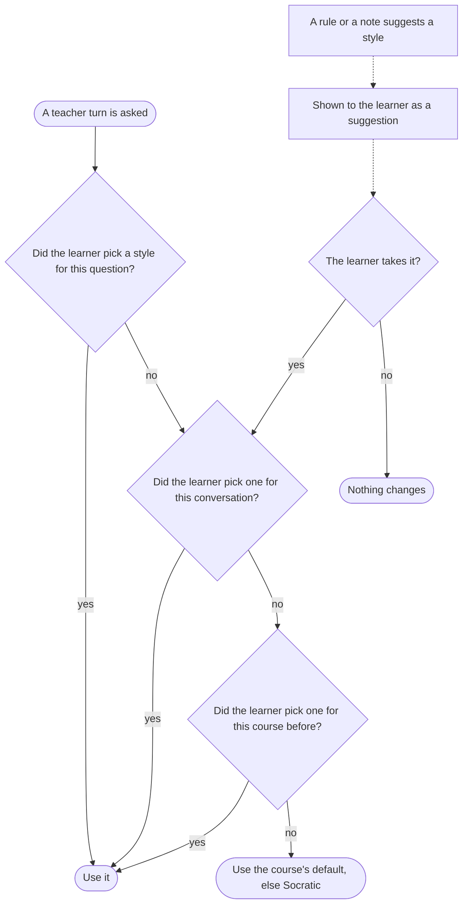
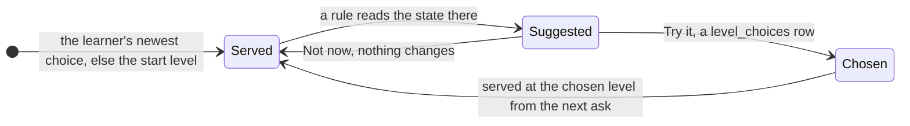

# RFC 12: Adapting to the learner

> **How to read this.** **Built** means it exists at commit `502304a`, with the file that shows it. **Proposed** means this RFC asks for it. **Open** means it still needs the maintainer's decision or real use; §10 lists those. The maintainer decided the seven points in Table 0.1 on 2026-11-27; everything else here is this RFC's proposal. It builds on [RFC 5](0005-mastery-that-fades.md) (mastery and its four states), [RFC 8](0008-explain-mode.md) (the pitch read from mastery), [RFC 9](0009-authoring-in-the-browser.md) (`checkCourse`, drafts and **Accept**), [RFC 11](0011-asking-the-teacher.md) v0.3.0 (the lesson teacher, its tools, notes, its aid rules R1 to R5 and learner versions) and [RFC 13](0013-homeroom.md) (the tool architecture every teacher tool follows). RFC 11's link resolves once flyingrobots/school#384 merges and RFC 13's once its own pull request does; RFC 11's tasks are filed as flyingrobots/school#385 to #400. How School works today is in the [architecture reference](../topics/architecture/README.md) and the [mastery reference](../topics/mastery/README.md); this RFC describes only what would change.

## Executive summary

RFC 11 gives every lesson a teacher who can see the whole course and the learner's record. It does not say how that teacher should teach, or how hard the next question should be. This RFC adds two things the learner can see and steer. A **teaching style** is how the teacher talks: six styles, with Socratic as the default. A **ladder** is how hard each idea is asked: four levels from recognising an answer to applying it in a new scenario. The course sets the defaults, the learner chooses, and School only suggests. RFC 5's measure counts quiz answers only, so the levels answered by a quiz (recognise, recall, and apply asked as a quiz) are measured; the levels answered by an explanation are reported from their gradings in words, outside the measure, as RFC 5 C5 requires. Every suggestion, and every inference behind one, is stored in the record and shown to the learner in plain words.

| Decision (2026-11-27) | What this RFC builds |
| --- | --- |
| 1. Six teaching styles: Socratic (the default), Explainer, Feynman, Challenger, Storyteller, Coach | A style text for each in the teacher's instructions, the style of every turn stored with it, and Feynman tied to the lesson's explain blocks (§5.1) |
| 2. Who chooses, in layers: the course sets a default and the styles it allows; the learner switches at any time, for the conversation or one question, and School never overrides that; the system suggests and never switches silently | `teaching` in `course.json`, a style picker in the teacher panel, style choices as append-only rows, and suggestions the learner answers (§5.2) |
| 3. Difficulty as a ladder per idea: 1 Recognise, 2 Recall, 3 Explain, 4 Apply, aiming at about 80 to 85% right first time, moved by RFC 5's states (not started: start at 2; settling: stay; holding: step up; faded: step down one, then climb; aided answers never step up) | `level` and `variantOf` on quiz and explain blocks, a cued-recall form of the quiz, the level served as the learner's newest choice or the start level, and RFC 5's states turned into suggestions, never moves (§5.3, §5.4) |
| 4. Variants come from the course author, or from RFC 11's teacher as checked proposed changes, each linked to its original quiz | Author variants checked by `checkCourse`; teacher variants through RFC 11's `propose_lesson_change` with a level and the quiz they vary (§5.5) |
| 5. Each answer records its level; "holding" becomes "holding at a level"; the learner sees the level in words, never a score, and can ask for harder or easier | A migration that stores each answer's idea and level, a measure per idea and quiz level beside RFC 5's per-quiz one, explanation levels described from gradings outside the measure, and aid that covers every block of an idea (§5.6, §5.7) |
| 6. Observations use only signals School already records, judge styles and levels by delayed mastery, and start with simple rules, notes and the learner's choice before any model | A table of the six signals, a warning about sample size, and suggestions written by rules whose reasons are stored and shown (§5.8) |
| 7. Staging: first the learner chooses, with course defaults; then mastery suggests the level and notes suggest the style; then evidence-backed suggestions once learner gates #52 and #223 exist | The order of work in three stages, the third blocked on flyingrobots/school#52 and flyingrobots/school#223 (§7) |

_Table 0.1. The maintainer's decisions and what this RFC builds for each. Rows 3 and 5 change what the record means, so they get the most space._

Two decisions are read here under rules that came before them. Decision 3's moves ("step up", "step down one") are read under decision 2 and C3: the level served is the learner's newest choice, and the moves are what School suggests. Decision 5's "holding at a level" is read under RFC 5 C5: model gradings are not part of the measure, so "holding" is said only of quiz levels, and the explain levels get their own words (§5.6). If the maintainer wants gradings in the measure, that is an amendment to RFC 5 C5, which this RFC does not make (Q9).

The first stage is tasks 1 to 8 in [§7](#7-order-of-work): styles the learner picks in the teacher panel, levels declared in the course, each answer stored with its level, and "harder" and "easier" the learner can ask for. In short: the teacher teaches the way the learner chooses, each idea is asked at the level the learner is ready for, and the record says how each idea is holding at each level.

## Contents

1. [The problem and who it serves](#1-the-problem-and-who-it-serves)
2. [Constraints](#2-constraints)
3. [What exists today](#3-what-exists-today)
4. [Options](#4-options)
5. [Design](#5-design)
6. [Threat model](#6-threat-model)
7. [Order of work](#7-order-of-work)
8. [Out of scope](#8-out-of-scope)
9. [Risks](#9-risks)
10. [Open questions](#10-open-questions)
11. [Decision](#11-decision)

## 1. The problem and who it serves

Every quiz in a School course today is a multiple-choice question asked the same way to everyone, and RFC 11's teacher has one voice. A learner who already holds an idea is asked to recognise it again, and a learner who is struggling gets the same question again. Recognising a right answer is also weaker evidence than producing one, so "holding" means less than it seems. This section names who adapting serves and what each needs.

| Who | What they need |
| --- | --- |
| A **learner** in a lesson | Questions that take effort but usually come out right, and a teacher who talks the way that helps them |
| A **learner** who wants control | To choose the style and ask for harder or easier at any moment, and never have School change either behind their back |
| A **learner** reading their record | To know how well each idea is held, in words: recognised, recalled, explained or applied |
| A **course author** | A way to write the same idea at several levels, and to say which teaching styles fit the course |
| The **maintainer** | Adaptation that rests on the record and simple rules that can be checked, before anything trained on one learner's data |

_Table 1.1. Who adapting serves. With one learner, the record is small, so the learner's own choice carries more weight than any inference._

In short: the learner wants the right challenge and the right voice, and wants to steer both; the record has to say what level each idea is held at.

## 2. Constraints

Each part of the design is held to these constraints. They come from earlier decisions and the maintainer's standing rules, not from this RFC.

| # | Constraint | Source |
| --- | --- | --- |
| C1 | Postgres is the only store. Every write is a `school.*` function; rows are append-only; nothing that matters lives in browser storage | [RFC 3](0003-postgres-functions-and-generated-types.md); [ADR 9](../adr/0009-the-learning-record-is-enforced-by-the-database.md) |
| C2 | The record never overstates mastery. Help shown before a first try makes it aided, decided by `seq`; an aided right answer never grows stability | RFC 5 §4.2; RFC 6 §5.1; RFC 11 §5.7 |
| C3 | The system suggests and the learner decides. Nothing about style or level changes without the learner's choice | The maintainer's decision 2, 2026-11-27 |
| C4 | Every inference about the learner is stored in the record and shown to them in plain words | The maintainer's standing rule |
| C5 | Mastery is a number inside School and words outside it: no score, percentage or rate is shown | RFC 5 §4.7 |
| C6 | Course files are content: School never writes into a course; a course changes only by an install (RFC 7) or an accepted draft (RFC 9) | [ADR 6](../adr/0006-separate-framework-lessons-and-learner-state.md); RFC 11 C5 |
| C7 | Everything an agent writes carries an AI label and renders as inert text | RFC 6 §5.5; RFC 11 C6 |
| C8 | UI only from shadcn registry components, with theme-book tokens, in light and dark | `web/components.json`; the maintainer's web style rules |
| C9 | Copy is encouraging or neutral, invites with questions, and never says "wrong", "attempt" or "forgot" | [School's voice](../topics/voice/README.md) |
| C10 | Every teacher tool is a thin RPC onto a `school.teacher_*` Postgres function, scoped by the conversation key inside the database | RFC 13 §5.3 (the maintainer's decision, 2026-11-27) |
| C11 | Model gradings are not part of the measure: an explanation's grade is different evidence from a quiz answer | RFC 5 C5 and §4.5 |
| C12 | The learner's own work (answers, typed responses, explanations, notes) never reaches a log or a search query | RFC 11 C7 and its query check (§6 there) |

_Table 2.1. The constraints every part of this RFC keeps. C2, C3 and C11 shape the design most: a level only rises on honest quiz evidence, and only the learner switches anything._

In short: the record stays honest and in Postgres, the learner decides, and everything School infers is in the record and in words.

## 3. What exists today

The measure, its four states, the pitch read from them, the teacher and its notes all exist or are decided. What is missing is any notion of a level, a way to write one idea at several levels, and a record of styles, choices and suggestions. This section grounds each piece in the code at `502304a` or in the RFC that decides it.

| Piece | Built, or decided | What adapting needs from it |
| --- | --- | --- |
| The quiz block | Choices, one correct, `why`, sources (`docs/topics/course-format/blocks.md`) | Level 1, Recognise, as it is; a cued-recall form for level 2 |
| The explain block | The learner writes in their own words; a grader checks it against criteria (`school.explanations`, `school.gradings` in `server/db/migrations/0001_init.sql`) | Level 3, Explain, as it is |
| Answers | `school.answers`: submission, encounter, block, choice, `correct` and `first_try` derived by `school.submit` from the snapshot (`0001_init.sql`) | Each answer's idea and level, derived the same way |
| Mastery | `school.mastery` per quiz and `school.mastery_rollup` into not started, settling, holding and faded (`0011_mastery.sql`, `0013_mastery_rollup.sql`; the [mastery reference](../topics/mastery/README.md)) | A measure per idea and level, and "holding at a level" |
| Due review | Weak and faded quizzes come back with a reason (`0006_due_review.sql`, `0014_faded_review.sql`; the [due-review reference](../topics/due-review/README.md)) | An idea brought back at the level it is due at |
| The pitch | RFC 8's four pitches from the rollup (`server/core/explain-pitch.ts`) | Unchanged; it reads the new rollup's states |
| Study days and encounters | A study day is a day with an answer or an explanation (`0008_study_days.sql`); every lesson opened is an encounter | Two of the signals in §5.8 |
| The teacher | RFC 11: a chat from any lesson with tools, notes, disclosures and learner versions (flyingrobots/school#385 to #400, open) | The place a style is used and a variant is proposed |
| Proposed changes | RFC 11 §5.9: `propose_lesson_change`, quiz-id rules deriving `<original>~<hash>`, the learner's own version (flyingrobots/school#395, #396) | Teacher variants with a level |
| Learner gates | flyingrobots/school#52 (one delayed review answered for real) and flyingrobots/school#223 (one faded review answered for real), both open | The evidence stage 3 waits for |

_Table 3.1. What adapting reuses and what it adds. The measure and the teacher exist or are decided; levels, variants, styles and suggestions do not._

In short: adapting is RFC 5's measure split by level and RFC 11's teacher given a style, plus a record of who chose what.

## 4. Options

Four questions have real alternatives: how a style reaches the teacher, where an idea's levels are written, how "holding at a level" is measured, and what makes a suggestion. Each one is weighed below against §2. [§5](#5-design) puts the chosen answers together.

### 4.1 How a style reaches the teacher

A style changes how the teacher talks, not what it can see or do. The question is where that difference lives.

| Option | For | Against |
| --- | --- | --- |
| **A. A style section in RFC 11's instructions, chosen per turn, versioned with `TEACHER_PROMPT_VERSION`, and stored with the turn** (recommended) | One teacher, one set of tools and notes; a switch takes effect on the next turn; the record says which style answered each turn | The instructions grow by up to 1,500 characters |
| B. A different agent per style in `bridge.json` | Each could use a different model | Six lists to keep; notes and history would cross agents anyway; the learner's choice would depend on host configuration (RFC 11 C3) |
| C. Let the model choose a style from the conversation | Nothing to pick | A silent switch, which decision 2 rules out (C3) |

_Table 4.1. How a style could reach the teacher. Option A changes only text the server already sends, and records the choice with every turn._

Option A keeps one teacher and makes the style a fact in the record.

### 4.2 Where an idea's levels are written

An **idea** is what a quiz tests. The ladder asks one idea at up to four levels, so something has to tie the blocks that ask it together.

| Option | For | Against |
| --- | --- | --- |
| **A. Each block declares `level`, and a variant declares `variantOf`, the id of the block it varies, which is the idea's id** (recommended) | Existing quizzes keep their ids and progress; a course with no levels is unchanged; `checkCourse` can check every link; RFC 11's derived ids already name their original | The lesson as served has to pick one block per idea |
| B. A new `ladder` block that holds the rungs | The rungs sit together in the file | A new container type; existing quizzes would move inside it, which changes their place in the block tree and RFC 8's scopes |
| C. The teacher writes every level on demand | No authoring | Every answer key written by a model, and every answer aided (RFC 11 R3); no level could ever be held cleanly |

_Table 4.2. Where levels could be written. Option A adds two fields and keeps every existing id meaning the same question._

Option A lets a course grow a ladder one variant at a time.

### 4.3 How "holding at a level" is measured

RFC 5 measures one quiz. The ladder needs to say how an idea is held at each level, without making the measure harder to explain.

| Option | Rule | For | Against |
| --- | --- | --- | --- |
| A. One measure per block | Unchanged; each variant is its own quiz | No change to RFC 5 | Four unrelated quizzes; "holding at recall" cannot be said |
| **B. One measure per idea and quiz level, with RFC 5's rules unchanged inside each** (recommended) | An idea's episodes at level L are the episodes of its quiz blocks at L; a clean typed (production) answer also counts at every lower quiz level, and a clean multiple-choice (recognition) answer above level 1 also counts at Recognise only (§5.6) | RFC 5's measure, stability and constants are reused as they are; "holding at L" is the highest quiz level whose measure is holding; explanations stay outside it (C11) | A migration, and a second function beside `school.mastery` |
| C. Level as a weight on stability | A clean answer at a higher level multiplies stability by more | One number | Changes RFC 5's constants and its worked example; a number no one can say in words |

_Table 4.3. How the measure could know about levels. Option B keeps RFC 5's model intact and applies it once per level._

Option B means a course with no levels reads exactly as today: each quiz is its own idea, at one level, and each explain block stays outside the measure as it is now.

### 4.4 What makes a suggestion

Decision 6 asks for simple rules, notes and the learner's choice before any model. The question is what writes a suggestion in stages 2 and 3.

| Option | For | Against |
| --- | --- | --- |
| **A. Fixed rules in a database function, each suggestion stored with its rule, its reason in words and the `seq`s it read** (recommended) | Checkable; deterministic by `seq`; the learner can be told exactly why; works with a handful of answers | Coarse |
| B. A bandit or other learned policy over styles and levels | Adapts with data | One learner gives tens of observations a week, far too few; its reasons cannot be said in words (C4) |
| C. The teacher model decides from the conversation | Rich | A model judging the evidence about the learner, which RFC 6 §4.1 rejected; still allowed as a note, never as a switch |

_Table 4.4. What could write a suggestion. Rules come first; the teacher may still suggest a style through a note, and the learner decides either way._

In short: a style section per turn, levels as two fields on blocks, RFC 5's measure once per level, and fixed rules for suggestions.

## 5. Design

This section describes the six styles and who chooses them, the ladder and how a level is chosen, variants, the change to mastery, aid across an idea, the signals, what the learner sees, the record and the tools. Everything here is Proposed.

### 5.1 The six teaching styles

A style is a section of the teacher's instructions, at most 1,500 characters, chosen for each turn. All six can see the same things through the same tools; they differ in what they do with them.

| Style | The teacher | It does not | Fits when |
| --- | --- | --- | --- |
| **Socratic** (the default) | Answers with questions. Because RFC 11's teacher can see every answer, it knows where the learner is going and leads them there one question at a time | State the answer unless the learner asks for it outright | The learner is close and needs to find it themselves |
| **Explainer** | Gives a direct explanation with one worked example, then checks understanding with one question | Hold back what was asked | The learner is new to the idea, or asks "just tell me" |
| **Feynman** | Asks the learner to explain the idea back in plain words, then points at the gaps. When the lesson has an explain block on the idea, it invites the learner to write it there, where it is saved and graded as every explanation is | Grade the chat; only the explain block is graded | The learner thinks they have it and wants to be sure |
| **Challenger** | Argues the other side, offers a plausible misconception, and asks the learner to defend their answer | Mock or score the learner | The idea is holding and the learner wants a harder test |
| **Storyteller** | Teaches through an analogy or a short story, then ties it back to the course's terms | Leave the analogy as the last word | The idea is abstract |
| **Coach** | Short and encouraging, about pace and habit: how regularly they return, what to look at next, when to stop for the day | Teach the content at length | The learner is returning after a gap, or studying in short sessions |

_Table 5.1. The six styles. Each is a way of using the same context; none can see or do more than another._

The Socratic teacher sees answers, so every answer it reads still makes a disclosure under RFC 11's rule R2, even when it only asks questions. The record cannot tell a question that hints from one that does not, and RFC 6 §4.1 rejected letting the model judge that. Feynman is the style that turns talk into evidence: an explanation written in the lesson's explain block is stored and graded by the existing grader, and its findings are described in words at level 3 (§5.6); the chat itself is neither stored as an explanation nor graded. Neither the explanation nor its grade enters the measure (C11).

In short: six ways to use the same teacher, with Socratic leading and Feynman sending the learner to the graded explain block.

### 5.2 Who chooses, in layers

Three layers decide the style of a turn, in a fixed order. The course sets the bounds, the learner chooses within them, and the system only suggests.

_Figure 5.1. How the style of a turn is chosen. A suggestion reaches the turn only through the learner's own choice; there is no path from a suggestion to a style that skips the learner._

| Layer | Who | Proposed |
| --- | --- | --- |
| 1. The course | The author | `course.json` may declare `"teaching": { "default": "socratic", "allowed": ["socratic", "explainer", "feynman"] }`. With none, the default is Socratic and all six are allowed. `checkCourse` refuses a default outside `allowed` or an unknown style |
| 2. The learner | The learner | A style picker in the teacher panel's header, for this conversation; a per-message choice beside the send button, for one question. Each pick is a `style_choices` row. A conversation choice also becomes the course's remembered choice for the next conversation. School never overrides a pick |
| 3. The system | Rules and notes | A suggestion row, shown in the panel as a question ("Would you like to try the Storyteller style for this one?") with **Try it** and **Not now**. Taking it is a learner pick. Stage 1 has no suggestions |

_Table 5.2. The three layers. Only layer 2 writes a style; layer 3 writes a suggestion, which becomes a style only through layer 2._

In short: the course bounds the choice, the learner makes it, and a suggestion is only ever a question.

### 5.3 The ladder

Each idea can be asked at four levels. A level says what the learner has to produce, not how obscure the question is. Most of the effort is in level 2, because it is the first level where the learner has to produce the answer.

| Level | Name | The learner | Block | In words on the page |
| --- | --- | --- | --- | --- |
| 1 | Recognise | Picks the right answer from choices | `quiz`, as today | "Recognising it" |
| 2 | Recall | Produces a short answer from a cue: a sentence with a gap, a picture, the first letter | `quiz` with `"form": "recall"`: a `cue`, and `accept`, a list of accepted answers, each with an id | "Recalling it" |
| 3 | Explain | Explains it in their own words, graded against criteria | `explain`, as today; described from its gradings, outside the measure | "Explaining it" |
| 4 | Apply | Uses it in a scenario the lesson did not show | `quiz` (multiple-choice or recall) declaring `"level": "apply"`, measured; or `explain` declaring it, described from gradings like level 3 | "Applying it" |

_Table 5.3. The four levels. Levels 1 and 3 are the blocks School already has; level 2 is one new form of quiz; level 4 is a declaration on either. Only quiz blocks are measured (C11)._

A recall answer is matched against `accept` after trimming, folding case and collapsing spaces. A match records that entry's id as the choice and counts as right; anything else records the id `unmatched` and the typed text, and the page shows the accepted answer with the quiz's `why`. The typed text is stored in a new column, `answers.response`, at most 200 characters. It is the learner's private work (C12): it is never written to a log, and RFC 11's search-query check, which refuses a run of `QUERY_RECORD_RUN` (6) words from the learner's answers and explanations, also checks every `answers.response`. A block with no `level` is level 1 if it is a quiz and level 3 if it is an explain block, so every course in use keeps its meaning.

**Aiming at effort that usually succeeds.** The target is about 80 to 85% right first time across the ideas a learner is working on. This is a target for the rules, never a number on a page (C5). Below it, questions are too hard to learn from; above it, too easy to move anything. The per-idea rules below do most of the work. The target is used once more in stage 2: when the learner's last 20 unaided first tries in a course come out right more than 17 times, the next suggestion is to step up, and fewer than 16 times, to step back.

In short: four levels, two of them already built, one new quiz form, and a target the rules aim at but the learner never sees as a number.

### 5.4 How a level is chosen, and what School suggests

The level an idea is served at is a choice, and only the learner makes it (C3). School reads RFC 5's states to suggest a move, and the learner takes the suggestion or leaves it. Nothing moves a level silently, in any stage.

| The idea's level for this learner | Rule |
| --- | --- |
| The learner has chosen one | The newest `level_choices` row for the idea: an **A harder one?** or **An easier one?** tap, or a suggestion they took |
| They have not | The start level: the lesson's `startLevel` in `course.json`, else 2 (Recall); if the idea has no block at that level, the nearest level below that it has, else the nearest above |

_Table 5.4. The level served. It is always the learner's newest choice, otherwise the start level; a rule never writes it._

From stage 2, rules read the idea's state at the level served and write a suggestion (§5.10), shown as a question the learner answers.

_Figure 5.2. How a level changes. The only edge into a new level passes through the learner's own choice; a rule can reach only "suggested"._

| State at the level served | What a rule suggests (stage 2) |
| --- | --- |
| Not started or settling | Nothing; due review brings it back at this level |
| Holding, from a clean quiz first try at this level | One level up: "Shall we try applying it?" |
| Holding only from aided answers | Nothing: an aided right answer refreshes the clock but never prompts a step up (C2) |
| Faded | One level down: "Shall we start from recognising it and climb back up?" |
| An explain level | Read from gradings in words (§5.6), never from the measure: when every criterion of the newest grading Meets, one level up; otherwise nothing |

_Table 5.5. The suggestion rules. They read RFC 5's states for quiz levels and gradings for explain levels, and they only ever ask._

A lesson serves one block per idea: the variant at the level served for that idea (Table 5.4), or the original when there is none. The snapshot records what was served, as today. When the learner asks for harder or easier during a lesson, the one quiz is swapped in place, which opens a new encounter because the content differs (`open_encounter` keys on the snapshot hash), exactly as RFC 11 §5.9 does when a learner takes a change. Answers already given stay in the earlier encounter.

In short: the learner's newest choice decides the level, the start level fills in until they make one, and RFC 5's states only ever produce a question.

### 5.5 Variants

A **variant** is a block that asks the same idea at another level. It names the block it varies in `variantOf`; that block is the idea, and its id is the idea's id. Variants come from two places, and both are checked before anything is served.

| Source | How it is written | Checked by | Counts in mastery |
| --- | --- | --- | --- |
| The course author | A block in the same lesson with `level` and `variantOf`, written by hand or with RFC 9's authoring | `checkCourse`: `variantOf` names a quiz or explain block in the same lesson; no variant of a variant; at most one block per idea and level; the level matches the block's form | A quiz variant, yes, at its level; an explain variant is described from its gradings, never measured (C11) |
| RFC 11's teacher | `propose_lesson_change` with an added or replacing block carrying `level`; School sets `variantOf` to the original's id and derives the new id as `<original>~<8 hex>` (RFC 11 Table 5.12) | RFC 11 Table 5.11, with this RFC's level rules added to check 3 | No: practice, as RFC 11 §5.9 decides for every quiz in a learner's version, until RFC 9's **Accept** folds it into the course |

_Table 5.6. Where variants come from. Only a variant in the course counts in mastery, because only its answer key was written or reviewed by a person._

A teacher variant is still useful before it is folded back: it is how a learner gets a level the author has not written yet. Its answers are stored like any answer and its page shows them, but they are aided by RFC 11's rule R3 and never prompt a level suggestion. **Suggest this for the course** (RFC 11 task 16, flyingrobots/school#400) is how a good one becomes an author variant.

In short: an author variant counts at its level; a teacher variant is practice the learner can use now and the author can adopt later.

### 5.6 The mastery change

Decision 5 changes what RFC 5's model measures: from one quiz to one idea at one quiz level. The measure itself, its two constants and its rules for each kind of first try do not change, and model gradings stay out of it (C11). Five things change, in one migration and one change to RFC 5's functions.

| # | Change | Proposed |
| --- | --- | --- |
| 1 | Each answer records its idea and level | `school.answers` gains `idea` and `level`, and `school.explanations` gains the same, set by `school.submit` and `school.save_explanation` from the block in the encounter's snapshot, never from the client. Rows from before the migration are read with the defaults of §5.3 |
| 2 | A measure per idea and quiz level | `school.idea_mastery(course, ideas, at, delay_ms)` returns, for each idea, RFC 5's measure at each quiz level it has: Recognise, Recall, and Apply when asked as a quiz. An idea's episodes at level L are the episodes of its counted quiz blocks at L, under the coverage rule below |
| 3 | The coverage rule | An answer counts at its own level. A clean first try that **produced** the answer (a recall-form quiz, at Recall or Apply) also counts as a clean episode at every lower quiz level. A clean first try that **recognised** it (a multiple-choice quiz at Apply) also counts at Recognise, and nowhere else: picking from choices says nothing about recall. A first try that is not clean counts only at its own level |
| 4 | "Holding at a level" | An idea is **holding at L** when L is the highest quiz level whose measure is holding. Its state for the rollup is the state at the level served (Table 5.4), or, when that is an explain level, at the highest quiz level below it |
| 5 | The rollup says levels | `school.mastery_rollup` keeps its signature and its four counts, now by idea, and adds `holdingAt`, the holding count per quiz level. An idea with no quiz block is not counted, as an explain block is not today. A course whose blocks declare no level has every idea at one level, so its counts are exactly today's |

_Table 5.7. The five changes to the mastery model. `school.mastery` per block stays as it is, for RFC 8's pitch and any caller that asks about a block._

**The explain levels, in words.** Level 3, and level 4 asked as an explanation, are never "holding" or "faded", because those words belong to the measure. They are described from the newest grading of the idea's explain block at that level, as RFC 8 already shows gradings beside mastery: "Your last explanation met every point" or "Your last explanation met two of three points". A grading can prompt a suggestion (Table 5.5) and nothing else. If the maintainer wants gradings in the measure, RFC 5 C5 must be amended first (Q9).

The words follow RFC 5 §4.7 and add the level. A level is a word, never a number or a score, and only appears for a course that declares levels.

| Today | With levels |
| --- | --- |
| "Holding" | "Holding at recall, ready to try applying it?" |
| "Still settling" | "Still settling at recall" |
| "Ready for another look" | "Ready for another look, starting from recognising it" |
| An explanation's grading | "You've explained it, and your last explanation met every point" |
| "2 of 3 quizzes holding" | "2 of 3 ideas holding: 1 at applying it, 1 at recalling it" |

_Table 5.8. The words with levels added (illustrative). "Holding" and "settling" are said only of quiz levels; an explanation is described by its grading. None names a number._

Due review reads the same episodes. An idea is due at the level served, or at the highest quiz level below it when that is an explain level, and the review item serves the variant at that level with RFC 5's reason. RFC 8's pitch reads the new rollup's four states, so it needs no change.

In short: RFC 5's measure, once per quiz level; production answers cover the levels below, recognition only Recognise; and explanations are described from their gradings, outside the measure.

### 5.7 Aid across an idea

Aid is recorded per block (RFC 6, RFC 11 R1 to R5), but mastery is now per idea. Without more, the teacher could read the Recognise quiz's correct choice, which discloses that block, and the learner could then answer the Recall variant of the same idea and read clean. So every aid rule that names a block names every block of its idea.

| Rule | Proposed |
| --- | --- |
| Disclosures expand to the idea | When any rule records a disclosure for a block (RFC 11 R2 `prompt`, `history`, `read_course`, `read_progress`, `read_notes`; R4 `note-shown`; R5 `reopened`), `school.record_disclosures` records one for every block of the same idea: the original and each variant in the course, and each variant in the learner's versions (RFC 11 §5.9) |
| Used up per block | Each expanded disclosure is used up by its own block's next episode, exactly as R2 says. So the learner's next try of each block of the idea is aided, whichever they meet first |
| Coverage never launders aid | An aided first try never counts as a clean episode at any other level (Table 5.7, row 3). A clean first try that comes after another block's disclosure was used up can count downward as usual |
| Where the idea comes from | The idea of a block is read from the snapshot of the course as installed, and from `variantOf` in the learner's versions, never from the teacher's arguments |
| A course with no levels | Every idea has one block, so the expansion adds nothing and the record reads as RFC 11 says |

_Table 5.9. Aid across an idea's blocks. Every rule that marks one block as seen marks the whole idea, because the idea is what the measure measures._

In short: what the teacher saw about one block of an idea, it saw about all of them, so the record marks them all.

### 5.8 What School observes, and how it judges

School adapts only from signals it already records. This keeps every inference explainable from rows the learner can see, and adds nothing the learner did not do in School.

| Signal | Where it is recorded | What it can suggest |
| --- | --- | --- |
| Mastery and fading, per idea and quiz level | `school.idea_mastery` (§5.6) | The suggestions of Table 5.5 |
| Aided and unaided first tries | Exposures, disclosures and `submission_aid` (`0012_ai_help.sql`; RFC 11 R2) | Whether the learner is leaning on help; an aided answer never steps up |
| Explanation grades | `school.gradings` findings: Meets, Partly, Not yet per criterion | A step-up suggestion at an explain level, and Feynman when explanations are partial; never the measure (C11) |
| How regularly the learner returns | Study days (`0008_study_days.sql`) | Coach after a gap |
| Session counts | Encounters per day and their length | Shorter sessions, Coach |
| Teacher notes | `teacher_notes` (RFC 11 §5.8) | A style the teacher saw help ("a worked example helped") |

_Table 5.10. The six signals and what each can suggest. None is new; each is already a row the learner can be shown._

**Judged by delayed mastery.** A style or a level is judged by how the ideas taught that way are holding at their next delayed review, not by how the conversation felt or how many answers came out right that day. An answer right after help is aided by C2, so a style cannot look good by giving answers away.

> [!WARNING]
> One learner gives a tiny sample. A week of study is a few dozen first tries across many ideas, styles and levels, and any difference between two styles will mostly be noise. So stages 1 and 2 use fixed rules, the teacher's notes and the learner's own choice. Stage 3's evidence-backed suggestions wait until the learner gates flyingrobots/school#52 and flyingrobots/school#223 show delayed reviews answered for real, and even then report counts in words ("Ideas you talked through in the Storyteller style were holding at their next review 5 times out of 6"), never a model's estimate.

In short: six signals already in the record, judged by what is still holding later, and no model until the record has something to say.

### 5.9 What the learner sees

Everything adapting does is visible and reversible from the page. Choices carry no AI label because they are the learner's; suggestions and the reasons behind them carry one because a rule or a model wrote them.

| Part | Where | Built from |
| --- | --- | --- |
| The style picker | The teacher panel's header, beside the **AI teacher** badge: the current style's name, opening a list of the allowed styles, each with one line from Table 5.1 | `Select`, `Tooltip` |
| One question's style | Beside the send button: "Ask this one as…" | `DropdownMenu` |
| The level of a quiz | A line above the quiz: "Recalling it: in your own words, with a hint" | `Badge` (`secondary`) |
| Harder or easier | Under the quiz before it is answered: **A harder one?** and **An easier one?**, each a question, absent where the idea has no level that way | `Button` (`ghost`) |
| A suggestion | In the panel or above the quiz, with `BotIcon`: the suggestion as a question, its reason in words, **Try it** and **Not now** | `ai-elements` `suggestion`, `Alert` |
| What School has noticed | A card on the course page, with `BotIcon`: every inference and suggestion in words, newest first, with its date and what it read; each can be set aside | `Card`, `Item`, `Collapsible` |
| The course page | Each lesson's counts with levels in words (Table 5.8) | `Badge` |

_Table 5.11. The parts the learner sees. Every inference is on the course page in words (C4), and every choice can be changed from where it was made._

| Moment | Copy (illustrative) |
| --- | --- |
| The style picker, closed | "Socratic: I'll ask questions to help you find it" |
| A style suggestion | "You've written that worked examples help. Would you like the Explainer style for this lesson?" |
| A level suggestion | "Plain hunt has been holding at recall for a while. Shall we try applying it to a new method?" |
| After a faded idea | "It's been a little while since ring three. Shall we start from recognising it and climb back up?" |
| A harder one, taken | "Here's one that asks you to apply it. Take your time." |
| What School has noticed, empty | "Nothing yet. As you study, School will note here what it suggests and why." |

_Table 5.12. Illustrative copy. Each invites with a question, and none names a score or says what went badly (C9)._

In short: the learner sees the style, the level, each suggestion and its reason, and every inference School made, in words.

### 5.10 The record

Adapting adds four append-only tables and changes three, across five migrations that take the next free numbers after `0017`, and after RFC 11's, when each is built. Every table has the `refuse_change` triggers, takes its `seq` from `record_seq`, and is written only through a function granted to `school_app`.

| Table | Columns | Rules |
| --- | --- | --- |
| `school.answers`, `school.explanations` (changed) | Gain `idea` and `level`; `answers` gains `response` | Set by the write functions from the snapshot; `level` one of `recognise`, `recall`, `explain`, `apply`. `response` is at most 200 characters, never logged, and checked by RFC 11's search-query check (C12) |
| `school.teacher_disclosures` (changed) | Gains `idea` and `expanded_from` (the block the rule named, NULL on that block's own row) | `school.record_disclosures` and RFC 11's note-shown and reopened writers expand each disclosure to every block of its idea in the same transaction (§5.7) |
| `school.style_choices` | `seq`, `choice_id`, `course`, `conversation_id` (NULL for the course's remembered choice), `question_id` (one question only), `style`, `suggestion_id` (when taking a suggestion), `at` | Written only by the learner's routes; `school.ask_teacher` reads the newest that applies and stores the turn's effective style and its source with the turn |
| `school.level_choices` | `seq`, `choice_id`, `course`, `idea`, `level`, `direction` (`harder`, `easier`, or a suggestion taken), `suggestion_id`, `at` | The learner's moves; the level served is the newest of these, else the start level (Table 5.4); rules never write one |
| `school.learner_inferences` | `seq`, `inference_id`, `course`, `kind` (`level`, `style`, `observation`), `rule` (the rule's name, or `teacher` for a note-based suggestion), `words` (what the learner reads, voice-checked), `proposal` (a style or a level), `evidence` (the `seq`s it read), `at` | Every inference and suggestion. `school.respond_to_inference` appends `taken`, `not-now` or `set-aside` in `inference_responses` |

_Table 5.13. The proposed tables and changes. Every inference is a row with its words and its evidence, so the learner can be shown exactly what School concluded and from what._

| Migration | Adds | Task |
| --- | --- | --- |
| Levels in the record | `answers.idea`, `answers.level`, `answers.response`, `explanations.idea`, `explanations.level`; `school.submit` and `school.save_explanation` replaced with the same signatures; recall answers matched in `school.submit` | 3 |
| Choices | `style_choices`, `level_choices`, `school.choose_style`, `school.choose_level`, `school.current_levels(course)` | 4 |
| Mastery by idea and level | `school.idea_mastery`, and `school.mastery_rollup` and `school.due_review` replaced with the same signatures to read ideas and levels | 5 |
| Disclosures across an idea | `teacher_disclosures.idea` and `expanded_from`; `school.record_disclosures`, `school.record_notes_shown` and `school.record_reopened` replaced with the same signatures to expand to the idea | 16 |
| Inferences | `learner_inferences`, `inference_responses`, `school.record_inference`, `school.respond_to_inference`, `school.course_inferences(course)` | 9 |

_Table 5.14. The migrations, each with its task in §7. Each takes the next free number when it is built; none rewrites an earlier migration._

In short: answers say their level, choices and inferences are rows, and mastery reads them all by `seq`.

### 5.11 The teacher's tools for adapting

The teacher needs to know the style and levels it is working with, and may suggest a style from what it has noticed. Under RFC 13's tool architecture (§5.3 there), each tool is a thin RPC onto one `school.teacher_*` function that takes the conversation key first, checks its scope inside the database, appends its own call to `teacher_tool_calls` in the same transaction, and is executable only by the `school_teacher` role.

| Tool | Function | Returns or writes | Limit per turn |
| --- | --- | --- | --- |
| `read_adaptation` | `school.teacher_read_adaptation(key)` | The turn's style and where it came from; each idea of the lesson with its level and its state there; the course's allowed styles. No answers, so no disclosure | 4 |
| `suggest_style` | `school.teacher_suggest_style(key, style, words)` | One `learner_inferences` row of kind `style`, rule `teacher`, after the voice check of RFC 11 §5.8 and a check that the style is allowed. It never changes the style | 1 |
| `propose_lesson_change` (extended) | `school.teacher_propose_lesson_change(key, summary, edits)`, RFC 11's tool under RFC 13's architecture | Accepts `level` on an added or replacing block and sets `variantOf` | RFC 11's |

_Table 5.15. The tools adapting adds or extends. None can write a style or a level; the database refuses anything but a suggestion._

The turn's style also arrives in the prompt, as the style section of the instructions, so an agent with `"tools": "none"` (RFC 11 Table 5.6) still teaches in the chosen style. In short: the teacher can read the style and levels and suggest a style, and nothing it calls can choose either.

## 6. Threat model

Adapting adds little new surface: two read and suggest tools, one new answer form, and stored inferences. The threats are a steered teacher trying to change how the learner is taught, a course that games the levels, and private inferences leaving the record. This section names each and what stops it.

| Concern | Threat | Mitigation |
| --- | --- | --- |
| A silent switch | Injected text in a course or a web result steers the teacher into changing the style or level | No tool writes a style or a level; `school_teacher` has no EXECUTE on `choose_style` or `choose_level`; the database refuses it (RFC 13 §5.3). The teacher can only suggest, once per turn, and the learner sees it |
| Suggestion spam | A steered teacher writes many suggestions | One `suggest_style` per turn; voice-checked; each on the course page, where the learner can set it aside |
| Levels gamed by a course | A course declares a trivial block as `apply` | The course is untrusted until the learner trusts it (RFC 7); `checkCourse` checks form against level; a level is only words, never a grade or completion |
| A model-written key moving mastery | A teacher variant's answer key is wrong | Teacher variants never count in mastery (§5.5); RFC 11's source-quote check of at least 8 words (Table 5.11 check 5 there) |
| Recall input | A typed answer carries markup or is very long | Stored as text of at most 200 characters, matched as text, rendered inert |
| The learner's typed answers leaving the record | A steered teacher puts an `answers.response` into a search query, or a log line carries one | RFC 11's query check covers `answers.response` (C12); `response` is on the never-logged list with prompts, arguments and results (RFC 11 C7) |
| Model grades read as mastery | A grading of a model-graded explanation is shown as "holding" | Explain levels are described from gradings in words and never enter `idea_mastery` or the rollup (C11, §5.6) |
| Aid laundered through a variant | The teacher reads one block's answer and the learner answers another block of the same idea | Every disclosure expands to the whole idea (§5.7); an aided answer never covers another level |
| Inferences leaving the record | An inference ("finds ring three hard") reaches a search query | RFC 11's query check refuses runs from the learner's answers, explanations and notes; it is extended to inference words |
| The learner's control | A rule overrides the learner's pick | Picks are rows only the learner's routes write; `school.ask_teacher` uses the newest pick before any default, and rules write only to `learner_inferences` |

_Table 6.1. Threats from adapting and their mitigations. The design keeps every change of style or level in the learner's hands, enforced by the database, not by the prompt._

In short: the teacher and the rules can only suggest, the database refuses anything more, and every suggestion is visible and can be set aside.

## 7. Order of work

Each row is one task issue with one observable outcome, mergeable on its own. None is filed yet; they are filed once this RFC is approved. The tasks follow decision 7's three stages. Each task updates the living references it changes in the same pull request: [mastery](../topics/mastery/README.md), [due review](../topics/due-review/README.md), [the course format](../topics/course-format/README.md) and its [blocks](../topics/course-format/blocks.md), the [lesson page](../topics/lesson-page/README.md) and the [course page](../topics/course-page/README.md).

| # | Stage | Task | Depends on | Done when |
| --- | --- | --- | --- | --- |
| 1 | 1 | **A course declares levels, variants and teaching styles.** `level`, `variantOf` and `"form": "recall"` on blocks, `teaching` and `startLevel` in `course.json`, checked by `checkCourse` | none | `school check` accepts a course with a ladder and refuses each broken link, duplicate level, unknown style and default outside `allowed`; the `school` skill and the blocks reference describe them |
| 2 | 1 | **The lesson page asks a recall quiz.** The cue, a text field, matching against `accept`, the accepted answer shown with `why` | 1 | Browser tests, light and dark: a matching answer is right, a near miss is shown the accepted answer; the voice test passes |
| 3 | 1 | **Each answer records its idea and level.** The first migration of Table 5.14 | 1 | Contract cases: an answer's level and idea come from the snapshot whatever the client sends; a recall answer's match is decided in the database; rows from before read with the defaults |
| 4 | 1 | **The learner's style and level choices in the record.** The choices migration | 3 | Contract cases: choices are append-only; the newest applicable choice wins; a course's remembered choice is read for a new conversation |
| 5 | 1 | **Mastery by idea and quiz level.** `school.idea_mastery`, the coverage rule, the rollup's `holdingAt`, due review by idea; explain levels described from gradings | 3, 16 | Contract cases: a course with no levels reads exactly as before (the RFC 5 Table 4.3 case still passes); a clean recall-form apply answer counts at recall and recognise; a clean multiple-choice apply answer counts at recognise only; an explanation's grading never changes `idea_mastery` or the rollup; an aided right answer never makes a level holding sooner |
| 6 | 1 | **The teacher teaches in a style.** Six style texts, the turn's style from the layers of Figure 5.1 stored with the turn | 4, flyingrobots/school#390 | HTTP tests with a fake bridge: the prompt carries the chosen style; a question's pick beats the conversation's, which beats the course's default; the turn records the style and its source |
| 7 | 1 | **The learner picks a style in the teacher panel.** The picker and the per-question menu | 6, flyingrobots/school#392 | Browser tests, light and dark, at 1280 px and 390 px: picking a style shows on the next turn and after a reload; only allowed styles are listed |
| 8 | 1 | **The learner asks for harder or easier, and sees levels in words.** Serving the block at the level served (Table 5.4), the swap in place, the level line, the course page words | 2, 4, 5 | Browser tests: with no choice the start level is served; **A harder one?** writes a choice, swaps the quiz and opens a new encounter; the earlier answers stay; the course page says "holding at recall" in words and describes an explanation by its grading; nothing in browser storage. **Stage 1 is complete** |
| 9 | 2 | **Inferences in the record.** The inferences migration, with the voice check | 4 | Contract cases: an inference stores its words, rule and evidence; responses are append-only; a set-aside inference is not offered again |
| 10 | 2 | **Mastery suggests the level.** The rules of Table 5.5 and the 20-answer target, as suggestions | 5, 9 | Tests at fixed clocks: holding suggests a step up, faded a step down, settling nothing; an aided answer never suggests up; no level changes until the learner takes one |
| 11 | 2 | **Notes suggest the style.** `teacher_read_adaptation` and `teacher_suggest_style` under RFC 13's architecture | 6, 9, flyingrobots/school#388 | Tests: the teacher can read styles and levels and write one suggestion a turn; a second, or a call to change a style, is refused by the database and recorded |
| 12 | 2 | **What School has noticed, on the course page.** Every inference in words with its evidence and **Set aside** | 9 | A browser test shows a level and a style suggestion with their reasons, light and dark; set aside moves one under **Set aside** |
| 13 | 2 | **Feynman sends the learner to the explain block.** The Feynman text invites the lesson's explain block on the idea; the panel links to it | 6 | A test: a Feynman turn on an idea with an explain block offers it; the explanation is saved and graded through the existing path |
| 14 | 2 | **The teacher proposes a variant at a level.** `level` and `variantOf` through `propose_lesson_change` | 1, flyingrobots/school#395 | Tests: a proposed recall variant gets a derived id and `variantOf`; its answers never move mastery |
| 15 | 3 | **Evidence-backed suggestions.** Counts of delayed mastery by style and level, in words, behind the stage-2 rules | 10, 11, flyingrobots/school#52, flyingrobots/school#223 | With both learner gates closed: a fixture record yields a suggestion citing the counts it read; with fewer than 6 delayed reviews per style none is made |
| 16 | 1 | **Aid covers every block of an idea.** The disclosures-across-an-idea migration (Table 5.14) | 3, flyingrobots/school#386 | Contract cases: a disclosure of the Recognise quiz makes the next first try of its Recall variant aided; each expanded disclosure is used up by its own block's next episode; R4's and R5's disclosures expand the same way; a course with no levels records exactly RFC 11's rows; the R2 differential still holds |

_Table 7.1. The build, as task issues. Task 1 can start at once; tasks 3 to 5 and 16 follow it; task 8 completes stage 1; stage 2 follows; task 15 waits for the learner gates. Task 16 is listed last because it was added in draft 2; it belongs to stage 1._

In short: the course and the record learn levels first, then the learner chooses, then rules suggest, and evidence comes last.

## 8. Out of scope

These are left out on purpose, so a build issue does not drift into them.

| Left out | Why |
| --- | --- |
| A learned policy (bandit, model) over styles and levels | Decision 6; one learner is too small a sample (§5.8) |
| Styles for RFC 6's passage asking or RFC 8's explain mode | They stay as decided; the teacher is where styles live |
| Levels for exams | RFC 2 keeps exams the same for every learner |
| Generating variants in advance for a whole course | RFC 2's preparation may do this later; here a variant is written by the author or proposed by the teacher |
| Showing a success rate | C5; the rate is for the rules only |
| More than four levels, or levels per course | One ladder keeps the words the same everywhere |

_Table 8.1. What this RFC does not build, and why. None of it blocks stage 1._

Each of these can be its own issue later.

## 9. Risks

The main risk is a measure that says more than it knows: an idea "holding at applying it" on thin evidence. The others are authoring cost, a rule that nags, and a learner who never leaves a comfortable level.

| Risk | Mitigation |
| --- | --- |
| "Holding at a level" overstates what one answer shows | RFC 5's settled rule applies per level; recognition answers cover only Recognise; aided answers never prompt a step up; disclosures cover the whole idea; teacher variants and gradings never count |
| Few courses write variants, so the ladder is empty | A course with no levels is unchanged; teacher variants give practice at any level now; RFC 9 can adopt them |
| Suggestions feel like nagging | One per turn from the teacher; rules suggest at most once per idea per day; **Not now** quiets that suggestion for a week |
| The learner stays at an easy level | Their choice (C3). The course page says where each idea is holding, and a rule may invite a step up |
| Recall matching is too strict | The accepted list is the author's; a near miss shows the accepted answer; Q4 asks about tolerance |
| The mastery migration changes rollup counts | A course with no levels reads exactly as today, asserted by a differential test over the existing fixtures (task 5) |

_Table 9.1. Risks and their mitigations. The measure carries the most weight, so a course with no levels must read exactly as before._

The risk this RFC treats as worst is a level that rises on help, which is why aided answers never prompt a step up, every disclosure covers the whole idea, and teacher variants and gradings never count.

## 10. Open questions

Decisions 1 to 7 are the maintainer's. These questions remain, each with a recommendation that holds until the maintainer decides or real use settles it.

| # | Question | Recommendation |
| --- | --- | --- |
| Q1 | May a course exclude a style the learner wants? | Yes, through `allowed`, since the author knows the material; the picker shows only allowed styles. Revisit if learners ask for an excluded one |
| Q2 | Does a clean answer at a higher level count at every lower level? | Only a produced answer does, as Table 5.7 row 3 says: a typed apply answer shows the learner can recall it, but picking from choices shows only recognition. A first try that is not clean counts only at its own level |
| Q3 | May an idea have several variants at one level? | Not at first: one per idea and level keeps the serving rule simple. Rotation can come later |
| Q4 | How tolerant is recall matching? | Exact after folding case and spaces at first. A later task could accept an edit distance of one for answers of eight letters or more |
| Q5 | Should a Socratic turn that never states an answer avoid R2's disclosures? | No. The record cannot tell a hinting question from a neutral one, and a model judging that about itself was rejected in RFC 6 §4.1 |
| Q6 | Do RFC 13's homeroom and its walkthrough use the same style choice? | Yes: the learner's style is per course for the lesson teacher and per conversation in homeroom; RFC 13 job 9 reads it |
| Q7 | Is 80 to 85% the right target, and is 20 answers the right window? | Keep both until stage 3 has data; both are constants in one migration |
| Q8 | Should the learner's chosen level be the same across lessons for one idea reused by `ref`? | Yes: the level belongs to the idea, which a `ref` reuses |
| Q9 | Should explanation gradings count toward "holding" at levels 3 and 4? | Not unless the maintainer amends RFC 5 C5, which keeps model grading out of the measure. Until then, the explain levels are described from gradings in words and only prompt suggestions (§5.6). If C5 is amended, the amendment belongs in RFC 5 and in Table 0.1 here |

_Table 10.1. Open questions and recommendations. Q1, Q2 and Q9 are the maintainer's choices; Q4 and Q7 can wait for real use._

In short: the author bounds the styles, produced answers cover lower levels, gradings stay out of the measure unless RFC 5 changes, and the numbers wait for evidence.

## 11. Decision

The maintainer decided the seven points of Table 0.1 on 2026-11-27. Draft 2 (v0.2.0) answers round 1 of an external review: gradings stay outside the measure (C11), aid covers every block of an idea (§5.7), the level served is the learner's newest choice with rules only suggesting (§5.4), the coverage rule separates production from recognition (Table 5.7), and typed answers join RFC 11's query check and never-logged list (C12). The rest of this RFC is Proposed, and the questions in §10 are Open. The tasks of §7 are drafted as issue specifications and not yet filed; this section will list their issue numbers once they are.

In short: how the teacher teaches and how hard it asks are decided in shape; the details, and the evidence for stage 3, are still to settle.
