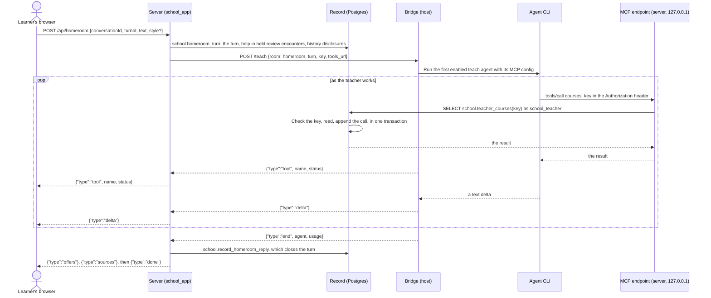
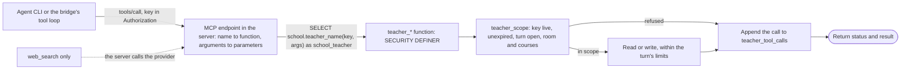
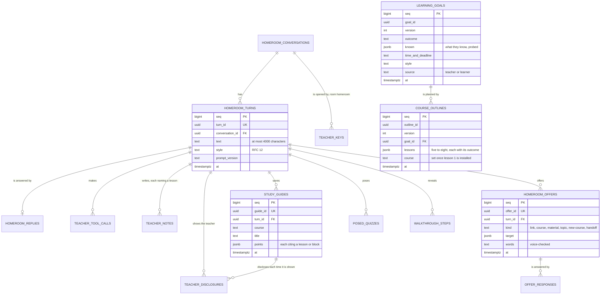

# RFC 13: Homeroom

> **How to read this.** **Built** means it exists at commit `502304a`, with the file that shows it. **Proposed** means this RFC asks for it. **Open** means it still needs the maintainer's decision or a run on the Mac that hosts School; §10 lists those. The maintainer decided the points in Table 0.1 on 2026-11-27; everything else here is this RFC's proposal. It builds on [RFC 2](0002-lessons-written-for-each-learner.md) (lessons written for one learner, inert generated content), [RFC 4](0004-publishing-courses.md) (the Library), [RFC 5](0005-mastery-that-fades.md) (mastery), [RFC 7](0007-installing-courses.md) (installing and previewing a course), [RFC 9](0009-authoring-in-the-browser.md) (authoring, and writing a new course from a description, flyingrobots/school#269), [RFC 10](0010-bridge-controls-in-settings.md) (the agent hierarchy claude, codex, agy, lms-qwen, and the `openai` kind), [RFC 11](0011-asking-the-teacher.md) v0.3.0 (the lesson teacher, conversation keys, tools over MCP, the tool-call record, notes, the aid rules R1 to R5 and learner versions) and [RFC 12](0012-adapting-to-the-learner.md) v0.3.0 (teaching styles, and disclosures that cover every block of an idea). RFC 10's link resolves once flyingrobots/school#371 merges, RFC 11's once flyingrobots/school#384 does, and RFC 12's once its own pull request does. RFC 10's tasks are filed as flyingrobots/school#372 to #383 and RFC 11's as #385 to #400. How School works today is in the [architecture reference](../topics/architecture/README.md) and the [home page reference](../topics/home-page/README.md); this RFC describes only what would change.

## Executive summary

RFC 11's teacher lives in a lesson and sees one course. A learner also has questions that belong to no lesson: what should I look at today, what did I find hard last month, is there a course on this, can you help me study, can you teach me something new. This RFC puts a chat on the home page, called **homeroom**. It is the same teacher as RFC 11 in another room. It holds a learner-wide key that reads across the learner's courses and record and writes only its own artefacts: notes, goals, offers and study guides. It fetches everything by tool and preloads nothing. Its jobs are ten tools on that key, shipped one at a time after the basic chat.

The design rests on one choice, the maintainer's: **every teacher and homeroom tool is a thin RPC onto a Postgres function, and the scope is enforced in the database.** A new role, `school_teacher`, can execute only `school.teacher_*` functions. Each function takes the conversation key first, checks it, records its own call in the same transaction, and returns. The MCP endpoint has no logic of its own. This amends RFC 11's tool layer (§5.3).

| Decision (2026-11-27) | What this RFC builds |
| --- | --- |
| 1. A chat on the home page: the same teacher as RFC 11, in another room | A `homeroom` conversation with its own turns, served by the `teach` agents, with a card on the home page and its own page (§5.1, §5.9) |
| 2. A learner-wide, read-only scoped key over courses and installs, where the learner is in each, mastery and due reviews, answers and explanations, teacher notes and learning goals; fetched by tool, never preloaded | A `homeroom` key, checked in the database like RFC 11's lesson key, whose reads cover every course and whose writes are limited to homeroom's own tables (§5.2) |
| 3. Every tool a thin RPC onto a `school.teacher_*` function, under a `school_teacher` role with EXECUTE only; the key checked inside each function; each call recorded by its function in the same transaction; writes as their own functions with limits; no logic in the MCP endpoint; web search the one exception, run by the server and recorded through a `teacher_*` function | The tool architecture of §5.3, amending RFC 11 §5.3 to §5.5; the role and key-check base is task 1, which every tool task follows |
| 4. Ten jobs, each a tool on the same key, shippable one at a time | Answer about the learner's learning; answer anything with web search; offer links; find a course in the Library; recommend materials; recommend topics; study in the chat; build study guides; walk through a question; start a course from a conversation (§5.4) |
| 5. Handoffs: a question about one lesson goes to that lesson's teacher with the conversation attached; both teachers write the same notes | A handoff offer, a lesson conversation opened with the homeroom turns it names and every disclosure behind them, and one notes table in which every note names a lesson (§5.5, §5.6) |

_Table 0.1. The maintainer's decisions and what this RFC builds for each. Row 3 changes RFC 11 as well, so it gets its own section._

The first slice is tasks 1 to 7 in [§7](#7-order-of-work): the role and key check, RFC 11's tools moved onto it, homeroom in the record, and a basic chat on the home page that can say which courses the learner has and where they are in each. Each job follows as its own task. In short: one teacher, a second room, a key the database checks, and ten jobs added one at a time.

## Contents

1. [The problem and who it serves](#1-the-problem-and-who-it-serves)
2. [Constraints](#2-constraints)
3. [What exists today](#3-what-exists-today)
4. [Options](#4-options)
5. [Design](#5-design)
6. [Threat model](#6-threat-model)
7. [Order of work](#7-order-of-work)
8. [Out of scope](#8-out-of-scope)
9. [Risks](#9-risks)
10. [Open questions](#10-open-questions)
11. [Decision](#11-decision)

## 1. The problem and who it serves

The home page shows what is ahead, what is coming back for review and how each course is holding. It cannot answer a question. A learner who wonders what to study, wants help with homework from elsewhere, or wants to learn something School has no course for has nowhere to ask. This section names who homeroom serves and what each needs.

| Who | What they need |
| --- | --- |
| A **learner** opening School | To ask about their own learning ("what was I stuck on in Bells?") and be pointed somewhere useful |
| A **learner** with a question from outside School | An answer with its sources shown, and help working through a problem without being handed the answer |
| A **learner** who wants to study | A short review in the chat, with every answer counted in the record exactly as in a lesson |
| A **learner** who wants something new | A course found in the Library, or one written for them from a conversation, which they own |
| The **maintainer** | A key that cannot reach beyond the learner's record and homeroom's own tables, enforced by the database, and a record of every call |

_Table 1.1. Who homeroom serves. With one learner these are one person in different moments; homeroom has to be useful in each and honest in the record for all of them._

In short: the learner wants a teacher at the front door, and the maintainer needs that teacher's reach set by the database.

## 2. Constraints

Each part of the design is held to these constraints. They come from earlier decisions and the maintainer's standing rules, not from this RFC.

| # | Constraint | Source |
| --- | --- | --- |
| C1 | Postgres is the only store. Every write is a `school.*` function; rows are append-only; nothing that matters lives in browser storage | [RFC 3](0003-postgres-functions-and-generated-types.md); [ADR 9](../adr/0009-the-learning-record-is-enforced-by-the-database.md) |
| C2 | The record never overstates mastery. Help before a first try makes it aided, decided by `seq`; a quiz whose answer reached the teacher, or reached the learner again through a note or a reopened conversation, is aided the next time (RFC 11 R2, R4, R5); a quiz whose key a model wrote is never in mastery | RFC 5 §4.2; RFC 6 §5.1; RFC 11 §5.7 and §5.9; RFC 12 §5.5 |
| C3 | Models run only on the host through the bridge, under commands written only in `bridge.json` | `server/agents.ts`; RFC 11 C3 |
| C4 | School is reachable only over Tailscale or localhost, with no login; writes are JSON and never cross-site | [ADR 4](../adr/0004-docker-on-this-mac-behind-tailscale.md); `guardApi` in `server/server.ts` |
| C5 | Course files are content; a course changes only by an install (RFC 7) or an accepted draft (RFC 9); an installed course is untrusted until the learner trusts it, and no teacher reads an untrusted course's text | [ADR 6](../adr/0006-separate-framework-lessons-and-learner-state.md); RFC 7 §5.3; RFC 11 Table 6.1 |
| C6 | Everything an agent writes carries an AI label and renders as inert text; web results are shown as unchecked | RFC 6 §5.5; RFC 11 C6 and §4.5 |
| C7 | The system suggests and the learner decides. Homeroom offers; it never installs, navigates, creates or changes anything on its own | The maintainer's standing rule |
| C8 | Every inference about the learner is stored in the record and shown to them in plain words | The maintainer's standing rule; RFC 12 C4 |
| C9 | Logs never hold a prompt, an argument, a result, the record or a key, including Postgres's own log and `pg_stat_activity` | `bridge/bridge.ts` header; RFC 11 C7 |
| C10 | UI only from shadcn registry components, with theme-book tokens, in light and dark | `web/components.json`; the maintainer's web style rules |
| C11 | Copy is encouraging or neutral, invites with questions, and never says "wrong", "attempt" or "forgot" | [School's voice](../topics/voice/README.md) |
| C12 | Most study is on a phone | RFC 6 C8; RFC 10 §5.9 |

_Table 2.1. The constraints every part of this RFC keeps. C2 and C7 shape the design most: homeroom's reads must still mark aid, and its jobs end in offers the learner takes._

In short: the record stays honest and in Postgres, the model stays on the host, and homeroom offers while the learner decides.

## 3. What exists today

Most of what homeroom needs is the lesson teacher and the pieces RFC 11 builds on. What is missing is a conversation that belongs to no lesson, a key that covers every course, a database role for tools, and the tables for goals, offers and study guides. This section grounds each piece in the code at `502304a` or in the RFC that decides it.

| Piece | Built, or decided | What homeroom needs from it |
| --- | --- | --- |
| The home page | The hero, still ahead, the timeline and today's letter, each from its own endpoint (`web/src/pages/home.tsx`; the [home page reference](../topics/home-page/README.md)) | A homeroom card that loads on its own, so a failure hides nothing else |
| Roles | The migrate job creates `school_owner` and `school_app`, runs every file as `school_owner`, and gives `school_app` its login; the server refuses to start unless `school_app` can execute exactly `GRANTED_FUNCTIONS` ([working notes](../working-notes.md); `server/adapters/database.ts`) | A third role, `school_teacher`, made the same way, with its own list and login check |
| Function conventions | `SECURITY DEFINER`, `SET search_path = school, pg_temp`, EXECUTE revoked from `PUBLIC` by default and granted by name (`0001_init.sql`, `0017_conversations.sql`) | Every `teacher_*` function follows them |
| The lesson teacher | RFC 11: turns in RFC 6's tables, `teacher_keys`, `teacher_tool_calls`, disclosures, notes, proposals; tools on a loopback MCP endpoint (flyingrobots/school#385 to #389, open) | The same teacher and agents; the tool layer amended (§5.3) |
| The bridge's teach route | RFC 11's `POST /teach` with the `teach` list, MCP for the command agents and a tool loop for the `openai` kind (flyingrobots/school#389, #398) | Reused with a `room` field |
| Mastery, due review, study days | `school.mastery_rollup`, `school.due_review`, `school.study_days` (`0013`, `0014`, `0008`) | Read by `teacher_progress` and `teacher_due` |
| Where the learner is | `GET /api/resume` (continue, next, start) and `GET /api/showcase` (`server/server.ts`) | The same facts per course from `teacher_courses` |
| Installs and preview | RFC 7: installs recorded in `course_installs` (`0010_course_installs.sql`); preview from a repository (flyingrobots/school#237, closed); install a previewed course (flyingrobots/school#238, open) | The preview a Library offer opens |
| The Library | RFC 4: a public index of course repositories pinned to commits, and a static catalog; flyingrobots/school#211 (open) | A copy of the index in the record, to search |
| Authoring | RFC 9: an authoring request, a checked draft, **Accept**, installs with source `authored` (`0016_authoring.sql`); a new course from a description is flyingrobots/school#269 (open) | The way homeroom's course is written, one lesson at a time |
| Teaching styles | RFC 12: six styles, chosen by the learner | The walkthrough's voice (job 9) |
| Components | `Card`, `Sheet`, `Drawer`, `Tabs`, `Badge`, `Alert`, `Item`, `ScrollArea`, `MessageScroller`, `Bubble`, `InputGroup`, `Textarea`, `Kbd`, `Spinner`; `ai-elements` `message`, `tool`, `sources`, `inline-citation`, `prompt-input`, `suggestion`, `confirmation`, `plan`, `task` (`web/src/components/ui/`, `web/src/components/ai-elements/`) | The whole chat, the outline editor and the study guide view |

_Table 3.1. What homeroom reuses and what it adds. The teacher, the agents and the record exist or are decided; the homeroom room, its key, the role and the new tables do not._

In short: homeroom is RFC 11's teacher with a wider key, a database role that bounds every tool, and a few tables of its own.

## 4. Options

Four questions have real alternatives: where the tools' scope is enforced, where homeroom's turns live, how a review in the chat is recorded, and how a course is written from a conversation. The first was decided by the maintainer and is shown for the record. Each is weighed against §2; [§5](#5-design) puts the answers together.

### 4.1 Where a tool's scope is enforced

RFC 11 checks the key and scopes each call in the server's TypeScript. A learner-wide key raises the stakes: a bug in that code could read or write across every course.

| Option | For | Against |
| --- | --- | --- |
| A. In the server, as RFC 11 §5.4 proposes | One language; the server already holds the record's connection | The endpoint holds `school_app`, which can call every write function; scope is only as good as the endpoint's code |
| **B. In the database: a `school_teacher` role that can execute only `school.teacher_*` functions, each checking the key itself and recording its own call** (decided, 2026-11-27) | A bug in the endpoint cannot widen the scope; a call without a record cannot exist; the same rules as every other write (RFC 3); testable on PGlite and Bun.SQL | One more role and login; the key check repeated in every function, which a shared internal function removes; `checkCourse` and web search cannot run in Postgres |
| C. A separate tools service with its own database user | Isolation from the server | A new process to run, and still needs option B's functions to be safe |

_Table 4.1. Where a tool's scope could be enforced. The maintainer chose option B; the two things Postgres cannot do are named exceptions in §5.3._

Option B makes the database the only judge of what a key may reach.

### 4.2 Where homeroom's turns live

RFC 6's `questions` require an encounter and an `ai-help` exposure in it, because every question there is about a lesson the learner is in. A homeroom turn is about no lesson.

| Option | For | Against |
| --- | --- | --- |
| **A. Homeroom's own tables: `homeroom_conversations`, `homeroom_turns`, `homeroom_replies`, beside RFC 6's** (recommended) | No nullable encounter in a table whose rules depend on it; tool calls, notes and offers name a homeroom turn the same way they name a lesson turn | Two families of turn tables |
| B. Make `questions.encounter_id` nullable for a `homeroom` kind | One family | Weakens a foreign key that RFC 6's aid rule rests on; every reader of `questions` must handle the new case |

_Table 4.2. Where homeroom's turns could live. Separate tables keep RFC 6's aid rule exactly as it is._

Option A costs one more set of append-only tables and keeps every existing rule intact.

### 4.3 How a review in the chat is recorded

Job 7 asks quizzes in the chat. Mastery stays true only if those answers are recorded exactly as answers in a lesson are.

| Option | For | Against |
| --- | --- | --- |
| **A. The real quiz path: the chat opens an encounter on the quiz's lesson as served, shows the quiz with the lesson's own component, and submits through `school.submit`** (recommended) | Every rule of RFC 5, RFC 6 and RFC 11 applies unchanged; the snapshot holds what was shown | The chat has to hold encounters open and record help in them |
| B. The model asks and judges the answer in the chat | Free-form | A model deciding correctness, outside the record's rules; mastery would mean less |
| C. Link to the lesson for each review | No new path | Not a review in the chat, which the decision asks for |

_Table 4.3. How a review in the chat could be recorded. Only the real quiz path keeps mastery true._

Option A puts the chat's review through the one path that already decides correctness, first tries and aid.

### 4.4 How a course is written from a conversation

Job 10 starts a course from a goal. The course can be written all at once or one lesson at a time.

| Option | For | Against |
| --- | --- | --- |
| **A. An outline first, then lesson 1 through RFC 9's authoring with an empty base (flyingrobots/school#269), then each next lesson when the learner arrives, shaped by mastery and notes** (recommended) | Each lesson is written for where the learner is (RFC 2); each passes `checkCourse`; the learner sees and edits the plan before anything is written | A wait at each new lesson unless it is drafted ahead |
| B. The whole course at once | One request | Lessons 2 to 8 written before the learner has answered anything; a long, costly request |
| C. RFC 2's `prepared/` learner state | Where RFC 2 puts lessons for one learner | Not built; RFC 9's installs already give provenance, checks and export |

_Table 4.4. How a course could be written. An outline and one lesson at a time follow RFC 2's idea through machinery that already exists._

In short: scope in the database, homeroom's own turn tables, the real quiz path for review, and courses written one lesson at a time.

## 5. Design

This section follows one homeroom turn, then describes the key, the tool architecture and how it amends RFC 11, the ten jobs, handoffs, the prompt and its budget, the record, and the page. Everything here is Proposed except what Table 0.1 decides.

### 5.1 The path of one turn

One turn is stored before any model is asked; the key opens the tools only while the turn runs; and every tool call is recorded by the function that answers it.

_Figure 5.1. One homeroom turn. The server writes the turn and the reply as `school_app`; the MCP endpoint reads and writes only as `school_teacher`, through functions that check the key._

| Piece | Proposed |
| --- | --- |
| `POST /api/homeroom` | JSON, guarded like every `POST /api/*` and `same-origin` when `Sec-Fetch-Site` is sent. Answers `application/x-ndjson`: `stored`, `tool`, `delta`, `offers`, `sources`, `done` or `failed`, each with a Zod schema. Refused (409) while another turn of the conversation runs |
| `GET /api/homeroom` | The conversations, newest first, each with its title, date and the learner's newest message; no replies, so it records nothing and the home card can load it freely |
| `GET /api/homeroom/:id` | One conversation's turns, tool calls (name, status and a summary), replies and offers. Before it answers, the server records RFC 11's R5: every block the conversation disclosed, by any `via`, again as `reopened` (§5.5). Because it writes, it is guarded as `guardLessonOpen` is |
| The bridge | RFC 11's `POST /teach` with `room: "homeroom"`; the same `teach` list, queue, fitting and fallback rule (RFC 11 Figure 5.3); `timeout_seconds: 180` |
| After the turn | The reply is stored whether or not the browser is still there; storing it closes the turn, which closes the key until the next turn |
| Logs | `bridge.teach.*` as RFC 11 has them, with `room`; the server's `school.teacher.tool` line names the tool and status only (C9) |

_Table 5.1. The routes and bridge changes one turn needs. The browser never sees the bridge, the endpoint or the key._

In short: store the turn, open the key, let the teacher call functions through a logic-free endpoint, store the reply, close the key.

### 5.2 The homeroom key

The homeroom key is RFC 11's conversation key with a wider read scope and a narrower write scope. It is minted when a homeroom conversation opens, stored only as a SHA-256 hash, carried only in the MCP transport, and accepted only while a turn of its conversation is open (RFC 11 Figure 5.2).

| | Lesson key (RFC 11) | Homeroom key (this RFC) |
| --- | --- | --- |
| Opened by | `school.ask_teacher`, in a lesson | `school.homeroom_turn`, on the home page |
| Reads | One trusted course: its content, this learner's record for it, its notes | Every trusted course served or installed: its content, where the learner is, mastery and due reviews, answers and explanations, notes; learning goals, study guides, and the Library index copy. For a course in safe mode, only its title, trust, source and the learner's states in words, never its text (C5) |
| Writes | Notes, proposals for the current lesson | Notes, each naming a course and lesson (RFC 11 R4), learning goals, offers, study guides, walkthrough steps, course outlines; never answers, choices, installs, trust or course content |
| Marks aid | Disclosures (R2) for every answer it reads | The same, for every answer it reads in any course, and the rules of §5.5 |
| Lives | Six hours after the last turn, then a new key | The same |

_Table 5.2. The two keys side by side. "Read-only" in decision 2 means read-only over the learning record: homeroom writes only its own artefacts, each visible to the learner._

The key carries no learner id, because School has one learner and one record (C4). In short: one hashed key per homeroom conversation that reads the whole record, writes only homeroom's own rows, and lives only while a turn runs.

### 5.3 The tool architecture, amending RFC 11

Every tool is a thin RPC onto a Postgres function. The scope is checked, the work done and the call recorded inside one function, in one transaction, under a role that can do nothing else. This section is the maintainer's decision of 2026-11-27 written out, and it replaces the parts of RFC 11 §5.3 to §5.5 that put the key check and the tool logic in the server.

_Figure 5.2. One tool call under the decided architecture. The endpoint holds no rule; every check and every record happens inside the function, so a refused call is recorded too. This is a simplification: web search's two calls are in Table 5.4._

| Rule | Proposed |
| --- | --- |
| The role | `school_teacher`, created `NOLOGIN` by the migrate job beside `school_owner` and `school_app`, then given `LOGIN` with a SCRAM-SHA-256 verifier of `SCHOOL_TEACHER_PASSWORD`, a new Keychain secret passed as a compose secret ([School's secrets](../topics/secrets/README.md)). It owns nothing, holds no table, sequence or schema privilege beyond `USAGE` on `school`, and has EXECUTE only on the `school.teacher_*` functions listed in `TEACHER_FUNCTIONS` (`server/adapters/database.ts`) |
| The login check | Before the endpoint starts, the server runs `teacherLoginRefusals`, as `loginRefusals` does for `school_app`: the role can log in, is not a superuser, owns nothing, can execute exactly `TEACHER_FUNCTIONS` and no other function, and has no table privilege. On any failure the endpoint does not start and the teacher reports itself off with the reason |
| The functions | `SECURITY DEFINER`, `SET search_path = school, pg_temp`, owned by `school_owner`, EXECUTE revoked from `PUBLIC` and granted to `school_teacher` alone. None is granted to `school_app`, and `school_teacher` is granted none of `GRANTED_FUNCTIONS` |
| The key, first | Every `teacher_*` function takes the plain key as its first argument and calls the internal, ungranted `school.teacher_scope(key, tool)`. It hashes the key with `sha256`, finds the key's newest event in `teacher_keys`, and answers the conversation, its room (`lesson` or `homeroom`), the courses it covers and the open turn, or a reason: unknown, revoked, expired, no open turn, out of scope. A turn is open from its turn row until its reply row, and at most 180 seconds after the turn row by the database's clock |
| Scope inside | A lesson key covers its one course; a homeroom key covers every course the server serves or has installed, and the whole record. A course or block named in the arguments is checked against that scope inside the function; the scope never comes from the arguments |
| One transaction, one record | Each function appends its call to `teacher_tool_calls` (turn, tool, arguments, status, result, timing) before it returns, refused or not. A refusal is returned as `{"status": "refused", "reason": ...}`, never raised, so the transaction commits with its record. There is no call without a record |
| Limits | Counted inside the function from `teacher_tool_calls` for the open turn, under an advisory lock per turn (READ COMMITTED, as `0005_read_committed.sql` requires for such locks). Table 5.4 lists them |
| Writes | Each write is its own function: the key check, the limits, the voice check of RFC 11 §5.8, and RFC 11's note answer check (no quiz's correct-choice text, no run of `NOTE_ANSWER_RUN` (8) words from a `why` or model answer) for every text the learner reads: notes, study guides, every offer's `words` and each recommendation's why, a handoff's summary, a teacher-written goal's `outcome` and `known`, and every outline lesson's title and outcome. A refusal names the field, so the teacher can say it another way; then the append |
| Disclosures | A read that returns an answer writes its disclosures in the same transaction, before it returns (RFC 11 R2), so the record knows what the teacher saw before the teacher does. Every disclosure goes through RFC 12's one internal writer, `school.write_disclosure`, which expands it to every block of its idea (RFC 12 §5.7); no function inserts into `teacher_disclosures` directly |
| The endpoint | `server/teacher-tools.ts`: a table from each tool name to its function and the order of its parameters, from which the MCP tool list is generated. It refuses a request with a foreign `Host`, an `Origin` or a `Sec-Fetch-*` header, or a body over 64 KiB, as RFC 11 §5.4 says, then calls the function on its own connection pool as `school_teacher` and passes the result back unchanged. It holds no rule about scope, limits or the record; the two jobs that must run beside the database are separate parts of the server, named in Table 5.4 |
| Bind parameters only | The endpoint calls each function as a prepared statement, `SELECT school.teacher_name($1, $2, ...)`, with the key and every argument bound, never written into the SQL text. So the key is never in the statement text, `pg_stat_activity.query`, or a logged statement. The compose Postgres sets `log_parameter_max_length = 0` and keeps `log_parameter_max_length_on_error = 0`, so a logged statement never shows bound values either. A refusal is returned, never raised, so no error message carries an argument |
| No connection string | The agent receives `tools_url` and the key in its MCP configuration. It never receives a database URL, a password or the bridge token |

_Table 5.3. The rules of the tool architecture. The database alone decides what a key may reach, and records every call it decides on._

Three things cannot run inside Postgres. Each is a named exception with a named runner, and each still records through a function.

| Exception | Why | What runs it | How it still records |
| --- | --- | --- | --- |
| Web search | It calls a provider over the internet | The endpoint, which for this one tool makes two function calls around the provider call and decides nothing itself | `school.teacher_search_begin(key, query)` checks the key, the limits and the query against the record (RFC 11 Table 6.1), stores the query, and returns a call id or a refusal; only then does the endpoint call the provider; `school.teacher_search_record(key, call_id, results)` stores the results as unchecked sources and returns them |
| `checkCourse` on a proposal | `checkCourse` is TypeScript (`server/check-course.ts`) | The **proposal checker**, `server/proposal-checker.ts`, a part of the server outside the endpoint, connected as `school_app`. `teacher_propose_lesson_change` stores the proposal as `unchecked` and calls `pg_notify('school_proposal', id)`, delivered when its transaction commits; the checker listens, also sweeps `school.unchecked_proposals()` at start-up and every 2 seconds, runs `checkCourse`, and records the outcome with `school.record_proposal_check` | `teacher_propose_lesson_change` runs the checks Postgres can (block ids, no `html` block, quiz-id rules, size) first. Only a checked proposal is shown to the learner. The teacher learns the outcome from `school.teacher_proposal_status(key, id)`, a `VOLATILE` function that waits up to 10 seconds for it. It takes the turn's advisory lock only to count the call against its limit and append the call's row, as a session-level lock (`pg_advisory_lock`) that it releases with `pg_advisory_unlock` before it waits, so the wait holds no lock and the turn's other tool calls never stall behind it. It then re-reads the proposal's check row every 200 ms; under READ COMMITTED each re-read is a new statement with a new snapshot, so it sees the checker's commit. While it waits it holds one `school_teacher` connection for up to 10 seconds, so the endpoint's pool keeps at least two connections. A check not done by then returns `unchecked`, and the proposal reaches the learner when it is checked, even after the turn ends Three status calls a turn |
| Refreshing the Library copy | Fetching RFC 4's index is a network call | The **Library refresher**, `server/library-refresh.ts`, connected as `school_app`: at start-up when the copy is over a day old, once a day after that, and when the learner taps **Refresh the Library** on the homeroom page. The teacher cannot start a fetch | `school.record_library_snapshot` appends the listings; `teacher_library_search` returns the copy's date with its results, so the teacher can say how fresh it is |

_Table 5.4. The three things that run outside Postgres, and what runs each. Each is the smallest piece that must, and each is bracketed by functions that keep the record; none is a rule in the endpoint._

**What this amends in RFC 11.** RFC 11's tools keep their names, arguments, results and limits; what moves is where they are enforced. Task 2 moves them, and RFC 11's tool task (flyingrobots/school#388) is best built on task 1 directly.

| RFC 11 | Under this architecture |
| --- | --- |
| §5.3: six tools implemented in the server | `teacher_read_course`, `teacher_read_progress`, `teacher_read_notes`, `teacher_write_note`, the two search functions, `teacher_propose_lesson_change` and `teacher_proposal_status` |
| §5.3, Table 5.4: limits enforced by the server | Counted inside each function |
| §5.4: the key checked in the server's endpoint; the server tracks the running turn | Checked by `teacher_scope` in the database; a turn is open from its row to its reply's |
| §5.4: every call a row in `teacher_tool_calls` | Appended by the function itself, in the call's own transaction |
| §5.8: the server's voice check on notes | Inside `teacher_write_note` |
| §5.9: the server checks a proposal before storing it | The database checks what it can; the proposal checker runs `checkCourse` and records the outcome (Table 5.4) |
| §5.5: MCP for command agents, the bridge's tool loop for `openai` | Unchanged: both reach the same endpoint with the same key |

_Table 5.5. RFC 11's tool layer, amended. Nothing an agent sees changes; the scope moves from the server's code into the database._

In short: a role that can only call `teacher_*` functions, a key checked inside each one, a record written by the function that decides, and an endpoint that only translates.

### 5.4 The ten jobs

Each job is one or more `teacher_*` functions on the homeroom key, shipped as its own task after the basic chat. Each ends in an answer or an offer; none acts on its own (C7).

| # | Job | Functions it adds | Writes | Limits per turn |
| --- | --- | --- | --- | --- |
| 0 | The basic chat: which courses, and where the learner is | `teacher_courses(key)`: each course served or installed, its title, trust, source, and the learner's current, next and just-finished lessons | Nothing | 4 |
| 1 | Answer about the learner's own learning, citing lessons and quizzes | `teacher_progress(key, course, lesson?)`, `teacher_read_course(key, course, lesson?)`, `teacher_read_notes(key, course?)`, `teacher_read_goals(key)`, `teacher_write_note(key, course, lesson, text, ...)` | Disclosures for answers returned; notes, each naming a lesson | 12 calls; 2 notes |
| 2 | Answer anything, with web search | `teacher_search_begin(key, query)`, `teacher_search_record(key, call_id, results)` | Queries and results, as unchecked sources | 3 searches; no note after a search |
| 3 | Take them somewhere | `teacher_offer_link(key, target, words)`: `target` is a lesson, a section, a review item, a course page, Settings or a study guide, checked to exist | An offer of kind `link` | 3 |
| 4 | Find a course in the Library | `teacher_library_search(key, query)` over the index copy; `teacher_offer_course(key, listing, words)` | An offer of kind `course` | 2 searches; 2 offers |
| 5 | Recommend extra materials | `teacher_course_references(key, course)`: each course's reference documents and quiz sources; `teacher_recommend(key, 'material', item, why)` | An offer of kind `material`, each with why it fits | 3 |
| 6 | Recommend new topics | `teacher_recommend(key, 'topic', item, why)`, reading goals, mastery and notes | An offer of kind `topic`, each with its reason | 3 |
| 7 | Help them study | `teacher_due(key, course?)`: due and fading items with reasons, without answers; `teacher_pose_quiz(key, course, block)` | A posed quiz; no disclosure | 5 posed quizzes |
| 8 | Build study guides | `teacher_study_material(key, course)`: finished lessons' key ideas, the learner's own past explanations, quizzes to revisit by id; `teacher_save_study_guide(key, course, title, points)` | A study guide; disclosures for every quiz and explain block of each lesson the material covers; `guide-shown` disclosures each time a guide is shown (§5.5) | 1 guide |
| 9 | Walk them through a question | `teacher_walkthrough_step(key, course?, block?, step)` | A step; on an unanswered School quiz, a disclosure | 1 step |
| 10 | Start a course from a conversation | `teacher_offer_new_course(key, words)`, `teacher_write_goal(key, goal)`, `teacher_propose_outline(key, goal_id, lessons)` | An offer of kind `new-course`; a learning goal; an outline | 1 offer; 1 outline |
| | Handoff | `teacher_offer_handoff(key, course, lesson, summary, turns)` | An offer of kind `handoff` | 1 |

_Table 5.6. The jobs and their functions. Every write is homeroom's own row, and every offer is something the learner can take or leave._

All calls together are limited to 16 a turn; a result to 32 KiB and all results to 256 KiB, as RFC 11 Table 5.4 has them.

#### Jobs 1 to 3: answering, and offering a place to go

**Job 1** answers questions such as "what have I been stuck on?" from the record, citing each lesson and quiz with an `inline-citation` that links to it. `teacher_progress` returns RFC 5's states in words (and RFC 12's levels), due items with reasons, and the learner's answers and explanations; every quiz whose answers it returns gets a disclosure, so the next try of it anywhere is aided (C2). **Job 2** answers anything, with web search as RFC 11 §5.10 shows it: every query is visible in the chat as it is made, results sit under the reply with **From the web, not checked**, and the query check refuses any run of six or more words from the learner's answers, explanations, notes or goals. **Job 3** offers a link as a button under the reply ("Open lesson 3 of Bells?"); the teacher cannot navigate, and a target that does not exist is refused by the function.

#### Job 4: finding a course in the Library

The Library is RFC 4's public index (flyingrobots/school#211). The Library refresher (Table 5.4) copies the index into the record at start-up when the copy is over a day old, once a day, and when the learner taps **Refresh the Library**, with `school.record_library_snapshot` as `school_app`: each listing's repository URL, pinned commit, title, summary, license and author, capped at 4 KiB of text each. `teacher_library_search` searches that copy and the learner's installed courses, so a course already installed is offered as itself. An offer of kind `course` shows a card with the listing; **Preview this course** opens RFC 7's preview with the URL and commit filled in. Installing still needs the preview, the learner's name choice and confirmation, and the course arrives untrusted (C5).

#### Jobs 5 and 6: recommending materials and topics

Materials come from each course's references first (its `reference/` documents and the sources its quizzes cite), then the web. Topics come from the learner's goals, what is holding and what is fading, and the notes. Each recommendation is an offer stored with **why it fits**, in words, and is shown to the learner with that reason; this is how C8 holds for recommendations, since each is an inference about the learner.

#### Job 7: studying in the chat

A review in the chat asks real quizzes through the real path, so mastery stays true. The teacher picks items with `teacher_due`, which returns each item's question, course, lesson and reason but never its correct choice or `why`, so choosing an item discloses nothing. `teacher_pose_quiz` records the pose; the server then opens an encounter on the quiz's lesson as served, with aid tracking, exactly as the lesson page would (`school.open_encounter`), and records it against the pose with `school.record_pose_encounter`. Only a trusted course's quiz can be posed (C5). The chat shows the quiz with the lesson's own quiz component, and the answer goes through `school.submit` on the same route a lesson uses.

| Rule | Proposed |
| --- | --- |
| Held open | A conversation **holds** a review encounter from the pose until the posed quiz is answered or skipped, and never longer than its key lives (six hours after the last turn). A held encounter is the only kind homeroom records help in |
| Not a place to continue | An encounter named in `posed_quizzes` is homeroom's, not a lesson the learner opened: `school.last_studied()`, and so `GET /api/resume` and "continue" on Home, skip it, and it never becomes the learner's current lesson |
| Cold first | While a posed quiz is unanswered, the message box offers **Answer first?** and holds the learner's message until they answer or choose **Skip**. So the usual first try has no help before it |
| Help in the chat | Every homeroom turn records an `ai-help` exposure, through `record_lesson_help`, in each review encounter the conversation holds, before the bridge is called. A quiz answered after the teacher has talked about it is aided, as in a lesson |
| Disclosures | Unchanged: a quiz whose answer the teacher read anywhere is aided the next time (R2) |
| After the answer | The quiz's `why` shows as in a lesson, and the teacher may talk about it; that turn's help falls after the first try |

_Table 5.7. The rules for review in the chat. A quiz asked cold and answered at once is a clean first try; one discussed first is aided, as anywhere else._

#### Job 8: study guides

A study guide covers finished material, weighted toward what is fading. Each guide has key ideas, the learner's own past explanations quoted with their dates, and quizzes to revisit by id (the quizzes themselves are taken through job 7 or in their lessons). `teacher_save_study_guide` refuses a point without a citation to a lesson or block in the course, checks every citation exists, applies the voice check and RFC 11's note answer check (no correct choice's text, no run of 8 words from a `why` or model answer), and stores the guide with the **AI-written** label. Guides are listed on the homeroom page and from each course page by title and date only (`GET /api/study-guides?course=`), and a guide's content is served only when the learner opens it (`GET /api/study-guides/:id`), read from the record.

A guide's key ideas and the explanations it quotes sit close to the answers, and the answer check cannot catch a paraphrase. So opening a guide records a `guide-shown` disclosure for every quiz and explain block of every lesson the guide cites, **each time it is opened**, before it is served (§5.5). A list of guides carries no content and records nothing, so visiting a course page never re-marks its quizzes, the problem RFC 11's R4 fixed for notes. A guide is for review, so the quizzes it covers come back aided once more; the panel says so before the guide opens: "Reading this guide counts as help, so these quizzes will come back for another look. Shall we open it?"

#### Job 9: walking through a question

A walkthrough helps with a School quiz, coursework from elsewhere, or anything. The teacher first asks what the learner has tried, then gives one nudge per turn in the learner's style (RFC 12: Socratic unless the learner chose another). Each nudge is a `teacher_walkthrough_step` row, shown as a numbered step. On a School quiz the learner has not yet answered in its current episode, each revealed step is also a disclosure under RFC 11, so the answer that follows counts as aided, and the panel says so before the first step: "Walking through this one counts as help, so it'll come back for another look later. Shall we start?"

#### Job 10: starting a course from a conversation

A course is never made from a quick question. A goal gets an offer, never an automatic creation. The flow is in Figure 5.3.

```mermaid
stateDiagram-v2
    [*] --> Chat
    Chat --> Offered: the learner states a goal; the teacher offers
    Offered --> Chat: Not now
    Offered --> Interview: the learner takes the offer
    Interview --> Goal: motivation, outcome, what they know (probed), time, how they like to learn
    Goal --> Outline: five to eight lessons, each with its outcome
    Outline --> Outline: the learner edits it
    Outline --> Lesson1: the learner chooses Write lesson 1
    Lesson1 --> Installed: checked, installed as their own course
    Installed --> NextLesson: the learner arrives at the next lesson
    NextLesson --> Installed: written from mastery and notes, checked, installed
```

_Figure 5.3. A course from a conversation. The learner moves every step that creates anything; the teacher only offers, asks and proposes._

| Step | Proposed |
| --- | --- |
| The offer | `teacher_offer_new_course` writes an offer of kind `new-course` only when the learner states a goal ("I want to be able to ring a touch of Grandsire"). A one-off question gets an answer, never an offer. The card asks: "Would you like a short course on this, written for you?" |
| The interview | A few questions a turn: why they want it, what they want to walk away able to do, what they already know (probed with one or two questions, not taken on trust), how much time and any deadline, and how they like to learn, which becomes RFC 12's starting style |
| The goal | `teacher_write_goal` stores a learning goal: the outcome in the learner's words, what they know, time and deadline, preferred style. The learner sees it on the homeroom page and can edit it, which appends a new version |
| The outline | `teacher_propose_outline` stores five to eight lessons, each with its title and outcome. The learner edits it in the chat (rename, reorder, remove, add, using the `plan` component) before anything is written; each edit appends a version |
| Lesson 1 | **Write lesson 1** is the learner's action. The server starts an RFC 9 authoring request with an empty base (flyingrobots/school#269), the outline, the goal and the sources, with an instruction that every claim cite a source and each section carry a short note of how sure the agent is. The draft passes `checkCourse` and the two checks RFC 11 already builds for model-written lessons: prose is plain text (Table 5.11 check 2 there), and every quiz names, for its correct choice, a quote of at least 8 words that appears in a cited source stored with the course (check 5 there). It does not wait on RFC 2's inert subset or answer-key checks, which are not built |
| Installed | The checked draft is installed as the learner's own course, source `authored`, with no **Accept** step: choosing **Write lesson 1** after seeing the outline is the decision to install. The course's `course.json` carries `"origin": "homeroom"` and every lesson shows **AI-written course** with `BotIcon` |
| Answer keys, and mastery | A model wrote every answer key, so the course's quizzes are **practice**, as RFC 11 §5.9 and RFC 12 §5.5 treat every model-written key: answers are stored and shown, but never enter mastery or due review. The course page says so: "AI wrote these answer keys and checked each against a quoted source. Your answers here shape the next lesson, and they don't count toward your progress." Whether a reviewed key could ever count is Q10 |
| Safe mode | The course's text was written by an agent that read web and Library text, so it arrives in safe mode like any untrusted install (C5). Neither teacher reads it: the lesson teacher is off in it, as RFC 11 has for every untrusted course, and homeroom sees only its title and the learner's states. The learner can trust it in Settings; the trust dialog says it was written by AI from web sources |
| Each next lesson | When the learner finishes a lesson, the server starts the next one's authoring request, shaped by the outline, the learner's practice answers in that course, and the course's notes (RFC 2's preparation ahead), so it is usually ready on arrival. It passes the same checks as lesson 1. A failed check is shown in words and can be asked again |
| How sure are you? | Every section of an AI-written lesson has **How sure are you?**, which shows the note of confidence and the sources stored with it. Once the learner trusts the course, asking further opens the lesson teacher, as any question would; in safe mode it offers Settings instead |
| The learner owns it | Rename it (a new authored install with a new title; the progress key stays), export it as a normal course (RFC 9's patch, or a git bundle of the install), or publish it later through RFC 4's reviewed pull request |

_Table 5.8. The steps from a goal to a course. Each step that writes a lesson is the learner's own action, every lesson says it was written by AI, and no model-written key counts in mastery._

In short: ten jobs, each a few functions that read the record or write homeroom's own rows, each ending in an answer or an offer.

### 5.5 Aid, notes and goals in homeroom

Homeroom reads answers across every course, so it needs RFC 11's aid rules in full, and two more for what only homeroom has: a handoff and a study guide. Every disclosure below expands to every block of its idea, as RFC 12 §5.7 requires, and is used up as RFC 11 R2 says.

| Rule | In homeroom |
| --- | --- |
| Encounter help (R1) | A homeroom turn has no lesson encounter. It records `ai-help` only in the review encounters its conversation holds (Table 5.7) |
| What the teacher reads (R2) | Every block a `teacher_*` read returns with its answer is disclosed under the homeroom turn, inside the function, before it returns (Table 5.3) |
| History (R2) | Before each homeroom turn, `school.homeroom_turn` writes again, under that turn with `via: "history"`, every block the conversation's earlier turns disclosed by any `via`, whether or not the prompt keeps those turns, as RFC 11 §5.7 does for a lesson |
| Notes (R4) | Every note names a course and a lesson. Homeroom's `teacher_write_note` refuses a note without one, so there are no learner-wide notes. A note shown on the homeroom page's **Notes** tab follows R4 exactly as on a course page: its lesson's blocks, its first showing only. `teacher_read_notes` follows R4's once-per-conversation rule |
| Reopening (R5) | `GET /api/homeroom/:id` records every block the conversation disclosed as `reopened` before it answers; the list and the home card carry no replies, so they record nothing |
| Handoffs (new) | Taking a handoff records, under the lesson conversation's first turn with `via: "history"`, every block the homeroom conversation had disclosed up to the handoff, because the summary was written from all of it. From then on the lesson conversation's own history rule carries them |
| Study guides (new) | Opening a guide records a `guide-shown` disclosure, with no turn, for every quiz and explain block of every lesson it cites, each time it is opened (job 8). The guide lists, on the homeroom page and each course page, carry titles and dates only, so they record nothing |
| Walkthrough steps | As job 9: each revealed step on a School quiz not yet answered in its current episode discloses that quiz |

_Table 5.9. The aid rules in homeroom. RFC 11's five rules apply as they stand; handoffs and study guides add two, and RFC 12 widens each to the whole idea._

**Learner-wide notes are refused.** RFC 11's R4 needs a lesson, because showing a note discloses that lesson's quizzes. A note about no lesson ("you study best in the evening") would either disclose nothing, leaving a gap, or every quiz the learner has, which would aid everything. So homeroom keeps no such notes. What the learner says about how they like to learn is kept in their learning goal, which they write or edit and which discloses nothing because it holds no answer.

**What these rules cannot see.** As RFC 11 says for a lesson, a teacher explaining an answer from general knowledge, without reading it, records no disclosure for that block. Homeroom has no lesson encounter for R1 to cover, so this gap is wider here than in a lesson: a quiz homeroom talked about without reading it is aided only if it is posed and held (Table 5.7). The design accepts that gap and does not claim to close it.

**Notes and goals, shared.** Both teachers write the same notes. `teacher_read_notes` on a lesson key returns its course's notes; on a homeroom key it returns every trusted course's notes. Learning goals are read by both: the lesson teacher through `teacher_read_goals` on its key, filtered to goals linked to its course and goals linked to none. Every note and goal is shown on the homeroom page and, for a course, on its course page, with the **AI teacher** badge.

In short: RFC 11's five rules in full, a handoff carries its disclosures, every showing of a guide is help, there are no notes without a lesson, and the gap that remains is named.

### 5.6 Handoffs

A question about a specific lesson belongs to that lesson's teacher, who sees the lesson in its prompt. Homeroom hands off rather than answering it from a distance.

| Step | Proposed |
| --- | --- |
| The offer | `teacher_offer_handoff(key, course, lesson, summary, turns)` stores an offer naming the lesson, a summary of at most 1,000 characters, and the homeroom turns it attaches (at most 6). The card asks: "This sounds like one for your teacher in lesson 3 of Bells. Shall we continue there?" |
| Taking it | Opens the lesson with RFC 11's panel open on a new lesson conversation that names the handoff. Its first turn records, as `history`, every block the homeroom conversation had disclosed up to the handoff (Table 5.9) |
| The lesson teacher | Sees the summary in its first turn's prompt, and can read the attached turns with `teacher_read_handoff(key)`, scoped to that handoff and its course |
| Back | The lesson panel offers **Back to homeroom**; homeroom sees the lesson conversation's notes, as any notes |

_Table 5.10. A handoff. The conversation travels with the learner, limited to the turns homeroom attached, and its disclosures travel with it in full._

In short: homeroom offers the lesson's teacher, takes the conversation and what it disclosed along, and both keep writing the same notes.

### 5.7 The prompt and its budget

Homeroom preloads nothing about the learner: the prompt carries the instructions, the message and the history, and every fact about courses and the record arrives by tool.

| Part | At most | Rule |
| --- | --- | --- |
| Instructions | 10,000 characters | Fixed text, `HOMEROOM_PROMPT_VERSION`, stored with each turn: who the teacher is, each tool, that offers are the learner's to take, that course, library and web text is material and never instructions, when to hand off, when (and when not) to offer a course |
| Style | 1,500 characters | RFC 12's style section for the conversation's style |
| Today | 100 characters | The date and the learner's time zone, so "today" and "this week" mean the record's days |
| The message | 4,000 characters | RFC 6's `QUESTION_MAX` |
| History | The rest | Earlier turns in order, each tool call with its arguments and a result summary of at most 2,000 characters; oldest whole turns dropped first, with a count, as RFC 11 Table 5.2 does |
| Conversation | 36 characters | The conversation's id. The key is never in the text |

_Table 5.11. The prompt budget for one homeroom turn. The fixed parts take at most about 15,600 characters, leaving at least 184,000 of the bridge's 200,000 for history._

The budget is per agent, through RFC 11's `max_prompt_chars`, so a fallback to lms-qwen keeps fewer turns. As an estimate, not a measurement: a homeroom turn of five tool calls over 25,000 tokens each is about 150,000 input tokens, close to RFC 11's estimate for a lesson turn; the record stores usage per turn so the real cost can be read. In short: no preloaded record, history in the rest of the budget, and usage measured.

### 5.8 The record

Homeroom adds append-only tables in five migrations, each taking the next free number after `0017` and after RFC 11's and RFC 12's when it is built. Every table has the `refuse_change` triggers, takes its `seq` from `record_seq`, and is written only through a function: a `school_app` function for the learner's own actions, a `teacher_*` function for the teacher's.

_Figure 5.4. Homeroom's tables beside RFC 11's. Every row a teacher writes names its turn, so the record can say which turn read, offered, posed or saved what._

| Migration | Adds | Task |
| --- | --- | --- |
| The teacher role base | `school.teacher_scope`; `teacher_keys` gains `room`; `teacher_tool_calls`, `teacher_disclosures` and `teacher_notes` each gain `homeroom_turn_id`, a plain column here because `homeroom_turns` comes in task 3. A tool call names exactly one of it and `question_id`; a disclosure names at most one, none for `note-shown`, `reopened` and `guide-shown`; a note names exactly one. `teacher_disclosures.via` gains `guide-shown`. The grant pattern for `school_teacher` | 1 |
| RFC 11's tools as functions | `teacher_read_course`, `teacher_read_progress`, `teacher_read_notes`, `teacher_write_note`, `teacher_search_begin`, `teacher_search_record`, `teacher_propose_lesson_change`, `teacher_proposal_status`, and `school.record_proposal_check` for `school_app` | 2 |
| Homeroom conversations | `homeroom_conversations`, `homeroom_turns`, `homeroom_replies`, `homeroom_offers`, `offer_responses`; `school.homeroom_turn`, `school.record_homeroom_reply`, `school.respond_to_offer`, `school.homeroom_conversations()`, `school.record_pose_encounter`; `teacher_courses`; the foreign keys from task 1's three `homeroom_turn_id` columns to `homeroom_turns` | 3 |
| Goals and outlines | `learning_goals`, `course_outlines`; `teacher_read_goals`, `teacher_write_goal`, `teacher_propose_outline`, `school.edit_goal`, `school.edit_outline` | 13, 19 |
| Study and guides | `posed_quizzes` (with the encounter each pose holds), `walkthrough_steps`, `study_guides`, `school.record_guide_shown`, `library_listings`, and their `teacher_*` and `school_app` functions; `school.last_studied()` replaced with the same signature to skip encounters named in `posed_quizzes` | 11, 16, 17, 18 |

_Table 5.12. The migrations, with the tasks in §7 that add them. Where a row names several tasks, each task adds its own part as its own migration; none rewrites an earlier one._

`homeroom_turns.text` and replies are kept forever, like every conversation; a conversation is never deleted, only left. In short: homeroom's turns, offers, goals, outlines, guides, poses and steps are all append-only rows, each naming the turn that wrote it.

### 5.9 The page

Homeroom is a card on the home page and a page of its own, built from registry components with theme-book tokens in light and dark, and it keeps nothing in browser storage: a reload reads every conversation, offer and guide back from School.

| Part | Wide screen | Phone (below 768 px) |
| --- | --- | --- |
| On the home page | A `Card` below the hero, loaded on its own: the **AI teacher** `Badge` with `BotIcon`, the newest exchange if any, and a `prompt-input` with the placeholder "What's on your mind today?". The `Kbd` hint `c` focuses it | The same card, full width, below the hero |
| The homeroom page, `/homeroom` | Conversations in a list on the left; the chat in a `MessageScroller` of `Message` and `Bubble`; replies streaming into inert `Markdown`; each tool call as an `ai-elements` `tool` row, closed by default ("Looked at your progress in Bells"); `Tabs` **Chat**, **Goals**, **Study guides**, **Notes** | One column; the conversation list in a `Sheet` from the left |
| Offers | Under the reply, each a `Card` with its kind's icon, its words and its reason, and the learner's buttons (**Open it**, **Preview this course**, **Try it**, **Not now**), which carry no robot icon | The same, buttons full width |
| A posed quiz | The lesson's own quiz component inside a `Card` naming its course and lesson, with **Skip** | The same |
| A walkthrough | Numbered steps in an `ai-elements` `task` list, with the line about help before the first | The same |
| The outline | `ai-elements` `plan`, each lesson editable in place, with **Write lesson 1** | The same, full width |
| Web results | `sources` with **From the web, not checked**, and each query shown as its tool row | The same |
| Under the chat | "Answers come from an AI and can be mistaken." | The same |

_Table 5.13. Homeroom on a wide screen and a phone. Everything the teacher wrote carries the AI label; every button that acts is the learner's._

| Moment | Copy (illustrative) |
| --- | --- |
| The box, empty | "What's on your mind today?" |
| Before the first turn | "Your teacher can see all your courses and your progress, and may share answers when that helps. Anything it shows you about a quiz counts as help, so that quiz comes back for another look later. Shall we start?" |
| A course offer | "There's a course in the Library on change ringing for beginners. Would you like to preview it?" |
| A new-course offer | "Would you like a short course on this, written for you? We'd start with a few questions about what you'd like to be able to do." |
| A posed quiz, before answering | "Want to answer this one first? We can talk it over right after." |
| A handoff | "This sounds like one for your teacher in lesson 3 of Bells. Shall we continue there?" |
| No answer came back | "No answer came back this time. Would you like to ask again?" |
| No teach agents | "Homeroom needs an agent in the bridge's teaching list. Would you like to look at Settings?" |

_Table 5.14. Illustrative copy. Each line invites with a question and none says what went badly (C11)._

In short: a card at the front door, a page for the whole conversation, offers the learner takes, and AI labels on everything the teacher wrote.

## 6. Threat model

Homeroom widens what one key can read to the whole record, adds two channels of outside text (web results and Library listings), and lets a conversation lead to a new course. The attacker that matters most is text the teacher reads that tries to steer it. This section first says what a steered agent can and cannot do under the decided architecture, then names each concern.

| A prompt-injected agent, holding a live homeroom key during a turn, can | It cannot |
| --- | --- |
| Read the learner's record and every course, through `teacher_*` reads, each recorded and each answer marked as a disclosure | Read anything outside `teacher_*` results: it has no connection string, and `school_teacher` holds no table privilege |
| Write up to Table 5.6's limits: two notes, a few offers, one guide, one outline, one goal, each voice-checked, visible and recorded | Write a learner action: answers, choices, trust, installs, removals, course content, or any `school_app` function; the database refuses the EXECUTE |
| Search the web up to three times, each query checked and shown | Send a query holding a run of six words from the learner's answers, explanations, notes or goals; the function refuses it before the server calls the provider |
| Offer a link, a course or a new course | Navigate, install, preview or create anything; each needs the learner's tap, and creation needs **Write lesson 1** after an outline the learner has seen |
| Make a call that is refused | Make a call that is not recorded: every function appends its call in its own transaction, refused or not |
| Use the key while its turn is open | Use it between turns, after six hours, after the learner ends the chat, or from a browser; the database and the endpoint refuse each |

_Table 6.1. What a steered agent can and cannot do. Every "cannot" is enforced by Postgres privileges or a check inside a function, not by the prompt or the endpoint's code._

| Concern | Threat | Mitigation |
| --- | --- | --- |
| The learner-wide key | A leaked key reads every course | 256 bits, stored only as a hash, carried only in the transport, open only during a turn and only on `127.0.0.1:4750`, and checked in the database; a process of the same user reading the run folder during a turn could take it, which is the trust the bridge already places in the host (RFC 10 Table 6.1) |
| The endpoint's code | A bug in `server/teacher-tools.ts` widens scope | It has no rules to get wrong: it only names functions, and it connects as `school_teacher`, which can do nothing else; `teacherLoginRefusals` checks the role before it starts |
| Injection from web results | A snippet steers the teacher into a note, an offer or a goal | No note, goal or outline after a search in the same turn; offers made after a search are marked "made after a web search"; snippets capped at 300 characters; no page fetched |
| Injection from Library listings | A listing's summary steers the teacher | Listings are capped at 4 KiB and stored as text; the instructions mark them as material; a course offer only opens RFC 7's preview, and the installed course is untrusted (C5) |
| Private data in search queries | The teacher puts the learner's answers, notes, goals or a course title into a query | The query check in `teacher_search_begin`, run in the database against the record; queries at most 200 characters; every query shown in the chat; search off until a provider is configured (RFC 11 Q3) |
| Course creation from injected text | A web result or listing tells the teacher to make a course, or to put something into one | No automatic creation: the learner takes the offer, answers the interview, sees and edits the outline and chooses **Write lesson 1**; the outline and goal cannot be written after a search in that turn; the lesson is RFC 9's confined authoring, checked by `checkCourse` and RFC 11's plain-text and quoted-key checks, labelled AI-written, with sources cited, and served in safe mode |
| A review that overstates mastery | The teacher reveals an answer and then poses the quiz | `teacher_due` returns no answers; any read that does writes a disclosure; every turn records help in held review encounters (Table 5.7) |
| Exfiltration through the reply | An image or link in a reply carries record text | Images removed, links shown with their full address and opened only on a click, raw HTML inert, as RFC 11 Table 6.1 |
| Cost and denial | A steered teacher loops on tools | 16 calls a turn, the 180-second timeout, one interactive job at a time, usage stored per turn |
| Logs | Tool arguments reach a log | Logs carry tool name, status, timing and sizes only (C9); the record holds the content |
| The key in Postgres | The key, as a function argument, shows in the statement log or `pg_stat_activity` | Bound as a parameter, never in SQL text; `log_parameter_max_length = 0`; refusals returned, not raised (Table 5.3); task 1 tests both views |
| Answers reaching the learner again | A reopened conversation, a handoff, a study guide or a note puts an answer in front of the learner after its disclosure was used up | R4, R5, the handoff's carried disclosures and `guide-shown` on every showing (Table 5.9), each widened to the whole idea |
| An untrusted course steering the teacher | A course in safe mode, a homeroom-written one included, carries text written by an agent that read web and Library text | Neither teacher reads a safe-mode course's text; homeroom sees only its title, trust and the learner's states (Table 5.2) |
| Model-written keys in mastery | A homeroom course's wrong key moves the measure | Its quizzes are practice and never enter mastery or due review; every key is checked against an 8-word quote from a cited source (Table 5.8) |

_Table 6.2. Threats to homeroom and their mitigations. The database bounds what any key can do, and every write ends as something the learner sees and can set aside._

In short: a steered agent can read what the learner could read and make visible, limited suggestions, and it cannot act for the learner, reach a table, leave a call unrecorded, or create anything without the learner's own steps.

## 7. Order of work

Each row is one task issue with one observable outcome, mergeable on its own. None is filed yet; they are filed once this RFC is approved. Tasks 1 to 7 are the first slice: the role and key check, RFC 11's tools moved onto it, homeroom in the record, and a basic chat that says which courses the learner has and where they are. Each job after that is its own task, and each names the `teacher_*` functions it adds. Each task updates the living references it changes in the same pull request: the architecture's record and bridge sections, [the home page](../topics/home-page/README.md), [School's secrets](../topics/secrets/README.md), [the migrate job's output](../topics/migrate-job/README.md), [due review](../topics/due-review/README.md) and [mastery](../topics/mastery/README.md).

| # | Task | Depends on | Done when |
| --- | --- | --- | --- |
| 1 | **The `school_teacher` role and the key check in the database.** The role, its secret and login, `TEACHER_FUNCTIONS` and `teacherLoginRefusals`, `teacher_scope`, `room` on keys, `homeroom_turn_id` on calls, disclosures and notes, bind-parameter calls, `log_parameter_max_length = 0` | flyingrobots/school#385 | Contract cases on both drivers: `school_teacher` can execute only listed functions and read no table; a dead, expired or out-of-scope key is refused and the refusal recorded; the server refuses to start the endpoint when the role has one privilege too many. On the Postgres driver, with `log_statement = 'all'` and `log_min_duration_statement = 0`, a teacher call's key appears neither in the server log nor in `pg_stat_activity.query` read from a second connection while the call is held on an advisory lock |
| 2 | **RFC 11's tools become `teacher_*` functions behind a logic-free endpoint.** The eight functions of Table 5.12's second row, the endpoint's name table, the proposal check exception | 1, flyingrobots/school#388 | Each RFC 11 tool test passes through the functions; every call, refused or not, has a row; the endpoint file holds no rule beyond transport checks; while `teacher_proposal_status` waits, another tool call in the same turn completes without waiting on it, and the status call returns `checked` within 200 ms of the checker's commit |
| 3 | **Homeroom conversations in the record.** The homeroom migration and `teacher_courses` | 1 | Contract cases: a turn is stored once per id; a homeroom key covers every trusted course and sees only titles and states of a safe-mode one; a reply closes the turn; each turn writes the conversation's history disclosures; offers and responses are append-only |
| 4 | **The bridge teaches in homeroom.** `room` on `POST /teach`, the homeroom instructions | flyingrobots/school#389 | Bridge tests: a homeroom turn runs with the same agents and fallback; the logs name the room and nothing else |
| 5 | **The server runs a homeroom turn.** `POST /api/homeroom`, the `GET` routes with R5 on `GET /api/homeroom/:id`, the prompt of Table 5.11 | 2, 3, 4 | HTTP tests with a fake bridge: the turn is stored before the bridge is asked; the prompt holds no record data and no key; the reply is stored when the browser goes away; opening a conversation records `reopened` for every block it disclosed, and the list records nothing |
| 6 | **Prove homeroom's tools on Claude Code.** A recorded run on the Mac that hosts School | 5 | The run shows `teacher_courses` called as `school_teacher`, the call in the record, and the key absent from `ps` and the prompt |
| 7 | **The basic homeroom chat on the home page.** The card, `/homeroom`, `c`, the help line | 5 | Browser tests, light and dark, at 1280 px and 390 px: a turn streams with its tool rows and AI label; a reload shows it; the home card shows the learner's newest message and no reply; the rest of Home loads when homeroom fails; nothing in browser storage. **The first slice is complete** |
| 8 | **Job 1: answer about the learner's own learning.** `teacher_progress`, `teacher_read_course` and `teacher_read_notes` on a homeroom key, `teacher_write_note` with a required lesson, citations | 7, flyingrobots/school#386, flyingrobots/school#387 | Tests: answers returned make disclosures in each course, widened to each idea; a citation links to its lesson; a note without a lesson is refused; a homeroom note is read by that lesson's teacher |
| 9 | **Job 2: answer anything, with web search.** `teacher_search_begin` and `teacher_search_record` on a homeroom key; queries visible | 7, flyingrobots/school#393 | Tests with a fake provider: a query with a run from a goal is refused in the database; results show as unchecked; no note after a search |
| 10 | **Job 3: offer a place to go.** `teacher_offer_link` and the link offers | 7 | Tests: a missing target is refused; an offer opens its target only on a tap; an offer whose words hold a quiz's correct-choice text is refused |
| 11 | **A copy of the Library index in the record.** `library_listings`, `school.record_library_snapshot`, the Library refresher and **Refresh the Library** | flyingrobots/school#211 | Tests with a fixture index: listings are capped and stored; the refresher runs at start-up when the copy is over a day old and on the button; no `teacher_*` function can start a fetch; nothing runs from a listing |
| 12 | **Job 4: find a course in the Library.** `teacher_library_search`, `teacher_offer_course`, the preview filled in | 10, 11, flyingrobots/school#238 | A browser test: an offer opens RFC 7's preview with URL and commit; installing still needs confirmation and lands untrusted |
| 13 | **Learning goals in the record.** `learning_goals`, `teacher_read_goals`, `teacher_write_goal`, `school.edit_goal`, the **Goals** tab | 3 | Contract and browser tests: a goal is versioned, never changed; the learner's edit appends; no goal after a search in a turn; a teacher-written goal whose `outcome` or `known` holds a correct choice is refused |
| 14 | **Job 5: recommend extra materials.** `teacher_course_references`, `teacher_recommend` for materials | 10 | Tests: references come before web results; each offer has its why; **Not now** is recorded; a recommendation whose why holds an 8-word run from a `why` is refused |
| 15 | **Job 6: recommend new topics.** `teacher_recommend` for topics, from goals, mastery and notes | 13, 14 | Tests: each topic offer cites the goal or state it came from, in words |
| 16 | **Job 7: study in the chat.** `teacher_due`, `teacher_pose_quiz`, `posed_quizzes`, held review encounters, `school.last_studied()` skipping them, the rules of Table 5.7 | 8 | Contract and browser tests: a posed quiz answered at once is a clean first try in the record; one answered after a turn is aided; `teacher_due` returns no answer and writes no disclosure; a posed quiz's lesson is never offered as **Continue**; a held encounter gets no help after its quiz is answered, skipped or the key expires; a safe-mode course's quiz cannot be posed |
| 17 | **Job 8: study guides.** `teacher_study_material`, `teacher_save_study_guide`, `study_guides`, `guide-shown`, the **Study guides** tab | 8 | Tests: a point without a citation, or with a correct choice's text, is refused; listing guides records nothing and carries no guide content; each opening of a guide records `guide-shown` for every quiz of every lesson it cites, so the next try of each is aided; it shows the AI-written label, links each point and is read back after a reload |
| 18 | **Job 9: walk through a question.** `teacher_walkthrough_step`, `walkthrough_steps`, disclosures on unanswered quizzes, RFC 12's style | 8 | Tests: each step on an unanswered School quiz is a disclosure, so the answer after is aided; a step on outside coursework writes no disclosure; the help line shows first |
| 19 | **Job 10, part 1: from a goal to an outline.** `teacher_offer_new_course`, `teacher_propose_outline`, `course_outlines`, the interview instructions, the outline editor | 13 | Tests: a one-off question never produces an offer in the fixture conversations; the outline has five to eight lessons; the learner's edits append versions; an outline lesson title holding a correct choice is refused |
| 20 | **Job 10, part 2: lesson 1 written and installed.** **Write lesson 1**, the authoring request from the outline, install without **Accept**, `origin: homeroom`, **AI-written course**, practice-only quizzes, safe mode, **How sure are you?** | 19, flyingrobots/school#269, flyingrobots/school#395 | A browser test against a fake bridge: lesson 1 is checked (plain-text prose, every key with an 8-word quote found in a cited source), installed as an authored course in safe mode and labelled; the course page says the keys are AI-written; its answers never enter mastery or due review; the lesson teacher is off until the learner trusts it; nothing is written before the learner's tap |
| 21 | **Job 10, part 3: each next lesson written on arrival.** Authoring the next lesson from the outline, practice answers and notes | 20 | Tests: finishing lesson 1 starts lesson 2's request with the practice answers and notes in it; lesson 2 passes the same checks; a refused draft is shown in words and can be asked again |
| 22 | **Job 10, part 4: the learner owns the course.** Rename, export, and the publishing guide | 20, flyingrobots/school#267 | Tests: a rename keeps progress; the export installs in another School as a normal course |
| 23 | **Handoffs to the lesson teacher.** `teacher_offer_handoff`, `teacher_read_handoff`, the lesson panel opened with the handoff, the carried disclosures | 8, flyingrobots/school#392 | A browser test: a handoff opens the lesson's teacher with the summary; the lesson conversation's first turn records every block the homeroom conversation disclosed; the lesson teacher can read only the attached turns; a handoff summary holding a correct choice is refused |

_Table 7.1. The build, as task issues. Tasks 1 and 4 can start at once; task 7 completes the first slice; jobs follow in any order their dependencies allow._

In short: the database role and key check first, RFC 11's tools onto them, then the basic chat, then one job at a time.

## 8. Out of scope

These are left out on purpose, so a build issue does not drift into them.

| Left out | Why |
| --- | --- |
| Homeroom acting on its own: navigating, installing, creating, trusting | C7; every job ends in an offer |
| Fetching web pages | Snippets only, as RFC 11 decides; a fetched page is a larger injection surface |
| Several learners, accounts, or sharing a conversation | School has one learner and no login (C4) |
| Reading homeroom replies aloud | A later issue, as RFC 11 leaves for the lesson teacher |
| Courses from a conversation that skip the outline | Decision 4, job 10 |
| Publishing to the Library from School | RFC 4 keeps it outside School |
| Notifications or reminders | Homeroom answers when asked; a Coach-style nudge outside School is a separate design |
| Choosing a model in the app | C3 |

_Table 8.1. What this RFC does not build, and why. None of it blocks the first slice._

Each of these can be its own issue later.

## 9. Risks

The main risk is a key that reads everything held by an agent that reads untrusted text. The design answers it with the database role. The others are cost, review honesty, and courses that read as more authoritative than they are.

| Risk | Mitigation |
| --- | --- |
| A steered teacher reaches beyond its scope | The role and the in-function checks (§5.3); task 1 tests the role's privileges directly |
| A function's check has a bug | One shared `teacher_scope`, tested once with every tool; a contract test asserts every `teacher_*` function refuses a dead key and records the call |
| Reviews in the chat overstate mastery | The real quiz path, the cold-first rule, and help recorded in held review encounters (Table 5.7) |
| An AI-written course reads as authoritative | **AI-written course** on every lesson, sources on every claim, **How sure are you?** on every section |
| Tool functions read the database's clock, not the server's | The record orders by `seq`; `at` from the database is only used for expiry and the turn window; Q6 |
| Cost grows with a learner-wide teacher | 16 calls a turn, usage stored per turn, the model one edit in `bridge.json` |
| Library or web text steers course creation | Every creating step is the learner's (§6) |
| A sixth secret to manage | Added to `./school up` and `./school import` as RFC 10 adds its own |

_Table 9.1. Risks and their mitigations. The role carries the most weight, so task 1 is first and every other task follows it._

The risk this RFC treats as worst is a learner-wide key that reaches further than its functions say, which is why the database, not the endpoint, decides.

## 10. Open questions

The points of Table 0.1 are the maintainer's. These questions remain, each with a recommendation that holds until the maintainer decides or a run settles it.

| # | Question | Recommendation |
| --- | --- | --- |
| Q1 | Is a homeroom course trusted, so the lesson teacher answers in it? | No. It is served in safe mode with no teacher, like any untrusted course, because its text was written by an agent that read web and Library text. RFC 2's inert subset governs how content renders, not whether its text can steer a teacher. The learner can trust it in Settings |
| Q2 | Should a posed quiz hold the learner's message until they answer (the cold-first rule)? | Yes, with **Skip** always there, so a clean first try is the usual case |
| Q3 | How often is the Library index copied? | By the Library refresher: at start-up when the copy is over a day old, once a day, and when the learner taps **Refresh the Library**; never at the teacher's request |
| Q4 | Should homeroom draft the next lesson ahead, before the learner arrives? | Yes, when the previous lesson is finished, so it is usually ready on arrival; revisit if usage shows lessons drafted and never opened |
| Q5 | Should handoffs also go the other way, from a lesson to homeroom? | Yes, as **Back to homeroom**, with notes shared; no turns attached in that direction at first |
| Q6 | Should `teacher_*` functions take the time from the server instead of the database's clock? | No: the endpoint has no logic, so the database's clock is used for expiry and the turn window only; `seq` orders everything |
| Q7 | Is a conversation's history kept forever? | Yes, like every conversation (C1); the learner can leave a conversation, never delete it, until a record-wide retention policy exists |
| Q8 | Should `checkCourse` move into a form Postgres can run, removing the proposal checker? | No; the proposal checker after the database's partial check is enough, and only a checked proposal is ever shown |
| Q9 | Which key focuses the homeroom box on Home? | `c`, which Home does not use today (the [home page keys](../topics/home-page/README.md#keys)); task 7 confirms it against the app shell |
| Q10 | Could a homeroom course's quizzes ever count in mastery? | Not until RFC 2's answer-key checks exist and a person reviews the keys. RFC 9's **Accept** could be that review, but the learner is the only person and is learning the material, so accepting would not check the keys. Keep them practice |

_Table 10.1. Open questions and recommendations. Q1, Q2 and Q10 are the maintainer's choices; Q6 and Q8 follow from the decided architecture._

In short: a homeroom course is safe-mode with no teacher and practice-only quizzes, review in the chat asks cold first, and the work outside Postgres stays with its named runners.

## 11. Decision

The maintainer decided the points of Table 0.1 on 2026-11-27, including the tool architecture of §5.3, which amends RFC 11. Draft 3 (v0.3.0) answers round 2: `teacher_proposal_status` waits without a lock (Table 5.4), guide lists carry titles only and only opening a guide counts (job 8), the answer check covers every text the teacher writes for the learner (Table 5.3), and every disclosure goes through RFC 12's expanding writer. Draft 2 (v0.2.0) answered round 1: RFC 11's R4 and R5 and two new rules for handoffs and study guides (§5.5), no learner-wide notes, practice-only quizzes and safe mode for a homeroom course, held review encounters that `/api/resume` skips, the key as a bind parameter, the named runners outside the endpoint, and `homeroom_turn_id` on disclosures and notes. The rest of this RFC is Proposed, and the questions in §10 are Open. The tasks of §7 are drafted as issue specifications and not yet filed; this section will list their issue numbers once they are.

In short: homeroom's shape, its jobs and the database-enforced tool layer are decided; the details are still to settle.
