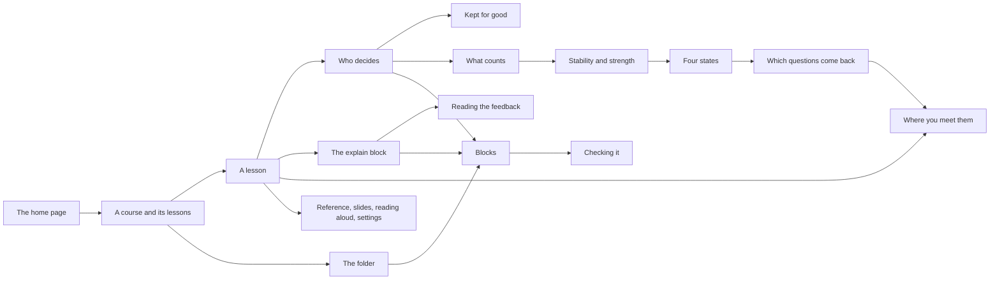

# RFC 14: Learning Path

> **How to read this.** **Built** means it exists at commit `6763d1c`, with the file that shows it. **Proposed** means this RFC asks for it. **Open** means it still needs the maintainer's decision; §10 lists those. Nothing here is decided. It builds on [RFC 2](0002-lessons-written-for-each-learner.md) (concepts, prerequisites, decision notes), [RFC 5](0005-mastery-that-fades.md) (mastery and its four states), [RFC 12](0012-adapting-to-the-learner.md) (ideas, levels and variants) and [RFC 13](0013-homeroom.md) (job 10, a course written one lesson at a time). How School works today is in the [architecture reference](../topics/architecture/README.md), the [course format](../topics/course-format/README.md) and the [mastery reference](../topics/mastery/README.md); this RFC describes only what would change.

## Executive summary

A course today is a fixed list of lessons, and every learner walks it in the same order. School measures each quiz per learner, but the order ignores that measure: a learner who already holds lesson 2 still reads it, and one who needs lesson 2 twice gets it once. This RFC makes a course a graph, and each learner's way through it a **learning path**. The author marks the sections of their lessons as **concepts** and says which concepts each one needs. School builds each study session from the concepts whose needs the learner already holds, in the same block JSON and with the same block ids, so the record, mastery and due review read it unchanged.

The model is borrowed from Taskalisk, which plans work as a graph of GitHub issues: an issue is a concept, `.blocked_by` is `needs`, a closed issue is a concept the learner holds, the open frontier is what the learner can study now, and a container (which groups issues and never blocks one) is the author's lesson. One thing has no Taskalisk equivalent: in School a closed node can reopen, because holding fades, and RFC 5's due review already decides when.

| Change | Status | Why |
| --- | --- | --- |
| A `section` may declare `needs`, the concepts it builds on; a section that does is a **concept** | Proposed | The author writes the graph; School only reads it (§5.2) |
| A concept is **met** when every quiz in it is settled, read from `school.mastery_rollup` with the concept as the group | Proposed | No new measure: RFC 5's states already say what is settled (§5.3) |
| The **frontier** is every concept not yet met whose needs are all met | Proposed | What the learner can study next, recomputed on every visit (§5.4) |
| A **path session** is a page School assembles from the frontier, served and recorded like any lesson | Proposed | One encounter, one snapshot, the same block ids, so nothing downstream changes (§5.5) |
| `needs` orders and never locks: every lesson stays open | Proposed | The learner chooses; School suggests (RFC 12 decision 2) |
| Lessons stay, as the author's default path and as containers on the course page | Proposed | A course with no `needs` is served exactly as today (§5.7) |
| School assembles authored blocks; it does not write lessons | Proposed, reverses RFC 2 step 3 | Every word the learner reads was written by the author, so there is nothing new to trust (§4, Q1) |

_Table 0.1. What this RFC proposes. The last row reverses a choice RFC 2 marks Decided, so the RFC stays a draft until the maintainer decides it._

The first slice is tasks 1 to 4 in [§7](#7-order-of-work): `needs` in the course format and in `school check`, concept state from the rollup, the frontier, and the path session. In short: the author writes concepts and what each needs, and School walks each learner through them in the order their record says they are ready for.

## Contents

1. [The problem and who it serves](#1-the-problem-and-who-it-serves)
2. [Constraints](#2-constraints)
3. [What exists today](#3-what-exists-today)
4. [Options](#4-options)
5. [Design](#5-design)
6. [Threat model](#6-threat-model)
7. [Order of work](#7-order-of-work)
8. [Out of scope](#8-out-of-scope)
9. [Risks](#9-risks)
10. [Open questions](#10-open-questions)
11. [Decision](#11-decision)

## 1. The problem and who it serves

The maintainer put the problem in one line on 2026-11-28: "It might take someone 5 lessons to reach c, whereas you could do it in 3." A fixed lesson list is the author's guess at one learner's path, and it misses everyone who is faster, slower or already part of the way there. This section names who a learning path serves and what each needs.

| Who | What they need |
| --- | --- |
| A **learner** new to a subject | The author's order, with a second look at whatever is still settling before what builds on it |
| A **learner** who already knows part of it | To show that with clean answers and skip what they hold, without being told to read it first |
| A **learner** coming back after weeks | What has faded, then the next new concept, not lesson 1 again |
| A **course author** | To write each concept once and say what it needs, without writing a lesson order for every kind of learner |
| The **maintainer** | No new trust problem: nothing a model wrote is served as course content, and the record means what it means today |

_Table 1.1. Who a learning path serves. With one learner these are one person at different times; the path has to be right in each._

In short: the order should come from the learner's record, and the content from the author.

## 2. Constraints

These are the rules a learning path must keep. Each comes from an earlier RFC or from the record's own design, and §5 shows where each is met.

| # | Constraint | Source |
| --- | --- | --- |
| C1 | The record is append-only, and correctness and first try are derived from the snapshot as served, never from the client | `server/db/migrations/0001_init.sql`, `school.snapshots` and `school.answers` |
| C2 | Mastery is read from the record every time and never stored | RFC 5 §4.1; the [mastery reference](../topics/mastery/README.md) |
| C3 | A block id names one history; `ref` places the same block, never a copy | [Lesson blocks](../topics/course-format/blocks.md#reuse-by-ref) |
| C4 | The learner chooses and School suggests; School never overrides a learner's choice | RFC 12 decision 2 |
| C5 | Every choice School makes for a learner is stored with its reason and shown in words | RFC 2 (decision notes); `openLessonEncounter`'s notes in `server/core/school.ts` |
| C6 | Copy is encouraging or neutral; never "wrong", "fail", "mistake", "attempt" or "retry"; no score | The [voice reference](../topics/voice/README.md) |
| C7 | A course School already serves keeps working, with its learners' history, after the change | The course format's `format: 1` contract |

_Table 2.1. Constraints on a learning path. C1 to C3 are why the design assembles blocks rather than copying or writing them._

In short: keep the record's meaning, keep block ids, let the learner choose, and say every choice in words.

## 3. What exists today

Most of what a learning path needs is already built. School already builds a different page for each learner, the record already keys everything by block id, and the rollup already counts any group of quizzes. What is missing is a way to say which sections build on which, and a rule that picks the next ones.

| Piece | Built at `6763d1c` | Used for |
| --- | --- | --- |
| A page assembled per learner | `openLesson` in `server/core/school.ts:152` prepends a `school:review` section of due quizzes taken from other lessons, and stores the page as shown | The path session is the same move applied to a whole page (§5.5) |
| The snapshot of what was shown | `school.snapshots` and `encounters.snapshot_hash` in `0001_init.sql`; `school.submit` judges answers against it | Answers in a path session are judged exactly as in a lesson |
| Decision notes | `openLessonEncounter` stores a note per review item with its rule, reason and evidence | Why each concept was chosen (C5) |
| Mastery by any group | `school.mastery_rollup` takes groups of quiz blocks under any key (the [mastery reference](../topics/mastery/README.md#rolling-up-to-lessons-and-courses)) | Concept state, with the concept's id as the key (§5.3) |
| Reserved ids | `server/blocks.ts:133` refuses author ids that start `school:` | The path session's page id cannot collide with a lesson's |
| `ref` across lessons | The loader resolves `{ "ref": "<id>" }` anywhere in a course | A session places concept sections by ref, keeping one history (C3) |
| A graph of concepts | Not built. RFC 2 §1 proposes concepts with prerequisites in a separate `curriculum/` folder, and step 3 of its order of work writes lessons from them | §4 compares that with this RFC |

_Table 3.1. What a learning path reuses. Only the last row is missing, and RFC 2 already sketched it._

In short: School can already serve a page it assembled and record it faithfully; it lacks only the graph and the rule that walks it.

## 4. Options

Three designs answer the problem: keep fixed lessons and adjust only review, have a model write each learner's next lesson (RFC 2 step 3, and RFC 13 job 10 part 3), or assemble each session from authored concepts. This section compares them.

| Option | For | Against |
| --- | --- | --- |
| A. Fixed lessons, smarter review | No format change; due review already brings back what has faded | Does nothing for the learner who is faster, or who already knows part of the course |
| B. A model writes each lesson from a curriculum (RFC 2 step 3) | Any order and any wording, fitted to one learner | Every lesson is untrusted content: RFC 2 needs inert blocks, an answer-key quote on every quiz and a preparation that can fail; RFC 13 keeps such quizzes out of mastery entirely. The external review of 2026-11-27 found job 10 hard to justify for this reason |
| C. Assemble each session from authored concepts (this RFC) | Every word is the author's; block ids, mastery and due review are unchanged; the order still fits the learner | Authors write concepts that stand alone, which is harder than writing lessons that flow; the order is only as good as the author's `needs` |

_Table 4.1. Three ways to fit a course to a learner. C keeps the record honest and needs the least new machinery; B stays possible later, on top of C, for material the author never wrote._

The recommendation is C. B is not ruled out: a concept the author never wrote could one day be drafted by a model and proposed through RFC 9's **Accept**, which would make it authored. That is outside this RFC (§8). In short: assemble, don't generate.

## 5. Design

A learning path has five parts: the words (§5.1), one new key in the course format (§5.2), concept state (§5.3), the frontier (§5.4) and the path session (§5.5). The rest of the section says how a learner tests out (§5.6), what happens to lessons (§5.7), what the learner reads (§5.8), and how this fits RFCs 2 and 12 (§5.9).

### 5.1 Terms

The design needs four words. "Concept" is RFC 2's word, kept so the two RFCs speak the same language; "idea" stays RFC 12's word for one quiz and its variants.

| Term | Meaning |
| --- | --- |
| **Concept** | A `section` that declares `needs`: its teaching, the quizzes that show it is held, and the concepts it builds on. A concept holds one or more ideas |
| **Learning path** | One learner's way through a course's concepts, derived from their record every time it is asked for and never stored |
| **Frontier** | The concepts the learner can study now: not yet met, every need met |
| **Path session** | A page School assembles from the frontier and serves as one encounter |

_Table 5.1. The terms of this RFC. A learning path is derived like mastery, so it can never disagree with the record._

In short: authors write concepts, School derives the path.

### 5.2 The course format

The format gains one optional key on `section`. A section that has it is a concept, and `school check` (`checkCourse`) holds a course with concepts to five rules. A course with no `needs` anywhere is checked and served exactly as today (C7).

```json
{
  "type": "section",
  "id": "holding-measure",
  "title": "Stability and strength",
  "needs": ["holding-first-try"],
  "children": [
    { "type": "prose", "id": "holding-stability", "html": "<p><strong>Stability</strong> is a quiz's half-life. It starts at one day. …</p>" },
    { "type": "quiz", "id": "holding-q-stability-grows", "q": "What makes a quiz's stability grow?", "choices": [
      { "id": "clean-after-delay", "text": "A clean first try given at least a delay after the previous answer", "correct": true },
      { "id": "answer-again-at-once", "text": "Answering it again straight away, several times", "correct": false },
      { "id": "aided-answer", "text": "A right answer after help was shown", "correct": false }
    ], "why": "Only a clean first try after the delay multiplies stability by 2.5. An aided one returns it to one day." }
  ]
}
```

_Listing 5.1. A concept from Back to School, regrouped so its quiz sits with its teaching (abridged: the prose is cut and the section's quote and card are left out; the ids are the course's own). The shipped course keeps this quiz in a Practice section at the end of the lesson. `needs: []` marks a concept with no prerequisites._

| # | Rule | Why |
| --- | --- | --- |
| 1 | A concept is a direct child of a lesson's `page` | One level is enough, and a concept inside a concept would be met twice |
| 2 | Every entry in `needs` is the id of a concept in the same course | An unknown or non-concept id is refused, as `ref` refuses an unknown id |
| 3 | `needs` has no cycle, directly or through other concepts | A cycle would leave its concepts off every frontier for ever |
| 4 | Every concept defines at least one quiz of its own | Without one it could never be met |
| 5 | In a course that has concepts, every quiz is defined inside exactly one concept | A quiz outside every concept would count towards no state on the path; a quiz used elsewhere is placed there by `ref` |

_Table 5.2. What `school check` adds for a course with concepts. Each rule fails with the concept's file and id, as the loader's other errors do._

A `ref` to a quiz in another concept is a hint that the author left out a need. `school check` reports it, without refusing, when the referenced quiz's concept is not among the referring concept's needs, directly or through them. In short: one optional key, five rules, and courses without it unchanged.

### 5.3 Concept state

A concept's state is the rollup of its own quizzes. `school.mastery_rollup` already takes groups of quiz blocks under any key, so the concept's id is the key and its quizzes are the group. No function or migration changes.

| Concept state | When | Met? |
| --- | --- | --- |
| Not started | Every quiz is not started | No |
| Still settling | Any quiz is settling, or some are not started | No |
| Holding | Every quiz is settled and holding | Yes |
| Ready for another look | Every quiz is settled, and at least one has faded | Yes |

_Table 5.3. A concept's state from its quizzes' RFC 5 states. Met means every quiz is settled, so a faded concept still opens what depends on it._

A faded concept stays met on purpose. Forgetting some of a concept does not undo the concepts built on it, and RFC 5's `due-review/faded` rule already brings its faded quizzes back. Re-locking the graph each time strength dips would send a returning learner back to the start, which is what §1 set out to stop. In short: met means settled, read from the rollup as it is.

### 5.4 The frontier

The frontier is every concept that is not met and whose needs are all met. School computes it from the course's concepts and their states each time it is asked, and ranks it to pick the next ones.

| Rank | Rule | Why |
| --- | --- | --- |
| 1 | A concept still settling comes before one not started | Finish what is started before opening something new |
| 2 | Then the concept that the most other concepts need, directly or through others | Studying it opens the most of the graph, as Taskalisk ranks by descendants |
| 3 | Then the author's order: lesson file order, then position in the lesson | With no other signal, the author's order is the default path |

_Table 5.4. How the frontier is ranked (proposed; Q3 asks whether the author's order should come first). The ranking is deterministic, so the same record always gives the same session._



_Figure 5.1. Back to School's sections as concepts (illustrative: the edges are this RFC's reading of the lessons, not written into the course). After the first three concepts the graph is four branches wide, so a learner who wants to write a course can go from "A course and its lessons" to "Checking it" without the four concepts on measuring._

In short: the frontier is what the learner is ready for, ranked by what is started, then by what it opens, then by the author's order.

### 5.5 The path session

A path session is a page School assembles and serves through `openLesson`, the same way it adds the review section today. It holds the review section, if anything is due, followed by up to two concepts from the top of the frontier, each placed by `ref`. Its page id is `school:path`, which no author can use (`server/blocks.ts:133`).

| Step | What happens | Constraint |
| --- | --- | --- |
| 1 | The server reads the concept states and ranks the frontier (§5.4) | C2: derived, never stored |
| 2 | It builds a `page` titled with the first concept's title, whose children are the review section and `{ "ref": "<concept id>" }` for each chosen concept | C3: the same blocks, with one history each |
| 3 | `openLessonEncounter` stores the page as shown in `school.snapshots` and opens an encounter with `lesson = 'school:path'` | C1: answers are judged against this snapshot |
| 4 | It stores one decision note per chosen concept, with the rule `path/frontier`, the rank rule that chose it, and its met needs as evidence | C5 |
| 5 | The learner studies it like any lesson; answers, explanations and aid are recorded as today | Nothing downstream changes |

_Table 5.5. Opening a path session. Every step reuses a built function; the only new code is the frontier and the page it builds._

Two concepts is a starting size, not a rule: a session should be about one sitting (Q4). The course page offers **Continue your path** for a course with concepts, and the home page's resume points at it. In short: a path session is a lesson School put together, recorded as a lesson.

### 5.6 Testing out

A learner who already knows a concept can show it. In a path session, each concept not yet started opens with its quizzes visible and its teaching folded under **Read this first?**, so a learner can answer first and read only what they need. A clean, unaided first try settles a quiz in that same session (the [mastery reference](../topics/mastery/README.md), Table 4), so answering every quiz of a concept cleanly meets it at once and opens what depends on it.

| Case | What the record says | What happens next |
| --- | --- | --- |
| Every quiz answered cleanly before reading | Settled, holding | The concept is met; the next session moves on |
| Some answered cleanly, one not | Still settling | The concept stays on the frontier, first in rank, and due review brings that quiz back |
| The learner opens **Read this first?** and then answers | Settled if clean; reading the teaching is not aid | Met as above |

_Table 5.6. Testing out of a concept. It needs no new rule: a clean first try already settles a quiz, and reading the author's teaching has never counted as help._

A lucky guess also settles a quiz, as it does in a lesson today, and fading brings it back like any other. In short: answer first, read if needed, and the record decides.

### 5.7 Lessons

Lessons stay. They are the author's default path, the course page still lists them, and any lesson can be opened at any time, so `needs` orders and never locks (C4). On the course page a lesson becomes a group of concepts, as a Taskalisk container groups issues without blocking any: it shows how many of its concepts are met and never gates what comes after it.

A learner who opens a lesson directly gets the lesson as written, with the review section as today, and their answers count towards the same concepts, because the blocks and ids are the same. In short: lessons become views the author wrote; the path is a view School writes from the record.

### 5.8 What the learner reads

Every new line is in School's voice (C6), says a count and never a score, and invites with a question where it asks anything.

| Where | Words (illustrative) |
| --- | --- |
| Course page | "You hold 6 of 22 concepts. Three are ready for you next." |
| A path session's heading note | "Picked because you hold *Who decides* and *What counts*." |
| A concept folded for testing out | "Know this already? Answer first, or read this first." |
| A concept met by testing out | "You already had this one. On to what it opens." |
| A concept still settling | "Still settling. It will come back once more before what builds on it." |

_Table 5.7. What a learning path says (illustrative). The decision note behind each choice is the source of its words, so the page never says something the record does not._

In short: counts of concepts, reasons in plain words, and questions rather than orders.

### 5.9 How this fits RFCs 2 and 12

RFC 2 proposes concepts with prerequisites in a separate `curriculum/` folder and a model that writes lessons from them. This RFC keeps RFC 2's concepts, prerequisites and decision notes, writes the concepts inside the lessons instead of beside them, and assembles instead of writing. RFC 2's exams, aid recording and delayed review are untouched.

| RFC | Part | Effect |
| --- | --- | --- |
| RFC 2 | Step 3: the curriculum format and preparation through the bridge | Replaced by this RFC, if the maintainer agrees (Q1) |
| RFC 2 | Q2: the curriculum's file format | Answered: no separate file; a concept is a section with `needs` |
| RFC 2 | Step 4: exams and completion | Unchanged; an exam can name concepts by id |
| RFC 12 | Ideas and variants (§5.5) | An idea's variants live inside its concept; `variantOf` checks "same lesson" today, and for a course with concepts it should check "same concept" |
| RFC 12 | The ladder (§5.3, §5.4) | Independent: the ladder chooses how hard to ask an idea, the path chooses which concept comes next |
| RFC 13 | Job 10 part 3: each next lesson written on arrival | Not needed for an authored course; still possible for a course a model drafts, outside this RFC |

_Table 5.8. Where this RFC touches earlier ones. The only reversal is RFC 2 step 3, which is not built._

In short: RFC 2's graph, written inside the lessons and walked by School instead of written out by a model.

## 6. Threat model

A learning path adds no new source of content: every block in a path session is one the author wrote and `school check` accepted. The new surface is the order, and a course is already hostile input under RFC 7. This section lists what could go wrong and what stops it.

| Threat | Effect | Control |
| --- | --- | --- |
| A course with a `needs` cycle | Its concepts never reach a frontier | `school check` rule 3 refuses it at install |
| A very large or deep graph | A slow frontier on every visit | The frontier is one pass over the course's concepts and one rollup call; a limit on concepts per course is task 1's to set |
| A `needs` that names an id in another course | A path that depends on progress elsewhere | Rule 2 allows only ids in the same course |
| A learner gaming the order with guesses | Concepts met that are not held | No worse than today: a guess settles a quiz in a lesson too, and fading brings it back |

_Table 6.1. Threats a learning path adds. None of them reaches the record, because a path session is recorded exactly like a lesson._

In short: the content is the author's and already checked; the order is checked at install and derived from the record.

## 7. Order of work

The work is four tasks for the first slice and two after it. Each is one pull request that leaves `main` working, and each can be filed with `issue-dag/2` frontmatter once this RFC is decided.

| # | Task | Needs | Acceptance |
| --- | --- | --- | --- |
| 1 | `needs` in the course format: the loader, `school check` rules 1 to 5, the missing-need warning, and the [course format reference](../topics/course-format/blocks.md) | None | A course without `needs` loads unchanged; each rule's failing course is refused naming its file and id; the bells and Aion courses still pass |
| 2 | Concept state: the rollup called with one group per concept, and the met rule | 1 | Tests over a fixture course: each row of Table 5.3, including a faded concept that stays met |
| 3 | The frontier and its ranking | 2 | Tests: each rank rule of Table 5.4 decides a tie; the same record always gives the same order; a concept with an unmet need is never on it |
| 4 | The path session: the assembled page, the encounter, the decision notes, **Continue your path** | 3 | A browser test: a fixture learner who holds the first concept gets the second; answering it cleanly moves the next session on; the decision note names the met needs |
| 5 | Testing out: quizzes first, teaching folded under **Read this first?** | 4 | A browser test: a concept answered cleanly before reading is met in the same session |
| 6 | Back to School regrouped into concepts, as the worked example | 1 | `school check` passes; every block and choice id is kept |

_Table 7.1. Order of work. Tasks 1 to 4 are the first slice; 5 and 6 follow, and 6 can run beside 2 to 4._

In short: format, state, frontier, session; then testing out and the example course.

## 8. Out of scope

These are related and deliberately left out, so the first slice stays small.

| Left out | Why |
| --- | --- |
| A model writing concepts the author did not | That is RFC 2 step 3 or RFC 13 job 10 under another name; it can be proposed later as drafts through RFC 9's **Accept** |
| Paths across courses | `needs` stays inside one course (§6) |
| The learner editing the graph | The learner already chooses by opening any lesson; editing `needs` is the author's |
| Showing the graph as a picture to the learner | Useful, and a separate design; the course page's counts come first |
| Exams on the path | RFC 2 step 4 owns exams |

_Table 8.1. What this RFC leaves out. Each could follow once the first slice has been used._

In short: authored concepts, one course, and the counts on the course page.

## 9. Risks

The main risk is authoring. A concept has to make sense when it arrives after any of its needs, not only after the section above it in the file, and prose that says "as above" breaks that. This section lists that risk and the others.

| Risk | Effect | Mitigation |
| --- | --- | --- |
| Concepts written as if read in file order | A session that refers to something the learner has not seen | The `/school` skill teaches writing concepts that stand alone; the missing-need warning (§5.2) catches the commonest case |
| `needs` too sparse | The path jumps ahead of what the learner is ready for | The author's order breaks ties (Table 5.4), so a sparse graph degrades to today's order |
| `needs` too dense | The path is as linear as a lesson list, and nothing is gained | Nothing breaks; the course is no worse than today |
| Two places to study one course | A learner unsure whether to open a lesson or the path | Both record to the same concepts; the course page offers the path first and the lessons below it |

_Table 9.1. Risks of a learning path. Each one falls back to today's behaviour rather than to something worse._

In short: the cost is in writing good concepts, and a poor graph is no worse than a fixed list.

## 10. Open questions

Each question needs the maintainer's decision. Each has a recommendation, and none is decided.

| # | Question | Recommendation |
| --- | --- | --- |
| Q1 | Replace RFC 2 step 3, a model writing each lesson from a curriculum, with assembly from authored concepts? | Yes (§4) |
| Q2 | Should a concept be any section with `needs`, or should the course opt in as a whole (for example `"path": true` in `course.json`)? | Any section with `needs`; rule 5 then makes the whole course consistent |
| Q3 | Should the author's order rank before "opens the most", so the default path is followed more closely? | No: the author's order breaks ties (Table 5.4), so a learner reaches the wide parts of the graph sooner |
| Q4 | How large is a path session: a fixed two concepts, a number of quizzes, or about a sitting's minutes? | Two concepts for the first slice, measured in real use before anything cleverer |
| Q5 | Should a faded need ever hold back what depends on it? | No (§5.3); due review handles fading |
| Q6 | Is "concept" the right word for a learner to read, or should the page say something plainer? | Keep "concept" in the format and the docs; the voice reference decides the page's word |

_Table 10.1. Open questions. Q1 decides whether the rest of this RFC goes ahead._

In short: Q1 first, then the smaller choices, most of which real use will answer better than argument.

## 11. Decision

Not decided. The maintainer named the idea on 2026-11-28 and asked for it to be written down. Under the plan of 2026-11-27, M5 (flyingrobots/school#428) is three weeks of real study before RFC tasks beyond the first slice are decided, and this RFC is meant to be decided in that light. If Q1 is answered yes, tasks 1 to 4 can be filed as their own milestone, and RFC 2's status and `docs/README.md` should be updated to say that step 3 is replaced.
