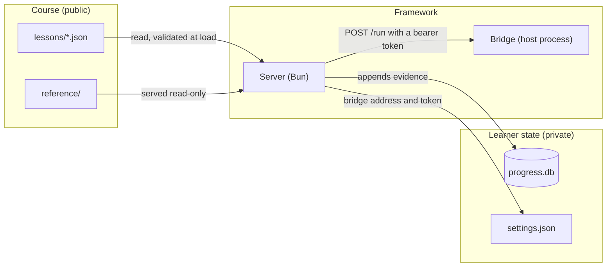
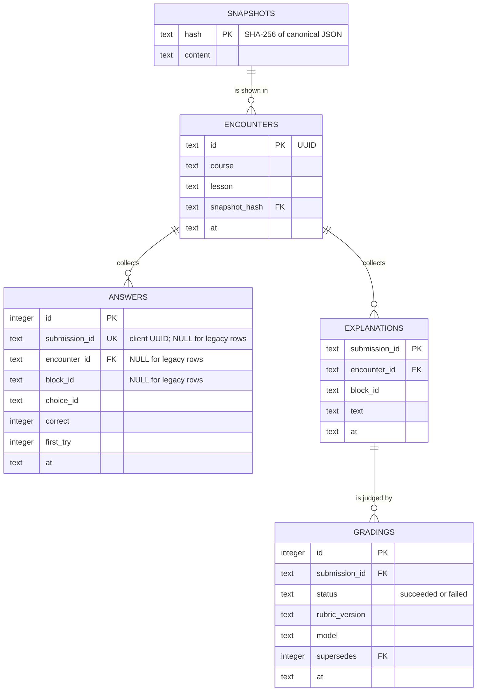
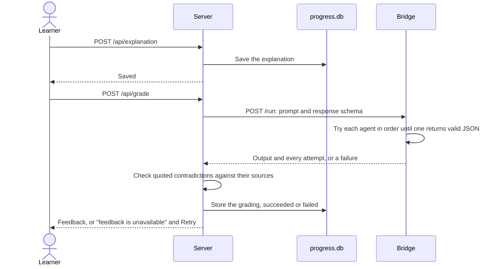

# School's architecture

This page is a reference for how School is built **today**. It describes nothing that is only
proposed; for that, read [RFC 2](../../rfc/0002-lessons-written-for-each-learner.md) and
[RFC 3](../../rfc/0003-postgres-functions-and-generated-types.md). Terms are defined in the
[glossary](../../glossary.md). Every claim was read from the code at commit `a959505`.

## Contents

| Section | Covers |
| --- | --- |
| [The three parts](#the-three-parts) | Framework, course, learner state, and the trust between them |
| [The server](#the-server) | Routes, the write guard, file serving |
| [The learning record](#the-learning-record) | Tables, rules, encounters, what the rules do and do not guarantee |
| [The bridge](#the-bridge) | How explanations are graded |
| [The web app](#the-web-app) | What exists of the interface |
| [Trust and known defects](#trust-and-known-defects) | What School assumes, and what is broken |
| [Configuration](#configuration) | Every environment variable |

## The three parts

School is split into three parts with different audiences and opposite privacy needs: the
framework, a course, and one learner's state[^adr6]. This section shows how they meet.

| Part | Holds | Visibility | Where |
| --- | --- | --- | --- |
| Framework | Server, block model, bridge, web app, docs | Public | This repository |
| Course | Objectives, resources, lessons as block JSON, reference documents | Public by default | Its own repository |
| Learner state | Mission, notes, learning records, `progress.db`, `settings.json` | Private | Its own folder; the server refuses to start if it is inside a course |

**Figure 1. How the three parts meet at run time**



*Figure 1. How the three parts meet at run time. The server reads the course and never writes to
it, and writes evidence only to the learner's private state. It reaches the bridge, which runs on
the host outside Docker, with a shared token.*

Today a course ships finished lessons, and every learner sees the same lesson. In short: course
content flows in read-only, evidence flows out to private state, and the bridge is the only path
to a model.

## The server

The server is one Bun program, run directly with no build step and no dependencies beyond Bun's
built-ins[^adr2]. It serves the built web app, course reference documents and named mounts, and a
JSON API.

| Method | Path | Does |
| --- | --- | --- |
| GET | `/api/courses` | Lists installed courses with lesson and reference counts |
| GET | `/api/courses/:c` | One course: lessons with correct-quiz counts, reference documents |
| GET | `/api/courses/:c/lessons/:id` | One lesson; `?view=web` opens or resumes an encounter, `?view=slides` records nothing |
| POST | `/api/answer` | Records a quiz answer |
| POST | `/api/explanation` | Saves an explanation, before any grading |
| POST | `/api/grade` | One grading attempt through the bridge |
| POST | `/api/view` | Records a view |
| GET | `/api/settings/status` | Whether the bridge answers |
| GET, POST | `/api/settings/bridge` | The bridge address and token; the token is never returned except once when generated. A new address clears a saved token, and is refused (409) while the token comes from the environment |
| GET, POST | `/api/settings/agents` | The bridge's agents as its file declares them; a POST only reorders them and switches them on or off |
| POST | `/api/settings/agents/test` | Runs one declared agent for real |
| GET | `/courses/:c/reference/*`, `/<mount>/*` | Files, contained in their folder after resolving symlinks |

Before any route, the server refuses with a 403 every request whose `Host` header is not one of
its names: `127.0.0.1`, `localhost`, `::1`, `HOST` when it is a real name, and the names in
`SCHOOL_ALLOWED_HOSTS`. The port is not compared. This stops a page that becomes same-origin
through DNS rebinding, which still sends its own name as the Host
([flyingrobots/school#18](https://github.com/flyingrobots/school/issues/18)).

Every `POST` under `/api/` must also carry `Content-Type: application/json` and is refused when
the browser says it is cross-site. That forces a CORS preflight the server never answers, which
stops an ordinary cross-site page from writing.

No endpoint can set an agent's command. `POST /api/settings/agents` forwards only each agent's
name and on/off switch, and the bridge's `PUT /config` accepts only a reordering of the agents
its file already declares; commands are written by editing that file on the host.

In short: the server is thin. It answers only to its own names, serves files safely, guards
writes against ordinary cross-site requests, and hands learning-record work to SQL.

## The learning record

The record is SQLite, schema version 6, in the learner's state folder. Its rules are written as
SQL so that server code does not have to be trusted to keep them[^adr9]. This section states what
those rules guarantee, and what they do not.

**Figure 2. The learning record's tables**



*Figure 2. The learning record's tables. Answers recorded before schema version 5 keep their
encounter, block and submission columns NULL: unknown attribution is kept as unknown, never
invented. `VIEWS` is omitted; it records page views only.*

| Rule | How it is enforced | What it does not cover |
| --- | --- | --- |
| Rows are never updated or deleted | `BEFORE UPDATE` and `BEFORE DELETE` triggers on answers, encounters, snapshots, explanations, gradings | A session that drops the triggers, or a direct `INSERT`. These are guard rails against mistakes, not tamper-proofing. |
| A resent submission stores nothing | Unique index on `answers.submission_id` | Nothing further |
| `correct` and `first_try` come from the snapshot | The `/api/answer` insert derives them from the encounter's stored snapshot and ignores the client | A direct `INSERT` into `answers` can still write any value; the guarantee holds for the API's statement only |
| An acknowledged answer is durable | `PRAGMA synchronous = FULL`; the 200 is sent after commit | Losing the disk; nothing makes scheduled backups yet |
| A submission names its encounter and choice | A `BEFORE INSERT` trigger | Legacy rows, which predate it |

An encounter resumes when the learner reopens the same lesson with the same snapshot and the
encounter's **creation or latest quiz answer** is within six hours. Explanations do not count as
activity today ([flyingrobots/school#19](https://github.com/flyingrobots/school/issues/19)).

**Listing 1. The resume rule**

```ts
    const open = db.query<{ id: string }, [string, string, string, string]>(`
      SELECT e.id FROM encounters e
      WHERE e.course = ?1 AND e.lesson = ?2 AND e.view = 'web' AND e.snapshot_hash = ?3
        AND max(e.at, coalesce((SELECT max(a.at) FROM answers a WHERE a.encounter_id = e.id), e.at)) >= ?4
      ORDER BY e.at DESC LIMIT 1`).get(o.course, o.lesson, hash, cutoff);
```

*Listing 1. The resume rule. Real source code from flyingrobots/school,
`<server/record.ts#L46-L50@a959505>`. Activity is the encounter's creation or its latest answer;
explanations are not consulted.*

The record does **not** yet capture assistance. RFC 1 requires that a submission made after a hint
or a model-answer reveal is recorded as aided[^rfc1]; no table records reveals today, so the record
cannot distinguish an explanation written after seeing the model answer from an unaided one.

In short: the record derives correctness and first try from what was shown, keeps unknown history
unknown, and refuses ordinary updates and deletes. Its guarantees cover the API's statements, not
arbitrary writes, and it does not yet record assistance.

## The bridge

Explanations are graded by agent programs the learner already uses, run by the bridge on the host
outside Docker, so their credentials never enter the container the network can reach[^rfc1].

**Figure 3. One grading**



*Figure 3. One grading. The explanation is saved before any model is called, and every attempt is
stored whether it succeeds or fails. One gap: a bridge reply that is valid JSON but the wrong shape
throws before the failure is stored ([flyingrobots/school#17](https://github.com/flyingrobots/school/issues/17)).*

| Property | Today |
| --- | --- |
| Agents | Command templates, tried in order; output must match the response schema. Declared, commands included, only in the bridge's file on the host. |
| Isolation | No shell, an empty working folder, the process tree killed on timeout. This is not filesystem confinement: an agent can do whatever its own command allows. |
| Local or hosted | Agents are launched locally; whether inference is local depends on the agent. A hosted CLI sends the prompt and the explanation over the network. |
| Grading | Fidelity, completeness, accessibility, each `meets`, `partly` or `misses`, or insufficient evidence; quoted contradictions are checked to exist in the source, not to support the criticism |

In short: the bridge confines model work to the host and records every outcome, with one known
gap in handling a malformed reply.

## The web app

`web/` is a stock shadcn/ui app on Vite and React, themed from theme-book through the
`@flyingrobots` registry. A test enforces that its stylesheet holds only stock shadcn tokens. What
exists: the theme, a light, dark and system toggle, a component sandbox at `/demo`, and three
homepage mockups. School's pages are not built yet
([flyingrobots/school#15](https://github.com/flyingrobots/school/issues/15)). ADR 9 describes a
browser outbox for unsent answers; it belonged to the deleted server-rendered pages and must be
rebuilt in the new app.

## Trust and known defects

School is private by network rather than by login. This section states what that trusts, and what
is currently broken.

| School trusts | Consequence |
| --- | --- |
| Everyone who can reach it | No login: anyone on the tailnet or localhost can use the API, including settings |
| Installed courses | Course HTML renders on School's origin with School's authority. RFC 1 decided installed courses are trusted code. |
| Configured agents | They run with the learner's account on the host, under their own commands' limits |

| Defect | Effect | Issue |
| --- | --- | --- |
| Bridge reply shape not validated | A malformed reply throws and stores no failed grading | [#17](https://github.com/flyingrobots/school/issues/17) |
| Explanations ignored by resume | An explanation does not keep its encounter open | [#19](https://github.com/flyingrobots/school/issues/19) |
| Phone over the tailnet | Never verified end to end | [#3](https://github.com/flyingrobots/school/issues/3) |

## Configuration

| Variable | Program | Meaning | Default |
| --- | --- | --- | --- |
| `SCHOOL_COURSES` | Server | `name=path` pairs, one per course | none |
| `SCHOOL_COURSE` | Server | One unnamed course | none |
| `SCHOOL_STATE` | Server | Learner state; must not be inside a course | `state/` |
| `SCHOOL_MOUNTS` | Server | `name=path` pairs served read-only | none |
| `SCHOOL_WEB` | Server | The built web app | `web/dist` |
| `HOST`, `PORT` | Server | Listen address | `127.0.0.1:4747` |
| `SCHOOL_ALLOWED_HOSTS` | Server | Host names answered besides `127.0.0.1`, `localhost`, `::1` and `HOST`, comma-separated; the tailnet name | none |
| `SCHOOL_BRIDGE_URL`, `SCHOOL_BRIDGE_TOKEN` | Server | Override the saved bridge settings | none |
| `SCHOOL_BRIDGE_TOKEN` | Bridge | Shared secret, 16 characters or more | required |
| `SCHOOL_BRIDGE_CONFIG` | Bridge | Agents file, re-read per request | `~/.config/school/bridge.json` |
| `SCHOOL_BRIDGE_HOST`, `SCHOOL_BRIDGE_PORT` | Bridge | Listen address | `127.0.0.1:4748` |

[^adr2]: flyingrobots/school, `docs/adr/0002-typescript-on-bun.md` at `a959505`.
[^adr6]: flyingrobots/school, `docs/adr/0006-separate-framework-lessons-and-learner-state.md` at `a959505`.
[^adr9]: flyingrobots/school, `docs/adr/0009-the-learning-record-is-enforced-by-the-database.md` at `a959505`.
[^rfc1]: flyingrobots/school, `docs/rfc/0001-school.md` at `a959505`.
