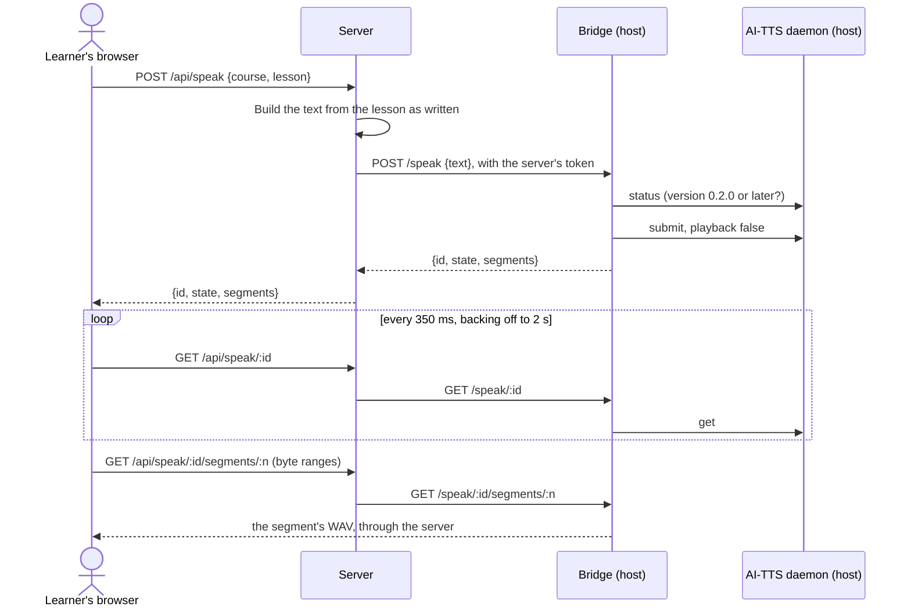

# Reading aloud

Reference: how School reads a lesson, or the latest feedback, aloud through the AI-TTS daemon
([flyingrobots/school#175](https://github.com/flyingrobots/school/issues/175)), and what it never
says. The cases are in the [test plan](test-plan.md).

## Contents

- [The path](#the-path)
- [What is spoken](#what-is-spoken)
- [The bridge's routes](#the-bridges-routes)
- [The server's routes](#the-servers-routes)
- [The playback bar](#the-playback-bar)
- [When it cannot read](#when-it-cannot-read)

## The path

**Figure 1. Reading a lesson aloud**

*Figure 1. Reading a lesson aloud. The daemon only synthesizes (`playback: false`): the browser
plays every segment, and nothing plays on the host's speakers. Pause, next, previous and stop act
in the browser, never on the daemon's own transport.*

The bridge speaks the daemon's socket protocol as Reader does: one JSON request line, one reply
line, on the Unix socket `$AI_TTS_SOCKET`, else `$AI_TTS_HOME/ai-tts.sock`, else
`~/Library/Application Support/ai-tts/ai-tts.sock`. It refuses a path that is a symlink or not a
socket. Each submission is `op: submit` with `playback: false`, `origin` and `source` `School`,
`sensitivity: confidential`, `content_format: markdown` and `priority: normal`, after a `status`
that must report version 0.2.0 or later. Code: `bridge/speech.ts`, `server/speak.ts`,
`web/src/lib/read-aloud.ts`, `web/src/components/read-aloud.tsx`.

## What is spoken

The server builds the text; the browser only names what it wants to hear, and a request carrying
text is refused (400).

- **A lesson** (`{ course, lesson }`), as written, without the review section School adds at its
  top: its title, its subtitle, each section's title, the text of its prose, cards, quotes and
  asides, each quiz's question and each explain block's prompt, in the order the page shows them.
  Block HTML is read as text: tags dropped, entities decoded, and scripts, styles and drawings
  (`svg`, `math`) left out.
- **The latest feedback** (`{ feedback: true }`): what the home page's feedback card shows,
  "Feedback on your explanation of <lesson>", the prompt, the summary, and each criterion as a word
  (Meets, Partly, Not yet) with its note.

Never spoken, because each gives an answer away: any quiz choice (the correct one, or the others,
which would leave it by elimination), a quiz's `why`, an explain block's model answer, the
sources an explanation is graded against, a nest diagram, and a contradiction's quote.

## The bridge's routes

Each needs the bridge's token, like its other routes.

| Method | Path | Does |
| --- | --- | --- |
| POST | `/speak` | `{ text }`, 1 byte to 512 KiB with no NUL, as JSON. Answers `{ id, state, segments }`, `segments` the number the daemon split it into |
| GET | `/speak/:id` | Progress: `{ id, state, error, segments: [{ index, ready, durationMs }] }`; never the text |
| GET | `/speak/:id/segments/:n` | The segment's WAV (`audio/wav`), with `Accept-Ranges: bytes`; one `Range: bytes=start-end` answers 206, a range outside the file 416. A segment not synthesized yet is 409, one that does not exist 404 |
| POST | `/speak/:id/cancel` | Cancels it at the daemon: `{ id, state }` |

Only the last 50 utterances this bridge submitted are served; any other id is a 403 on every
route. Each submission, cancellation and failure is a JSON Lines log line with a schema
(`bridge.speak.submit`, `bridge.speak.cancel`, `bridge.speak.failed`,
[the programs' output](../program-output/README.md#the-bridge)); no line holds the text.

## The server's routes

| Method | Path | Does |
| --- | --- | --- |
| POST | `/api/speak` | `{ course, lesson }` or `{ feedback: true }`: builds the text and submits it through the bridge. An unknown lesson, or no feedback yet, is 404 |
| GET | `/api/speak/:id` | The bridge's progress |
| GET | `/api/speak/:id/segments/:n` | The segment's audio, passing on the browser's `Range` and, back, only `Content-Type`, `Content-Length`, `Content-Range` and `Accept-Ranges` |
| POST | `/api/speak/:id/cancel` | Cancels it |

Each goes to the bridge with the server's token, which is never in a response or the server's
output. An id that is not an utterance's (`utt_` and 32 hex digits) or a segment that is not a
number is refused (400) before the bridge is asked. The POSTs are guarded like every other: JSON
only, never cross-site.

## The playback bar

**Read aloud** (`R`) sits under a lesson's title, beside Slides, and in the home page's feedback
card, beside Write a new draft. While School reads, a bar fixed to the bottom of the page shows:

| Part | Shows |
| --- | --- |
| A robot badge, **AI voice** | That the voice is AI-TTS's |
| The words | "Reading · 2 of 5", "Paused · 2 of 5", "Getting part 3 of 5 ready" with a spinner while that segment is being synthesized, or "Getting ready to read" before the daemon has split the text |
| Previous part (`,`), Pause or Resume (`/`), Next part (`.`) | Steps and pauses in this browser |
| Stop reading (`Esc`) | Stops, and cancels at the daemon |

The browser plays the segments in order through one `<audio>` element and moves to the next when
one ends; after the last it stops. It polls progress every 350 ms while it waits for the segment it
needs, backing off 1.6 times each poll to at most 2 s otherwise, and stops polling once every segment
is ready. Leaving the page stops reading. `R` does nothing while focus is in an explain block,
where it revises the explanation, and no key acts while typing.

`Space` does not pause: it is the shell's leader key, taken before any page sees it
([the app shell's keys](../app-shell/README.md#keys)), so pause and resume are on `/`, between `,`
and `.`.

## When it cannot read

Every refusal is a reason in words, shown in the bar with a Close button (`Esc`).

| Cause | Answer |
| --- | --- |
| No bridge connected, or a token from the environment with a URL from Settings | 503, saying so and pointing to Settings |
| The bridge cannot be reached | 503, "The bridge could not be reached …" |
| A bridge from before reading aloud | 503, asking for the bridge to be updated |
| The bridge refuses the server's token | 502, pointing to the token in Settings |
| No daemon socket, a path that is not a socket or is a symlink, or a daemon that hangs up or does not answer within 5 s | 503 from the bridge, passed on |
| A daemon older than 0.2.0 | 503, naming the version needed and the one found; nothing is submitted |
| Three failed polls in a row | The bar says School stopped answering |
